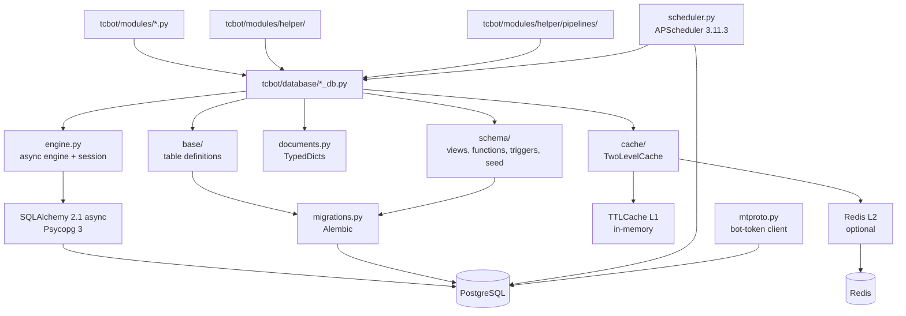

# Database Layer

The database layer lives in `tcbot/database/` and is the only place that
should talk to PostgreSQL. Command modules and workflows call helper
functions instead of building statements themselves.

This document is the reference spec for the Python database layer. Every
table, index, helper signature, cache behavior, and scheduler detail below
is taken from the current `tcbot/database/` Python code.

For modules that consume these database helpers, see
[`modules.md`](modules.md). For shared helpers, see
[`helpers.md`](helpers.md). For conversation flows, see
[`workflows.md`](workflows.md).



## Access rules

- Keep all SQL in `tcbot/database/` helpers. Command modules and workflows
  must not build statements or import the engine directly.
- Put new database concerns in descriptive `*_db.py` files and add the
  matching table and index to `tcbot/database/base/`.
- Helpers are async and fully typed; they use the `TypedDict` shapes from
  `documents.py` and the `NewType` primitives from `types.py`.
- Stored timestamps are timezone-aware and in UTC. Use `utc_now()` from
  `tcbot.utils.time_and_date`; never call `datetime.now()` directly.
- Every read and write runs through `engine.db_call()`, so the circuit
  breaker and the call timeout apply uniformly.

## Schema ownership

| Module | Responsibility |
|---|---|
| `base/` | The single source of truth for every table, column, constraint, and index. The package splits the schema by domain: `identity`, `rbac`, `rules`, `moderation`, `enforcement`, `automation`, `broadcast`, `jobs`, `runtime`, `settings`, `community`. |
| `schema/` | The database objects SQLAlchemy cannot express: the views, the functions, the triggers, the access policies, and the reference data. One SQL file each, applied in the order the files are listed. |
| `migrations.py` | Applies the pending Alembic revisions at startup. |
| `engine.py` | The async engine, the session boundary, the circuit-breaker guard, and the query helpers. |
| `connection_options.py` | The libpq `search_path` and UTC options shared by the async engine, the migrations, and the scheduler job store. |

The schema is versioned with Alembic. `alembic/versions/0001_initial.py`
creates the first layout, `0002_member_cache_sort_indexes.py` adds the
sort indexes the paged user list needs, and `0003_community_schema.py`
migrates an existing database to the community model. Every later revision
adds to it; `engine.connect()` applies the pending revisions before the
engine is published, so a fresh deployment boots against an empty database
and an existing one is upgraded in place.

```bash
# Apply the migrations by hand (the bot does this at startup).
uv run alembic upgrade head

# Generate a revision after changing base/.
uv run alembic revision --autogenerate -m "describe the change"
```

A schema change therefore needs three edits: the table in `base/`, the
matching Alembic revision, and the helper that uses it. The integration
tests build their schema from `base/` and `schema/`, so a revision that
drifts from them is caught by `tests/test_schema_migration.py`, which
migrates an empty schema and compares the result with the declared
metadata.

The `%SCHEMA%` placeholder in the SQL files stands for the schema the
objects live in, so the same files apply to the deployment schema and to
the schema an integration test owns. `tcbot.database.schema.apply_schema()`
replaces the placeholder with the current schema and applies the files.

The migration must not reconfigure the application logging. Alembic's
standard recipe calls `fileConfig()`, which removes every handler the bot
installed (including the Telegram error handler) and resets the root
level. The bot applies the migrations during startup, so the standard
call would silence the bot and stop the error reports the moment it
connects to the database. `alembic/env.py` therefore configures the
Alembic logger on its own.

## The community model

The schema holds one community: one bot, one set of groups, one staff
roster. There is no tenant column and no federation key, because a
separate community would be a separate deployment.

| Domain | Tables |
|---|---|
| Identity | `telegram_users`, `telegram_chats`, `chat_members`, `connected_chats`, `join_requests` |
| Configuration | `community_settings`, `chat_settings`, `user_settings` |
| Access | `role_definitions`, `permission_definitions`, `role_permissions`, `role_assignments`, `promotion_requests` |
| Rules | `rule_sets`, `rule_set_versions`, `rule_items`, `rule_acknowledgements` |
| Moderation | `moderation_cases`, `moderation_case_rules`, `moderation_actions`, `moderation_appeals`, `moderation_messages`, `moderation_evidence_uploads`, `moderation_evidence_items` |
| Enforcement | `moderation_enforcement_runs`, `moderation_enforcement_targets`, `moderation_enforcement_attempts` |
| Automation | `automation_policies`, `automation_policy_versions`, `automation_events`, `automation_runs`, `automation_run_steps`, `automation_run_step_attempts` |
| Broadcast | `broadcast_campaigns`, `broadcast_targets`, `broadcast_attempts` |
| Operations | `audit_events`, `scheduled_jobs`, `scheduled_job_runs`, `retention_policies`, `telegram_user_erasures`, `mtproto_state`, `apscheduler_jobs` |

Two rules hold everywhere:

- **One source of truth per domain.** A ban, a mute, a warning, and a kick
  are all rows of `moderation_actions`. A group connection is a row of
  `connected_chats`; its configuration is a row of `chat_settings`. The
  views (`active_bans`, `active_mutes`, `warn_counts`, `community_members`,
  `effective_chat_settings`, `moderation_timeline`, `role_permission_matrix`)
  are derived, never a second copy of the facts.
- **The scope is explicit.** A ban and a mute use `scope_type = 'community'`
  and carry no `chat_id`. A warning and a kick use `scope_type = 'chat'`
  and carry the group they belong to. The scope is never inferred from
  `origin_chat_id`.

## Connection manager

`engine.py` owns the async SQLAlchemy engine. Every helper runs on the
event loop and awaits the driver; there is no worker thread and no
blocking call on the loop.

| Export | Purpose |
|---|---|
| `connect()` | Applies the pending Alembic revisions, creates the async engine and the session factory, and pings the server through the `postgres` circuit breaker. On failure the engine is disposed again, so a failed boot leaks no pool. |
| `close()` | Disposes the engine and drops the session factory. Safe to call without a prior `connect()`. |
| `engine()` | Returns the shared engine or raises `RuntimeError` when the database is not connected. |
| `is_connected()` | Returns `True` once a connection has been established via `connect()`. |
| `session()` | Async context manager yielding an `AsyncSession` that commits on success and rolls back on failure. One session per operation. |
| `read_connection()` | Async context manager yielding an autocommit connection for a read-only statement. A read needs no transaction, so it costs one round trip instead of one plus the `COMMIT` that closes it. The pre-ping on checkout adds a second round trip, which the autocommit saving offsets. |
| `db_call(op, *, timeout=20.0)` | Runs one database operation through the circuit breaker and a caller-side timeout. Raises `CircuitOpenError` while the circuit is OPEN. |
| `run_transaction(op, *, timeout=20.0)` | Runs a unit of work that spans several statements atomically on one session. It already runs through `db_call`, so a caller must not wrap it in another one. |
| `fetch_all(stmt)` / `fetch_one(stmt)` / `fetch_value(stmt)` / `fetch_count(stmt)` / `count_rows(stmt)` | Read helpers. They run on an autocommit connection, so a read is one round trip. `count_rows` wraps a selection in a counting query so the result is the row count and never the first column. |
| `run(stmt)` / `run_returning(stmt)` | Write helpers. `run` returns the affected row count, `run_returning` the rows a `RETURNING` clause produced. |
| `run_script(sql)` | Runs a plain SQL script on the shared session. The script is not parameterised, so the percent signs of `format()` and the colons of the idempotency keys stay literal. |
| `is_connection_error(exc)` / `is_transient_db_error(exc)` / `is_database_error(exc)` / `is_pool_timeout(exc)` | Error classification used by the circuit breaker and the error handler. `is_pool_timeout` recognises SQLAlchemy's own pool-timeout error, which does not inherit from the builtin `TimeoutError`. |
| `constraint_name(exc)` | The name of the constraint an integrity error violated, so a caller can tell a duplicate identifier apart from a duplicate partial index. |

### Transaction boundary

`run_transaction` hands the callback the session of the transaction. Every
statement the callback issues on that session joins the same transaction,
so the unit either lands completely or not at all.

The boundary is the whole point: a compensating write after the fact
cannot restore the guarantee, because a crash between the two writes
leaves the pair inconsistent. Two rules follow from it:

- A callback must not call `engine.run()` or `engine.fetch_*()`. Those open
  their own session and commit on their own, so the write lands outside the
  transaction the callback was given.
- A callback must not wrap itself in another `db_call`. The nested call
  would record one failure twice and trip the circuit early.

### Connection parameters

`connect()` builds the engine with these explicit parameters:

| Parameter | Value |
|---|---|
| `pool_size` | `cfg.db_pool_size` (`DB_POOL_SIZE`, default `5`) |
| `max_overflow` | `cfg.db_max_overflow` (`DB_MAX_OVERFLOW`, default `5`) |
| `pool_timeout` | `10 s` |
| `pool_recycle` | `1800 s` |
| `pool_pre_ping` | `True` |
| `connect_timeout` | `10 s` |
| `options` | `-c search_path=<DB_SCHEMA> -c timezone=UTC` |

The pool size is configuration, not a constant, because it has to fit the
number of connections the database grants the bot user. A pooler in
transaction or session mode caps it at a small number, and a pool that is
larger than the cap does not fail at startup: it fails later, as a "max
clients reached" refusal on every call that needs a connection, and the
circuit breaker reads that refusal as an outage of the database. The
default of `5` plus `5` overflow fits a pooled deployment.

The session zone is pinned to UTC because the application works in UTC end
to end and the session zone decides how a timestamp without one is read
back. The schema is named explicitly because a pooler in transaction mode
does not carry the search path of the client into the session it hands
out.

The URL comes from `cfg.database_url` and is normalised to the
`postgresql+psycopg://` scheme. `postgresql://` and `postgres://` are
accepted as well.

### Database schemas

The project uses three PostgreSQL schemas and no more:

| Schema | Owner | Purpose |
|---|---|---|
| `public` | The deployment | The default schema of the server. `DB_SCHEMA` defaults to it. |
| `test` | The integration tests | The schema `tests/postgres_support.py` builds and empties. |
| `development` | A developer | The schema the operator scripts use, and the schema `DB_SCHEMA=development` selects. |

`cfg.db_schema` names the schema the application reads and writes. A
schema that does not exist yet is created before the migrations run, so
a fresh database comes up empty and a name nobody created never sends
the schema objects into another schema.

The schema objects (the views, the functions, the triggers, the
policies, and the reference data) always land in the schema the
connection was pointed at. `tcbot.database.schema` reads the schema from
the search path instead of `current_schema()`, because `current_schema()`
returns the first schema of the path that *exists*: a path that names a
schema nobody created would silently place every object in the next
schema of the path.

### Circuit breaker

`postgres` (from `tcbot/utils/circuit_breaker.py`) trips OPEN after 5
consecutive transient failures and allows one HALF_OPEN probe after 60 s.
A successful probe closes the circuit; a failed probe reopens it.
`db_call` rejects with `CircuitOpenError` while OPEN.

Only transient database errors count toward opening the circuit: a dropped
connection, a refused socket, a driver timeout, an exhausted connection
pool, and the caller-side `TimeoutError` raised by `db_call`. A constraint
violation or a syntax error is an application bug, not an outage, so it
propagates without recording a failure. A `CircuitOpenError` from a
handler logs once at WARNING in `_error_handler` instead of flooding the
logs-errors channel.

A failure that passes through two breakers counts once. `run_transaction`
already runs through `db_call`, so a caller must not wrap it in a second
one: the exception is the same object on both levels, and counting it
twice would trip the circuit after fewer real failures than the threshold
promises.

A pool timeout is a load condition, not a broken database. It counts
toward the circuit (so a half-open probe reopens instead of flooding a
saturated pool) and it is reported as a transient condition rather than a
database error.

## Tables at a glance

| Helper | Table(s) | Main responsibilities |
|---|---|---|
| `users_cache.py` | `telegram_users` | Telegram identity cache: upsert, change-detection upsert, harvest, get, batch queries, mention formatting, counts, paged listing, name search, erasure. |
| `users_roles.py` | `role_assignments`, `role_definitions`, `role_permissions`, `permission_definitions` | Role assignment CRUD, effective-role resolution, the permission catalog and the permission check. |
| `bans_db/` | `moderation_actions`, `moderation_cases`, `moderation_appeals`, `moderation_messages` | Ban decisions and their lifecycle: creation, update, review slot, appeal submission and decision, per-user history. |
| `groups_db.py` | `connected_chats`, `telegram_chats`, `chat_settings`, `join_requests` | Connected group state, group configuration, pending connection requests, cache invalidation, chat-migration repoint. |
| `warns_db.py` | `moderation_actions` (warn scope), `moderation_cases` | Warning decisions, per-group counters, limit checks, clear, expiry. |
| `kicks_db.py` | `moderation_actions` (kick scope), `moderation_cases` | Kick decisions and their per-user history. |
| `mutes_db.py` | `moderation_actions` (mute scope), `moderation_cases` | Mute decisions, the live active-mute view, and the per-user history. |
| `queues_db.py` | `promotion_requests` | Queued staff promotion requests and their resolution status. |
| `settings_db.py` | `user_settings` | Per-user locale and timezone preferences. |
| `cache/` | in-process + Redis | `TTLCache[T]` (L1) and `TwoLevelCache[T]` (L1 in-process + L2 Redis) with five public singletons. |
| `redis_client.py` | Redis (optional) | Async Redis client singleton with pool management and liveness tracking. |
| `scheduler.py` | PostgreSQL (APScheduler) | APScheduler 3.11.3 `AsyncIOScheduler` backed by `SQLAlchemyJobStore`. |
| `mtproto.py` | Telegram MTProto | Bot-token client singleton: user-ID resolution and group member harvest. Claims a single-owner lease before connecting (90 s TTL, 30 s heartbeat); losers and parked sessions degrade to Bot-API-only. |
| `mtproto_store.py` | `mtproto_state` | PostgreSQL-backed Kurigram storage engine shared by all instances, plus the atomic single-owner lease (`<ns>:lock:mtproto_owner`) with expiry takeover. The peer, name-list and update-state writes go out as one multi-row upsert per bounded chunk, so a session with hundreds of peers costs a handful of transactions instead of one per peer. |
| `documents.py` | type-only | `TypedDict` document shapes and `Literal` aliases. |
| `types.py` | type-only | `NewType` primitives: `UserId`, `GroupId`, `ChatId`, `BanId`. |

## Telegram identities (`users_cache.py`, table `telegram_users`)

`telegram_users` is the canonical identity of a Telegram user. The
username is display metadata, never a key: it can change or disappear, so
it never identifies anybody.

### Row shape: `UserDoc`

| Field | Type | Meaning |
|---|---|---|
| `user_id` | `UserId` (int) | Telegram user ID (primary key). |
| `username` | `str \| None` | Current username. |
| `first_name` | `str \| None` | Current display name. |
| `last_name` | `str \| None` | Current last name. |
| `language_code` | `str \| None` | Telegram client language. |
| `is_bot` | `bool` | Whether the account is a bot. |
| `is_premium` | `bool` | Whether the account holds Telegram Premium. |
| `first_seen_at` | `datetime` | First-seen timestamp. The conflict action never rewrites it, so a refresh keeps the moment the profile was first cached. |
| `last_seen_at` | `datetime \| None` | Last sighting. |
| `erased_at` | `datetime \| None` | Set when the account was deleted on Telegram and the profile was anonymised. |
| `erasure_reason` | `str \| None` | Why the profile was anonymised. |

### Mutations

- `upsert_user(user_id: int, username: str | None, first_name: str, last_name: str | None = None) -> None`
  Unconditional upsert through `INSERT ... ON CONFLICT DO UPDATE`. `None` for
  `username`/`last_name` means "unknown, preserve the stored value": the
  conflict action carries only the refreshed columns, so the stored value
  stays. Pass `""` to clear a field. The conflict action never rewrites
  `first_seen_at`. Populates the `user_mention_cache` entry when the write
  carried every field; a partial write (a preserved `username` or
  `last_name`) invalidates the entry instead, because the stored triple
  cannot be reconstructed from the write alone.
- `upsert_user_if_changed(user_id: int, username: str | None, first_name: str, last_name: str | None = None) -> bool`
  Change-detection write. Compares the incoming `(first_name, username,
  last_name)` triple against the L1 mention-cache entry and skips the
  database write entirely on a match. Returns `True` when a write occurred,
  `False` when skipped. Legacy two-element cache entries count as changed.
  This is the hot-path writer, and the guard only works because
  `upsert_user` populates the mention cache on a complete write.
- `harvest_user_identity(user_id: int, username: str | None, first_name: str, last_name: str | None = None) -> bool`
  Snapshot write for data taken from a live Telegram `User` object. Unlike
  `upsert_user_if_changed`, `None` means "absent on Telegram": fields the
  object omits are cleared via `""` so removals propagate. Delegates to
  `upsert_user_if_changed`. Never use with partial data from ban/promote/
  check-by-ID paths (those must keep `None`).
- `refresh_display_name(user_id: int, first_name: str) -> bool`
  Writes a display name that changed, leaving the rest of the profile
  alone. Used by the ban and kick executors, which learn a name without
  learning a username.
- `remember_identity(user_id: int, first_name: str | None, username: str | None, last_name: str | None) -> None`
  Mirrors a resolved identity into L1 only, no database I/O. Used after a
  Telegram-side resolve because `upsert_user` invalidates rather than
  populates. An empty identity stores the all-`None` not-found sentinel.

### Queries

- `get_user(user_id: int) -> UserDoc | None`
  Full cached profile, read by primary key.
- `get_user_mention_data(user_id: int) -> tuple[str, str | None]`
  `(first_name, username)` for mention formatting, routed through
  `user_mention_cache.get_or_fetch` (L1 to L2 to database). A missing row is
  cached as the all-`None` sentinel; the consumer converts it to
  `str(user_id)`, so the returned first element is never empty.
- `get_first_name(user_id: int, fallback: str = "") -> str`
  Cached `first_name`, or the caller's `fallback` when the user has no row
  (sentinel). Uses the same `get_or_fetch` path as `get_user_mention_data`,
  so calls to these helpers never cause redundant round-trips for the same
  user.
- `get_mention_data_batch(user_ids: list[int]) -> dict[int, tuple[str, str | None]]`
  Batch `(first_name, username)` for many users in one query. The batch
  readers consult both cache layers: the in-memory layer answers first,
  and the keys it missed are fetched from Redis in one round trip, so a
  warm Redis serves the batch without a database query even right after a
  restart. Only the remaining IDs trigger one `IN (...)` query. Newly
  fetched data is populated into the mention cache; users missing from
  the database get the sentinel cached and `str(user_id)` returned.
- `get_first_names_batch(user_ids: list[int]) -> dict[int, str]`
  Batch first names only. The cache path is the same as
  `get_mention_data_batch`. Newly fetched rows populate the full mention
  triple through the shared batch-miss path, so repeat renders by any
  reader skip the round-trip. Missing users get the sentinel cached and
  `str(user_id)` returned.
- `total_users() -> int`
  `COUNT(*)` over the whole table.
- `all_users_page(*, skip: int = 0, limit: int = 200, sort_by: str = "first_name") -> list[UserDoc]`
  One server-side page. `sort_by` is validated against `_USER_SORT_FIELDS`
  (`user_id`, `username`, `first_name`, `last_updated`), falling back to
  `first_name`; `last_updated` sorts descending, everything else ascending.
  Every accepted key maps to an indexed field and carries a `user_id`
  tie-break so the page order stays stable. The name sorts use the
  default-opclass `(first_name_lower, user_id)` and
  `(username_lower, user_id)` indexes: the `text_pattern_ops` indexes
  serve the prefix search but cannot serve an `ORDER BY`, so without the
  extra indexes the planner sorts the whole table on every page turn.
  `limit` is clamped to at least 1 and used for both the `LIMIT` and the
  `OFFSET`.
- `search_by_name(needle: str, limit: int = 5) -> list[UserDoc]`
  Target-resolution search. A server-side anchored prefix query
  (`first_name_lower LIKE 'needle%'` or `username_lower LIKE 'needle%'`,
  with the needle escaped) over the lowercase mirror columns, capped at
  `limit` results (hard ceiling 100). Only `user_id`, `first_name`, and
  `username` are projected. The mirrors exist because PostgreSQL cannot
  serve a case-insensitive match from an index; a case-sensitive prefix on
  an indexed mirror is a range scan. The mirror columns carry the
  `text_pattern_ops` opclass, which is what makes the prefix scan work
  under a non-C collation.
- `is_placeholder_name(name: str | None) -> bool`
  Return True when a display name is a fallback rather than a real name:
  empty, a bare numeric ID, or the legacy `User <id>` form. Single owner
  for that rule, so no surface renders a placeholder as a name.

**Performance tip:** use the batch functions whenever data for more than one
user is needed in a list view or fan-out result; calling single-user
functions in a loop is an N+1 anti-pattern. For partial-name target
resolution use `search_by_name`; for paginated list views use
`all_users_page`.

**Hot-path harvest pattern:** on every observed Telegram update
`_update_member_cache` schedules `harvest_user_identity` as a
fire-and-forget background task, bounded to 20 in-flight tasks (updates
beyond the cap skip the harvest and refresh on the next event). When the
cached identity has not changed, no database write is issued.

**Error behavior:** every helper uses `db_call()`; a database outage raises
`CircuitOpenError` (circuit OPEN) or the driver exception, which
`_update_member_cache` logs at DEBUG and swallows so a cache failure never
breaks the update path.

## Access control (`users_roles.py`, tables `role_assignments`, `role_definitions`, `role_permissions`, `permission_definitions`)

The schema holds two layers that have to agree: the **catalog** (the role
definitions, the permission definitions, and the grants between them) and
the **assignment** (who holds which role right now).

### Catalog

| Table | Contents |
|---|---|
| `role_definitions` | The four system roles with their display name and priority: `owner` (100), `admin` (80), `developer` (60), `moderator` (40). |
| `permission_definitions` | The permission keys and their resource namespace. The resource always matches the key prefix, and a check constraint enforces it. |
| `role_permissions` | Which role holds which permission. |

The catalog is reference data: it is seeded by `schema/seed.sql` and the
seed is idempotent, so a deployment always starts from the same contract.

The application speaks its own tier vocabulary: `founder`, `admin`,
`developer`, `tester`. `ROLE_KEY_BY_APP_ROLE` and `APP_ROLE_BY_ROLE_KEY`
translate between the two, and they are the only place the vocabularies
meet. The catalog calls the last tier `moderator`; the handlers call it
`tester`.

### Assignment

`role_assignments` is the row that says a user holds a role. A demotion
revokes the row, it never deletes it, so the history of who held which role
stays readable.

| Field | Type | Meaning |
|---|---|---|
| `user_id` | `UserId` | The holder. |
| `role_key` | `str` | One of the catalog role keys. |
| `assigned_by_user_id` | `UserId \| None` | Who granted the role. |
| `assigned_at` | `datetime` | When the role was granted. |
| `status` | `str` | `active`, `revoked`, or `expired`. |
| `expires_at` | `datetime \| None` | When the role stops being in force. |
| `revoked_at` | `datetime \| None` | When the role was revoked. |
| `revoked_by_user_id` | `UserId \| None` | Who revoked it. |

An assignment is in force while its status is `active` and its expiry is in
the future. A partial unique index allows one active assignment per user,
and another allows at most one active `owner`, so two owners cannot exist
even briefly.

### Role hierarchy

```text
founder = 4 > admin = 3 > developer = 2 > tester = 1 > none = 0
```

- `VALID_ROLES`: `{"developer", "tester"}` (the only roles assignable via `set_role`).
- `role_rank(role: str | None) -> int`: maps a role string to its rank, `0` for `None`/unknown.
- `ROLE_LABEL`: human labels (`Founder`, `Admin`, `Developer`, `Tester`).
- `role_label(role: str | None) -> str`: the human label for a role, falling back to the role itself. Single owner for the label lookup, so every surface renders a role the same way.
- `STAFF_ROLES`: `{"admin", "developer", "tester"}`, every role that can be demoted (the Founder is protected and never demoted).
- `FOUNDER_ADMIN_ROLES`: `{"founder", "admin"}`, the roles that count as federation staff for permission gates. Both sets live here so a new tier cannot land in the rank table and be missed by every set check.

### Effective-role resolution

`get_effective_role` reads the active assignment of the user and maps its
role key back to the application vocabulary. A stored key outside the known
set is ignored and logged as an error, so a hand-edited row cannot grant
privilege.

- `get_effective_role(user_id: int, *, fresh: bool = False) -> str | None`
  Resolves the role through `effective_role_cache.get_or_fetch`
  (L1 60 s, L2 90 s). A failed lookup propagates instead of caching a
  degraded result: a cached "founder" for a real database error would
  silently bypass authorization until the TTL expired. With `fresh=True`
  the caches are bypassed and the row is read directly (the cache is
  refreshed with the result): enforcement gates use `fresh=True` so a
  demotion or transfer in another process is never hidden for the cache
  TTL. Executor-versus-target checks go through
  `guards.resolve_and_check()`, which fails closed when either lookup
  fails.
- `role_meta(user_id: int) -> tuple[str | None, int | None, datetime | None]`
  `(role, assigned_by, assigned_at)` for profile views. A missing row
  still returns `None` metadata.
- `cache_effective_role(user_id: int, role: str | None) -> None`
  Publishes an already-resolved role into the cache, so a tier that read
  the role straight from the database compares against the same value
  later in the same request.

### Owner CRUD

- `get_owner_id(*, fresh: bool = False) -> int | None`
  Current owner's ID through `owner_id_cache` (L1 300 s, L2 360 s, fixed
  key `__owner__`). With `fresh=True` the owner row is read directly from
  the database (cache refreshed with the result): enforcement gates use it
  so a transfer in another process is never hidden for the TTL.
- `is_owner(user_id: int, *, fresh: bool = False) -> bool`
  `get_owner_id(fresh=fresh) == user_id`; cached, no database round trip on
  hits. Errors propagate so decorators keep their fail-closed retry reply.
  Enforcement gates (promotion decisions, the founder-only users list) use
  `fresh=True`.
- `ensure_initial_owner(initial_id: int) -> None`
  Inserts the founder when the community has no owner. On an integrity
  error (another instance won the startup race) it invalidates the owner
  cache instead of failing.
- `set_owner(user_id: int) -> None`
  Replaces the owner in one transaction: every active assignment of the
  new owner and every active owner assignment is revoked, and the new
  owner row is inserted, all inside the same transaction. The transaction
  takes a PostgreSQL advisory lock, so two concurrent transfers serialise
  instead of interleaving: without the lock the two transactions could
  each revoke the other's owner row and leave the community with **no**
  owner, which would leave the whole federation without a Founder until the
  next restart. The helper then verifies the single-row invariant loudly,
  puts the new ID in the owner cache, and calls
  `effective_role_cache.clear_all()` so no process keeps a stale
  `"founder"` role after the transfer. A failed transfer rolls back, fails
  closed, and logs operator guidance.

### Admin and custom role CRUD

- `is_admin(user_id: int) -> bool`: existence check on an active `admin` assignment.
- `is_staff(user_id: int, *, fresh: bool = False) -> bool`: `get_effective_role(user_id, fresh=fresh) in ("founder", "admin")`. Keeps the historical fail-open-to-`False` contract: lookup failures log at WARNING and return `False`; cancellation still propagates. Callers that need a retry hint on outage use `get_effective_role` directly (like the appeal-review path and decorators). Enforcement callers (disconnect, group-language write) use `fresh=True` so a demotion is never hidden for the 60 s TTL; display-only callers keep the cached path.
- `add_admin(user_id: int, promoted_by: int) -> None`: grants the admin role. It revokes the role the target held before it in the same transaction, so the assignment that follows the grant is the only active one. Invalidates the target's effective role cache.
- `all_admins() -> list[AdminDoc]`: all active admin assignments.
- `admin_count() -> int`: `COUNT(*)`.
- `set_role(user_id: int, role: str, assigned_by: int) -> None`: grants a developer or tester role. A role outside `VALID_ROLES` raises, so a stored "admin" or "founder" can never be written through this path.
- `remove_role(user_id: int) -> bool`: revokes the active assignment of the user, whatever role it holds.
- `all_by_role(role: str) -> list[RoleRefDoc]`: all users holding a specific role.
- `role_count(role: str) -> int`: `COUNT(*)` on the role filter.

Granting and revoking are one transaction: the revocation and the
assignment land together, so a user never holds two active roles and the
database guard sees a single change. A caller must not revoke the roles
again after the grant: the second revocation would also revoke the role
that was just written.

### Permissions

- `has_permission(user_id: int, permission_key: str) -> bool`
  The single authorization primitive of the schema. It calls the database
  function `actor_has_permission`, which reads the active assignment and
  walks down to the permission list. It returns `False` when there is no
  assignment, when the assignment expired, and when the permission is
  unknown, so a failure never grants privilege.
- `permissions_for(user_id: int) -> list[str]`
  The permission keys the user currently holds.
- `permission_catalog() -> list[dict[str, object]]`
  Every permission key with its resource and description.
- `role_catalog() -> list[dict[str, object]]`
  Every role key with its display name and priority, highest priority
  first.

The handlers gate a command on a tier rather than on a permission key.
The two have to agree, and `tests/test_rbac_catalog.py` pins that: for
every gated command it names the capability and the tier the handler
enforces, and the test fails when the seeded grants no longer match the
tier model. The catalog is the reference the tier model is checked against,
so a change to one of them has to be a change to both.

**Security notes:** role lookup failures reject the action where
authorization is enforced (`get_effective_role` propagates,
`resolve_and_check` fails closed). `is_staff` is the only deliberately
coerce-to-`False` path and is kept for its historical callers.

## Moderation decisions (`bans_db/`, tables `moderation_actions`, `moderation_cases`, `moderation_appeals`, `moderation_messages`)

A moderation decision is one row of `moderation_actions`. A ban, a mute, a
warning, and a kick differ in their `action_type` and their `scope_type`,
not in their storage.

| Field | Type | Meaning |
|---|---|---|
| `id` | `int` | Surrogate primary key. |
| `action_type` | `str` | `ban`, `mute`, `warn`, or `kick`. |
| `scope_type` | `ScopeType` | `community` for a ban and a mute, `chat` for a warning and a kick. |
| `target_user_id` | `UserId` | The subject of the decision. |
| `actor_user_id` | `UserId` | Who took the decision. |
| `reason` | `str` | The reason. The database refuses an empty one. |
| `duration_seconds` | `int \| None` | The intended duration; `None` means permanent. |
| `created_at` | `datetime` | When the decision was taken. |
| `expires_at` | `datetime \| None` | The absolute expiry; `NULL` means permanent. |
| `status` | `ActionStatus` | `active`, `completed`, `revoked`, `expired`, or `superseded`. |
| `external_ref` | `str` | The public reference carried by the appeal deep link: 10 to 32 lowercase alphanumerics, unique, and immutable once written. |
| `case_id` | `int` | The case the decision belongs to. |
| `evidence_upload_id` | `int \| None` | The evidence batch the decision cites. |
| `supersedes_action_id` | `int \| None` | The decision this one replaces. |
| `action_origin` | `str` | `manual`, `system`, `automated`, or `ai`. |
| `chat_id` | `int \| None` | The group a chat-scoped decision belongs to. |
| `origin_chat_id` | `int \| None` | The group the decision was taken in. |
| `metadata` | `dict` | The annotation of the decision: the review slot, the appeal link, the update counter, and the previous proof reference. |

The facts of a decision are immutable. The database rejects an update that
changes the target, the actor, the reason, the scope, the expiry, the
external reference, the case, or the evidence link: a correction is a new
decision, and the old one keeps its history. The status and the metadata
are the parts that may change.

A ban and a mute start `active`; a warning and a kick start `completed`,
because they are one-shot records. A partial unique index allows one
active ban and one active mute per target, so a re-ban supersedes the
previous decision instead of duplicating it.

### Cases

`moderation_cases` is the investigation a decision belongs to. A case has
a subject, a status (`open`, `collecting_evidence`, `evidence_failed`,
`under_review`, `escalated`, `resolved`, `dismissed`, `cancelled`), an
opener, an assignee, and a closer. `requires_evidence` tells the decision
whether a proof is mandatory.

A case opens with its decision and closes with it: the case, the archived
proof, and the decision land in one transaction, and the case moves to
`resolved` with the actor that filed it. Every incident therefore owns one
case, and the next decision about the same subject opens a new one. A case
that stayed open would be picked up by the next decision, and the history
of the community would collapse into one case per user.

The evidence policy of a case is immutable. A decision that may stand on
its own (an automated threshold ban) only reuses a case that does not
demand evidence: the database refuses a decision that promises proof it
does not carry, so inheriting an unrelated evidence requirement would
make the decision fail instead of being filed.

### The shared write path (`moderation_db.py`)

Every decision belongs to a case, and a manual ban cites an archived proof.
The helpers that write those three rows together live in
`moderation_db.py`, so the ban, mute, warning, and kick paths cannot drift
apart on the case lifecycle or on the evidence batch.

| Function | Purpose |
|---|---|
| `open_case(sess, subject_user_id, actor_user_id, *, title, summary, severity, requires_evidence) -> int` | Returns the open case of the subject, or opens one for the decision. |
| `archive_proof(sess, case_id, uploader_user_id, proof_message_id, destination_chat_id) -> int \| None` | Archives one proof message and returns the batch id. The batch walks `queued`, `uploading`, `completed`. |
| `close_case(sess, case_id, actor_user_id) -> None` | Closes the case of a decision that was filed. A case that was closed by somebody else keeps its own closing actor and moment. |

### Appeals and message references

`moderation_appeals` is one appeal against one ban. The composite foreign
key `(action_id, appellant_user_id)` points at
`moderation_actions(id, target_user_id)`, so only the banned user can
appeal, and a trigger refuses an appeal against anything but a ban. A
partial unique index allows one open appeal per decision and appellant; a
decided appeal stays in the history and a later appeal is a new row.

`moderation_messages` records the Telegram messages that belong to a
decision: the log, the review card, the appeal notice. It is a reference
list, not the evidence archive.

### Row shape: `BanDoc`

The ban helpers join the decision with its messages and appeals, so the
reader sees one document.

| Field | Type | Meaning |
|---|---|---|
| `ban_id` | `BanId` (str) | The public reference (`external_ref`) of the decision. |
| `target_user_id` | `UserId` | Target Telegram user ID. |
| `reason` | `str` | Moderation reason. |
| `actor_user_id` | `UserId` | Who created or last updated the decision. |
| `proof_message_id` | `int` | Uploaded proof message ID in the proof destination. |
| `log_message_id` | `int` | Audit log message ID. |
| `previous_proof_message_id` | `int \| None` | Prior proof ID when an active ban was updated. |
| `previous_log_message_id` | `int \| None` | Prior log ID when an active ban was updated. |
| `timestamp` | `datetime` | Initial creation time. |
| `updated_timestamp` | `datetime \| None` | Last update time. |
| `until_date` | `datetime \| None` | The expiry of the decision; `None` means permanent. |
| `duration_str` | `str \| None` | The duration as the moderator wrote it. |
| `is_active` | `bool` | Whether the ban is currently active. |
| `status` | `ActionStatus` | The status of the decision. |
| `update_count` | `int` | Number of updates applied. |
| `review_message_id` | `int \| None` | Appeal review card message ID. |
| `review_timestamp` | `datetime \| None` | When the review slot was claimed. |
| `appeal_log_msg_id` | `int \| None` | Appeal log message ID (presence marks "appeal ever submitted"). |
| `appeal_submitted_at` | `datetime \| None` | Appeal submission time. |
| `appeal_link` | `str \| None` | Link to the submitted appeal. |
| `rejected_by_id` | `int \| None` | Reviewer Telegram ID. |
| `rejected_at` | `datetime \| None` | Decision time. |
| `case_id` | `int` | The case the decision belongs to. |
| `evidence_upload_id` | `int \| None` | The evidence batch the decision cites. |
| `action_origin` | `str` | How the decision was reached. |
| `scope_type` | `ScopeType` | `community` for a ban. |
| `origin_chat_id` | `int \| None` | The group the command came from. |

### Retrieval

- `action_by_ref(ban_id: str) -> dict[str, Any] | None`
  The raw decision row behind a public reference.
- `get_active_ban(user_id: int) -> BanDoc | None`
  The currently active ban for a user. A partial unique index keeps one
  active ban per target, so the read is a single row.
- `get_ban(ban_id: str) -> BanDoc | None`
  Any ban record by its public reference.

### Mutations

- `create_ban(target_id: int, reason: str, admin_id: int, proof_msg_id: int, log_msg_id: int, ban_id: str | None = None, *, until_date: datetime | None = None, duration_str: str | None = None, action_origin: str = "manual") -> BanDoc`
  Inserts a new active ban and returns the stored row, so the caller sees
  exactly what a later read would return. If `ban_id` is `None`, one is
  generated. A violation of the one-active-ban-per-user constraint is
  treated as a lost race: the existing record is returned and the
  moderation continues. A violation of the `external_ref` unique
  constraint on a generated id is retried once with a fresh id, because
  the caller never chose that id. The same violation on an id the caller
  supplied is never swallowed, because the caller reuses the id for the
  appeal link and the log patch. An `automated` origin may stand without
  archived proof; a `manual` one may not.
- `update_ban(ban_id: str, reason: str, admin_id: int, new_proof_id: int, new_log_id: int = 0, old_proof_id: int = 0, old_log_id: int = 0, *, until_date: datetime | None = None, duration_str: str | None = None) -> BanDoc | None`
  Files a re-ban: a new decision that supersedes the active one, with the
  new reason, the new proof, and its own case. The superseded decision
  keeps its reason, its actor, and its timestamps, so the history of the
  incident stays readable.
- `set_log_message_id(ban_id: str, log_msg_id: int) -> None`
  Patches only the audit log message ID (used when the ban log is edited).
- `deactivate_all_active_bans(user_id: int) -> int`
  Revokes the active ban of a user in one statement; returns the count.
  This is the single authoritative write of an unban: if it fails, the user
  is still banned in the database while the chats say otherwise, and the
  join path would ban the user again on the next membership event.
- `submit_appeal(ban_id: str, appellant_user_id: int, appeal_text: str, review_message_id: int) -> bool`
  Records the appeal and claims the review slot in one transaction. The
  claim is a conditional update on the decision, so the database decides
  the winner: two concurrent submissions cannot both write a row, and the
  loser leaves the decision untouched. The appeal row and the claim have
  to land together, because a claim without a row would leave a review
  card that no decision can close, and a row without a claim would leave a
  pending appeal that blocks every later appeal for the same decision.
- `set_review_if_absent(ban_id: str, msg_id: int) -> bool`
  The review slot claim on its own, for a flow that already filed the
  appeal. The condition is part of the `UPDATE`, so the database decides
  the winner.
- `claim_appeal_decision(ban_id: str, review_msg_id: int) -> bool`
  Consumes the review slot for a reviewer, so only one reviewer decides
  the appeal. A claim that ends without a decision has to hand the slot
  back with `restore_review`.
- `restore_review(ban_id: str, review_msg_id: int, review_timestamp: datetime | None = None) -> bool`
  Hands the slot back after a decision was not reached. The restore is
  conditional on an active decision whose slot is free and that carries no
  decided appeal, so it cannot resurrect a review that another reviewer
  already closed.
- `accept_appeal(ban_id: str, reviewer_id: int, note: str = "") -> bool`
  Closes the open appeal as accepted and names the reviewer. Returns
  `False` when no appeal was pending.
- `set_rejected_by(ban_id: str, admin_id: int, admin_name: str) -> None`
  Closes the open appeal as rejected and names the reviewer, so the audit
  trail survives log-channel loss.
- `release_stale_review(ban_id: str) -> bool`
  Withdraws the open appeal of a decision and frees its review slot in one
  transaction. A review card nobody answered for a long time is stale, and
  the withdrawn appeal must not keep occupying the decision.
- `clear_review(ban_id: str) -> None`
  Clears the review slot so a rejected user can submit a new appeal.
- `set_appeal_log_msg(ban_id: str, msg_id: int, submitted_at: datetime | None = None, appeal_link: str = "") -> None`
  Stores the appeal metadata and the message reference in one transaction.

### Statistics and history

- `active_ban_count() -> int`: `COUNT(*)` over the active rows.
- `active_bans_page(skip: int, limit: int) -> list[BanDoc]`
  One server-side page of active bans, newest first. `limit` clamped to at least 1.
- `active_bans_for_users(user_ids: list[int]) -> list[BanDoc]`
  Active bans for a set of IDs through `IN (...)`, newest first; backs
  name-search results. Returns `[]` for an empty input.
- `active_ban_user_ids() -> list[int]`
  Only the target IDs of all active bans (projection-only, fastest
  path), newest first.
- `user_appealable_bans(user_id: int, *, skip: int = 0, limit: int | None = None) -> list[BanDoc]`
  The user's bans that ever had an appeal, newest first. `limit=None`
  returns the full list.
- `user_bans(user_id: int, *, skip: int = 0, limit: int | None = None) -> list[BanDoc]`
  Every ban (active and inactive) for a user, newest first.
- `user_ban_count(user_id: int) -> int`: total bans ever issued against the user.
- `user_appeal_count(user_id: int) -> int`: count of bans with an appeal submitted.

**Error behavior:** all operations route through `db_call()`.
`create_ban` absorbs only the one-active-ban race; every other integrity
error propagates so moderation callers report the real failure.

**Uniqueness:** the partial unique index on the target of an active ban
keeps one active ban per user, so two moderators reaching the warn
threshold at the same moment cannot store two records that disagree about
which ban is real. The database enforces the invariant; `create_ban`
treats a collision as a lost race and reuses the winning record instead of
failing the moderation action.

## Groups (`groups_db.py`, tables `connected_chats`, `telegram_chats`, `chat_settings`, `join_requests`)

Four tables, four jobs: `telegram_chats` holds the Telegram identity of a
chat, `connected_chats` holds the connection to the community,
`chat_settings` holds the configuration of a connected group, and
`join_requests` holds the pending decision.

### Row shapes

`GroupDoc` (a connected group with its identity and its configuration):

| Field | Type | Meaning |
|---|---|---|
| `chat_id` | `GroupId` | Telegram group chat ID (primary key of the registry). |
| `title` | `str` | Current group title, from `telegram_chats`. |
| `added_by` | `UserId` | Who connected the group. |
| `added_date` | `datetime` | First connect date, preserved across re-adds and title refreshes. |
| `is_active` | `bool` | Connection state; disconnect marks it `False` instead of deleting. |
| `locale` | `str \| None` | The group-wide render locale chosen via `/language`, from `chat_settings`. |

`PendingGroupDoc` (`join_requests`):

| Field | Type | Meaning |
|---|---|---|
| `chat_id` | `ChatId` | The chat that asked to be connected. |
| `owner_id` | `UserId` | The user who asked. |
| `message_id` | `int` | The prompt message ID. |
| `added_date` | `datetime` | Request time. |
| `request_id` | `int` | The request row ID. |
| `status` | `RequestStatus` | `pending`, `approved`, `rejected`, or `cancelled`. |

### Queries and mutations

- `get_group_titles(chat_ids: list[int]) -> dict[int, str]`
  `{chat_id: title}` for the given chats in one `IN (...)` query; missing
  groups are absent from the result. Falls back to `str(chat_id)` when a
  title is empty.
- `refresh_group_title(chat_id: int, title: str) -> bool`
  Atomic update: the statement skips when the stored title already matches
  (one round trip on the common no-change path, no read-then-write race).
  Returns `True` when a change was written and the groups cache
  invalidated; `False` when already current or the group is unknown.
- `is_connected(chat_id: int, *, fresh: bool = False) -> bool`
  `connected_cache.get_or_fetch` (L1 120 s, L2 180 s): existence check on
  `chat_id` with `is_active`. With `fresh=True` the row is read directly
  and the cache refreshed: the origin guard uses `fresh=True` so a
  disconnect in another process is never hidden for the TTL.
- `add_group(chat_id: int, title: str, added_by: int) -> None`
  Upsert that preserves `added_date` and sets `is_active = True`. Puts
  `True` in `connected_cache` and invalidates the active-groups list cache.
- `deactivate_group(chat_id: int) -> bool`
  Sets `is_active = False`; returns `False` when the row does not exist.
  Puts `False` in `connected_cache` and invalidates the active-groups list
  cache. The row stays: the moderation history refers to the group, so a
  disconnect must not remove the identity.
- `active_groups() -> list[GroupDoc]`
  All active groups, `active_groups_cache.get_or_fetch` (L1 30 s, L2 45 s,
  single entry keyed `__all__`).
- `active_group_count() -> int`
  `COUNT(*)` over the active rows.
- `with_primary_groups(groups, primary_ids, *extra_ids) -> list[dict[str, Any]]`
  Appends the primary groups and any extra chat that is missing from the
  list. Single owner for the "connected plus primaries" merge every
  community-wide fan-out performs, so the dedup key and the synthesized
  entry shape cannot drift between the ban, mute, warn, unban, and
  appeal-approve paths.
- `migrate_group(old_chat_id: int, new_chat_id: int) -> bool`
  Chat-migration repoint. Telegram retires the id of a basic group and
  hands the bot the id of the supergroup that replaced it, so the
  identity, the configuration, the registry, the membership, the open
  request, and the decisions of that group have to follow the new id. The
  move runs as one database transaction through the
  `repoint_chat_records` function: the decisions point at the connected
  group, so the new registry row has to exist before the decisions move,
  and a half-moved group would be worse than one that did not move at
  all. The old chat stays known but inactive, so the history that refers
  to it stays readable. A row that already exists for the new chat keeps
  its own connection state, because that row records a decision the
  operator took about that chat. Returns `True` when the group was
  connected and has been moved. Cancellation propagates.
- `add_pending(chat_id: int, title: str, owner_id: int, message_id: int) -> None`
  Records the join request of a chat. The request facts are immutable, so
  an open request is kept as it is: a second request for the same chat
  reuses the open one instead of rewriting who asked for it and when.
- `get_pending(chat_id: int) -> PendingGroupDoc | None`
  Reads one open request.
- `remove_pending(chat_id: int) -> None`
  Closes the join request of a chat after approval or rejection.

### Group configuration

`chat_settings` is the only place the configuration of a group lives. The
registry holds the connection, the configuration holds the settings. A
trigger creates the settings row when a chat is connected, so a connected
group never lacks a place for its configuration.

| Field | Type | Meaning |
|---|---|---|
| `chat_id` | `GroupId` | The group (primary key, foreign key to the chat registry). |
| `locale` | `str \| None` | The group-wide render locale. |
| `timezone` | `str \| None` | The group timezone, as an IANA name. |
| `settings` | `dict` | The flexible group settings. |

- `get_group_locale(chat_id: int) -> str | None`
  Reads the stored group locale for the shared-audience resolution path
  (`helper/locale.py`). Unset (`None`) is cached too. Backed by a bare
  `cachetools` L1 `_GROUP_LOCALE_L1` (maxsize 1024, ttl 300 s), not a
  Redis-backed `TwoLevelCache`.
- `set_group_locale(chat_id: int, locale: str | None) -> bool`
  Stores the locale verbatim, or clears it when `None`. Returns `True` when
  a group row matched; pops the L1 entry and invalidates the active-groups
  list cache (whose rows carry the locale, so a change would otherwise
  linger for the groups-list TTL). Validity against the translation
  catalog is enforced by the caller and at resolution time.

The `effective_chat_settings` view resolves the effective configuration of
an active group: the group locale, then the community default; the group
timezone, then the community default; and the global settings merged with
the group settings. The merge is a shallow merge at the top level of the
object, so a nested object needs an explicit rule at the application level.

**Error behavior:** every access uses `db_call()`.

## Warnings (`warns_db.py`, `moderation_actions` with `action_type = 'warn'`)

A warning is a chat-scoped decision: it belongs to the group it was
issued in and it never reaches another group.

### Row shapes

`WarnDoc` (one warning decision):

| Field | Type | Meaning |
|---|---|---|
| `target_user_id` | `UserId` | Warned user. |
| `reason` | `str` | Warning reason. |
| `actor_user_id` | `UserId` | Moderator who warned. |
| `chat_id` | `ChatId` | Group where the warning was issued. |
| `timestamp` | `datetime` | Warning time. |

The `warn_counts` view (one row per user/chat pair):

| Field | Type | Meaning |
|---|---|---|
| `user_id` | `UserId` | Warned user. |
| `chat_id` | `ChatId` | Group. |
| `count` | `int` | Running warning total for the pair. |
| `updated_at` | `datetime` | The time of the newest warning. |

`warn_counts` is a view over the warning decisions, not a stored counter:
it counts the warnings that are still in force, which is exactly what the
auto-ban threshold needs. A counter that was stored separately could drift
from the history it counts, and the drift would delay the ban a warning
earned.

The per-group threshold is `cfg.warn_limit` (env `WARN_LIMIT`, default 3,
minimum 1). A second federation-wide threshold `cfg.fed_warn_limit` (env
`FED_WARN_LIMIT`, default 0 = disabled) auto-bans when
`federation_warn_count()` reaches the value. See
[`../features/moderation/warnings.md`](../features/moderation/warnings.md).

### Mutations

- `add_warn(user_id: int, reason: str, admin_id: int, chat_id: int) -> int`
  Writes the warning decision and returns the new warning count for the
  pair. The decision, its case, and the count read land in one transaction,
  and a transaction-scoped advisory lock orders a burst of warnings for the
  same group and user, so the count cannot lag the history or skip the
  threshold. The count is derived from the history, so it cannot disagree
  with it.
- `clear_warns(user_id: int, chat_id: int) -> int`
  Revokes the active warnings of one group and returns how many were
  revoked. The history stays: the decision is revoked, never deleted.
- `clear_all_warns(user_id: int) -> int`
  Revokes every active warning across all groups (used on the federation
  auto-ban so a user starts with a clean slate).
- `clear_warns_for_chats(user_id: int, chat_ids: Sequence[int]) -> int`
  Revokes the active warnings of the given groups in one pass.
- `remove_last_warn(user_id: int, chat_id: int) -> bool`
  Revokes the most recent warning of a group and returns `True` only when
  a warning was actually revoked. The revocation is conditional on the
  warning still being in force, so two callers that read the same warning
  do not both revoke it.

### Queries

- `warn_count(user_id: int, chat_id: int) -> int`
  The active warning count of a user in a group.
- `get_warns(user_id: int, chat_id: int, *, skip: int = 0, limit: int | None = None) -> list[WarnDoc]`
  Full warn list for a user in a group, oldest first (timestamp ascending).
  `limit=None` returns everything.
- `user_total_warns(user_id: int) -> int`
  Total warn rows recorded against the user across all groups.
- `user_warn_groups(user_id: int) -> list[tuple[int, int]]`
  `[(chat_id, count), ...]` for every group where the user has warns,
  sorted by the newest warning descending.
- `federation_warn_count(user_id: int) -> int`
  Total active warn count across all federation chats. Used to evaluate
  the `FED_WARN_LIMIT` threshold.

**Error behavior:** warn revocations raise when the write fails
(empty-state misreporting is a correctness hazard). Counter repairs recount
the history and store the absolute count, so a repair that read the history
in one statement and wrote the count in another could overwrite the
increment of a warning that landed in between.

## Kicks (`kicks_db.py`, `moderation_actions` with `action_type = 'kick'`)

A kick is a chat-scoped decision against one group. It is never a
federation-wide action.

### Row shape: `KickDoc`

| Field | Type | Meaning |
|---|---|---|
| `target_user_id` | `UserId` | Kicked user. |
| `chat_id` | `ChatId` | Group where the kick happened. |
| `reason` | `str` | Kick reason. |
| `actor_user_id` | `UserId` | Moderator who kicked. |
| `timestamp` | `datetime` | Kick time. |

- `log_kick(user_id: int, chat_id: int, reason: str, admin_id: int) -> None`
  Writes one kick decision.
- `user_kicks(user_id: int, *, skip: int = 0, limit: int | None = None) -> list[KickDoc]`
  Every kick for a user, newest first. `limit=None` returns the full list.
- `user_kick_count(user_id: int) -> int`
  Total kicks ever logged against the user.

## Mutes (`mutes_db.py`, `moderation_actions` with `action_type = 'mute'`)

A mute is a community-scoped decision: it applies to every active group of
the community.

### Row shapes

`MuteDoc` (one mute decision):

| Field | Type | Meaning |
|---|---|---|
| `target_user_id` | `UserId` | Muted user. |
| `chat_id` | `ChatId \| None` | Always `None`: a mute is community-scoped. |
| `reason` | `str` | Mute reason. |
| `actor_user_id` | `UserId` | Moderator who muted. |
| `timestamp` | `datetime` | Mute time. |
| `duration_secs` | `int \| None` | Set for timed mutes, `NULL` for permanent mutes. |

`ActiveMuteDoc` (the `active_mutes` view, one row per currently muted
user):

| Field | Type | Meaning |
|---|---|---|
| `user_id` | `UserId` | Muted user (primary key). |
| `until_date` | `datetime \| None` | `NULL` for a permanent mute, a UTC expiry datetime for a timed mute. |
| `timestamp` | `datetime` | When the decision was taken. |

The live-state store powers two re-application paths: `greeting._handle_member`
calls `get_active_mute` on every join event and re-restricts a still-muted
user; `connected_flow.complete_join` calls `active_mute_docs()` and fans
out `restrict_chat_member` for every active mute when a new group connects.

### Mutations

- `record_mute(user_id: int, chat_id: int, reason: str, admin_id: int, *, until: datetime | None = None) -> int`
  Writes the community-scoped mute decision and returns its row ID. The
  decision and its case land in one transaction. A violation of the
  one-active-mute-per-user constraint is treated as a lost race: the
  existing decision is returned and the mute proceeds.
- `clear_active_mute(user_id: int) -> None`
  Revokes the active mute of a user.

### Queries

- `get_active_mute(user_id: int) -> ActiveMuteDoc | None`
  The user's active mute, or `None` when none exists or the timed mute has
  expired.
- `active_mute_docs() -> list[ActiveMuteDoc]`
  Every currently active mute, used for group-connect replay. Expired
  timed mutes are excluded at query time.
- `user_mutes(user_id: int, *, skip: int = 0, limit: int | None = None) -> list[MuteDoc]`
  Every mute audit record for a user, newest first. `limit=None` returns the
  full list.
- `user_mute_count(user_id: int) -> int`
  Total mute audit records for a user.

A basic group that becomes a supergroup keeps its history under the new
chat id. The repoint is one transaction in the database
(`groups_db.migrate_group`): the registry, the configuration, the
membership, the open request, and the decisions of the group move
together, and the origin chat of a decision moves with it.

## Promotion requests (`queues_db.py`, table `promotion_requests`)

### Row shape: `PromotionRequestDoc`

| Field | Type | Meaning |
|---|---|---|
| `request_id` | `str` | Short unique request ID (generated by `make_short_id()`, length 10). |
| `target_user_id` | `UserId` | The user asking for the promotion. |
| `username` | `str \| None` | Target username at request time. |
| `first_name` | `str` | Target display name at request time. |
| `requested_role_key` | `str` | The catalog role the request asks for. |
| `requested_by_user_id` | `UserId` | Who initiated the request. |
| `status` | `RequestStatus` | `pending`, `approved`, `rejected`, or `cancelled`. |
| `requested_at` | `datetime` | When the request was queued. |
| `resolved_at` | `datetime \| None` | When it was resolved. |
| `resolved_by_user_id` | `UserId \| None` | Who resolved it. |
| `decision_note` | `str \| None` | The note of the decision. |

The document carries the column names of `promotion_requests`, so the
promotion flow reads the same vocabulary the table stores.

### Helpers

- `enqueue(user_id: int, username: str | None, first_name: str, promoted_by: int) -> str`
  Inserts a pending request and returns its `request_id`. Retries once with
  a fresh ID when the random `request_id` collides (mirrors
  `bans_db.create_ban`). A violation of the one-pending-per-user partial
  index raises `AlreadyPendingError`; a violation of the `request_id`
  unique constraint raises `DuplicateKeyError`. Both subclass
  `DuplicateKeyError`, so a caller that checks for that keeps working.
- `get_request_by_id(request_id: str) -> PromotionRequestDoc | None`
  Reads a request by its ID.
- `get_request(user_id: int) -> PromotionRequestDoc | None`
  Reads the pending request for a user.
- `all_pending() -> list[PromotionRequestDoc]`
  All pending requests, oldest first, capped at 200 rows with a list-view
  projection.
- `pending_count() -> int`
  Count of pending requests; kept byte-identical to `all_pending`'s status
  filter so "shown vs total" header arithmetic stays meaningful.
- `resolve(request_id: str, status: str, resolved_by: int) -> bool`
  Marks a request resolved. The `status = 'pending'` filter makes the claim
  atomic: concurrent decisions on the same request resolve exactly once and
  late taps get `False`.

## Per-user settings (`settings_db.py`, table `user_settings`)

The table stores one preference row per user. Preference-only rows are kept
out of `telegram_users` on purpose, so they never inflate cached-user counts
or appear in user listings.

### Helpers

- `get_user_locale(user_id: int) -> str | None`
  Returns a user's stored locale for the private-chat resolution path, or
  `None` when unset. Unset (`None`) is cached too. Backed by a bare
  `cachetools` L1 `_LOCALE_L1` (maxsize 4096, ttl 300 s), not a
  Redis-backed `TwoLevelCache`.
- `set_user_locale(user_id: int, locale: str | None) -> None`
  Upserts the locale of the user and keeps the row when `locale` is `None`,
  so the other preferences survive a reset. Pops the L1 entry on write.

## Caching (`cache/`, `redis_client.py`)

### Cache types

`TTLCache[T]` (memory TTL, maxsize, default 512): pure in-process TTL cache
with LRU eviction, backed by `cachetools.TTLCache`. Reads and writes are
synchronous, `get_or_fetch` is async and serialises concurrent misses per
key with an `asyncio.Lock` (one `fetch()` runs; waiters share the result).
Operations: `get` (returns value or the `CACHE_MISS` sentinel), `put`,
`invalidate`, `clear`, `get_or_fetch`.

`TwoLevelCache[T]` wraps `TTLCache[T]` and adds an optional Redis L2 layer.
Public methods are drop-in compatible with `TTLCache`, except `clear_all`,
which is async. When Redis is not configured (or unreachable), every cache
degrades transparently to pure in-memory behavior.

Methods:

- `get(key)` / `put(key, val)` / `invalidate(key)`: synchronous, operate on L1; `put` and `invalidate` additionally enqueue an ordered (FIFO) Redis write/delete through the shared mutation chain for the cache's prefix.
- `clear()`: synchronous, clears L1 only; never touches Redis.
- `clear_all()`: async, clears L1 and deletes every Redis key matching `tcbot:<prefix>:v2:*` via `SCAN` + `UNLINK` in batches of 100 (never blocking `KEYS`). Each scan and unlink is bounded by the 2.0 s write timeout so a stalled sweep aborts instead of holding the FIFO mutation tail. Use when the affected key is unknown, for example after an ownership transfer. Not for hot paths.
- `get_or_fetch(key, fetch)`: async hot path. Layer order:
  1. L1 in-memory (no I/O).
  2. L2 Redis, bounded by a 1.0 s timeout (`_REDIS_GET_TIMEOUT_S`) so a stalled Redis falls through to the database fetch.
  3. Database `fetch()` coroutine; the result populates both layers (the L2 write is fire-and-forget and 2.0 s-bounded).

A per-key lock coalesces concurrent misses so only one database fetch runs
per key, and the lock stays in place for the whole fetch: a reader that
arrives after a write still joins the running fetch instead of starting
its own. The per-key state also carries an invalidation counter that
advances on every write and every invalidation. A fetch that was already
in flight compares the counter before it publishes, so a value that
predates the change is handed to its caller but never cached. The state is
dropped once its last waiter leaves, so high-cardinality callers (profile
lookups) never accumulate stale entries.

- `refresh(key, fetch)`: async, re-reads the key from the source and publishes the result. It is the path a fresh read uses: the value it carries can predate a concurrent write, and the generation counter keeps that stale value out of the cache.

### Redis key format and prefixes

- Key format: `tcbot:<prefix>:v2:<key>` (the `v2` namespace).
- Redis TTL: `max(1, int(redis_ttl))` seconds, applied with `ex=` on writes.
- Redis prefixes: `role`, `conn`, `groups`, `owner`, `umention`.
- FIFO ordering is per `(prefix, event loop)`: each mutation chains after the previous one so a slower write can never complete after a newer delete or prefix-wide clear, including across separate cache objects sharing a prefix. Background task names are `tcbot.redis.<prefix>`.
- Serialization: tagged JSON via msgspec. `_tag_scalars` tags `datetime` values with `__tcbot_type__` (msgspec would otherwise encode datetimes as bare RFC3339) so a cache hit has the same runtime types as the original row; `_restore_tagged` restores them bottom-up and tolerates untagged legacy values, so payloads written by the retired stdlib codec read identically. Unknown scalar types fall back to strings rather than failing the write.

Sentinel: `CACHE_MISS`, compare with `is CACHE_MISS`. Distinct from `None`
because `None` is a valid cached value (for example, a user with no role).

### Public singletons

| Cache | Type | L1 TTL | L2 TTL | L1 maxsize | Redis prefix | Typical key | Populated by |
|---|---|---|---|---|---|---|---|
| `effective_role_cache` | `TwoLevelCache[str \| None]` | 60 s | 90 s | 2048 | `role` | `user_id` | `users_roles.get_effective_role()`; invalidated by every role write |
| `connected_cache` | `TwoLevelCache[bool]` | 120 s | 180 s | 512 | `conn` | `chat_id` | `groups_db.is_connected()`, `add_group`/`deactivate_group`/`migrate_group` |
| `active_groups_cache` | `TwoLevelCache[list[GroupDoc]]` | 30 s | 45 s | 4 | `groups` | `__all__` | `groups_db.active_groups()`; invalidated on group changes |
| `owner_id_cache` | `TwoLevelCache[int \| None]` | 300 s | 360 s | 4 | `owner` | `__owner__` | `users_roles.get_owner_id()`; refreshed on `set_owner`/`ensure_initial_owner` |
| `user_mention_cache` | `TwoLevelCache[list[str \| None]]` | 300 s | 600 s | 4096 | `umention` | `user_id` | `users_cache` mention readers; invalidated by `upsert_user` |

L1 mention-cache entries are `[first_name, username, last_name]` triples;
readers use indexes 0 and 1, index 2 exists so change detection notices
last-name-only updates. The all-`None` triple is the not-found sentinel.

Bare `cachetools` L1 caches (no Redis, no L2): `groups_db._GROUP_LOCALE_L1`
(maxsize 1024, ttl 300 s) and `settings_db._LOCALE_L1` (maxsize 4096, ttl
300 s).

### Redis client (`redis_client.py`)

- `connect(url: str) -> None`
  Creates the `redis.asyncio` client from a `ConnectionPool.from_url` and
  verifies connectivity with `PING`. Raises `redis.asyncio.RedisError` on
  failure (caller decides whether to abort or continue with in-memory
  only). Raises `RuntimeError` when the `hiredis` C extension is missing
  and `REDIS_URL` is set (verified lazily here, not at import, keeping
  "Redis is optional" intact). Reconnects close the previous pool first so
  sockets are not orphaned.
- `close() -> None`
  Closes the client (`aclose`) and explicitly disconnects the pool
  (`pool.aclose`), because with an explicitly passed pool the client does
  not own it and `aclose` alone would leak sockets.
- `client() -> redis.asyncio.Redis | None`
  Active client, or `None` when Redis is not configured.
- `client_is_usable() -> bool`
  True when the client can serve the running loop. The client holds
  sockets bound to the loop that created it, so a client that outlived
  its loop would wait for an answer that can never arrive. The cache
  treats such a client as absent, and `ensure_connected()` replaces it.
- `mark_op(*, ok: bool) -> None`
  Records one Redis operation outcome (called from `cache/`); logs the
  transition to unhealthy exactly once.
- `liveness() -> bool | None`
  Last known Redis liveness (`None` = no operation observed yet), used by
  the synchronous `/health` route.

Pool parameters: `decode_responses=True`, `max_connections=20`,
`socket_connect_timeout=5 s`, `socket_timeout=2 s`,
`health_check_interval=30 s`.

### Cache error/failure behavior

- A stalled or failing Redis read on `get_or_fetch` never holds the hot path longer than 1.0 s; it falls through to the database fetch and marks the op failed.
- A serialization failure degrades the cache to L1-only instead of failing a fetch that just succeeded.
- Redis writes/deletes are fire-and-forget, bounded to 2.0 s each, and logged at DEBUG on failure; background-task errors are surfaced via a done-callback log, never raised into callers.
- Redis failures after the first are not re-logged per op (transition logging only), and the pool/health state is tracked via `mark_op`.
- Single-key deletes and writes for revocation prefixes (`role`, `conn`, `groups`, `owner`) are never dropped by the 200-deep mutation-queue bound: a dropped role revocation would leave other processes serving the revoked privilege until the key TTL (90-360 s). Display-name hints (`umention`) remain droppable; the next update refreshes them.
- A cancelled predecessor does not drop its successors: each FIFO mutation shields its predecessor and only aborts on its own cancellation, so one cancelled task cannot cascade-cancel the tail.
- A client that belongs to another event loop is reported as absent by the cache, so a read falls back to the database instead of waiting on a socket that can never answer.

## Scheduler (`scheduler.py`)

`start(database_url: str) -> None`
spawns the `tcbot.scheduler` background asyncio task and waits (bounded by
the same 10 s grace window as `stop()`) for the scheduler to become ready,
so a constructor error or a hung job-store handshake reports a startup
failure instead of hanging boot. On readiness failure it raises
`RuntimeError` (wrapped from the captured error).

`stop() -> None` sets the stop event and waits up to 10 s for graceful
shutdown, then cancels a stuck task so shutdown never orphans a live
scheduler into the next `start()`. A background-task exception is logged
and still clears the module globals, and cancellation of `stop()` itself
clears them before propagating. Safe to call when `start()` never ran.

`is_ready() -> bool` returns `True` only after the full startup sequence
completed successfully (scheduler object set, ready event set, no captured
error).

Job store: `SQLAlchemyJobStore(engine=..., tablename="apscheduler_jobs")`
registered under the explicit alias `postgres` inside a single
`AsyncIOScheduler`. The store owns a synchronous engine with a two-
connection pool and short timeouts (2 s connect, 5 s pool timeout), because
it reads and writes on the event loop: a database outage must stall the
bot for seconds, not for the main engine's timeout. The store's connection
carries the same `search_path` and UTC zone as the main engine, so the job
table lands in `DB_SCHEMA` instead of the server default.

The `apscheduler_jobs` table is the library's own schema, so the
application migrations do not mirror it. It is created on the scheduler
worker thread when the store is built, and the store subclass makes the
library's own table creation a no-op: `scheduler.start()` runs on the event
loop and its blocking `CREATE TABLE` would stall the loop for the whole
connect timeout while the database is unreachable.

The subclass keeps the rest of the library's start sequence. A job that is
read back from the store carries the scheduler of the store, and the
scheduler is what turns the next run time of a due job into a real date.
A store that is not bound makes every job that is overdue when the bot
starts raise inside the scheduler, the new run time is never written back,
and the job fires again on every tick. Only the table creation stays off
the event loop.

The remaining store calls are inherently blocking, because APScheduler 3.x
calls them synchronously from the event loop. Their timeouts bound the
stall to a couple of seconds while the database is down.

Every job names the `postgres` alias explicitly. APScheduler defaults to the
`default` alias, which it auto-creates as an in-memory store, so a job
registered without an alias would never reach the database and would die
with the process.

The store is built on a worker thread: the constructor creates a
synchronous engine, which resolves the host of the connection string
inside the constructor and would otherwise block the event loop. The
scheduler itself starts on the event loop, because it arms its own timer
with `loop.call_later`, which is not thread-safe.

The schedules run on UTC. APScheduler defaults to the host's local zone,
which is host-dependent, so the daily expiry would fire at a different
local midnight on every machine.

An unchanged schedule keeps its persisted fire time. Re-adding a job
through `add_job(replace_existing=True)` rewrites `next_run_time` from
the current clock, which would reset the daily cadence on every restart and
stop the job from ever firing on a bot that restarts more often than the
interval. The stored job is therefore left untouched when its interval and
arguments still match the desired configuration; only a changed
configuration replaces it. This is what makes `misfire_grace_time` and
`coalesce` effective after a restart.

Recurring jobs:

| Job ID | Trigger | Purpose |
|---|---|---|
| `tcbot.expiry_daily` | `IntervalTrigger(hours=24)` | Calls `expire_due_decisions()`: moves the ban, mute, and role-assignment rows whose deadline passed to `expired` and queues the revoke runs that lift the restrictions on Telegram. Always registered. Uses `misfire_grace_time=86400` and `coalesce=True` so a restart straddling the daily fire still runs the sweep once. On Vercel the same function runs on demand through the cron endpoint because no persistent scheduler exists there (see [`../operations/vercel.md`](../operations/vercel.md)). |
| `tcbot.stale_cleanup_daily` | `IntervalTrigger(hours=24)` | Calls `expire_stale_records()`: deletes membership-cache rows older than 90 days and processes the pending Telegram-account erasures. Always registered. Uses `misfire_grace_time=86400` and `coalesce=True`. |

Retired schedules are removed on every startup:

| Job ID | Purpose |
|---|---|
| `tcbot.warn_expiry_daily` | The old warn-expiry job patched warnings that had no deadline, which the community schema forbids. The removal runs against the `postgres` store after the scheduler started. |
| `tcbot.db_cleanup_weekly` | Legacy weekly member-cache cleanup. `_cleanup_old_records()` stays importable as a no-op shim so a persisted record that still points at it can deserialize without `AttributeError`. |
| `tcbot.enforcement_sync` | The enforcement sweep that the retired `/tcsync` command drove. The command and the sweep were removed, so the schedule can no longer fire. |

Persistent per-ban unban jobs: there are NONE in the current code. The
scheduler registers only the periodic jobs above (plus the legacy
removal). There is no `DateTrigger` usage and no per-ban unban/untimed job
API in `scheduler.py`.

Scheduler error behavior: a background-task crash sets `_sched_error`,
unblocks `start()` (so it never hangs forever), and `start()` re-raises as
`RuntimeError`. Removing a stale schedule whose removal fails for a reason
other than not present logs at warning level, so a disabled schedule that
keeps firing is visible in the logs.

## Indexes

The indexes live in `base/` and are created by the Alembic migration, so
they exist before the first handler query reaches the database.

| Table | Index | Purpose |
|---|---|---|
| `moderation_actions` | unique `(external_ref)` | The public reference carried by the appeal deep link. |
| `moderation_actions` | unique `(id, target_user_id)` | The composite foreign key target that enforces "only the banned user may appeal". |
| `moderation_actions` | unique `(target_user_id)` partial on `action_type = 'ban' AND status = 'active'` | One active ban per target. |
| `moderation_actions` | unique `(target_user_id)` partial on `action_type = 'mute' AND status = 'active'` | One active mute per target. |
| `moderation_actions` | `(target_user_id, created_at desc)` | The per-user decision history. |
| `moderation_actions` | `(action_type, status)` | The active-ban and active-mute filters. |
| `moderation_actions` | `(actor_user_id)`, `(case_id)`, `(chat_id)`, `(origin_chat_id)`, `(evidence_upload_id)`, `(revoked_by_user_id)`, `(status)` | The foreign-key and filter columns of the decisions. |
| `moderation_appeals` | `(action_id)`, `(status)`, `(reviewed_by_user_id)` | The appeal filters. |
| `moderation_appeals` | unique `(action_id, appellant_user_id)` partial on `status = 'pending'` | One open appeal per decision and appellant. |
| `moderation_messages` | `(action_id)` | The message references of a decision. |
| `moderation_cases` | `(subject_user_id)`, `(status)` | The case filters. |
| `role_assignments` | unique `(user_id)` partial on `status = 'active'` | One active role per user. |
| `role_assignments` | unique `(role_key)` partial on `status = 'active' AND role_key = 'owner'` | At most one active owner. |
| `role_assignments` | `(user_id)`, `(role_key)`, `(status)`, `(expires_at)` | The role filters and the expiry sweep. |
| `role_permissions` | `(permission_key)` | The reverse lookup of the grants. |
| `permission_definitions` | `(resource)` | The permission filters by resource. |
| `connected_chats` | primary key `(chat_id)` | One row per connected group. |
| `connected_chats` | `(is_active)` | Active-group listing and count. |
| `telegram_chats` | primary key `(chat_id)` | One row per chat identity. |
| `chat_settings` | primary key `(chat_id)` | One configuration row per group. |
| `join_requests` | `(chat_id)`, `(status)` | The pending-request filters. |
| `telegram_users` | primary key `(user_id)` | One profile per user. |
| `telegram_users` | `(username_lower, user_id)` with `text_pattern_ops` | Name search: the case-sensitive prefix query on the lowercase mirror. |
| `telegram_users` | `(first_name_lower, user_id)` with `text_pattern_ops` | Name search: the case-sensitive prefix query on the lowercase mirror. |
| `telegram_users` | `(username_lower, user_id)` default opclass | The paged users list sort on `username_lower`. A pattern opclass only provides the pattern comparison operators, so it cannot serve an `ORDER BY`. |
| `telegram_users` | `(first_name_lower, user_id)` default opclass | The paged users list sort on `first_name_lower`, the default sort. |
| `user_settings` | primary key `(user_id)` | One preference row per user. |
| `promotion_requests` | unique `(request_id)` | One row per request ID. |
| `promotion_requests` | `(target_user_id)` | Per-target history and the pending lookup. |
| `promotion_requests` | unique `(target_user_id)` partial on `status = 'pending'` | One pending request per user (concurrent promotes collapse to one entry). |
| `promotion_requests` | `(status)` | The pending filter of `all_pending()` and `pending_count()`. |
| `mtproto_state` | `(date)` | `get_update_states()` oldest-first sort. |
| `mtproto_state` | `(usernames)` GIN | MTProto peer lookup by username. |
| `mtproto_state` | `(id)` with `text_pattern_ops` | The row key carries the session namespace as a prefix, so the peer and update-state lookups match on a prefix. |
| `mtproto_state` | `(phone_number)` partial on `phone_number IS NOT NULL` | MTProto peer lookup by phone number. |

The `text_pattern_ops` opclass is what makes the prefix scans work under a
non-C collation. The default `text_ops` opclass can only serve a prefix
scan when the database collation is `C`, and the deployment database is
not, so without it the name search degrades to a sequential scan.

If a new query depends on a new access pattern, add the matching index to
`base/` together with the helper change and generate the matching
Alembic revision.

## Document typing

Use `documents.py` for row shapes and `types.py` for nominal ID types in
new helpers. These are typing aids; the stored values remain plain
strings, integers, booleans, and datetimes. All `*_db.py` modules use a
TypedDict from `documents.py` when reading or inserting records.

| Table | TypedDict |
|---|---|
| `moderation_actions` (ban) | `BanDoc` |
| `moderation_actions` (warn) | `WarnDoc` |
| `moderation_actions` (kick) | `KickDoc` |
| `moderation_actions` (mute) | `MuteDoc` |
| `moderation_actions` (active mute) | `ActiveMuteDoc` |
| `telegram_users` | `UserDoc` |
| `connected_chats` | `GroupDoc` |
| `join_requests` | `PendingGroupDoc` |
| `role_assignments` | `AdminDoc` |
| `role_assignments` (index reference) | `RoleRefDoc` |
| `promotion_requests` | `PromotionRequestDoc` |

Literal aliases: `RoleName = Literal["owner", "admin", "developer", "moderator"]`
(the catalog vocabulary), `RequestStatus = Literal["pending", "approved",
"rejected", "cancelled"]`, `ActionStatus = Literal["active", "completed",
"revoked", "expired", "superseded"]`, `ScopeType = Literal["community",
"chat"]`.

The tier vocabulary the handlers use is `users_roles.RoleName = Literal[
"founder", "admin", "developer", "tester"]`.

## Startup wiring and shutdown

`init_shared_subsystems` in `tcbot/__main__.py` (called by `_post_init` for
long-lived transports and by serverless with `start_mtproto=False`) runs, in
order: `connect()` (which applies the pending Alembic revisions and pings
the server), then in parallel `ensure_initial_owner(cfg.initial_owner_id)`
(failures non-fatal), `redis_client.connect_if_configured()` when
configured (connection failure degrades to in-memory cache only with a
warning), and `mtproto.start()` on long-lived transports (an exception
aborts boot; a degraded `False` warns and continues Bot-API-only). Then
`scheduler.start(cfg.database_url, cfg.warn_expiry_days)`,
followed by a background `_warm_hot_caches` task that pre-loads owner ID,
active groups, and the owner's effective role into L1+L2. `_post_shutdown`
stops the scheduler, closes Redis, and disposes the database engine.
Related `cfg` fields: `database_url`, `redis_url`, `warn_expiry_days`,
`initial_owner_id`.

## Safety rules

- Do not build statements in command modules or workflow files.
- Keep new table helpers in `*_db.py` files.
- Change a table in `base/` and ship the matching Alembic revision; the
  two must not drift.
- Keep stored schema changes backward-compatible unless a migration plan
  exists.
- Use `utc_now()` from `tcbot.utils.time_and_date` for stored timestamps.
- Never log secrets or connection strings.
- Do not document or commit real database URLs, tokens, or private chat
  IDs; use placeholders.
