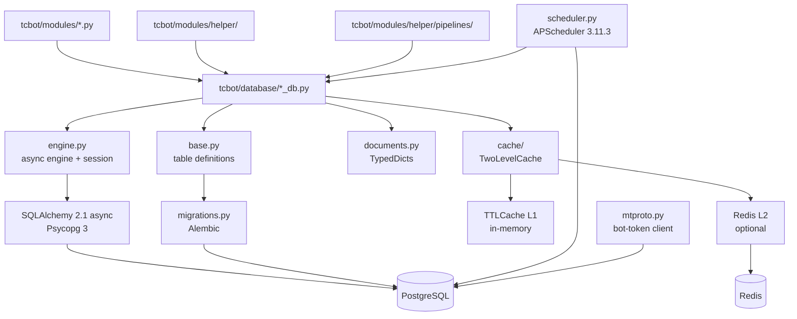

# Database Layer

The database layer lives in `tcbot/database/` and is the only place that
should talk to PostgreSQL. Command modules and workflows call helper
functions instead of building statements themselves.

This document is the reference spec for the Python database layer. Every
table, index, helper signature, cache behavior, and scheduler detail below
is taken from the current `tcbot/database/` Python code.

For modules that consume these database helpers, see
[`modules.md`](modules.md). For shared helpers, see
[`helpers.md`](helpers.md). For conversation flows, see
[`workflows.md`](workflows.md).



## Access rules

- Keep all SQL in `tcbot/database/` helpers. Command modules and workflows
  must not build statements or import the engine directly.
- Put new database concerns in descriptive `*_db.py` files and add the
  matching table and index to `base.py`.
- Helpers are async and fully typed; they use the `TypedDict` shapes from
  `documents.py` and the `NewType` primitives from `types.py`.
- Stored timestamps are timezone-aware and in UTC. Use `utc_now()` from
  `tcbot.utils.time_and_date`; never call `datetime.now()` directly.
- Every read and write runs through `engine.db_call()`, so the circuit
  breaker and the call timeout apply uniformly.

## Schema ownership

| Module | Responsibility |
|---|---|
| `base.py` | The single source of truth for every table, column, constraint, and index. Alembic autogenerate and the runtime schema check both read it. |
| `migrations.py` | Applies the pending Alembic revisions at startup. |
| `engine.py` | The async engine, the session boundary, the circuit-breaker guard, and the query helpers. |

The schema is versioned with Alembic. `alembic/versions/0001_initial.py`
creates every table and index of `base.py`, and every later revision adds
to it; `engine.connect()` applies the pending revisions before the engine
is published, so a fresh deployment boots against an empty database and an
existing one is upgraded in place.

```bash
# Apply the migrations by hand (the bot does this at startup).
uv run alembic upgrade head

# Generate a revision after changing base.py.
uv run alembic revision --autogenerate -m "describe the change"
```

A schema change therefore needs three edits: the table in `base.py`, the
matching Alembic revision, and the helper that uses it. The integration
tests build their schema from `base.py`, so a revision that drifts from it
is caught by `tests/test_schema_migration.py`, which migrates an empty
schema and compares the result with the declared metadata.

`scripts/generate_initial_migration.py` is the bootstrap tool for the
first revision of a new project. It refuses to overwrite an existing
first revision: the applied revision is the database's history, and
rewriting it would leave a deployed database on the old schema while the
repository claims the change shipped.

The migration must not reconfigure the application logging. Alembic's
standard recipe calls `fileConfig()`, which removes every handler the bot
installed (including the Telegram error handler) and resets the root
level. The bot applies the migrations during startup, so the standard
call would silence the bot and stop the error reports the moment it
connects to the database. `alembic/env.py` therefore configures the
Alembic logger on its own.

## Connection manager

`engine.py` owns the async SQLAlchemy engine. Every helper runs on the
event loop and awaits the driver; there is no worker thread and no
blocking call on the loop.

| Export | Purpose |
|---|---|
| `connect()` | Applies the pending Alembic revisions, creates the async engine and the session factory, and pings the server through the `postgres` circuit breaker. On failure the engine is disposed again, so a failed boot leaks no pool. |
| `close()` | Disposes the engine and drops the session factory. Safe to call without a prior `connect()`. |
| `engine()` | Returns the shared engine or raises `RuntimeError` when the database is not connected. |
| `is_connected()` | Returns `True` once a connection has been established via `connect()`. |
| `session()` | Async context manager yielding an `AsyncSession` that commits on success and rolls back on failure. One session per operation. |
| `read_connection()` | Async context manager yielding an autocommit connection for a read-only statement. A read needs no transaction, so it costs one round trip instead of one plus the `COMMIT` that closes it. The pre-ping on checkout adds a second round trip, which the autocommit saving offsets. |
| `db_call(op, *, timeout=20.0)` | Runs one database operation through the circuit breaker and a caller-side timeout. Raises `CircuitOpenError` while the circuit is OPEN. |
| `run_transaction(op, *, timeout=20.0)` | Runs a unit of work that spans several statements atomically on one session. It already runs through `db_call`, so a caller must not wrap it in another one. |
| `fetch_all(stmt)` / `fetch_one(stmt)` / `fetch_value(stmt)` / `fetch_count(stmt)` / `count_rows(stmt)` | Read helpers. They run on an autocommit connection, so a read is one round trip. `count_rows` wraps a selection in a counting query so the result is the row count and never the first column. |
| `run(stmt)` / `run_returning(stmt)` | Write helpers. `run` returns the affected row count, `run_returning` the rows a `RETURNING` clause produced. |
| `is_connection_error(exc)` / `is_transient_db_error(exc)` / `is_database_error(exc)` / `is_pool_timeout(exc)` | Error classification used by the circuit breaker and the error handler. `is_pool_timeout` recognises SQLAlchemy's own pool-timeout error, which does not inherit from the builtin `TimeoutError`. |
| `constraint_name(exc)` | The name of the constraint an integrity error violated, so a caller can tell a duplicate identifier apart from a duplicate partial index. |

### Connection parameters

`connect()` builds the engine with these explicit parameters:

| Parameter | Value |
|---|---|
| `pool_size` | `20` |
| `max_overflow` | `10` |
| `pool_timeout` | `10 s` |
| `pool_recycle` | `1800 s` |
| `pool_pre_ping` | `True` |
| `connect_timeout` | `10 s` |
| `options` | `-c timezone=UTC` |

The pool is sized for a federation of dozens of groups, where every handler
may read the member cache or the role tables at the same time. The session
zone is pinned to UTC because the application works in UTC end to end and
the session zone decides how a timestamp without one is read back.

The URL comes from `cfg.database_url` and is normalised to the
`postgresql+psycopg://` scheme. `postgresql://` and `postgres://` are
accepted as well.

### Circuit breaker

`postgres` (from `tcbot/utils/circuit_breaker.py`) trips OPEN after 5
consecutive transient failures and allows one HALF_OPEN probe after 60 s.
A successful probe closes the circuit; a failed probe reopens it.
`db_call` rejects with `CircuitOpenError` while OPEN.

Only transient database errors count toward opening the circuit: a dropped
connection, a refused socket, a driver timeout, an exhausted connection
pool, and the caller-side `TimeoutError` raised by `db_call`. A constraint
violation or a syntax error is an application bug, not an outage, so it
propagates without recording a failure. A `CircuitOpenError` from a
handler logs once at WARNING in `_error_handler` instead of flooding the
logs-errors channel.

A failure that passes through two breakers counts once. `run_transaction`
already runs through `db_call`, so a caller must not wrap it in a second
one: the exception is the same object on both levels, and counting it
twice would trip the circuit after fewer real failures than the threshold
promises.

A pool timeout is a load condition, not a broken database. It counts
toward the circuit (so a half-open probe reopens instead of flooding a
saturated pool) and it is reported as a transient condition rather than a
database error.

## Tables at a glance

| Helper | Table(s) | Main responsibilities |
|---|---|---|
| `users_cache.py` | `member_cache` | Member profile cache: upsert, change-detection upsert, harvest, get, batch queries, mention formatting, counts, paged listing, name search. |
| `users_roles.py` | `tc_owners`, `tc_admins`, `tc_roles` | Owner CRUD, admin CRUD, developer/tester role CRUD, effective-role resolution. |
| `bans_db.py` | `bans` | Active ban lookup, ban creation/update, unban deactivation, appeal/review metadata, active ban lists, per-user history. |
| `groups_db.py` | `federated_groups`, `pending_joins` | Connected group state, pending connection requests, group locale, cache invalidation, chat-migration repoint. |
| `warns_db.py` | `warns`, `warn_counts` | Warning event history, per-group counters, limit checks, backfill/sync, clear, migration. |
| `kicks_db.py` | `kicks` | Append-only kick audit records. |
| `mutes_db.py` | `mutes`, `active_mutes` | Mute audit trail plus the live active-mute store used to re-apply restrictions. |
| `queues_db.py` | `promotion_requests` | Queued Admin promotion requests and resolution status. |
| `settings_db.py` | `user_settings` | Per-user locale preference rows, kept apart from `member_cache`. |
| `cache/` | in-process + Redis | `TTLCache[T]` (L1) and `TwoLevelCache[T]` (L1 in-process + L2 Redis) with five public singletons. |
| `redis_client.py` | Redis (optional) | Async Redis client singleton with pool management and liveness tracking. |
| `scheduler.py` | PostgreSQL (APScheduler) | APScheduler 3.11.3 `AsyncIOScheduler` backed by `SQLAlchemyJobStore`. |
| `mtproto.py` | Telegram MTProto | Bot-token client singleton: user-ID resolution and group member harvest. Claims a single-owner lease before connecting (90 s TTL, 30 s heartbeat); losers and parked sessions degrade to Bot-API-only. |
| `mtproto_store.py` | `mtproto_state` | PostgreSQL-backed Kurigram storage engine shared by all instances, plus the atomic single-owner lease (`<ns>:lock:mtproto_owner`) with expiry takeover. The peer, name-list and update-state writes go out as one multi-row upsert per bounded chunk, so a session with hundreds of peers costs a handful of transactions instead of one per peer. |
| `documents.py` | type-only | `TypedDict` document shapes and `Literal` aliases. |
| `types.py` | type-only | `NewType` primitives: `UserId`, `GroupId`, `ChatId`, `BanId`. |

## Member profiles (`users_cache.py`, table `member_cache`)

### Row shape: `UserDoc`

| Field | Type | Meaning |
|---|---|---|
| `user_id` | `UserId` (int) | Telegram user ID (primary key). |
| `username` | `str \| None` | Current username. |
| `first_name` | `str \| None` | Current display name. |
| `last_name` | `str \| None` | Current last name. |
| `first_name_lower` | `str \| None` | Lowercase mirror of `first_name`; backs the prefix name search. |
| `username_lower` | `str \| None` | Lowercase mirror of `username`; backs the prefix name search. |
| `commit_date` | `datetime` | First-seen timestamp. The conflict action never rewrites it, so a refresh keeps the moment the profile was first cached. |
| `last_updated` | `datetime` | Last write time; drives the stale-profile cleanup. |

### Mutations

- `upsert_user(user_id: int, username: str | None, first_name: str, last_name: str | None = None) -> None`
  Unconditional upsert through `INSERT ... ON CONFLICT DO UPDATE`. `None` for
  `username`/`last_name` means "unknown, preserve the stored value": the
  conflict action carries only the refreshed columns, so the stored value
  stays. Pass `""` to clear a field. The conflict action never rewrites
  `commit_date`. Populates the `user_mention_cache` entry when the write
  carried every field; a partial write (a preserved `username` or
  `last_name`) invalidates the entry instead, because the stored triple
  cannot be reconstructed from the write alone.
- `upsert_user_if_changed(user_id: int, username: str | None, first_name: str, last_name: str | None = None) -> bool`
  Change-detection write. Compares the incoming `(first_name, username,
  last_name)` triple against the L1 mention-cache entry and skips the
  database write entirely on a match. Returns `True` when a write occurred,
  `False` when skipped. Legacy two-element cache entries count as changed.
  This is the hot-path writer, and the guard only works because
  `upsert_user` populates the mention cache on a complete write.
- `harvest_user_identity(user_id: int, username: str | None, first_name: str, last_name: str | None = None) -> bool`
  Snapshot write for data taken from a live Telegram `User` object. Unlike
  `upsert_user_if_changed`, `None` means "absent on Telegram": fields the
  object omits are cleared via `""` so removals propagate. Delegates to
  `upsert_user_if_changed`. Never use with partial data from ban/promote/
  check-by-ID paths (those must keep `None`).
- `remember_identity(user_id: int, first_name: str | None, username: str | None, last_name: str | None) -> None`
  Mirrors a resolved identity into L1 only, no database I/O. Used after a
  Telegram-side resolve because `upsert_user` invalidates rather than
  populates. An empty identity stores the all-`None` not-found sentinel.

### Queries

- `get_user(user_id: int) -> UserDoc | None`
  Full cached profile, read by primary key.
- `get_user_mention_data(user_id: int) -> tuple[str, str | None]`
  `(first_name, username)` for mention formatting, routed through
  `user_mention_cache.get_or_fetch` (L1 to L2 to database). A missing row is
  cached as the all-`None` sentinel; the consumer converts it to
  `str(user_id)`, so the returned first element is never empty.
- `get_first_name(user_id: int, fallback: str = "") -> str`
  Cached `first_name`, or the caller's `fallback` when the user has no row
  (sentinel). Uses the same `get_or_fetch` path as `get_user_mention_data`,
  so calls to these helpers never cause redundant round-trips for the same
  user.
- `get_mention_data_batch(user_ids: list[int]) -> dict[int, tuple[str, str | None]]`
  Batch `(first_name, username)` for many users in one query. The batch
  readers consult both cache layers: the in-memory layer answers first,
  and the keys it missed are fetched from Redis in one round trip, so a
  warm Redis serves the batch without a database query even right after a
  restart. Only the remaining IDs trigger one `IN (...)` query. Newly
  fetched data is populated into the mention cache; users missing from
  the database get the sentinel cached and `str(user_id)` returned.
- `get_first_names_batch(user_ids: list[int]) -> dict[int, str]`
  Batch first names only. The cache path is the same as
  `get_mention_data_batch`. Newly fetched rows populate the full mention
  triple through the shared batch-miss path, so repeat renders by any
  reader skip the round-trip. Missing users get the sentinel cached and
  `str(user_id)` returned.
- `total_users() -> int`
  `COUNT(*)` over the whole table.
- `all_users_page(*, skip: int = 0, limit: int = 200, sort_by: str = "first_name") -> list[UserDoc]`
  One server-side page. `sort_by` is validated against `_USER_SORT_FIELDS`
  (`user_id`, `username`, `first_name`, `last_updated`), falling back to
  `first_name`; `last_updated` sorts descending, everything else ascending.
  Every accepted key maps to an indexed field and carries a `user_id`
  tie-break so the page order stays stable. The name sorts use the
  default-opclass `(first_name_lower, user_id)` and
  `(username_lower, user_id)` indexes: the `text_pattern_ops` indexes
  serve the prefix search but cannot serve an `ORDER BY`, so without the
  extra indexes the planner sorts the whole table on every page turn.
  `limit` is clamped to at least 1 and used for both the `LIMIT` and the
  `OFFSET`.
- `search_by_name(needle: str, limit: int = 5) -> list[UserDoc]`
  Target-resolution search. A server-side anchored prefix query
  (`first_name_lower LIKE 'needle%'` or `username_lower LIKE 'needle%'`,
  with the needle escaped) over the lowercase mirror columns, capped at
  `limit` results (hard ceiling 100). Only `user_id`, `first_name`, and
  `username` are projected. The mirrors exist because PostgreSQL cannot
  serve a case-insensitive match from an index; a case-sensitive prefix on
  an indexed mirror is a range scan. The mirror columns carry the
  `text_pattern_ops` opclass, which is what makes the prefix scan work
  under a non-C collation.
- `is_placeholder_name(name: str | None) -> bool`
  Return True when a display name is a fallback rather than a real name:
  empty, a bare numeric ID, or the legacy `User <id>` form. Single owner
  for that rule, so no surface renders a placeholder as a name.

**Performance tip:** use the batch functions whenever data for more than one
user is needed in a list view or fan-out result; calling single-user
functions in a loop is an N+1 anti-pattern. For partial-name target
resolution use `search_by_name`; for paginated list views use
`all_users_page`.

**Hot-path harvest pattern:** on every observed Telegram update
`_update_member_cache` schedules `harvest_user_identity` as a
fire-and-forget background task, bounded to 20 in-flight tasks (updates
beyond the cap skip the harvest and refresh on the next event). When the
cached identity has not changed, no database write is issued.

**Error behavior:** every helper uses `db_call()`; a database outage raises
`CircuitOpenError` (circuit OPEN) or the driver exception, which
`_update_member_cache` logs at DEBUG and swallows so a cache failure never
breaks the update path.

## Roles, owners, and admins (`users_roles.py`, tables `tc_owners`, `tc_admins`, `tc_roles`)

### Row shapes

`AdminDoc` (tc_owners and tc_admins rows):

| Field | Type | Meaning |
|---|---|---|
| `user_id` | `UserId` | Owner or admin user ID (primary key). |
| `promoted_by` | `UserId` | Who promoted the admin (tc_admins only). |
| `promoted_date` | `datetime` | Promotion time (tc_admins only). |

`RoleDoc` (tc_roles):

| Field | Type | Meaning |
|---|---|---|
| `user_id` | `UserId` | Role holder (primary key). |
| `role` | `RoleName` | `"founder"`, `"admin"`, `"developer"`, or `"tester"` literal; only `developer`/`tester` are stored as custom roles. |
| `assigned_by` | `UserId` | Admin who assigned the role. |
| `assigned_at` | `datetime` | Assignment time. |

`RoleRefDoc` (tc_roles): minimal row carrying only `user_id`, used for role
index/roster lookups.

### Role hierarchy

```text
founder = 4 > admin = 3 > developer = 2 > tester = 1 > none = 0
```

- `VALID_ROLES`: `{"developer", "tester"}` (the only roles assignable via `set_role`).
- `role_rank(role: str | None) -> int`: maps a role string to its rank, `0` for `None`/unknown.
- `ROLE_LABEL`: human labels (`Founder`, `Admin`, `Developer`, `Tester`).
- `role_label(role: str | None) -> str`: the human label for a role, falling back to the role itself. Single owner for the label lookup, so every surface renders a role the same way.
- `STAFF_ROLES`: `{"admin", "developer", "tester"}`, every role that can be demoted (the Founder is protected and never demoted).
- `FOUNDER_ADMIN_ROLES`: `{"founder", "admin"}`, the roles that count as federation staff for permission gates. Both sets live here so a new tier cannot land in the rank table and be missed by every set check.

### Effective-role resolution

Resolution order in `get_effective_role`:

1. `tc_owners` match returns `"founder"`.
2. `tc_admins` match returns `"admin"`.
3. `tc_roles` custom role returns `"developer"` or `"tester"`.
4. No role returns `None`.

- `get_effective_role(user_id: int, *, fresh: bool = False) -> str | None`
  Resolves the full effective role via `effective_role_cache.get_or_fetch`
  (L1 60 s, L2 90 s). The `_fetch` reads owner/admin/custom role in
  parallel with `return_exceptions=True`, calls `throw_if_cancelled`, and
  re-raises any non-cancellation exception so a degraded "founder"/"admin"
  result is never cached for a real database error. With `fresh=True` the
  caches are bypassed and the rows are read directly (the cache is
  refreshed with the result): enforcement gates use `fresh=True` so a
  demotion or transfer in another process is never hidden for the cache
  TTL. Executor-versus-target checks go through
  `guards.resolve_and_check()`, which fails closed when either lookup
  fails.
- `role_meta(user_id: int) -> tuple[str | None, int | None, datetime | None]`
  `(role, assigned_by, assigned_at)` for profile views. An owner has no
  metadata (`None`s); an admin reads `promoted_by`/`promoted_date` from
  `tc_admins`; a custom role reads `assigned_by`/`assigned_at` from
  `tc_roles`. A missing row still returns the role with `None` metadata.

### Owner CRUD

- `get_owner_id(*, fresh: bool = False) -> int | None`
  Current owner's ID through `owner_id_cache` (L1 300 s, L2 360 s, fixed
  key `__owner__`). With `fresh=True` the owner row is read directly from
  the database (cache refreshed with the result): enforcement gates use it
  so a transfer in another process is never hidden for the TTL.
- `is_owner(user_id: int, *, fresh: bool = False) -> bool`
  `get_owner_id(fresh=fresh) == user_id`; cached, no database round trip on
  hits. Errors propagate so decorators keep their fail-closed retry reply.
  Enforcement gates (promotion decisions, the founder-only users list) use
  `fresh=True`.
- `ensure_initial_owner(initial_id: int) -> None`
  Inserts the founder when `tc_owners` is empty. On an integrity error
  (another instance won the startup race) it invalidates the owner cache
  instead of failing.
- `set_owner(user_id: int) -> None`
  Replaces the owner in one transaction: the insert and the convergence
  delete commit together, so a crash between them cannot leave one or two
  owner rows. The transaction takes a PostgreSQL advisory lock, so two
  concurrent transfers serialise instead of interleaving: without the lock
  the sequence insert A, insert B, delete != A, delete != B leaves the
  table with **no** owner row, which would leave the whole federation
  without a Founder until the next restart. The helper then verifies the
  single-row invariant loudly, puts the new ID in the owner cache, and
  calls `effective_role_cache.clear_all()` so no process keeps a stale
  `"founder"` role after transfer. A failed transfer rolls back, fails
  closed, and logs operator guidance. Owner reads use a sorted query so a
  transient two-row state resolves deterministically.

### Admin CRUD

- `is_admin(user_id: int) -> bool`: existence check on `tc_admins`.
- `is_staff(user_id: int, *, fresh: bool = False) -> bool`: `get_effective_role(user_id, fresh=fresh) in ("founder", "admin")`. Keeps the historical fail-open-to-`False` contract: lookup failures log at WARNING and return `False`; cancellation still propagates. Callers that need a retry hint on outage use `get_effective_role` directly (like the appeal-review path and decorators). Enforcement callers (disconnect, group-language write) use `fresh=True` so a demotion is never hidden for the 60 s TTL; display-only callers keep the cached path.
- `add_admin(user_id: int, promoted_by: int) -> None`: upsert through `ON CONFLICT DO NOTHING`; no-op if already present. Invalidates the target's effective role cache.
- `remove_admin(user_id: int) -> bool`: delete; returns whether a row was deleted; invalidates the role cache.
- `all_admins() -> list[AdminDoc]`: all admin rows.
- `admin_count() -> int`: `COUNT(*)`.

### Custom role CRUD

- `set_role(user_id: int, role: str, assigned_by: int) -> None`: upsert `tc_roles` (`user_id`, `role`, `assigned_by`, `assigned_at`); invalidates the RoleDoc role cache.
- `remove_role(user_id: int) -> bool`: delete the custom role; returns whether a row was deleted; invalidates the cache.
- `get_role(user_id: int) -> str | None`: reads `tc_roles` only (no owner/admin fallback).
- `all_by_role(role: str) -> list[RoleRefDoc]`: all users holding a specific custom role (serves the `(role)` index).
- `role_count(role: str) -> int`: `COUNT(*)` on the role filter.

**Security notes:** role lookup failures reject the action where
authorization is enforced (`get_effective_role` propagates,
`resolve_and_check` fails closed). `is_staff` is the only deliberately
coerce-to-`False` path and is kept for its historical callers.

## Bans (`bans_db.py`, table `bans`)

### Row shape: `BanDoc`

| Field | Type | Meaning |
|---|---|---|
| `ban_id` | `BanId` (str) | Short unique ban identifier (generated by `make_short_id()`, default length 10). |
| `banned_user_id` | `UserId` | Target Telegram user ID. |
| `reason` | `str` | Moderation reason. |
| `admin_user_id` | `UserId` | Admin who created or last updated the ban. |
| `proof_message_id` | `int` | Uploaded proof message ID in the proof destination. |
| `log_message_id` | `int` | Audit log message ID. |
| `previous_proof_message_id` | `int \| None` | Prior proof ID when an active ban was updated. |
| `previous_log_message_id` | `int \| None` | Prior log ID when an active ban was updated. |
| `timestamp` | `datetime` | Initial creation time. |
| `updated_timestamp` | `datetime \| None` | Last update time. |
| `until_date` | `datetime \| None` | Reserved for future timed-ban support; currently always `None`. |
| `duration_str` | `str \| None` | Reserved for future timed-ban support; currently always `None`. |
| `is_active` | `bool` | Whether the federation ban is currently active. |
| `update_count` | `int` | Number of updates applied. |
| `review_message_id` | `int \| None` | Appeal review card message ID. |
| `review_timestamp` | `datetime \| None` | When the review slot was claimed. |
| `appeal_log_msg_id` | `int \| None` | Appeal log message ID (presence marks "appeal ever submitted"). |
| `appeal_submitted_at` | `datetime \| None` | Appeal submission time. |
| `appeal_link` | `str \| None` | Link to the submitted appeal. |
| `rejected_by_id` | `int \| None` | Rejector Telegram ID (set by `set_rejected_by`). |
| `rejected_by_name` | `str \| None` | Rejector display name. |
| `rejected_at` | `datetime \| None` | Rejection time. |

### Retrieval

- `get_active_ban(user_id: int) -> BanDoc | None`
  The currently active ban for a user: filter `banned_user_id = ? AND
  is_active`, sort `(timestamp desc, ban_id desc)`. Served by the compound
  index.
- `get_ban(ban_id: str) -> BanDoc | None`
  Any ban record by its unique `ban_id`.

### Mutations

- `create_ban(target_id: int, reason: str, admin_id: int, proof_msg_id: int, log_msg_id: int, ban_id: str | None = None, *, until_date: datetime | None = None, duration_str: str | None = None) -> BanDoc`
  Inserts a new active ban and returns the stored row, so the caller sees
  exactly what a later read would return. If `ban_id` is `None`, one is
  generated. A violation of the one-active-ban-per-user constraint is
  treated as a lost race: the existing record is returned and the
  moderation continues. A violation of the `ban_id` unique constraint on
  a generated id is retried once with a fresh id, because the caller
  never chose that id. The same violation on an id the caller supplied is
  never swallowed, because the caller reuses the id for the appeal link
  and the log patch.
- `update_ban(ban_id: str, reason: str, admin_id: int, new_proof_id: int, new_log_id: int = 0, old_proof_id: int = 0, old_log_id: int = 0, *, until_date: datetime | None = None, duration_str: str | None = None) -> BanDoc | None`
  One `UPDATE ... RETURNING`: updates reason, admin, proof/log IDs (moving
  the old ones to `previous_*`), timestamps and `until_date`/`duration_str`,
  and increments `update_count`.
- `set_log_message_id(ban_id: str, log_msg_id: int) -> None`
  Patches only the audit log message ID (used when the ban log is edited).
- `deactivate_all_active_bans(user_id: int) -> int`
  Deactivates every active ban for a user in one statement; returns the
  count deactivated. Used by unban and appeal-approval flows to clear any
  duplicate active records.
- `deactivate_extra_active_bans(user_id: int, keep_ban_id: str) -> int`
  Deactivates all active bans except the canonical `keep_ban_id`
  (ban-update cleanup); returns the count deactivated.
- `set_review_if_absent(ban_id: str, msg_id: int) -> bool`
  Atomic claim of the pending-review slot: the statement requires
  `review_message_id IS NULL`, so two concurrent appeal submissions cannot
  both win. Returns whether this submit claimed the slot; the loser
  discards its orphan review card.
- `clear_review(ban_id: str) -> None`
  Clears the review slot so a rejected user can submit a new appeal.
- `set_rejected_by(ban_id: str, admin_id: int, admin_name: str) -> None`
  Persists rejector identity and `rejected_at` so the audit trail survives
  log-channel loss.
- `set_appeal_log_msg(ban_id: str, msg_id: int, submitted_at: datetime | None = None, appeal_link: str = "") -> None`
  Stores appeal metadata; `submitted_at` defaults to now.

### Statistics and history

- `active_ban_count() -> int`: `COUNT(*)` over the active rows.
- `active_bans_page(skip: int, limit: int) -> list[BanDoc]`
  One server-side page of active bans, newest first (`(is_active,
  timestamp desc, ban_id desc)` index). `limit` clamped to at least 1.
- `active_bans_for_users(user_ids: list[int]) -> list[BanDoc]`
  Active bans for a set of IDs through `IN (...)`, newest first; backs
  name-search results. Returns `[]` for an empty input.
- `active_ban_user_ids() -> list[int]`
  Only the `banned_user_id`s of all active bans (projection-only, fastest
  path), newest first.
- `user_appealable_bans(user_id: int, *, skip: int = 0, limit: int | None = None) -> list[BanDoc]`
  The user's bans that ever had an appeal (`appeal_log_msg_id` present),
  newest first; served by the partial index. `limit=None` returns the full
  list.
- `user_bans(user_id: int, *, skip: int = 0, limit: int | None = None) -> list[BanDoc]`
  Every ban (active and inactive) for a user, newest first.
- `user_ban_count(user_id: int) -> int`: total bans ever issued against the user.
- `user_appeal_count(user_id: int) -> int`: count of bans with an appeal submitted.

**Error behavior:** all operations route through `db_call()`.
`create_ban` absorbs only the one-active-ban race; every other integrity
error propagates so moderation callers report the real failure.

**Uniqueness:** a partial unique index on `(banned_user_id)` where
`is_active` is true keeps one active ban per user, so two moderators
reaching the warn threshold at the same moment cannot store two records
that disagree about which ban is real. The database enforces the
invariant; `create_ban` treats a collision as a lost race and reuses the
winning record instead of failing the moderation action.

## Groups (`groups_db.py`, tables `federated_groups`, `pending_joins`)

### Row shapes

`GroupDoc` (federated_groups):

| Field | Type | Meaning |
|---|---|---|
| `chat_id` | `GroupId` | Telegram group chat ID (primary key). |
| `title` | `str` | Current group title. |
| `added_by` | `UserId` | Who connected the group. |
| `added_date` | `datetime` | First connect date, preserved across re-adds and title refreshes. |
| `is_active` | `bool` | Connection state; disconnect marks it `False` instead of deleting. |
| `locale` | `str \| None` | Optional group-wide render locale chosen via `/language`. |

`PendingGroupDoc` (pending_joins):

| Field | Type | Meaning |
|---|---|---|
| `chat_id` | `ChatId` | Awaiting-approval chat ID (primary key, one pending per chat). |
| `title` | `str` | Group title at request time. |
| `owner_id` | `UserId` | Group owner requesting approval. |
| `message_id` | `int` | The approval prompt message ID. |
| `added_date` | `datetime` | Request time. |

### Queries and mutations

- `get_group_titles(chat_ids: list[int]) -> dict[int, str]`
  `{chat_id: title}` for the given chats in one `IN (...)` query; missing
  groups are absent from the result. Falls back to `str(chat_id)` when a
  title is empty.
- `refresh_group_title(chat_id: int, title: str) -> bool`
  Atomic update: the statement skips when the stored title already matches
  (one round trip on the common no-change path, no read-then-write race).
  Returns `True` when a change was written and the groups cache
  invalidated; `False` when already current or the group is unknown.
- `is_connected(chat_id: int, *, fresh: bool = False) -> bool`
  `connected_cache.get_or_fetch` (L1 120 s, L2 180 s): existence check on
  `chat_id` with `is_active`. With `fresh=True` the row is read directly
  and the cache refreshed: the origin guard uses `fresh=True` so a
  disconnect in another process is never hidden for the TTL.
- `add_group(chat_id: int, title: str, added_by: int) -> None`
  Upsert that preserves `added_date` and sets `is_active = True`. Puts
  `True` in `connected_cache` and invalidates the active-groups list cache.
- `deactivate_group(chat_id: int) -> bool`
  Sets `is_active = False`; returns `False` when the row does not exist.
  Puts `False` in `connected_cache` and invalidates the active-groups list
  cache.
- `active_groups() -> list[GroupDoc]`
  All active groups, `active_groups_cache.get_or_fetch` (L1 30 s, L2 45 s,
  single entry keyed `__all__`).
- `active_group_count() -> int`
  `COUNT(*)` over the active rows.
- `migrate_group(old_chat_id: int, new_chat_id: int) -> bool`
  Chat-migration repoint. Updates `federated_groups` and `pending_joins`
  in parallel (`return_exceptions=True`), logging and skipping any table
  that failed while still processing the other. Returns `True` if any
  record moved. When the target chat already has a row the primary key
  rejects the repoint, so the stale old row is merged into the surviving
  row in one transaction (the old row's group locale carries over when the
  survivor has none) and the old row is dropped. Invalidates caches:
  `connected_cache.put(old_chat_id, False)`, `connected_cache.put(new_chat_id,
  ...)` only when the federated_groups row actually moved (a pending-only
  migration must not poison `is_connected`), and
  `active_groups_cache.invalidate(__all__)` when the group row moved. The
  cached value mirrors the row that survived: the target row may be an
  inactive one, and caching "connected" unconditionally would report a
  disconnected group as connected for the whole cache TTL and pull it
  into the federation fan-outs. Cancellation propagates.
- `add_pending(chat_id: int, title: str, owner_id: int, message_id: int) -> None`
  Upserts a pending join request (primary key `chat_id`, one pending per
  chat).
- `get_pending(chat_id: int) -> PendingGroupDoc | None`
  Reads one pending request.
- `remove_pending(chat_id: int) -> None`
  Deletes the pending request after approval or rejection.

### Group locale

`federated_groups.locale` rides on the connected group's row; there is no
separate preference table, and only connected groups hold settings. Reads
filter on the indexed `chat_id`.

- `get_group_locale(chat_id: int) -> str | None`
  Reads the stored group locale for the shared-audience resolution path
  (`helper/locale.py`). Unset (`None`) is cached too. Backed by a bare
  `cachetools` L1 `_GROUP_LOCALE_L1` (maxsize 1024, ttl 300 s), not a
  Redis-backed `TwoLevelCache`.
- `set_group_locale(chat_id: int, locale: str | None) -> bool`
  Stores the locale verbatim, or clears it when `None`. Returns `True` when
  a group row matched; pops the L1 entry and invalidates the active-groups
  list cache (whose rows carry the locale, so a change would otherwise
  linger for the groups-list TTL). Validity against the translation
  catalog is enforced by the caller and at resolution time.

**Error behavior:** every access uses `db_call()`. `migrate_group` never
aborts the whole migration because one table failed: it logs per-table
failures, skips that side, and reports whether anything moved.

## Warnings (`warns_db.py`, tables `warns`, `warn_counts`)

### Row shapes

`WarnDoc` (warns, one row per warning event):

| Field | Type | Meaning |
|---|---|---|
| `id` | `int` | Surrogate primary key. |
| `user_id` | `UserId` | Warned user. |
| `reason` | `str` | Warning reason. |
| `admin_id` | `UserId` | Admin who warned. |
| `chat_id` | `ChatId` | Group where the warning was issued. |
| `timestamp` | `datetime` | Warning time. |

`WarnCountDoc` (warn_counts, one row per user/chat pair):

| Field | Type | Meaning |
|---|---|---|
| `user_id` | `UserId` | Warned user (primary key with `chat_id`). |
| `chat_id` | `ChatId` | Group (primary key with `user_id`). |
| `count` | `int` | Running warning total for the pair. |
| `updated_at` | `datetime` | Last counter update; drives warn-expiry pruning. |

The per-group threshold is `cfg.warn_limit` (env `WARN_LIMIT`, default 3,
minimum 1). A second federation-wide threshold `cfg.fed_warn_limit` (env
`FED_WARN_LIMIT`, default 0 = disabled) auto-bans when
`federation_warn_count()` reaches the value. See
[`../features/moderation/warnings.md`](../features/moderation/warnings.md).

### Mutations

- `add_warn(user_id: int, reason: str, admin_id: int, chat_id: int) -> int`
  The history row and the counter land in one transaction
  (`run_transaction`). They must agree: the counter is what the auto-ban
  threshold reads, so a history row without its counter (or the other way
  round) would silently delay the ban that the warning earned. The counter
  is written with `INSERT ... ON CONFLICT DO UPDATE SET count = count + 1
  RETURNING count`, so two concurrent warnings in the same group both
  count. When the counter row is missing, the insert takes its value from
  the warning history instead of starting at one: a counter that ignored
  the rows already in the history would under-count and delay the
  threshold. Returns the new warn count. A statement that returns no
  counter row raises and rolls the transaction back rather than committing
  a warning whose count is missing.
- `clear_warns(user_id: int, chat_id: int) -> int`
  Deletes warn history plus the counter for one group; returns the history
  deleted count. Both deletes share one transaction. They write the same
  fact from two sides, so a failure between them would leave a counter
  without its history, and a surviving counter keeps a count for warnings
  that were cleared. Raises the delete failure instead of returning 0 (a
  0 return means "nothing to clear"; reporting an outage as an empty state
  would mislead the moderator).
- `clear_all_warns(user_id: int) -> int`
  Deletes warn history plus every counter across all groups (used on
  federation auto-ban so a user starts with a clean slate). Raises like
  `clear_warns`; callers inside `gather` inspect the captured exception.

### Queries

- `warn_count(user_id: int, chat_id: int) -> int`
  Current counter for a user in a group, via `_sync_warn_count`: reads the
  counter row, or atomically backfills it from the warn history when
  missing (`INSERT ... ON CONFLICT DO UPDATE`) so concurrent callers cannot
  double-backfill.
- `get_warns(user_id: int, chat_id: int, *, skip: int = 0, limit: int | None = None) -> list[WarnDoc]`
  Full warn list for a user in a group, oldest first (timestamp ascending).
  `limit=None` returns everything.
- `remove_last_warn(user_id: int, chat_id: int) -> bool`
  Deletes the most recent warn row and decrements the counter in one
  transaction. The decrement only runs when the delete removed a row, so
  two callers that read the same warning do not both decrement. A failed
  delete raises and leaves the counter untouched; a missing counter row is
  rebuilt from history (`_recount_and_store`). Returns `True` only when a
  warn was actually removed. Cancellation propagates.
- `user_total_warns(user_id: int) -> int`
  Total warn rows recorded against the user across all groups.
- `user_warn_groups(user_id: int) -> list[tuple[int, int]]`
  `[(chat_id, count), ...]` for every group where the user has warns,
  sorted by `updated_at` descending.
- `federation_warn_count(user_id: int) -> int`
  Total active warn count across all federation chats: a server-side
  `SUM(count)` over the rows where `count > 0`. Returns 0 when there is
  nothing. Used to evaluate the `FED_WARN_LIMIT` threshold.
- `migrate_records(old_chat_id: int, new_chat_id: int) -> bool`
  Chat-migration repoint. Warn history moves with one update; counter rows
  merge by summation (per user, added into the supergroup counter through
  an upsert) so a supergroup that already holds warns keeps the combined
  total instead of losing one side to the per-pair primary key. Each old
  counter is consumed with an atomic take (removed before its count lands
  on the new pair), so a crash plus retry can only under-count, never
  double-count into a false auto-ban. Each stage logs and skips on
  failure. Returns `True` if any record moved. Called by
  `greeting.on_chat_migration` alongside `groups_db.migrate_group` (plus
  the kick/mute history repoints) so warning history and thresholds survive
  a basic-group to supergroup migration.

**Error behavior:** warn deletions raise when the history delete fails
(empty-state misreporting is a correctness hazard); counter-delete failures
are repaired (recount for single-group clears, bounded retry for
federation-wide clears) and stay non-fatal. Counter backfill is atomic so
concurrent first-reads cannot double-count.

**Counter repairs:** a repair recounts the history and stores the absolute
count, so it runs in one transaction that locks the counter row before it
counts. A repair that read the history in one statement and wrote the
absolute count in another could overwrite the increment of a warning that
landed in between: the counter would then sit one below the history and
the auto-ban threshold would fire one warning late.

## Kicks (`kicks_db.py`, table `kicks`)

### Row shape: `KickDoc`

| Field | Type | Meaning |
|---|---|---|
| `id` | `int` | Surrogate primary key. |
| `user_id` | `UserId` | Kicked user. |
| `chat_id` | `ChatId` | Group where the kick happened. |
| `reason` | `str` | Kick reason. |
| `admin_id` | `UserId` | Admin who kicked. |
| `timestamp` | `datetime` | Kick time. |

Kicks are an append-only audit trail; records are never deleted.

- `log_kick(user_id: int, chat_id: int, reason: str, admin_id: int) -> None`
  Inserts one kick event.
- `user_kicks(user_id: int, *, skip: int = 0, limit: int | None = None) -> list[KickDoc]`
  Every kick for a user, newest first. `limit=None` returns the full list.
- `user_kick_count(user_id: int) -> int`
  Total kicks ever logged against the user.

All operations route through `db_call()`.

## Mutes (`mutes_db.py`, tables `mutes`, `active_mutes`)

### Row shapes

`MuteDoc` (mutes, one row per mute event):

| Field | Type | Meaning |
|---|---|---|
| `id` | `int` | Surrogate primary key. |
| `user_id` | `UserId` | Muted user. |
| `chat_id` | `ChatId` | Group where the mute happened. |
| `reason` | `str` | Mute reason. |
| `admin_id` | `UserId` | Admin who muted. |
| `timestamp` | `datetime` | Mute time. |
| `duration_secs` | `int \| None` | Set for timed mutes, `NULL` for permanent mutes. |

`ActiveMuteDoc` (active_mutes, one row per currently muted user):

| Field | Type | Meaning |
|---|---|---|
| `user_id` | `UserId` | Muted user (primary key). |
| `until_date` | `datetime \| None` | `NULL` for a permanent mute, a UTC expiry datetime for a timed mute. |
| `timestamp` | `datetime` | When the restriction was recorded. |

The live-state store powers two re-application paths: `greeting._handle_member`
calls `get_active_mute` on every join event and re-restricts a still-muted
user; `connected_flow.complete_join` calls `active_mute_docs()` and fans
out `restrict_chat_member` for every active mute when a new group connects.

### Mutations

- `log_mute(user_id: int, chat_id: int, reason: str, admin_id: int, *, duration_secs: int | None = None) -> None`
  Appends one audit event; `duration_secs` is stored only for timed mutes.
- `set_active_mute(user_id: int, *, until: datetime | None = None) -> None`
  Upserts the active-mute row. `until=None` creates a permanent mute; timed
  mutes pass the UTC expiry matching the `until_date` sent to
  `restrict_chat_member`. Called by the mute executor before the restrict
  fan-out (fail-closed: no group is touched when the record cannot
  persist).
- `clear_active_mute(user_id: int) -> None`
  Deletes the row on unmute.

### Queries

- `get_active_mute(user_id: int) -> ActiveMuteDoc | None`
  The user's active mute, or `None` when none exists or the timed mute has
  expired. Both permanent (`until_date IS NULL`) and still-valid timed
  mutes match the shared `_not_expired_clause` (`until_date IS NULL OR
  until_date > now`).
- `active_mute_docs() -> list[ActiveMuteDoc]`
  Every currently active mute, used for group-connect replay. Expired
  timed mutes are excluded at query time.
- `user_mutes(user_id: int, *, skip: int = 0, limit: int | None = None) -> list[MuteDoc]`
  Every mute audit record for a user, newest first. `limit=None` returns the
  full list.
- `user_mute_count(user_id: int) -> int`
  Total mute audit records for a user.

PostgreSQL has no TTL index, so expired timed-mute rows are pruned by the
daily `expire_stale_records` job (see
[`Scheduler`](#scheduler-schedulerrpy)). The query-time filter stays in
place, so an expired row is never reported even before the sweep runs.

## Promotion requests (`queues_db.py`, table `promotion_requests`)

### Row shape: `PromotionRequestDoc`

| Field | Type | Meaning |
|---|---|---|
| `request_id` | `str` | Short unique request ID (generated by `make_short_id()`, length 10). |
| `target_id` | `UserId` | The user requesting promotion. |
| `username` | `str \| None` | Target username at request time. |
| `first_name` | `str` | Target display name at request time. |
| `promoted_by` | `UserId` | Admin who initiated the request. |
| `status` | `RequestStatus` | `"pending"`, `"approved"`, or `"rejected"` literal. |
| `requested_date` | `datetime` | When the request was queued. |
| `resolved_date` | `datetime \| None` | When it was resolved. |
| `resolved_by` | `UserId \| None` | Who resolved it. |

### Helpers

- `enqueue(user_id: int, username: str | None, first_name: str, promoted_by: int) -> str`
  Inserts a pending request and returns its `request_id`. Retries once with
  a fresh ID when the random `request_id` collides (mirrors
  `bans_db.create_ban`). A violation of the one-pending-per-user partial
  index raises `AlreadyPendingError`; a violation of the `request_id`
  unique constraint raises `DuplicateKeyError`. Both subclass
  `DuplicateKeyError`, so a caller that checks for that keeps working.
- `get_request_by_id(request_id: str) -> PromotionRequestDoc | None`
  Reads a request by its ID.
- `get_request(user_id: int) -> PromotionRequestDoc | None`
  Reads the pending request for a user.
- `all_pending() -> list[PromotionRequestDoc]`
  All pending requests, oldest first, capped at 200 rows with a list-view
  projection.
- `pending_count() -> int`
  Count of pending requests; kept byte-identical to `all_pending`'s status
  filter so "shown vs total" header arithmetic stays meaningful.
- `resolve(request_id: str, status: str, resolved_by: int) -> bool`
  Marks a request resolved. The `status = 'pending'` filter makes the claim
  atomic: concurrent decisions on the same request resolve exactly once and
  late taps get `False`.

## Per-user settings (`settings_db.py`, table `user_settings`)

### Row shape: `UserSettingsDoc`

| Field | Type | Meaning |
|---|---|---|
| `user_id` | `UserId` | User ID (primary key, one preference row per user). |
| `locale` | `str \| None` | Stored locale code (verbatim; validity enforced by the caller and at resolution time). |

Preference-only rows are kept out of `member_cache` on purpose, so they
never inflate cached-user counts or appear in user listings.

### Helpers

- `get_user_locale(user_id: int) -> str | None`
  Returns a user's stored locale for the private-chat resolution path, or
  `None` when unset. Unset (`None`) is cached too. Backed by a bare
  `cachetools` L1 `_LOCALE_L1` (maxsize 4096, ttl 300 s), not a
  Redis-backed `TwoLevelCache`.
- `set_user_locale(user_id: int, locale: str | None) -> None`
  Upserts the `{user_id, locale}` row, or deletes the row entirely when
  `locale is None` so the table holds only users with an explicit
  preference. Pops the L1 entry on write.

## Caching (`cache/`, `redis_client.py`)

### Cache types

`TTLCache[T]` (memory TTL, maxsize, default 512): pure in-process TTL cache
with LRU eviction, backed by `cachetools.TTLCache`. Reads and writes are
synchronous, `get_or_fetch` is async and serialises concurrent misses per
key with an `asyncio.Lock` (one `fetch()` runs; waiters share the result).
Operations: `get` (returns value or the `CACHE_MISS` sentinel), `put`,
`invalidate`, `clear`, `get_or_fetch`.

`TwoLevelCache[T]` wraps `TTLCache[T]` and adds an optional Redis L2 layer.
Public methods are drop-in compatible with `TTLCache`, except `clear_all`,
which is async. When Redis is not configured (or unreachable), every cache
degrades transparently to pure in-memory behavior.

Methods:

- `get(key)` / `put(key, val)` / `invalidate(key)`: synchronous, operate on L1; `put` and `invalidate` additionally enqueue an ordered (FIFO) Redis write/delete through the shared mutation chain for the cache's prefix.
- `clear()`: synchronous, clears L1 only; never touches Redis.
- `clear_all()`: async, clears L1 and deletes every Redis key matching `tcbot:<prefix>:v2:*` via `SCAN` + `UNLINK` in batches of 100 (never blocking `KEYS`). Each scan and unlink is bounded by the 2.0 s write timeout so a stalled sweep aborts instead of holding the FIFO mutation tail. Use when the affected key is unknown, for example after an ownership transfer. Not for hot paths.
- `get_or_fetch(key, fetch)`: async hot path. Layer order:
  1. L1 in-memory (no I/O).
  2. L2 Redis, bounded by a 1.0 s timeout (`_REDIS_GET_TIMEOUT_S`) so a stalled Redis falls through to the database fetch.
  3. Database `fetch()` coroutine; the result populates both layers (the L2 write is fire-and-forget and 2.0 s-bounded).

A per-key `asyncio.Lock` coalesces concurrent misses so only one database
fetch runs per key; the lock is dropped after the fetch and on `invalidate`
so high-cardinality callers (profile lookups) never accumulate stale
locks.

### Redis key format and prefixes

- Key format: `tcbot:<prefix>:v2:<key>` (the `v2` namespace).
- Redis TTL: `max(1, int(redis_ttl))` seconds, applied with `ex=` on writes.
- Redis prefixes: `role`, `conn`, `groups`, `owner`, `umention`.
- FIFO ordering is per `(prefix, event loop)`: each mutation chains after the previous one so a slower write can never complete after a newer delete or prefix-wide clear, including across separate cache objects sharing a prefix. Background task names are `tcbot.redis.<prefix>`.
- Serialization: tagged JSON via msgspec. `_tag_scalars` tags `datetime` values with `__tcbot_type__` (msgspec would otherwise encode datetimes as bare RFC3339) so a cache hit has the same runtime types as the original row; `_restore_tagged` restores them bottom-up and tolerates untagged legacy values, so payloads written by the retired stdlib codec read identically. Unknown scalar types fall back to strings rather than failing the write.

Sentinel: `CACHE_MISS`, compare with `is CACHE_MISS`. Distinct from `None`
because `None` is a valid cached value (for example, a user with no role).

### Public singletons

| Cache | Type | L1 TTL | L2 TTL | L1 maxsize | Redis prefix | Typical key | Populated by |
|---|---|---|---|---|---|---|---|
| `effective_role_cache` | `TwoLevelCache[str \| None]` | 60 s | 90 s | 2048 | `role` | `user_id` | `users_roles.get_effective_role()`; invalidated by every role write |
| `connected_cache` | `TwoLevelCache[bool]` | 120 s | 180 s | 512 | `conn` | `chat_id` | `groups_db.is_connected()`, `add_group`/`deactivate_group`/`migrate_group` |
| `active_groups_cache` | `TwoLevelCache[list[GroupDoc]]` | 30 s | 45 s | 4 | `groups` | `__all__` | `groups_db.active_groups()`; invalidated on group changes |
| `owner_id_cache` | `TwoLevelCache[int \| None]` | 300 s | 360 s | 4 | `owner` | `__owner__` | `users_roles.get_owner_id()`; refreshed on `set_owner`/`ensure_initial_owner` |
| `user_mention_cache` | `TwoLevelCache[list[str \| None]]` | 300 s | 600 s | 4096 | `umention` | `user_id` | `users_cache` mention readers; invalidated by `upsert_user` |

L1 mention-cache entries are `[first_name, username, last_name]` triples;
readers use indexes 0 and 1, index 2 exists so change detection notices
last-name-only updates. The all-`None` triple is the not-found sentinel.

Bare `cachetools` L1 caches (no Redis, no L2): `groups_db._GROUP_LOCALE_L1`
(maxsize 1024, ttl 300 s) and `settings_db._LOCALE_L1` (maxsize 4096, ttl
300 s).

### Redis client (`redis_client.py`)

- `connect(url: str) -> None`
  Creates the `redis.asyncio` client from a `ConnectionPool.from_url` and
  verifies connectivity with `PING`. Raises `redis.asyncio.RedisError` on
  failure (caller decides whether to abort or continue with in-memory
  only). Raises `RuntimeError` when the `hiredis` C extension is missing
  and `REDIS_URL` is set (verified lazily here, not at import, keeping
  "Redis is optional" intact). Reconnects close the previous pool first so
  sockets are not orphaned.
- `close() -> None`
  Closes the client (`aclose`) and explicitly disconnects the pool
  (`pool.aclose`), because with an explicitly passed pool the client does
  not own it and `aclose` alone would leak sockets.
- `client() -> redis.asyncio.Redis | None`
  Active client, or `None` when Redis is not configured.
- `client_is_usable() -> bool`
  True when the client can serve the running loop. The client holds
  sockets bound to the loop that created it, so a client that outlived
  its loop would wait for an answer that can never arrive. The cache
  treats such a client as absent, and `ensure_connected()` replaces it.
- `mark_op(*, ok: bool) -> None`
  Records one Redis operation outcome (called from `cache/`); logs the
  transition to unhealthy exactly once.
- `liveness() -> bool | None`
  Last known Redis liveness (`None` = no operation observed yet), used by
  the synchronous `/health` route.

Pool parameters: `decode_responses=True`, `max_connections=20`,
`socket_connect_timeout=5 s`, `socket_timeout=2 s`,
`health_check_interval=30 s`.

### Cache error/failure behavior

- A stalled or failing Redis read on `get_or_fetch` never holds the hot path longer than 1.0 s; it falls through to the database fetch and marks the op failed.
- A serialization failure degrades the cache to L1-only instead of failing a fetch that just succeeded.
- Redis writes/deletes are fire-and-forget, bounded to 2.0 s each, and logged at DEBUG on failure; background-task errors are surfaced via a done-callback log, never raised into callers.
- Redis failures after the first are not re-logged per op (transition logging only), and the pool/health state is tracked via `mark_op`.
- Single-key deletes and writes for revocation prefixes (`role`, `conn`, `groups`, `owner`) are never dropped by the 200-deep mutation-queue bound: a dropped role revocation would leave other processes serving the revoked privilege until the key TTL (90-360 s). Display-name hints (`umention`) remain droppable; the next update refreshes them.
- A cancelled predecessor does not drop its successors: each FIFO mutation shields its predecessor and only aborts on its own cancellation, so one cancelled task cannot cascade-cancel the tail.
- A client that belongs to another event loop is reported as absent by the cache, so a read falls back to the database instead of waiting on a socket that can never answer.

## Scheduler (`scheduler.py`)

`start(database_url: str, warn_expiry_days: int) -> None`
spawns the `tcbot.scheduler` background asyncio task and waits (bounded by
the same 10 s grace window as `stop()`) for the scheduler to become ready,
so a constructor error or a hung job-store handshake reports a startup
failure instead of hanging boot. On readiness failure it raises
`RuntimeError` (wrapped from the captured error).

`stop() -> None` sets the stop event and waits up to 10 s for graceful
shutdown, then cancels a stuck task so shutdown never orphans a live
scheduler into the next `start()`. A background-task exception is logged
and still clears the module globals, and cancellation of `stop()` itself
clears them before propagating. Safe to call when `start()` never ran.

`is_ready() -> bool` returns `True` only after the full startup sequence
completed successfully (scheduler object set, ready event set, no captured
error).

Job store: `SQLAlchemyJobStore(engine=..., tablename="apscheduler_jobs")`
registered under the explicit alias `postgres` inside a single
`AsyncIOScheduler`. The store owns a synchronous engine with a two-
connection pool and short timeouts (2 s connect, 5 s pool timeout), because
it reads and writes on the event loop: a database outage must stall the
bot for seconds, not for the main engine's timeout.

The `apscheduler_jobs` table is the library's own schema, so the
application migrations do not mirror it. It is created on the scheduler
worker thread when the store is built, and the store subclass makes the
library's own creation call a no-op: `scheduler.start()` runs on the event
loop and its blocking `CREATE TABLE` would stall the loop for the whole
connect timeout while the database is unreachable.

The remaining store calls are inherently blocking, because APScheduler 3.x
calls them synchronously from the event loop. Their timeouts bound the
stall to a couple of seconds while the database is down.

Every job names the `postgres` alias explicitly. APScheduler defaults to the
`default` alias, which it auto-creates as an in-memory store, so a job
registered without an alias would never reach the database and would die
with the process.

The store is built on a worker thread: the constructor creates a
synchronous engine, which resolves the host of the connection string
inside the constructor and would otherwise block the event loop. The
scheduler itself starts on the event loop, because it arms its own timer
with `loop.call_later`, which is not thread-safe.

The schedules run on UTC. APScheduler defaults to the host's local zone,
which is host-dependent, so the daily expiry would fire at a different
local midnight on every machine.

An unchanged schedule keeps its persisted fire time. Re-adding a job
through `add_job(replace_existing=True)` rewrites `next_run_time` from the
current clock, which would reset the daily cadence on every restart and
stop the job from ever firing on a bot that restarts more often than the
interval. The stored job is therefore left untouched when its interval and
arguments still match the desired configuration; only a changed
configuration replaces it. This is what makes `misfire_grace_time` and
`coalesce` effective after a restart.

Recurring jobs:

| Job ID | Trigger | Purpose |
|---|---|---|
| `tcbot.warn_expiry_daily` | `IntervalTrigger(hours=24)`, args `[warn_expiry_days]` | Calls `expire_old_warns(warn_expiry_days)`: deletes `warn_counts` rows older than the cutoff from `updated_at` and `warns` rows from `timestamp` in one transaction. Both must be pruned together: pruning only the counters lets the counter backfill rebuild them from the surviving history, and pruning only the history leaves a counter that counts a warning nobody can see. The transaction carries a 60 s budget of its own, because a bulk delete over a large history can run long. Registered only when `WARN_EXPIRY_DAYS > 0`; otherwise the schedule is removed. Uses `misfire_grace_time=86400` and `coalesce=True` so a restart straddling the daily fire still runs expiry once, never dropping a day. On Vercel the same function runs on demand through the cron endpoint because no persistent scheduler exists there (see [`../operations/vercel.md`](../operations/vercel.md)). |
| `tcbot.stale_cleanup_daily` | `IntervalTrigger(hours=24)` | Calls `expire_stale_records()`: deletes the expired timed mutes from `active_mutes` and the stale profiles from `member_cache`. PostgreSQL has no TTL index, so this job replaces the TTL pruning the previous deployment relied on. Always registered. Uses `misfire_grace_time=86400` and `coalesce=True`. |
| `tcbot.db_cleanup_weekly` (legacy) | removed on every startup | Legacy weekly member-cache cleanup schedule. Retired; the removal runs against the `postgres` store after the scheduler started (a removal issued before `start()` only searches the pending-job list and would leave the persisted row firing). `_cleanup_old_records()` stays importable as a no-op shim so a persisted record that still points at it can deserialize without `AttributeError`. |

| `tcbot.enforcement_sync` (retired) | removed on every startup | The enforcement sweep that the `/tcsync` command drove. The command and the sweep were removed, so the schedule is removed on every startup and can no longer fire. |

Persistent per-ban unban jobs: there are NONE in the current code. The
scheduler registers only the periodic jobs above (plus the legacy
removal). There is no `DateTrigger` usage and no per-ban unban/untimed job
API in `scheduler.py`; the module docstring's mention of "timed-ban"
support refers to reserved `BanDoc.until_date`/`duration_str` fields that
are always `None` today.

Scheduler error behavior: a background-task crash sets `_sched_error`,
unblocks `start()` (so it never hangs forever), and `start()` re-raises as
`RuntimeError`. `expire_old_warns` logs per-table delete failures, and a
partial run (one table failed) raises a job failure after the error log
instead of reporting success, so the scheduler and the serverless cron
endpoint surface the incomplete expiry (a cancelled expiry propagates via
`throw_if_cancelled` rather than reporting success). Removing a stale
schedule whose removal fails for a reason other than not present logs at
warning level, so a disabled schedule that keeps firing is visible in the
logs.

## Indexes

The indexes live in `base.py` and are created by the Alembic migration, so
they exist before the first handler query reaches the database.

| Table | Index | Purpose |
|---|---|---|
| `bans` | `(banned_user_id, is_active, timestamp desc, ban_id desc)` | `get_active_ban()` filter + sort. |
| `bans` | unique `(ban_id)` | Data integrity. |
| `bans` | `(banned_user_id, appeal_log_msg_id)` partial on `appeal_log_msg_id IS NOT NULL` | `user_appeal_count()` presence filter. |
| `bans` | unique `(banned_user_id)` partial on `is_active` | One active ban per user. The database enforces the invariant that two moderators reaching the warn threshold at the same moment cannot store two records. |
| `bans` | `(is_active, banned_user_id)` | Covering index for the `active_ban_user_ids()` lookup over the active slice. |
| `bans` | `(is_active, timestamp desc, ban_id desc)` | `active_ban_count()` / `active_bans_page()` filter + sort. |
| `bans` | `(banned_user_id, timestamp desc, ban_id desc)` | `/check` full ban history for a user. |
| `tc_owners` | primary key `(user_id)` | One owner row per ID. |
| `tc_admins` | primary key `(user_id)` | One admin row per ID. |
| `tc_roles` | primary key `(user_id)` | One custom role per user. |
| `tc_roles` | `(role)` | `all_by_role()` roster filter. |
| `federated_groups` | primary key `(chat_id)` | One row per chat. |
| `federated_groups` | `(is_active)` | Active-group listing / count. |
| `pending_joins` | primary key `(chat_id)` | One pending request per chat. |
| `member_cache` | primary key `(user_id)` | One profile per user. |
| `member_cache` | `(username_lower, user_id)` with `text_pattern_ops` | Name search: the case-sensitive prefix query on the lowercase mirror. |
| `member_cache` | `(first_name_lower, user_id)` with `text_pattern_ops` | Name search: the case-sensitive prefix query on the lowercase mirror. |
| `member_cache` | `(username_lower, user_id)` default opclass | The paged users list sort on `username_lower`. A pattern opclass only provides the pattern comparison operators, so it cannot serve an `ORDER BY`. |
| `member_cache` | `(first_name_lower, user_id)` default opclass | The paged users list sort on `first_name_lower`, the default sort. |
| `member_cache` | `(last_updated desc, user_id)` | `all_users_page()` sort on the recency key. |
| `user_settings` | primary key `(user_id)` | One preference row per user. |
| `warns` | `(user_id, chat_id, timestamp desc)` | Per-group history. PostgreSQL scans a btree backwards for the oldest-first view. |
| `warns` | `(user_id, timestamp desc)` | `/check` history across groups. |
| `warns` | `(timestamp)` | Warn-expiry sweep. |
| `warns` | `(chat_id)` | `migrate_records()` repoint on a group upgrade. |
| `warn_counts` | primary key `(user_id, chat_id)` | One counter per user/chat. |
| `warn_counts` | `(updated_at)` | Warn-expiry counter sweep. |
| `warn_counts` | `(user_id, count, updated_at desc)` | `user_warn_groups()` / `federation_warn_count()` filter + sort. |
| `warn_counts` | `(chat_id)` | `migrate_records()` repoint on a group upgrade. |
| `kicks` | `(user_id, timestamp desc)`, `(chat_id)` | Per-user history and group lookups. |
| `mutes` | `(user_id, timestamp desc)`, `(chat_id)` | Per-user history and group lookups. |
| `active_mutes` | primary key `(user_id)` | One live mute row per user (upserted by `set_active_mute`). |
| `active_mutes` | `(until_date)` | `get_active_mute()` expiry filter and the stale-mute sweep. |
| `promotion_requests` | unique `(request_id)` | One row per request ID. |
| `promotion_requests` | `(target_id, status)` | Per-target history. |
| `promotion_requests` | unique `(target_id)` partial on `status = 'pending'` | One pending request per user (concurrent promotes collapse to one entry). |
| `promotion_requests` | `(status, requested_date)` | `all_pending()` filter + oldest-first sort. |
| `mtproto_state` | `(date)` | `get_update_states()` oldest-first sort. |
| `mtproto_state` | `(usernames)` GIN | MTProto peer lookup by username. |
| `mtproto_state` | `(id)` with `text_pattern_ops` | The row key carries the session namespace as a prefix, so the peer and update-state lookups match on a prefix. |
| `mtproto_state` | `(phone_number)` partial on `phone_number IS NOT NULL` | MTProto peer lookup by phone number. |

The `text_pattern_ops` opclass is what makes the prefix scans work under a
non-C collation. The default `text_ops` opclass can only serve a prefix
scan when the database collation is `C`, and the deployment database is
not, so without it the name search degrades to a sequential scan.

If a new query depends on a new access pattern, add the matching index to
`base.py` together with the helper change and generate the matching
Alembic revision.

## Document typing

Use `documents.py` for row shapes and `types.py` for nominal ID types in
new helpers. These are typing aids; the stored values remain plain
strings, integers, booleans, and datetimes. All `*_db.py` modules use a
TypedDict from `documents.py` when reading or inserting records.

| Table | TypedDict |
|---|---|
| `bans` | `BanDoc` |
| `kicks` | `KickDoc` |
| `mutes` | `MuteDoc` |
| `active_mutes` | `ActiveMuteDoc` |
| `warns` | `WarnDoc` |
| `warn_counts` | `WarnCountDoc` |
| `member_cache` | `UserDoc` |
| `federated_groups` | `GroupDoc` |
| `user_settings` | `UserSettingsDoc` |
| `pending_joins` | `PendingGroupDoc` |
| `tc_admins` | `AdminDoc` |
| `tc_roles` | `RoleDoc` |
| `tc_roles` (index reference) | `RoleRefDoc` |
| `promotion_requests` | `PromotionRequestDoc` |

Literal aliases: `RoleName = Literal["founder", "admin", "developer", "tester"]`;
`RequestStatus = Literal["pending", "approved", "rejected"]`.

## Startup wiring and shutdown

`init_shared_subsystems` in `tcbot/__main__.py` (called by `_post_init` for
long-lived transports and by serverless with `start_mtproto=False`) runs, in
order: `connect()` (which applies the pending Alembic revisions and pings
the server), then in parallel `ensure_initial_owner(cfg.initial_owner_id)`
(failures non-fatal), `redis_client.connect_if_configured()` when
configured (connection failure degrades to in-memory cache only with a
warning), and `mtproto.start()` on long-lived transports (an exception
aborts boot; a degraded `False` warns and continues Bot-API-only). Then
`scheduler.start(cfg.database_url, cfg.warn_expiry_days)`,
followed by a background `_warm_hot_caches` task that pre-loads owner ID,
active groups, and the owner's effective role into L1+L2. `_post_shutdown`
stops the scheduler, closes Redis, and disposes the database engine.
Related `cfg` fields: `database_url`, `redis_url`, `warn_expiry_days`,
`initial_owner_id`.

## Safety rules

- Do not build statements in command modules or workflow files.
- Keep new table helpers in `*_db.py` files.
- Change a table in `base.py` and ship the matching Alembic revision; the
  two must not drift.
- Keep stored schema changes backward-compatible unless a migration plan
  exists.
- Use `utc_now()` from `tcbot.utils.time_and_date` for stored timestamps.
- Never log secrets or connection strings.
- Do not document or commit real database URLs, tokens, or private chat
  IDs; use placeholders.
