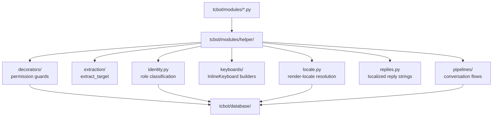

# Helper Package

Shared handler helpers live in `tcbot/modules/helper/`. These modules support command modules and workflow files but do not perform top-level module discovery.

For command modules that consume these helpers, see [`modules.md`](modules.md).
For conversation flows, see [`workflows.md`](workflows.md). For database
helpers used by these helpers, see [`database.md`](database.md).



## `decorators/`

Decorators provide authorization, handler-level rate limiting, and debug tracing.

| Decorator/helper | Purpose |
|---|---|
| `ratelimiter(throttle)` | Per-handler sliding-window user throttle backed by Redis sorted set when available; falls back to in-process sliding window. Use as the outermost command decorator and pass one of the shared `THROTTLE_*` tiers. The current Founder (cached owner ID, 300 s TTL) bypasses per-handler quotas so incident response never stalls; everyone else shares the same bucket. |
| `log_execution` | DEBUG-level entry/exit/exception tracing. Use as the innermost decorator. |
| `owner_only` | Founder-only commands. |
| `staff_only` | Founder/Admin commands. |
| `mod_only` | Developer+ commands, such as ban and unban. |
| `basic_mod_only` | Tester+ commands, such as kick, mute, and warn. |
| `global_rate_limit_handler` | Universal rate limiter registered by `__main__.py` at group `-1`. Uses `_AsyncRateLimiter` (Redis sorted-set + in-process fallback) for both command and callback-query buckets. The Founder bypasses both buckets; plain chat messages are never limited. |

### Throttle tiers

`Throttle(limit, period)` is the single owner of the per-handler budgets. Every command module draws its tier from this table instead of declaring its own constants, so two handlers that mean the same thing throttle the same way.

| Tier | Budget | Used by |
|---|---|---|
| `THROTTLE_READ` | 8 calls / 30 s | Read-only commands (`/help`, `/stats`, `/tcgroups`, the warn listing). |
| `THROTTLE_CALLBACK` | 15 presses / 30 s | Buttons that only open a view. |
| `THROTTLE_CALLBACK_DEEP` | 20 presses / 30 s | Buttons that open a paginated drill-down. |
| `THROTTLE_STAFF` | 10 calls / 30 s | Staff commands that change federation state. |
| `THROTTLE_MODERATION` | 5 calls / 60 s | Destructive moderation commands (ban, kick, mute, warn, unban). |
| `THROTTLE_FEDERATION` | 3 calls / 60 s | Federation-wide commands that fan out over every group. |
| `THROTTLE_BULK` | 3 calls / 300 s | Bulk commands that run for minutes. |
| `THROTTLE_CRITICAL` | 1 call / 300 s | A single destructive operation per window. |
| `THROTTLE_SWEEP` | 2 calls / 300 s | The scheduled federation sweep. |

The Redis key already carries the handler name, so two handlers on the same tier keep independent buckets.

### Rate limiter backend

`_AsyncRateLimiter` backs the global `_cmd_limiter` (8 calls / 30 s), `_cbq_limiter` (20 presses / 10 s), and each `ratelimiter()` per-handler instance:

- **Redis available**: atomic Lua script on a sorted-set key `rl:{prefix}:{uid}`. Expired entries are purged each check via `ZREMRANGEBYSCORE`. State survives bot restarts, so the quota is consistent across restarts (including the 24/7 runner cycle in `.github/workflows/run-bot.yml`).
- **Redis absent or error**: transparent fallback to `_RateLimiter` (in-process `deque`-based sliding window). Rate limiting is never silently disabled; the fallback is logged at DEBUG level.
- **Founder exemption**: `_is_exempt(uid)` compares against the cached owner ID before any bucket check, in both the global handler and every per-handler wrapper. A failed lookup means not exempt (fail-closed, throttling stays on); cancellation propagates. Per-handler quotas are graduated by cost: reads 8-10 calls / 30 s, moderation writes 3-5 calls / 60 s, bulk actions 1-3 calls / 300 s, callbacks 15-20 presses / 30 s.
- **Staff global tier**: `_throttle_tier(uid)` resolves the flood ceiling for commands in one cached role read: Founder skips it, Tester and above share `_cmd_staff_limiter` (16 calls / 30 s), everyone else uses `_cmd_limiter` (8 calls / 30 s). A failed lookup lands on the strict bucket; cancellation propagates. Per-handler quotas still pace each destructive command, and the callback bucket (20 presses / 10 s) is unchanged for all tiers.
- **One retry voice**: every rejection (global command, global callback, per-handler message, per-handler callback) replies with `replies.rate_limit_text(wait, locale, plain=True)`, so throttled users see identical wording regardless of which bucket stopped them. The text clamps to a minimum of 1 second so sub-second waits never render as "try again in 0 seconds".

Typical command decorator order:

```python
@decorators.ratelimiter(decorators.THROTTLE_MODERATION)
@decorators.mod_only
@decorators.log_execution
async def cmd_example(update, ctx): ...
```

## `formatter.py`

Removed: formatting helpers live only in `tcbot/utils/formatter.py` (the single source of truth) and every caller imports from there directly. There is no helper-layer copy.

All bot messages use Telegram MarkdownV2 parse mode. Functions are documented in full
in [`utilities.md#formatterpy`](utilities.md).

| Function | Output/use |
|---|---|
| `esc(text)` | Escape user-provided text. |
| `bold(text)` | `*...*` with escaped content. |
| `italic(text)` | `_..._` with escaped content. |
| `code(text)` | `` `...` `` with escaped content. |
| `pre(text)` | ` ```...``` ` monospace block with escaped content. |
| `link(text, url)` | MarkdownV2 link. Escape or validate URLs before passing untrusted values. |
| `user_ref(user_id, name, username=None)` | ID-based mention, always a clickable `FullName` resolving via `tg://user?id=...`; usernames are never used. Falls back to the numeric ID as link text when the name is the numeric fallback. Sole name in the formatter (the old `mention()` alias was removed). |

Use `esc()`, `code()`, or `user_ref()` for any user-provided value in MarkdownV2 messages. Use `user_ref()` in action summaries and audit logs where the name links to the numeric user ID.

## `extraction/`

Target resolution for moderation commands.

| Export | Purpose |
|---|---|
| `extract_target(update, args, bot=None, *, prefer_explicit=False)` | Resolves targets; returns `tuple[int, str]` (user_id, fname) on success or `tuple[None, None]` on failure. Priority: reply to sender_chat-aware (channel senders are refused: they are not actionable user IDs, so resolution falls through to args/entities) → args (ID/username) → args (partial name search in DB) → text mentions → @mentions. One exception: a typed numeric ID or `@username` that verifies as a real user different from the quoted sender overrides the reply (deliberate intent beats quote context); anything unverified or fuzzy keeps the reply. With `prefer_explicit=True` (read-only `/check`), any resolving arg wins and only a miss falls back to the reply. Numeric IDs take a cache fast path (IDs are immutable, so a real cached name skips the live `get_chat` round trip); bare-numeric and legacy `User <id>` fallbacks fall through to the live lookup. |
| `extract_mod_target(update, args, bot=None)` | Single owner of moderation target resolution plus the consumed-or-reason decision, used by the ban, kick, mute, and warn entries. Returns `(hit, consumed)`: `consumed` is true when `args[0]` named the target (classic no-reply path, or the verified-override path), so entries drop it from the reason; otherwise the reply stands and `parse_inline_reason` still strips a restated ID via `reply_target_id`. |
| `reply_uid(msg)` | Returns the quoted user/channel ID for a reply, skipping the anonymous-admin placeholder, the Telegram service account, and channel posts. Public so command modules share the exact reply-target decision without reaching into a private helper. |
| `sync_user_identity(bot, target_id)` | Full sync protocol for detail views: cached read, live verify, update on mismatch. The older gap-fill-only `resolve_user_identity` was removed once every consumer used `sync`; its logic lives on inside `sync_user_identity` and `_fetch_live_identity`. |

**Resolution priority for `extract_target()`:**
1. **Reply** - Most common use case, checked first (a verified typed ID/`@username` naming someone else overrides it; `/check` prefers any resolving arg)
2. **Args with full info** - Numeric ID or @username
3. **Args with partial info** - Searches users_cache by name (e.g., `/check John` finds users with "John" in their name); read-only callers only, moderation paths never fuzzy-match
4. **Text mention entity** - Direct user mention in message
5. **@Mention entity** - Username mention in message

This priority order makes reply-based targeting more natural while adding support for partial name searches.

## `locale.py`

Render-locale resolution shared by handlers, callbacks, and flows. Every entry point resolves one locale per outgoing message so a shared audience reads one language.

| Export | Purpose |
|---|---|
| `effective_locale(chat_type, user_id, chat_id)` | Resolves the render locale for a message: private chats read the sender's `user_settings` row, group-like chats read the group's `federated_groups.locale`. Only the locale the chat type consumes is read, so each resolution costs one lookup instead of two; a failed read degrades to `None` (falls through to the default) and never raises. |
| `locale_for_update(update)` | Convenience wrapper using `update.effective_chat` / `update.effective_user`; missing chat or user falls back to `DEFAULT_LOCALE`. |
| `locale_for_user(user_id)` | Personal locale for a DM to one user (ban notices, appeal updates), independent of any chat. |
| `locale_for_chat(chat)` | Group locale when no `Update` is available (join/leave events carry the chat directly). Reads only the group row. |

All resolution funnels through `tcbot.utils.i18n.resolve_locale`, which applies explicit precedence and never raises; see [`utilities.md#i18npy`](utilities.md). Chat-type to scope mapping lives once in `language._chat_scope` (used by the language panel and its callbacks).

## `keyboards/`

All inline keyboard factories live here. Command modules and workflows should import keyboard factories instead of constructing repeated keyboard layouts inline.

Main groups:

| Factory group | Examples |
|---|---|
| Ban/checking | `ban_log_kb(target_id, proof_link, appeal_url, locale=None, *, previous_proof_link=None)` (ban-log proof/appeal buttons, one per row; the update flow adds the previous-proof row), `ban_update_confirm_kb(log_url, proof_url, locale=None)` (re-ban confirmation: View Log / View Proof URL buttons plus Cancel / Continue), `appeal_button_kb`, `checkme_ban_kb`, `checkme_detail_back_kb` |
| Proof | `action_proof_kb(target_id, proof_link)` - single "Proof {target_id}" URL button; returns `None` when `proof_link` is falsy. Used by mute/kick/warn executors after uploading proof. |
| Admin roles | `promote_role_kb`, `demote_confirm_kb`, `promo_decision_kb` |
| Menus/help | `main_menu_kb`, `group_start_kb`, `help_topics_menu_kb`, `help_topics_kb`, `back_to_start_kb`, `back_to_help_kb`, `back_to_help_cmd_kb`, `module_help_kb`, `back_to_module_kb`, `additional_menu_kb` |
| Privacy | `privacy_kb`, `privacy_policy_sections_kb`, `back_to_privacy_policy_kb` |
| Groups | `groups_menu_kb`, `tcgroups_kb` |
| Stats | `stats_main_kb`, `stats_back_kb`, `stats_list_kb`, `stats_search_panel_kb`, `stats_search_results_kb`, `stats_search_row` |
| Check | `check_back_row`, `check_warns_back_row`, `check_back_markup`, `check_paged_markup`, `check_warn_groups_kb`, `check_profile_kb` |
| Paging | `nav_row` - the `[« Prev]` / `[Next »]` row for paged views |
| Flow steps | `reason_step_kb`, `proof_step_kb`, `connect_join_kb` - owned here; `BuildReason.keyboard()`, `BuildProof.keyboard()`, and `BuildConnection.join_keyboard()` stay as thin delegating steps so existing call sites keep working. The flow modules call these builders directly; there is no second wrapper layer. |
| Paginated drill-downs | `paged_drill_kb(items, *, page, total_pages, nav_prefix, back_callback, extra_rows=None, per_row=3, locale=None)` - numbered drill-in grid plus nav row, back button, and optional extra rows. Single owner for the numbered-grid look (the one place numbered buttons gain their PRIMARY style), replacing local copies in the stats and check drill-downs. The `« Prev` / `Next »` labels come from `button.prev` / `button.next` in the view locale; the row primitive itself lives in `tcbot/modules/helper/keyboards/nav.py` (`nav_row`, also locale-aware), because it builds Telegram buttons rather than page maths. |
| Language menu | `language_list_kb(scope, items, *, back_label=None, back_callback=None, selected=None, locale=None)` - one row per locale button from `(display_name, locale_code)` pairs, each sending `lang:set:<scope>:<locale>`. The currently selected locale is prefixed with `✓` (a plain check character, not an emoji); the optional Back row sends `back_callback` verbatim. The Back label renders from `button.back` in `locale` unless `back_label` overrides it. |

See [keyboard styles](../reference/keyboard-styles.md) for layout, color, and callback-data conventions (semantic `style`: `SUCCESS` for Approve, `DANGER` for Reject/destructive Confirm, `PRIMARY` for continue/select steps; everything else neutral).

## `identity.py`

`identity.classify(bot, executor_id, target_id, target_fname, *, target_is_bot=None)` returns an `Identity` dataclass that classifies a moderation target as one of: `self`, `this_bot`, `other_bot`, `telegram`, `anon_admin`, `founder`, `admin`, `developer`, `tester`, `user`. Pass `target_is_bot=True` to skip the Telegram bot lookup when the caller already knows the target is a bot. The name and role cache reads run in parallel; a role-lookup failure degrades to `user` (fail open, callers pair it with a fail-closed role read) while cancellation always propagates. `identity.verify_not_bot(update, target_id, bot)` returns `True` for a verified human, `False` for a verified bot, and `None` when indeterminate; ownership transfer fails closed on `None` while promotion keeps the best-effort `is_proven_bot` wrapper that treats unknown as allowed.

The `Identity` dataclass now includes:
- `kind`: The identity type
- `target_id`: User ID
- `fname`: First name
- `username`: Optional username display metadata (mention rendering always uses the numeric ID `tg://user` link; usernames are ignored by `user_ref`)
- `is_bot`: Boolean flag

The companion helpers `identity.refuse_message(action, ident, locale=None)`, `identity.staff_notice(action, ident, community_name, locale=None)`, and `identity.profile_note(ident, locale=None)` produce the witty refusal lines, staff heads-up notices, and recognition notes respectively. `refuse_message` gates every moderation entry handler; `staff_notice` is used by the warn/unwarn/resetwarns/unmute paths, where the action proceeds on staff targets with a heads-up instead of refusing or auto-demoting; `profile_note` returns a short recognition note for special identities (`this_bot`, `self`, `telegram`, `anon_admin`) on read-only views such as `/check`, or `None` for identities that need no note.

Every moderation command (ban, kick, mute, warn, unban, unmute, promote, demote) must call `identity.classify` once and route through `refuse_message` instead of inlining `target_id == ctx.bot.id` / `user.id == owner_id` / role-string branches. Refusal copy lives in `identity.py` so the bot's voice stays consistent across the whole project.

## Permission helpers in `guards.py` and `targets.py`

The `decorators/` package holds only decorators: the federated-tier guards, the rate limiters, and the execution tracer. The permission helpers live next to it, split by the question they answer. `guards.py` answers "may the executor act, and on whom?"; `targets.py` answers "who is the target?".

| Export | Purpose |
|---|---|
| `resolve_and_check(msg, executor_id, target_id, min_role=...)` | Resolves executor and target roles, checks minimum executor rank, checks executor outranks target, and replies on failure. Both roles are read fresh, so the check never depends on a decorator having run first. Role lookup errors fail closed and do not become a no-role result. |
| `enforcement_verdict(executor_id, target_id, *, min_role)` | Re-checks the executor at enforcement time: both roles are read fresh, the executor must still hold `min_role`, and the executor must still outrank the target, exactly like `resolve_and_check` does at entry. Returns `(EnforcementVerdict, role_label)` where the verdict is `ALLOWED`, `OUTRANKED`, `RANK_INSUFFICIENT`, or `LOOKUP_FAILED`; a lookup failure and a lost tier fail closed. A cancelled read propagates instead of reading as a refusal. |
| `enforcement_refusal(executor_id, target_id, *, min_role, action, locale)` | Single owner of the enforcement-time gate: the verdict, the refusal log line, and the notice text. Returns the notice when the action may not proceed and `None` when it may. The four moderation executors call it instead of re-implementing the check. |
| `enforcement_refusal_text(verdict, target_label, locale)` | Renders a verdict as its refusal notice. |
| `outranks(executor_role, target_role)` | Single owner of the outrank comparison. Equal rank is refused, so a peer can never act on a peer. |
| `required_rank(min_role)` | Rank of the tier an executor must hold. An unknown tier name resolves to the highest rank, so a mistake can only refuse an action. |
| `staff_access(user_id, *, min_role)` | Staff-tier check for the panes that gate on the owner id as well. Returns `StaffAccess.ALLOWED`, `DENIED`, or `LOOKUP_FAILED`; a lookup failure is reported apart from a refusal so the caller can ask for a retry. |
| `recheck_executor_rank(msg, executor_id, *, min_role)` | Re-verifies the executor still meets `min_role` at enforcement time (Done/Skip/Continue taps): a mid-window demotion blocks enforcement fail closed. Returns `True` when the tap may proceed, `False` after replying on failure. |
| `classify_and_check(bot, admin_id, target_id, target_name, msg, *, action, min_role, target_is_bot=None)` | Shared identity classification plus executor-vs-target rank validation for the kick/mute/warn entries: parallel reads, fail closed with the refusal reply already sent. Returns `(ident, target_role)` or `None`. |
| `check_callback_staff(admin_id, q, update, *, min_role="admin")` | Re-checks the staff rank in parallel with `q.answer()`; returns the role or `None` after editing the perm-expired notice. The rank table decides the threshold, so a tier that joins it takes part in the gate. |
| `check_callback_executor(update, q, admin, *, min_role="admin")` | Refuses the anonymous-admin placeholder, then runs `check_callback_staff`. Every admin callback uses it, so the placeholder can never reach a tier check that only happens to reject it by rank. |
| `prompt_owner_mismatch(q, update, *, min_parts, key)` | Alert-denies a prompt tap from anyone but the recorded opener (new callbacks carry `{...}:{executor}`; legacy taps without the segment keep working). `cancel_owner_mismatch` and `action_owner_mismatch` are the cancel/action wrappers. |
| `can_demote_admin(executor_role, target_role)` | Demote rank rule: the executor must outrank the target, and demoting an Admin needs the Founder. |
| `banned_target_refusal(target_id, locale, *, log_label)` | Returns a refusal line when the target holds an active ban, `None` when it does not. Used by the promotion paths so a banned user cannot gain federation rank. Fails closed: a failed ban lookup refuses the action. |
| `require_federation_origin(msg, chat_id, chat_type, locale, allow_private=...)` | Enforces that moderation entries originate from a connected group or a primary group (private only when `allow_private` is set for federation-wide entries). A disconnected group, or a private chat where `allow_private` is false, replies with the shared notice and blocks the action; a connection-state outage replies with the database retry notice and blocks (fail closed). |
| `targets.resolve_mod_target(update, ctx, *, action, min_role, allow_private, log_prefix, bot_check=False)` | Shared entry sequence for the ban/kick/mute/warn commands: resolves locale, checks the federation origin, extracts the target, and runs identity plus rank checks, replying and returning `None` on any failure. Returns a `ModTarget` (`msg`, `admin`, `locale`, `target_id`, `target_name`, `has_explicit_target`, `args`, `ident`); callers keep only duty-specific parsing (reason, duration) and conversation setup. `bot_check=True` (warn) runs a verified bot check before classifying. |
| `targets.resolve_staff_target(update, ctx, *, action, min_role, log_prefix, bot_check=True)` | Shared entry sequence for the commands that act once and finish (unwarn, resetwarns, unmute): checks the federation origin, resolves the target, classifies it, and refuses the protected identities. Returns a `StaffTarget` (`target_id`, `target_name`, `ident`, `locale`) or `None` after replying. |
| `targets.run_staff_action(update, ctx, *, action, min_role, log_prefix, execute)` | Runs one single-action moderation command: resolve the target, run the identity and rank checks, emit the staff-action notice, and delegate to the executor. The three commands that act once and finish share it. |
| `targets.resolve_executor_target(msg, admin_id, update, args, bot, *, action, locale=None)` | Shared executor-role plus target fetch for the promote/demote commands: parallel reads, fail closed with a retry reply on outage. Returns `(executor_role, target_id, target_fname)` or `None`. |
| `targets.classify_and_load_role(bot, admin_id, target_id, target_fname, msg, *, action, locale=None)` | Shared identity classification plus live target-role fetch for the promote/demote commands: parallel reads, fail closed. Returns `(ident, current_role)` or `None`. |

Ban, kick, and mute pair this with the enforcement-time demote from `pipelines/demote_flow.py`, which removes the target's role right before the moderation action is applied.

The entry check and the enforcement check are two moments, so the rule is applied twice. The reason and proof steps of a moderation flow stay open for a minute, and a target promoted in that window would otherwise be actioned by a moderator who no longer outranks them. The ban, kick, mute, and warn executors therefore call `enforcement_refusal` before they record anything, so a refused action leaves no audit row, no ban record, no warning counter, and no orphan proof behind. The verdict carries the tier the action needs, so a moderator demoted during the reason or proof window is refused there as well.

## `messages/replies.py`

Shared bot-reply strings and the typed help-entry interface used by multiple command modules. Import with `from tcbot.modules.helper.messages import replies`.

Every reply is now a function of the render `locale`, not a module-level string constant. Functions whose output may be parsed take a required `*, plain` keyword: `plain=True` returns text for contexts Telegram never parses (callback alerts), `plain=False` returns MarkdownV2-escaped text. Section labels and scope bodies are pre-escaped internally (`plain=True` to the catalog) so buttons render them raw while titles escape them via `bold()`.

### `HelpEntry` TypedDict

```python
class HelpEntry(TypedDict):
    name: str  # display name (matches __module_name__)
    overview: str  # one-line or short paragraph overview
    sections: list[tuple[str, str]]  # (section_header, section_body) pairs
```

Each help-bearing module declares exactly one `__help__: replies.HelpEntry = {...}` instead of three separate attributes. `help.py` reads it through the module's `get_help(locale)` builder via `_builder_help()`, which rebuilds the content per request so the topic names and bodies follow the tapper's locale.

### Section constructor helpers

| Helper | Returns | Purpose |
|---|---|---|
| `who_section(perm, locale=None)` | `tuple[str, str]` | Builds a `(sec_who(locale), perm)` section entry. |
| `where_section(ctx, locale=None)` | `tuple[str, str]` | Builds a `(sec_where(locale), ctx)` section entry. |
| `target_section(locale=None)` | `tuple[str, str]` | Builds a `(sec_target(locale), target_syntax(locale))` section entry. |
| `module_help(locale, *, name, overview, commands, who, where, what=None, flow=None, details=(), target=True, examples=None)` | `HelpEntry` | Single owner of the help section order: commands, audience, place, explanation, flow, the module's own detail sections, the target syntax, and the examples. Two modules that mean the same thing therefore render the same shape. |

All command modules that expose user-facing commands use these helpers rather than raw inline tuple literals.

### Reply-text functions

| Function | Purpose |
|---|---|
| `rate_limit_text(wait_s, locale=None, *, plain)` | Single owner for the throttled retry notice. Used by the global limiter and every per-handler `ratelimiter` rejection; the wait is clamped to a minimum of 1 second. |
| `target_syntax(locale=None)` | Usage hint for commands that accept a target argument (V2-escaped). |
| `no_reason(locale=None, *, plain)` | Default fallback text when no moderation reason is supplied. |
| `err_cannot_resolve(locale=None, *, plain)` | Error when the target cannot be resolved (covers "no target provided" and "unresolvable"). Used by all command modules at `extract_target` return sites. |
| `err_role_verify` / `err_group_only` / `err_no_connected_groups` / `err_group_not_found` / `err_groups_load_failed` / `err_db_retry` / `err_perm_expired` / `err_unknown_role` (`locale=None, *, plain`) | Role-verification, group-only, empty-federation, unknown-group, group-load-failure, DB-retry, expired-permission, and unknown-role notices respectively. |
| `perm_founder_only` / `perm_staff_only` / `perm_dev_above` / `perm_tester_above` (`locale=None, *, plain`) | Permission hints: Founder only, TC Staff, Developer or above, Tester or above. |
| `context_bot_or_group` / `context_anyone` / `where_connected_group` (`locale=None`) | Context-guard and scope bodies for help "Where" sections (V2-escaped). |
| `sec_commands(locale=None)` | Help-text section header: `Commands & Aliases`. |
| `sec_who(locale=None)` | Help-text section header: `Who can use`. |
| `sec_where(locale=None)` | Help-text section header: `Where to use`. |
| `sec_what(locale=None)` | Help-text section header: `What it does`. |
| `sec_examples(locale=None)` | Help-text section header: `Examples`. |
| `sec_target(locale=None)` | Help-text section header: `Target syntax`. |

Command modules import from `replies.py` instead of inlining these strings.

## `ban_info.py`

| Function | Purpose |
|---|---|
| `build_ban_detail(ban, target_fname=None, locale=None)` | Returns `(formatted_text, proof_link_or_none)` MarkdownV2 ban details and an optional proof link. Shared by the checking and stats flows. |
| `build_ban_summary(ban, user_id, user_fname, admin_fname=None, locale=None)` | Returns the compact `/checkme` ban card and its proof link. The display names arrive resolved; only the usernames are read here. |
| `ban_proof_link(ban)` | The proof message link of a ban record, or `None`. Single owner for the proof channel and thread. |
| `ban_date_text(ban, locale=None)` | The ban timestamp for display, or the unknown-date notice. |

## `messages/links.py`

Telegram link builders. The three functions are re-exported by the `messages` package, so call sites use `from tcbot.modules.helper.messages import message_link` (and the same for the other two).

| Function | Purpose |
|---|---|
| `chat_id_to_link_id(chat_id)` | Converts Telegram supergroup IDs to `t.me/c` path IDs. |
| `message_link(chat_id, message_id, thread_id=None)` | Builds a private-channel/group message link; pass `thread_id` for topic threads. |
| `appeal_deep_link(bot_username, ban_id)` | Builds `https://t.me/<bot>?start=appeal_<ban_id>`. |

## `scope.py`

Owner of the per-conversation payload scope used by every moderation flow.

| Function | Purpose |
|---|---|
| `conversation_key(update)` | The `(chat_id, user_id)` key python-telegram-bot builds for a conversation registered `per_chat=True, per_user=True`. `None` when the update carries no chat or no user. |
| `flow_scope(ctx, update)` | The payload dict owned by that conversation. Created on first use and stored under one key of `ctx.user_data`, so it disappears with that user's data. |
| `clear_flow_scope(ctx, update, *, keys=None)` | Drops the payload of that conversation. `keys` limits the removal to the named payload keys; without it the whole payload goes. The scope entry, and the scope map itself, are removed once they hold nothing, so `ctx.user_data` keeps one entry per chat a user still has an open action in. |

python-telegram-bot keys `ctx.user_data` by user id alone, so one dict is shared by every chat a user is in. The moderation conversations are registered `per_chat=True, per_user=True`, so a payload kept directly in `ctx.user_data` belongs to two conversations at once: a moderator who starts a second action in another group overwrites the target, the reason, and the prompt of the first one, and the first group then enforces against the second target. Flows therefore read and write their payload through `flow_scope(ctx, update)`, never through `ctx.user_data` directly.

## `messages/`

This package owns message sending and editing plus MarkdownV2 audit-log building for moderation, appeals, staff roles, group connections, broadcasts, and auto-demotions. `messages/safe_edits.py` holds the safe-edit transport (`safe_edit`, `safe_edit_cb`, `safe_edit_message`, `clear_markup_cb`, `answer_and_edit`, `ack_and_render`, `safe_reply`), the callback-refusal notice (`cb_error_edit`), the federation log delivery (`send_log`), and the callback-payload parsers (`callback_args`, `callback_numbers`, `callback_args_optional`); `messages/audit_logs.py` holds `LogBuilder` and every audit-log builder; `messages/links.py` holds the Telegram link builders; `messages/panels.py` holds the informational panel renderers (`about_msg`, `render_groups`) that the start menu and their own commands share; `messages/replies.py` holds the shared reply strings and the `HelpEntry` shape. The package `__init__.py` re-exports the transport, audit-log, link, and panel surfaces, so `from tcbot.modules.helper.messages import safe_reply` keeps working. The reply strings stay a module (`from tcbot.modules.helper.messages import replies`) because they form a namespace of forty notices rather than a flat surface.

The panel renderers live here rather than in their command modules so the start menu and the commands reach the same renderer. A command module importing another command module would create a cycle in the making and would defeat `MODULES_NO_LOAD`, which stops a module from registering its handlers but not from being imported.

`cb_error_edit(q, text, *, log_label, parse_mode="MarkdownV2", log_level="debug")` is the single owner of the "a tap was refused" shape: it drops the keyboard so the button cannot be pressed again, logs the failure at debug level because a refusal is a normal outcome, and swallows a generic error so one broken edit never fails a handler. `parse_mode` follows the same convention as `safe_edit_cb`: MarkdownV2 by default, and `None` for text produced with `t(..., plain=True)`. The two must match, because a plain-text notice sent as MarkdownV2 fails to parse and never reaches the user, while a MarkdownV2 notice sent as plain text shows the escape backslashes.

Audit-log families:

- `ban_log`, `ban_update_log`, `proof_caption_new`, `proof_caption_update`;
- `mute_log`, `unmute_log`, `kick_log`, `warn_log`, `unwarn_log`, `unban_log`;
- `appeal_received_log`, `appeal_submitted_log`, `appeal_approved_edit`, `appeal_rejected_edit`, `appeal_unban_log`;
- `promoted`, `demoted`, `ownership_transferred`, promotion request logs (`promote_request_log`, `promote_approved_log`, `promote_rejected_log`);
- `group_connected_log`, `group_connection_rejected_log`, `group_disconnected_log`, `group_bot_removed_log`;
- `broadcast_log`.

Use the `LogBuilder` class in this module to compose new audit-log messages; avoid hand-rolled f-strings so layout stays consistent.

| Function | Purpose |
|---|---|
| `safe_edit(msg, text, **kwargs)` | Edit a `Message` object with `parse_mode="MarkdownV2"`; swallows harmless `BadRequest` cases such as `message is not modified`, `message to edit not found`, and `chat not found`. Unexpected failures are logged as warnings. |
| `safe_edit_cb(q, text, **kwargs)` | Edit a `CallbackQuery` message via `q.edit_message_text`; same error-swallow policy as `safe_edit`. Use when a user can re-tap a button that lands them on the same content to avoid `BadRequest: message is not modified` noise. |
| `clear_markup_cb(q)` | Remove the inline keyboard from a callback-query message via `q.edit_message_reply_markup(reply_markup=None)`. Editing message text without `reply_markup` keeps the old buttons (the parameter is omitted from the API call), so ending a flow with only an edit would leave dead buttons behind; call this after the edit. Treats a `message is not modified` error as already-removed. |
| `safe_reply(msg, text, *, log_label="reply", parse_mode="MarkdownV2", **kwargs)` | Fire-and-forget `Message` reply with debug-only failure logging; `log_label` names the call site. The single owner for all fire-and-forget replies across commands and workflows. Defaults to `parse_mode="MarkdownV2"`; pass `parse_mode=None` for plain-text replies (error strings, constants) so Telegram performs no entity parsing. Sites whose failure drives control flow (prompt cleanup, wedged-conversation guards) stay raw. |
| `answer_and_edit(q, text, **kwargs)` | Answer a callback query and edit its message in parallel; cancellation propagates. |
| `ack_and_render(q, data_coro)` | Answer the query while the data coroutine runs, then edit with the rendered `(text, kb)`; data failures leave the message untouched and cancellation propagates. |
| `send_log(bot, text, **kwargs)` | Post a federation audit log to the configured `cfg.logs` destination as MarkdownV2 in the configured thread. Single owner for the log delivery contract, so every federation executor posts its audit log the same way. |
| `callback_args(q, count)` | Split the callback payload into exactly `count` colon-separated segments, dropping the leading prefix. `None` when the payload is missing or has a different shape. |
| `callback_numbers(q, count)` | The same shape contract, with every segment parsed as an integer. `None` when the payload is malformed. |

## Helper usage rules

- Keep user-facing MarkdownV2 escaped.
- Keep keyboard callback-data stable because handlers match it with regex patterns.
- Do not duplicate role checks that already exist in `users_roles` or `guards.resolve_and_check`.
- Do not create keyboard factories outside `keyboards/`. Flow step classes keep thin delegating methods over the same builders. The only markup outside is the locale-aware `nav_row()` row primitive in `tcbot/modules/helper/keyboards/nav.py`, consumed through `paged_drill_kb()` or directly with an explicit locale.
