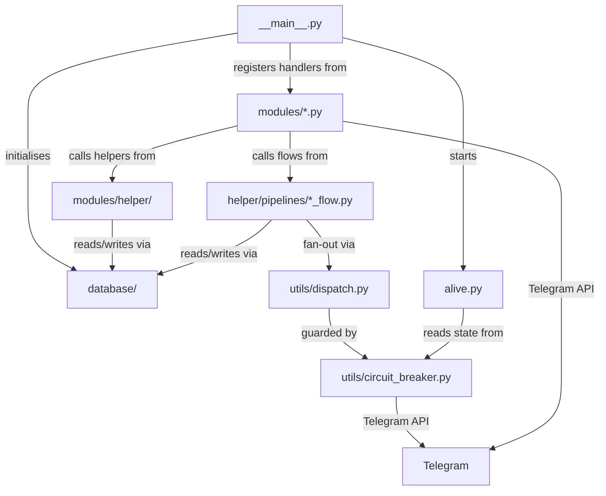
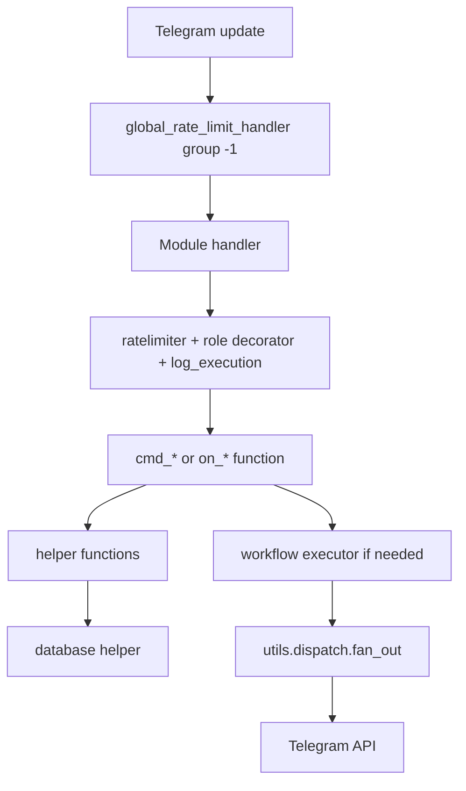

# Repository Map

For the project overview, see [`../../README.md`](../../README.md). For the
documentation index, see [`../README.md`](../README.md). For module breakdown,
see [`modules.md`](modules.md). For the database layer, see
[`database.md`](database.md). For shared helpers, see [`helpers.md`](helpers.md).
For runtime utilities, see [`utilities.md`](utilities.md). For contribution
workflow, see [`../../CONTRIBUTING.md`](../../CONTRIBUTING.md).

This page maps the repository structure and the service boundaries between packages.

## Top-level layout

```text
<project root>/
├── tcbot/                  Main Python package
├── api/                    Vercel serverless endpoints (webhook, cron)
├── docs/                   Documentation grouped by purpose
├── i18n/                   Translation catalogs (en-US source, id-ID mirror)
├── tests/                  Pytest test suite
├── .github/                GitHub Actions workflows + dependabot config
├── .agents/                Maintainer and agent rules
├── pyproject.toml          Dependencies and Ruff config
├── pyrightconfig.json      Pyright type checker configuration
├── uv.lock                 Locked dependency graph
├── vercel.json             Vercel functions, timeouts, and cron schedule
├── .python-version         Pinned Python for Vercel and uv (3.14)
├── config.env.example      Environment variable template
├── README.md               Project overview
├── CONTRIBUTING.md         Contribution workflow and review checklist
├── AGENTS.md               Maintainer and agent project guide
├── CLAUDE.md               Symlink to AGENTS.md
├── SECURITY.md             Security policy
├── replit.md               Replit deployment notes
├── CHANGELOG.md            Version history
├── docker-compose.yml      Bot + PostgreSQL + Redis local stack
├── alembic.ini             Alembic migration configuration
├── alembic/                Alembic environment and versioned migrations
└── Dockerfile              Container image
```

Repository maintenance guidance lives under `.agents/`. Its six canonical
rule files are `rules/code-style.md`, `rules/comment-style.md`,
`rules/docs-sync.md`, `rules/changelog-style.md`, `rules/security-rules.md`,
and `rules/asyncio-gather-rules.md`.

## Documentation structure

| Category | Scope |
|---|---|
| `getting-started/` | Local, Docker, and hosted setup instructions. |
| `architecture/` | Repository boundaries, modules, database, helpers, utilities, and workflow internals. |
| `features/` | User-visible flows and detailed moderation, role, appeal, and statistics behavior. |
| `operations/` | Backup and restore, CI/CD, and performance guidance. |
| `reference/` | Stable UI and callback conventions such as keyboard styles. |

## Runtime package map

```text
tcbot/
├── __init__.py             Config loader, env parsing, immutable Configs model
├── __main__.py             App lifecycle, builder, errors, and main startup
├── error_reporter.py       Telegram error classification and shipping to LOGS_ERRORS
├── alive.py                Flask health endpoint and webhook receiver
├── serverless.py           Vercel lifecycle: shared PTB app, update dispatch, cron expiry
├── database/
│   ├── base/               Table, column, constraint, and index definitions (schema source of truth)
│   │   ├── identity.py       Telegram users, chats, membership, connected groups, join requests
│   │   ├── settings.py       Group and user configuration
│   │   ├── community.py      The community profile singleton
│   │   ├── rbac.py           Role catalog, permission catalog, role assignments, promotion requests
│   │   ├── rules.py          Rule sets, versions, items, acknowledgements
│   │   ├── moderation.py     Cases, actions, appeals, messages, evidence
│   │   ├── enforcement.py    Enforcement runs, targets, attempts
│   │   ├── automation.py     Automation policies, versions, events, runs, steps
│   │   ├── broadcast.py      Broadcast campaigns, targets, attempts
│   │   ├── jobs.py           Scheduled job registry, job runs, retention policies, erasure queue
│   │   └── runtime.py        MTProto state and the APScheduler job table
│   ├── schema/             The SQL objects SQLAlchemy cannot express
│   │   ├── views.sql          The derived views of the community
│   │   ├── functions.sql      The functions, including the authorization primitive
│   │   ├── triggers.sql       The triggers that protect the invariants
│   │   ├── policies.sql       The row-level security policies
│   │   └── seed.sql           The role, permission, retention, and job reference data
│   ├── engine.py            Async engine, session boundary, circuit-breaker guard, query helpers
│   ├── connection_options.py libpq search_path and UTC options shared by every engine
│   ├── migrations.py        Alembic wiring: applies the pending revisions at startup
│   ├── bans_db/             Federation ban decisions and their appeal lifecycle
│   │   ├── _queries.py         Reads: active ban, ban by reference, per-user history
│   │   ├── _writes.py          Writes: create, update, review slot, appeal, decision
│   │   └── _compose.py         Joins a decision with its messages and appeals
│   ├── moderation_db.py     Shared write path of the decisions: case, proof, closing
│   ├── groups_db.py        Connected groups, group configuration, join requests
│   ├── users_cache.py      Telegram identity cache operations
│   ├── users_roles.py      Role assignments, effective-role resolution, the permission catalog
│   ├── warns_db.py         Warning decisions and the per-group counters
│   ├── kicks_db.py         Kick decisions and the per-user history
│   ├── mutes_db.py         Mute decisions and the live active-mute view
│   ├── queues_db.py        Promotion request queue
│   ├── cache/              TwoLevelCache: codec, L1 memory, Redis boundary, singletons, twolevel
│   ├── redis_client.py     Optional async Redis client (owns the connect/degrade decision)
│   ├── scheduler.py        APScheduler background jobs (SQLAlchemyJobStore)
│   ├── mtproto.py          Bot-token MTProto client: resolve + member harvest
│   ├── mtproto_store.py    PostgreSQL-backed Kurigram storage engine
│   ├── settings_db.py      Per-user settings (locale and timezone preferences)
│   ├── documents.py        TypedDict document shapes
│   └── types.py            NewType ID primitives
├── modules/
│   ├── __init__.py         Dynamic module discovery and handler collection
│   ├── *.py                Command and callback modules
│   └── helper/
│       ├── ban_info.py     Ban detail renderer
│       ├── decorators/     Auth, per-handler rate limits, tracing
│       ├── guards.py       Permission gates: may the executor act, and on whom
│       ├── targets.py      Target resolution: who the command acts on
│       ├── extraction/     Target resolution and live identity refresh
│       ├── identity.py     Identity classification, group-permission checks, refusal messages
│       ├── keyboards/      Inline keyboard factories
│       │   └── nav.py         Previous/next row for paged views
│       ├── locale.py       Render-locale resolution shared by handlers, callbacks, flows
│       ├── messages/       Safe edits, channel delivery, and federation log renderers
│       │   ├── safe_edits.py    Safe-edit transport helpers
│       │   ├── audit_logs.py    Audit-log builders (LogBuilder + per-event logs)
│       │   ├── links.py         Telegram link builders (`t.me/c/...`, appeal deep links)
│       │   └── replies.py       Shared localized reply and help-text strings, HelpEntry shape
│       ├── scope.py        Per-conversation payload scope for the moderation flows
│       └── pipelines/
│           └── *_flow.py modules   Conversation factories, plus Promote / Demote / Check classes
└── utils/
    ├── circuit_breaker.py  Async circuit breaker for Telegram + PostgreSQL
    ├── dispatch.py         Bounded concurrent fan-out (integrates Telegram circuit)
    ├── formatter.py        MarkdownV2 escaping and formatting (single source of truth)
    ├── i18n.py             TOML locale catalogs, lookup, and interpolation
    ├── logger.py           Console formatter and error log handler
    ├── pagination.py       Shared clamp_page() page arithmetic
    ├── prefixes.py         Prefix parsing and command filters
    ├── secrets.py          Constant-time secret comparison for inbound credentials
    ├── tasks.py            Background task lifecycle owner (TaskTracker)
    ├── time_and_date.py    Central clock: UTC store/display + measure + durations + date_or_unknown()
    ├── transport.py        Shared PTB HTTP timeouts, pool size, and lookup budget
    └── update_processor.py Per-conversation update serialization for PTB
```

## Ownership boundaries

| Area | Owns | Must not own |
|---|---|---|
| `tcbot/__main__.py` | App lifecycle, handler wiring, DB init, and webhook transport (polling fallback for local dev only) | Feature business logic |
| `tcbot/modules/*.py` | Command entry points, handler registration, user-facing permissions | Raw SQL writes, duplicate conversation state handlers |
| `tcbot/modules/helper/` | Shared handler helpers and keyboard factories | Top-level command registration |
| `tcbot/modules/helper/pipelines/*_flow.py` | Conversation factories, state transitions, flow executors | Module discovery or `__handlers__` exports |
| `tcbot/database/*_db.py` | Table-specific DB operations | Telegram API calls |
| `tcbot/database/base/` | Table, column, constraint, and index definitions | Telegram API calls, module discovery |
| `tcbot/database/schema/` | Views, functions, triggers, policies, and reference data | Telegram API calls, module discovery |
| `tcbot/utils/` | Runtime infrastructure utilities | Feature-specific moderation policy |



## Startup flow

```mermaid
sequenceDiagram
    participant Proc as uv run python -m tcbot
    participant Config as tcbot.__init__
    participant Main as tcbot.__main__
    participant Alive as tcbot.alive
    participant DB as database.engine
    participant Mods as tcbot.modules
    participant PTB as PTB Application

    Proc->>Config: load env into cfg
    Proc->>Main: call main()
    Main->>Main: setup logging
    Main->>Alive: start Flask health thread
    Main->>PTB: build Application (post_init registered as callback)
    Main->>Mods: get_handlers()
    Mods->>Mods: discover, filter, import modules
    Mods-->>Main: handlers
    Main->>PTB: add handlers and error handler
    Main->>PTB: initialize() + post_init (explicit; not called by PTB in webhook mode)
    Main->>DB: connect() (apply Alembic revisions, create engine, ping)
    par parallel setup
        Main->>DB: ensure_initial_owner()
        Main->>Main: connect Redis (optional)
        Main->>Main: start MTProto (fail fast without API_ID/API_HASH)
    end
    Main->>Main: start APScheduler
    Main->>Main: warm hot caches (background task)
    Main->>Main: attach error_reporter + asyncio exception handler
    Main->>PTB: set_webhook() + get_webhook_info() verify
    Main->>Alive: register_webhook() wire Flask /webhook -> PTB queue
    PTB->>PTB: await updates from Flask webhook receiver
```

## Dynamic module discovery

`tcbot/modules/__init__.py` discovers every top-level `tcbot/modules/*.py` file and every package directory with an `__init__.py`, except `__init__.py` and the `helper/` package. Discovery is sorted for deterministic registration order.

Filtering order:

1. If `MODULES_LOAD` is set, only those module names are loaded. Invalid names cause startup to exit.
2. If `MODULES_NO_LOAD` is set, matching names are removed from the discovered list.
3. `get_handlers()` imports active modules and extends the application handler list with each module's `__handlers__`.

Module names are filenames without `.py`, for example `bans`, `appeals`, or `maintenance`.

## Request handling layers



## Cross-links

- Setup and environment: [Setup guide](../getting-started/setup.md)
- Command modules: [Modules](modules.md)
- Workflows: [Workflow overview](../features/workflow-overview.md) and [Workflow internals](workflows.md)
- Database layer: [Database layer](database.md)
- Shared helpers: [Helper package](helpers.md)
- Runtime utilities: [Runtime utilities](utilities.md)
