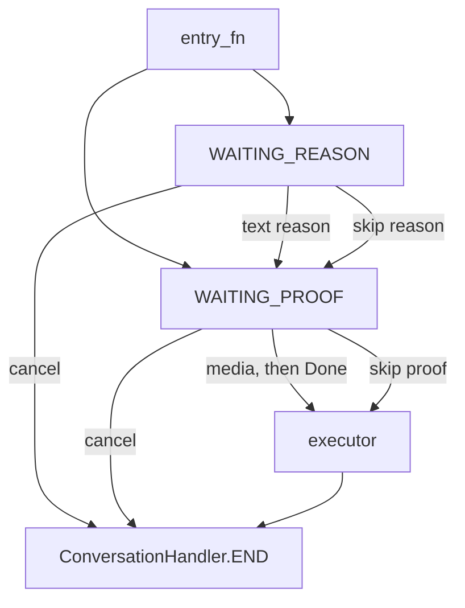
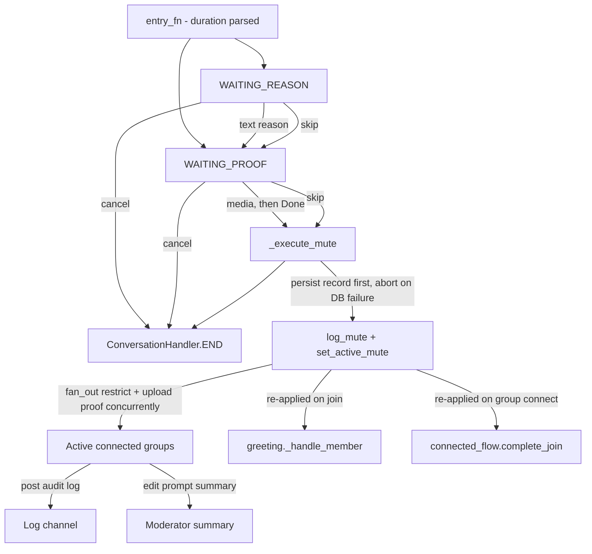
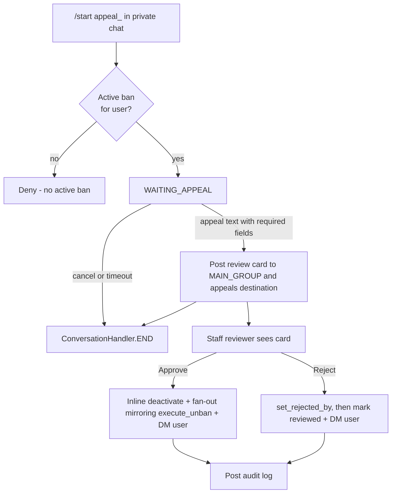

# Workflow Internals

For modules that register these conversation handlers, see [`modules.md`](modules.md).
For shared helpers, see [`helpers.md`](helpers.md). For database helpers
consumed by these flows, see [`database.md`](database.md). For per-feature flow
details, see [`../features/moderation/banning.md`](../features/moderation/banning.md),
[`../features/moderation/warnings.md`](../features/moderation/warnings.md),
[`../features/appeals.md`](../features/appeals.md),
[`../features/roles/promote.md`](../features/roles/promote.md), and
[`../features/roles/demote.md`](../features/roles/demote.md).

Conversation and multi-step logic lives in `tcbot/modules/helper/pipelines/`. Each flow lives as one `*_flow.py` module within the file budget, split into a `*_flow/` package only when a flow outgrows it; do not create `*_conv.py` files.

## Package rules

- Command modules own command filters and `__handlers__` registration.
- Workflow files own state constants, `ConversationHandler` factories, and execution adapters.
- Shared reason/proof logic belongs in `reason_flow.py` and `proof_flow.py` (one module each, under the same budget rule).
- Callback handlers must call `await q.answer()` before doing further work.
- Timeout handling (`cfg.album_debounce`) is a per-action setting; the bot does not use job-queue or `ConversationHandler.TIMEOUT` states. Conversations end via escape commands, cancel, or explicit fallback handlers (e.g. `on_proof_timeout` in `ban_flow.py` fires when the moderator sends a command during the proof window).

## Shared proof builder: `proof_flow.py`

`BuildProof` builds proof-step keyboards and messages.

| Export | Purpose |
|---|---|
| `BuildProof(action, skip_allowed=True)` | Configures proof buttons and prompts for an action. Labels come from `button.skip`/`button.cancel` catalog keys. |
| `BuildProof.keyboard()` | Returns `[Skip] [Cancel]` when skipping is allowed, otherwise `[Cancel]`. |
| `BuildProof.step_prompt(...)` | Prompt after an in-conversation reason. |
| `BuildProof.noted_prompt(...)` | Prompt when a reason was provided inline. |
| `upload_proof(bot, msgs, caption, proof_chat, proof_thread)` | Uploads proof media and returns the first uploaded message ID. Photos and videos travel as one media group (caption on the first item); GIFs and files are sent individually after the gallery. Returns `None` fast without Telegram I/O on empty input or a batch with no usable item; a failed gallery falls through to the document loop, and a failed document is logged and skipped. |
| `upload_proof_media(bot, msgs, caption)` | Single owner for the "upload the proof and remember where it landed" step. Reads the destination from the configured proof channel, returns a `ProofUpload` (`message_id`, `link`), and never raises: a proof that could not be stored must not void the moderation action. |
| `upload_proof_for_action(bot, msgs, target_id, admin_id, admin_fname)` | The same, with the standard caption that names the target, the acting staff member, and the time. Used by the kick, mute, and warn executors. |
| `ProofUpload.landed` | True when at least one proof message reached the channel. The ban executor requires a proof and checks this before writing the ban record. |

## Shared reason factory: `reason_flow.py`

State constants:

```python
WAITING_REASON = 0
WAITING_PROOF = 1
```

Exports:

| Export | Purpose |
|---|---|
| `parse_inline_reason(args, has_explicit_target)` | Returns reason text after the target token when needed. Ban, kick, mute, and warn entries all use this parser with the consumed flag from `extraction.extract_mod_target(update, args, bot)`, so reply-target reasons keep leading ID-like tokens, except a restated numeric ID of the replied-to user (passed as `reply_target_id` on the reply path only), which is dropped as a duplicate. A verified typed ID naming someone else overrides the reply and is consumed as the target. |
| `MAX_REASON_LEN` | Maximum character length accepted for a moderation reason (1000). Typed input exceeding this stays in `WAITING_REASON` with a retry notice; overlong inline reasons fail fast at the entry with the same text via `is_reason_too_long()` and `reason_too_long_text()`. |
| `is_reason_too_long(text)` | Shared length predicate used by the typed-reason handler and all four inline-reason entries. |
| `reason_too_long_text(actual_len)` | Single source of truth for the overlong-reason reply text. |
| `BuildReason(...)` | Configures reason-step prompts and buttons. |
| `build_modaction_conv(reason, proof, entry_fn, executor, entry_filter, escape_filter=None)` | Builds the shared kick/mute/warn conversation. |

The shared factory stores action-specific values in the conversation scope, then calls the supplied executor adapter. When a moderator submits proof media, `_on_proof` stores the actual `Message` objects (`{action}_proof_msgs`) in that scope. Executors pop `{action}_proof_msgs` and upload them to the proof channel via `upload_proof()`; the resulting URL is shown as an inline keyboard button via `keyboards.action_proof_kb()`.

`_on_proof` buffers every proof item (`{action}_proof_msgs`) until the moderator taps `Done`; `_on_done_proof` runs the executor with the live tap update. Tapping `Done` with nothing collected answers with a retry alert and stays put.

- `{action}_executing` - set to `True` before the first `await` in the Done/Skip handlers; any duplicate call (double-tap, racing media) that arrives while the executor is running returns `ConversationHandler.END` immediately.

The keys are cleared automatically by `_clear_scope` (prefix `{action}_`) on cancel, timeout, and END.

### Conversation scope: `helper/scope.py`

Every flow reads and writes its payload through `scope.flow_scope(ctx, update)`, never through `ctx.user_data` directly. The reason is that python-telegram-bot keys `ctx.user_data` by user id alone, so one dict is shared by every chat a user is in, while the conversations are registered `per_chat=True, per_user=True`. A payload kept in the shared dict belongs to two conversations at once: a moderator who starts a second action in another group overwrites the target, the reason, and the prompt of the first one, and the first group then enforces against the second target.

| Export | Purpose |
|---|---|
| `conversation_key(update)` | The `(chat_id, user_id)` key python-telegram-bot builds for a conversation registered `per_chat=True, per_user=True`. `None` when the update carries no chat or no user. |
| `flow_scope(ctx, update)` | The payload dict owned by that conversation. Created on first use and stored under one key of `ctx.user_data`, so it disappears with that user's data. |
| `clear_flow_scope(ctx, update)` | Drops the payload of that conversation and removes the scope entry when it was the last one. |



## Ban: `ban_flow.py`

| Item | Value |
|---|---|
| State | `WAITING_PROOF = 0` |
| Factory | `ban_conversation(entry_fn, entry_filter)` |
| Module instance | `proof = BuildProof("ban", skip_allowed=False)` |
| Entry module | `tcbot/modules/bans.py` |

Ban differs from the shared reason flow:

- The reason must be supplied in the command message.
- Proof is required by UI (`skip_allowed=False`).
- An active ban triggers a confirmation card (`WAITING_UPDATE_CONFIRM` with `View Log` / `View Proof` URLs and `Cancel` / `Continue`) before proof collection.
- Proof media accumulate in one session keyed by `(chat_id, user_id)` and flush on `Done`, after `cfg.album_debounce` seconds of silence, or at the 60 s collection cap; the flush claim is a synchronous check-and-set so Done and the timer can never double-execute.
- `_execute_ban()` uploads proof, then writes the `bans` document and posts the audit log (`_execute_ban_record` returns `(log_msg_id, db_ok, canonical_ban_id)`). The record is written before the log is rendered, so a concurrent ban for the same target that wins the insert race hands back the canonical ban id and the log, its appeal link, and the target's appeal button all name the record that exists. When the database write fails the flow aborts before `fan_out()` so no group is touched. Only after the record lands does it fan out bans to active groups with `fan_out()`, then edit the prompt summary and DM the appeal link.

```mermaid
flowchart TD
    Entry[entry_fn - reason inline] --> Proof[WAITING_PROOF]
    Proof -->|media, then Done (or silence window)| Exec[_execute_ban]
    Proof -->|cancel| End[ConversationHandler.END]
    Proof -->|timeout| Timeout[on_proof_timeout]
    Timeout --> End
    Exec -->|fan_out to all groups| Groups[Active connected groups]
    Exec -->|upload proof| ProofChat[Proof channel/chat]
    Exec -->|post audit log| LogChat[Log channel]
    Exec --> End
```

## Kick: `kick_flow.py`

| Item | Value |
|---|---|
| Factory | `kick_conversation(entry_fn, entry_filter)` |
| Module instances | `reason = BuildReason("kick")`, `proof = BuildProof("kick")` |
| Executor | `execute_kick(update, ctx, target_id, target_name, reason_text, proof_msgs=None, prompt_chat=None, prompt_id=None)` |

Kick is current-group-only. It bans the user from the current chat and immediately unbans them so the action behaves as a kick rather than a permanent group ban. If `proof_msgs` is provided, the proof upload starts before enforcement and runs concurrently with `ban_chat_member`, so the kick never waits for the proof-channel round trip; the resulting link is shown as an inline keyboard button on the reply and log messages. A ban failure cancels the in-flight upload and replies with a permissions/retry hint.

## Mute: `mute_flow.py`

| Item | Value |
|---|---|
| Factory | `mute_conversation(entry_fn, entry_filter, escape_filter=None)` |
| Module instances | `reason = BuildReason("mute")`, `proof = BuildProof("mute")` |
| Duration parser | `parse_duration(raw)` in `tcbot/utils/time_and_date.py` |
| Formatter | `fmt_duration(td, locale)` in `tcbot/utils/time_and_date.py` |
| Executors | `_execute_mute(...)`, `execute_unmute(...)` |

Duration tokens are parsed before entering the conversation.

| Token | Unit | Example |
|---|---|---|
| `s` | seconds | `45s` |
| `m` | minutes | `30m` |
| `h` | hours | `2h` |
| `d` | days | `7d` |
| `w` | weeks | `1w` |
| `mo` | months (30 days) | `3mo` |
| `ye` | years (365 days) | `1ye` |

Mute applies restrictions across all connected groups with `fan_out()`. The mute is also persisted to the `active_mutes` collection so it can be re-applied automatically when:

- A muted user joins any connected group (`greeting._handle_member` fetches `get_active_mute` in parallel with `get_active_ban` and calls `restrict_chat_member` if an active mute is found).
- A new group connects to the federation (`connected_flow.complete_join` fetches `active_mute_docs()` and fans out `restrict_chat_member` for every active mute, mirroring the existing ban replay).

`execute_unmute` clears the `active_mutes` record via `clear_active_mute` before announcing, and aborts with a retry reply when the clear fails, so a failed clear never reports success.



## Warn: `warn_flow.py`

| Item | Value |
|---|---|
| Factory | `warn_conversation(entry_fn, entry_filter, escape_filter=None)` |
| Module instances | `reason = BuildReason("warn", skip_allowed=False)`, `proof = BuildProof("warn")` |
| Limit | `cfg.warn_limit` (env var `WARN_LIMIT`, default 3, minimum 1) |
| Executors | `execute_warn(update, ctx, target_id, target_name, reason_text, proof_msgs=None)`, `execute_unwarn`, `execute_warnlist`, `execute_resetwarns` |

Warns are tracked per `(user_id, chat_id)`. At `cfg.warn_limit` (per-group) or `cfg.fed_warn_limit` (federation-wide), the flow issues a **federation-wide ban** via `fan_out()` to all active connected groups plus primary groups, creates a ban document in the `bans` collection, and then clears warnings across all groups with `clear_all_warns` (only after at least one group ban succeeds). If `proof_msgs` is provided, the proof upload starts before the warn write and runs concurrently with `warns_db.add_warn`, so the warn never waits for the proof-channel round trip; the resulting link is attached as an inline keyboard button to all outgoing messages (auto-ban log, replies, non-auto-ban log). A warn-write failure cancels the in-flight upload and replies with a retry notice.

## Unban: `unban_flow.py`

`execute_unban(update, ctx, target_id, target_fname, *, pre_ban=None)` is a direct executor, not a `ConversationHandler`. It finds the active ban (or uses a caller-supplied `pre_ban` record to skip the DB round-trip), deactivates it, unbans the user from all active groups with `fan_out()`, and posts an audit log.

## Appeal: `appeal_submit_flow.py` + `appeal_review_flow.py`

| Item | Value |
|---|---|
| State | `WAITING_APPEAL = 0` (in `appeal_submit_flow.py`) |
| Factory | `BuildAppeal.build_handler(entry_filter)` (submit mixin) |
| Decision handler | `BuildAppeal.on_decision(update, ctx)` (review mixin) |
| Lock helper | `reviewer_locked_out(review_timestamp, ban_admin_id, reviewer_id)` (in `appeal_review_flow.py`) |

`BuildAppeal` combines `AppealSubmitMixin`
(user DM entry, gates, posting, cancel) with `AppealReviewMixin` (staff
decisions). `appeals.py` uses the `appeal` singleton exported from
`appeal_submit_flow.py`. Both keyboards live in `keyboards/`
(`appeal_cancel_kb`, `appeal_review_kb`).

Appeal flow requirements:

- Entry is `/start appeal_<ban_id>` in private chat.
- The user must have an active ban matching the deep-link ban ID.
- The appeal text must start with `#appeal` (case-insensitive); when the ban carries a `log_message_id`, the text must also reference that ID as a standalone number. Section labels (`Log link:`, `Clarification:`, `Agreement:`) are requested by the instructions but not parsed semantically.
- Submit revalidates pending-review and rejection-cooldown state, then claims the review slot atomically (`set_review_if_absent`).
- A review card is posted to `MAIN_GROUP` (general) with a copy in the appeals destination.
- Approve runs an inline deactivate-plus-fan-out sequence mirroring `execute_unban` and notifies the user; a cancelled deactivation propagates with the card untouched instead of rendering a DB-fail edit. A failed ban read answers the `appeals.review.db_retry` popup with the card untouched for a re-tap. Reject records the rejector (display-name read in parallel), then runs the DM, card edit, and review clear in parallel.
- Non-deciding taps (including ban-read outages) answer with a popup and never edit the shared card.



## Connection: `connected_flow.py`

`BuildConnection` handles group connection prompts and bot-added events.

| Method | Purpose |
|---|---|
| `join_prompt()` | Prompt shown when connecting a group. |
| `join_keyboard()` | `Connect` / `Cancel` buttons. |
| `check_perms(member)` | Verifies required bot admin permissions. |
| `complete_join(...)` | Adds the group, applies existing bans, and logs the connection. |
| `on_bot_added(update, ctx)` | Handles `MY_CHAT_MEMBER` updates. |
| `on_join_decision(update, ctx)` | Handles connect/cancel callback decisions. |

## Promotion: `promote_flow.py`

Promotion is not a conversation. `Promote.execute(...)` in `pipelines/promote_flow.py` performs direct role assignment or creates a promotion request for Founder approval when required. `admins.py` registers the command and callback handlers.

## Demotion: `demote_flow.py`

Demotion is not a conversation. `Demote.execute(...)` in `pipelines/demote_flow.py` handles two distinct paths controlled by the optional `trigger` argument. It returns `True` when a role row was actually removed and `False` when the role was already gone; a database failure propagates to the caller, which owns the failure policy.

| Call | Trigger | Path |
|---|---|---|
| `Demote.execute(...)` | `None` | Manual `/tcdemote`: `admins.py` sends a Confirm/Cancel prompt first; the confirm callback calls `Demote.execute(trigger=None)`, which removes the role, posts the federation log, and DMs the target. |
| `Demote.execute(..., trigger="ban")` | `"ban"` | Auto-demote before a federation ban: silently removes the role. The DM body names the trigger verb (banned/kicked/muted), but the federation log is identical to the manual path and never notes the trigger. |
| `Demote.execute(..., trigger="kick")` | `"kick"` | Auto-demote before a current-group kick: same silent role-removal path as `"ban"`. |
| `Demote.execute(..., trigger="mute")` | `"mute"` | Auto-demote before a federation-wide mute: same silent role-removal path as `"ban"` and `"kick"`. |

`Demote.remove_role(target_id, target_role)` is the shared DB write used by all four paths. It delegates to `users_roles` and returns `True` if a role was actually removed.

The demote runs at enforcement time, next to the Telegram call it protects, never at the entry. The reason and proof steps of the ban, kick, and mute flows are cancelable, so an entry-time demote would strip the target's role, log it, and tell the target they were banned while the moderator could still cancel the action.

Two gates wrap that call and own the failure policy, so the rule cannot drift between the flows that use it:

| Gate | Policy | Users |
|---|---|---|
| `demote_before_enforcement(bot, target_id, target_fname, *, trigger, executor_id=0, executor_fname="")` | Best effort. A lookup or demote failure is logged loudly and enforcement still runs, because the moderation record already exists and enforcement is the side effect. | Ban, kick, mute, and join enforcement (the pre-fan-out re-check that closes the proof-collection race window). |
| `demote_before_unban(bot, target_id, target_fname, target_role, executor_id, executor_fname)` | Fail closed. Returns `UnbanGate.PROCEED` only when the role is gone; `DEMOTE_FAILED` and `ROLE_SURVIVED` block the unban so a staff holder never keeps rank after the ban lifts. | `/tcunban` and the appeal-approve path. |

## Ownership transfer: `transfer_flow.py`

Ownership transfer is not a conversation. `execute_transfer(bot, ...)` in
`pipelines/transfer_flow.py` moves the Founder row to the target, promotes the
target to admin, removes the old owner's custom role, and notifies both
parties. The target must be a verified human (a verified bot is refused and
an indeterminate lookup asks for a retry). `admins.py` registers the command
and callback handlers.

## Promotion decision: `promo_decision_flow.py`

The Founder-side approve/reject callbacks for queued admin requests live in
`pipelines/promo_decision_flow.py`. Approving runs `Promote.execute` and
updates the pending card; rejecting clears the queue entry. Both paths
re-read the owner and effective role fresh so a transfer in another process
takes effect at once.

## Stats: `stats_flow.py`

`stats_flow.py` exposes the unified `Stats` class used by `/tcstats`. Every
drill-down (overview, staff roster, users, connected chats, active bans, and
the search panel) is a classmethod on `Stats` returning
`(text, InlineKeyboardMarkup)`. Callbacks pair `q.answer()` with `safe_edit_cb`
so the same view can be re-tapped without raising `Message is not modified`.
See [`../features/statistics.md`](../features/statistics.md) for the full
method list and callback namespaces.

## Check: `check_flow.py`

`check_flow.py` exposes the `Check` class used by `/check`. It is not a conversation; every method is a classmethod returning `(text, InlineKeyboardMarkup)` that `check.py` sends or edits directly.

| Method | Callback prefix | Purpose |
|---|---|---|
| `Check.profile(bot, target_id, *, executor_id=None)` | `check_main:<uid>` | Top-level profile card: identity, role, active ban, total ban count, warn counts, kick count, mute count, and drill-down buttons. With `executor_id` the target is classified relative to the viewer and special identities (this bot, self) get a recognition note. |
| `Check.bans_list(target_id, page)` | `check_bans:<uid>:<page>` | Paginated list of all bans (active + inactive), newest first. Each row shows status, Ban ID, timestamp, reason snippet, and a numbered button. |
| `Check.ban_detail(target_id, ban_id)` | `check_ban_item:<uid>:<ban_id>` | Full ban card via `ban_info.build_ban_detail`; exposes `View Proof` and `View Appeal` URL buttons when available. |
| `Check.warns_by_group(target_id)` | `check_warns:<uid>` | Lists groups where the user has active warnings, with count and a drill-in button per group. |
| `Check.warns_in_group(target_id, chat_id, page)` | `check_warn_chat:<uid>:<chat>:<page>` | Paginated per-group warning list: timestamp, reason snippet, admin. |
| `Check.kicks_list(target_id, page)` | `check_kicks:<uid>:<page>` | Paginated kick records: timestamp, group, reason snippet, admin. |
| `Check.mutes_list(target_id, page)` | `check_mutes:<uid>:<page>` | Paginated mute records: same shape as kicks. |
| `Check.appeals_list(target_id, page)` | `check_appeals:<uid>:<page>` | Paginated list of bans that have an associated appeal; items drill into `Check.ban_detail`. |

All drill-down views include a `« Back` button that returns to `Check.profile`
via `check_main:<uid>`. See
[`../features/moderation/check.md`](../features/moderation/check.md) for the
full behavior reference.
