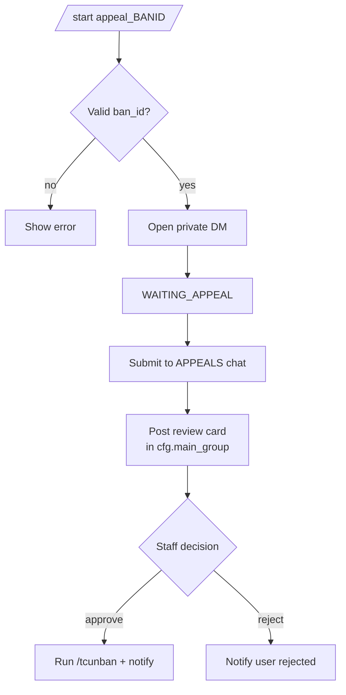

# Appeals

This document describes the current ban appeal behavior implemented by `tcbot/modules/appeals.py`, `tcbot/modules/helper/pipelines/appeal_submit_flow.py` (user submission) and `appeal_review_flow.py` (staff decisions).

For the ban flow that triggers appeals, see
[`moderation/banning.md`](moderation/banning.md). For the check command often
used during appeals, see [`moderation/check.md`](moderation/check.md). For
shared helpers, see [`../architecture/helpers.md`](../architecture/helpers.md).
For the database layer, see [`../architecture/database.md`](../architecture/database.md).



## Purpose

The appeal flow lets a user with an active federation ban submit one appeal through the bot in private messages or in place in the main group. The appeal is forwarded to the configured appeals destination, posted for staff review in the main group and in the appeals destination, logged in the federation logs channel, and then resolved through inline callback buttons.

## Entry points

A banned user can reach the appeal flow through a bot deep link:

- The `Submit Appeal` button attached to a ban log entry.
- The `Appeal` button shown by `/checkme` when the user has an active federation ban.
- A direct deep link in this format:
  - `https://t.me/<bot_username>?start=appeal_<ban_id>`

The registered `/start` entry filter only accepts private-chat messages matching:

```text
/start appeal_<10 lowercase letters or digits>
```

The deep-link flow itself is DM-only. If the link is opened outside a private chat, the bot asks the user to open it in private messages.

A second entry point is the main group (`MAIN_GROUP`). There, a banned user sends a `#appeal` message (with the log reference, and optionally the ban id); the bot looks up their active ban by sender and runs the same submission gates and posting as the DM path. Outside `MAIN_GROUP` the tag stays silent. Repeated `#appeal` messages from one user are rate-limited before the lookup runs.

## Eligibility checks

When the appeal link is opened, the bot validates the ban decision before starting the conversation:

1. The `ban_id` must exist as `moderation_actions.external_ref` for a ban decision.
2. The decision must still be active (`status = 'active'` and inside its deadline).
3. The Telegram user opening the link must match `target_user_id` on the decision.
4. The decision must not already carry a fresh review slot. If it does and the slot was claimed within the last 72 hours, the user is told their appeal is still under review. If the slot is older than 72 hours (or missing), the stale review is cleared automatically and the user may submit a new appeal.

Invalid, expired, or wrong-account links end the conversation without changing the database.

## User submission format

After a valid deep link is opened, the bot sends instructions in DM and waits for one text message.

The message must start with `#appeal`. The check is case-insensitive and ignores leading/trailing whitespace, so these are accepted:

```text
#appeal
#APPEAL
#Appeal
   #appeal
```

Messages that do not start with `#appeal` are ignored and the bot remains in the appeal state.

The requested appeal body contains three sections:

```text
#appeal
Log link: https://t.me/TranssionCoreFederationLogs/123
Clarification: I understand what happened and why the ban was issued.
Agreement: I will follow the community rules going forward.
```

The current implementation does not parse the section labels semantically. It validates the `#appeal` prefix and, when the ban record has a `log_message_id`, checks that the submitted text contains that log message ID as a standalone number. This makes the log-link check tolerant of full Telegram links, bare message IDs, and links with query parameters, while rejecting partial numeric matches.

Examples:

- `https://t.me/c/12345/67?thread=10` matches log message ID `67`.
- `67` as a standalone token matches log message ID `67`.
- `670` does not match log message ID `67`.
- `6` does not match log message ID `67`.

If the log message ID is missing or mismatched, the bot replies with `Invalid log link. Please check and try again.` and keeps waiting.

Appeal messages have a **maximum length of 2000 characters**. Messages that exceed this limit are rejected with a trimming instruction; the user may shorten the message and try again without restarting the session.

## Submission side effects

When a valid appeal message is submitted, the bot first revalidates the
fresh ban record: the ban must still be active, must not have gained a fresh
pending review while the user was typing (a concurrent submit from another
session), and must not be inside the 24-hour rejection cooldown. Any of
those states ends the session with the matching reply instead of posting a
duplicate review card.

When the checks pass:

1. The user's appeal message is forwarded to the configured appeals destination (`cfg.appeals`).
2. A staff review card is posted to `cfg.main_group`; once its message id is known, the Approve/Reject keyboard is attached and a second copy with the same buttons is posted in `cfg.appeals`, so either surface stays actionable. The card id is the decision token, so a card left behind by an earlier appeal cannot decide a newer one.
3. A submitted-appeal log is posted to `cfg.logs`.
4. The pending-review slot and the appeal row are claimed atomically with `bans_db.submit_appeal`, so a concurrent duplicate submit cannot overwrite the winner and orphan its card. The loser deletes its own orphan review card best-effort and is told the appeal is already pending.
5. Appeal-log metadata is stored with `bans_db.set_appeal_log_msg` when the log post succeeded.
6. The original DM instruction message is edited to confirm submission.
7. The user is cached/updated in `users_cache`.

If both the review post and the appeal-log post fail, the instruction
message is edited to a delivery-failure reply and the conversation stays in
`WAITING_APPEAL` with its state intact, so the user can retry by sending
another `#appeal` message without reopening the deep link.

The review card contains two inline buttons:

| Button | Callback data |
|---|---|
| `Approve` | `appeal_approve_<ban_id>_<review_message_id>` |
| `Reject` | `appeal_reject_<ban_id>_<review_message_id>` |

Both callbacks use the underscore-delimited
`<action>_<ban_id>_<review_message_id>` shape that the handler registers and
parses (`appeals.py` pattern `^appeal_(approve|reject)_\S+_\d+$`;
`appeal_review_flow.py` splits the last segment). Both
`keyboards.appeal_review_kb()` buttons emit this shape, so Approve and Reject
taps reach the review handler. The trailing id must still match the live
`review_message_id` on the ban record; a card from an earlier appeal carries
a stale id and is refused with the shared stale-card alert. A card posted
before this payload shape existed has no trailing id: it is accepted only
when the tapped message is the live review card, so an upgrade does not
strand an appeal that is awaiting a decision.

The DM instruction message has a cancel button:

| Button | Callback data |
|---|---|
| `Cancel` | `cancel_appeal` |

Cancel clears the in-memory conversation keys and edits the instruction message to say that nothing was submitted.

## Database impact

Appeals live in the community decision tables, not in a separate legacy `bans` table:

| Table | Holds |
|---|---|
| `moderation_actions` | the ban decision: `external_ref` (the public `ban_id`), `target_user_id`, `status`, `expires_at`, `metadata`, and the case link |
| `moderation_appeals` | one row per submitted appeal: `action_id`, `appellant_user_id`, `appeal_text`, `status`, `submitted_at`, `resolved_at`, `reviewed_by_user_id`, `decision_note` |
| `moderation_messages` | the stored Telegram message references of a decision, including the federation log (`log`) and the appeal log (`appeal_log`) |
| `moderation_evidence_uploads` / `moderation_evidence_items` | the archived proof batch and its message id |

The composed `BanDoc` exposes the fields the flow reads:

| Field | Used for |
|---|---|
| `ban_id` | Deep-link and callback identifier (`moderation_actions.external_ref`). |
| `target_user_id` | Confirms the appeal belongs to the current user. |
| `is_active` | Blocks appeals for revoked, superseded, expired, or missing decisions. |
| `log_message_id` | Validates that the user referenced the correct ban log (`moderation_messages`, kind `log`). |
| `review_message_id` / `review_timestamp` | The review slot stored in the decision metadata; blocks duplicate appeals and starts the 12-hour original-admin priority window. |
| `appeal_log_msg_id` | Lets the bot edit the submitted-appeal log after approval or rejection (`moderation_messages`, kind `appeal_log`). |
| `appeal_submitted_at` | The `moderation_appeals.submitted_at` value, displayed in final appeal log edits. |
| `appeal_link` | The forwarded appeal message link stored in the decision metadata. |

The update helpers involved are:

- `bans_db.set_review_if_absent(ban_id, review_msg_id)` (atomic claim; returns whether this submit won the review slot)
- `bans_db.set_appeal_log_msg(ban_id, appeal_log_msg_id, appeal_link=...)`
- `bans_db.claim_appeal_decision(ban_id, review_msg_id)` (atomic decision claim; consumes the review slot)
- `bans_db.approve_appeal_and_queue_unban(ban_id, reviewer_id, reviewer_name, requested_by, chat_ids)` on approval (accepts the appeal, revokes the ban, releases the review slot, and queues the unban run in one transaction)
- `bans_db.restore_review(ban_id, review_msg_id, review_timestamp)` (hands the slot back when a tap reached no decision)
- `bans_db.reject_appeal(ban_id, reviewer_id, reviewer_name)` (closes the appeal as rejected and releases the review slot in one transaction)
- `bans_db.clear_review(ban_id)` (releases the slot of a card found stale)
- `users_cache.upsert_user(...)` after submission

If the review post fails, no review slot is stored. If the appeal-log post fails, no `appeal_log` message reference is stored. The implementation logs those failures and continues where possible.

## Staff review rules

Appeal decisions are handled by `appeal.on_decision` and are registered outside the conversation handler. The entry is wrapped in a per-user staff throttle before the handler runs. Only Founder or Admin reviewers (effective role `founder`/`admin` via `users_roles.get_effective_role`) may use the review buttons. In this codebase that matches `is_staff` semantics; Developer and Tester custom roles are not included.

A role-lookup outage fails closed with a retry alert instead of an authorization verdict, so a transient database blip is never misreported as "not authorized".

Taps that do not decide anything never edit the shared review card; they
answer the callback query with a popup alert so the card stays actionable
for staff:

- Taps from non-staff users.
- Taps by the banned user themselves (self-review is refused with a popup and the card stays actionable).
- Taps inside the 12-hour banning-admin priority window by a different admin.
- Taps on a card whose review-message id no longer matches the live review slot (a card left behind by an earlier appeal).
- Repeat taps after the appeal was already decided (the winner's verdict edit is preserved).
- Taps during a role-lookup outage.
- Taps when the ban read fails (`appeals.review.db_retry` popup, card untouched for a re-tap).

The only resolved tap that edits the card is a stale one: an inactive ban
that still carries a live review marker (left behind by a manual `/tcunban`,
which never touches review state). That tap clears the marker best-effort
and updates the card to the already-resolved text.

The original banning admin gets a 12-hour priority window after the appeal review timestamp is set:

- During the first 12 hours, only the `actor_user_id` stored on the ban can approve or reject.
- The original banning admin is always allowed during that window.
- After 12 hours, any Founder/Admin reviewer can decide.
- If `review_timestamp` is missing, or `actor_user_id` is missing or zero (legacy record), the lock does not apply.

The callback handler always answers the callback query before continuing once it has parsed a valid decision action.

The decision claim consumes the review slot, so only one reviewer acts on
it. A tap that reaches no decision (a rank refusal, a database outage, a
blocked demote) hands the slot back with `bans_db.restore_review`, so the
review card stays actionable instead of dying with the appeal undecided.
The restored slot keeps the original review timestamp, so the 12-hour
priority window continues where it left off.

## Approval behavior

When a staff member approves an appeal:

1. The approver's effective role is read fresh and must outrank the target's current role. Approving strips the target's federation role (the ban lift requires it) and lifts the ban everywhere, which is the same irreversible action as `/tcunban`, and that command path refuses an equal-rank target. An Admin therefore cannot approve an appeal against a peer Admin; the tap is refused with the shared outrank notice and nothing is changed.
2. Active connected groups are fetched from `groups_db.active_groups()`, with the primary group (`cfg.main_group`) appended when absent. If the fetch fails, approval aborts before deactivation with the review card untouched (a re-tap retries the full sequence); deactivating first would leave chats unbanned-nowhere with no record to re-drive.
3. If the banned user currently holds a federation staff role, that role is demoted before deactivation, mirroring `/tcunban`. A role-lookup outage or a demote failure aborts with the review card untouched and a retry alert.
4. `bans_db.approve_appeal_and_queue_unban(ban_id, reviewer_id, reviewer_name, requested_by, chat_ids)` is the decision. One transaction accepts the pending appeal, revokes the active ban, releases the review slot, and queues a `revoke` enforcement run with one target per group. A failure rolls the whole unit back, so an accepted appeal cannot sit on an active ban, and a revoked ban cannot sit beside a pending appeal. The review card stays actionable and the tapper gets a retry alert.
5. The queued run is delivered immediately with `enforcement_worker.deliver_queued_run`. If another worker already owns it, the approval is still committed and the scheduled worker finishes the delivery.
6. `db.enforcement_db.run_report(run_id)` supplies the per-group outcome. Failed targets stay in the run with a retry deadline, and the operator sees the failure count in the logs.
7. The user receives a DM telling them the appeal was approved.
8. The review message is edited to show who approved it and the inline keyboard is removed. If that edit fails, a durable `moderation_notification_tasks` row is queued and the scheduler retries it, so the card cannot stay live over a settled appeal.
9. The submitted-appeal log message is edited to an approved version when possible.
10. A separate `Unban (via Appeal)` log is sent to the federation logs channel.

Each notification in steps 7-10 is inspected separately and logged (warning for the user DM, card edit, and appeal-log update; error for the unban log), so a silent Telegram failure is visible to operators.

Approval is a federation unban. It removes the Telegram ban across all connected groups and revokes the persistent ban record. The decision and its enforcement run are one transaction; the Telegram delivery is retried by the scheduled enforcement worker, so a crash after the commit does not lose a group.

## Rejection behavior

When a staff member rejects an appeal:

1. The target's effective role is read fresh and the reviewer must outrank it, exactly like approval and `/tcunban`. A role-lookup outage fails closed with a retry alert, and a peer (equal rank) target is refused with the shared outrank notice before anything is written.
2. `bans_db.reject_appeal(ban_id, admin.id, admin.first_name)` records the rejector's identity (`rejected_by_id`, `rejected_by_name`, `rejected_at`) and releases `review_message_id` and `review_timestamp` in the same transaction. If this write fails, rejection aborts with the review card untouched and the tapper gets a retry alert, so a re-tap retries the full sequence. A rejection that cannot free its slot is not a recorded decision.
3. The ban remains active.
4. The review message is edited to show who rejected it and the inline keyboard is removed. If that edit fails, a durable `moderation_notification_tasks` row retries it even though the ban remains active.
5. The user receives a DM telling them the appeal was reviewed and not approved.
6. The submitted-appeal log message is edited to a rejected version when possible.

A failed card edit still proceeds to the DM with a warning log: the decision and the slot release are already committed, so the user is not blocked past the cooldown. A failed DM is logged at warning level; neither notification failure reopens the decision.

Rejection does not deactivate the ban. The `review_message_id` and `review_timestamp` fields **are cleared atomically with the rejection** so the user may submit a subsequent appeal without being locked out.

## Logs

Appeal-related logs are built in `tcbot/modules/helper/messages/` (`audit_logs.py`):

| Template | Destination / use |
|---|---|
| `appeal_received_log` | Staff review card in the main group and its copy in the appeals destination. |
| `appeal_submitted_log` | Initial log in the federation logs channel. |
| `appeal_approved_edit` | Edited version of the submitted log after approval. |
| `appeal_rejected_edit` | Edited version of the submitted log after rejection. |
| `appeal_unban_log` | Separate unban log sent after an approved appeal. |

If editing the existing appeal log fails, the bot attempts to send a new log message as a fallback.

## Timeouts and fallbacks

- There is no `ConversationHandler.TIMEOUT` state. Conversations end only via escape commands, cancel, or successful submission.
- Any recognized command during the waiting state ends the session with `Appeal session ended.`
- Cancel ends the session without writing appeal metadata.
- If the user sends `#appeal` after the session state has expired or the ban ID is missing from the conversation scope, the bot asks them to start the appeal again.

## Edge cases

- Non-banned users cannot submit because they cannot pass the active-ban lookup.
- A user cannot appeal someone else's ban; the `target_user_id` must match the Telegram account opening the link.
- A user can have only one pending appeal when `review_message_id` was stored successfully.
- A submission or decision only matches a ban that is still in force: a timed ban whose deadline passed is no longer appealable even before the daily sweep marks the row `expired`.
- A staff `/tcunban` withdraws a pending appeal in the same transaction as the ban revocation, so the appeal cannot block a later submission with no reviewer able to decide it.
- Case-insensitive `#appeal` tags are accepted.
- The log-link validation is number-based, not URL-domain-based; it checks for the stored log message ID as a standalone integer token.
- If the forwarded appeal message cannot be linked, the review/log text uses `N/A` for the appeal link but still posts the review/log when possible.
- If user DM notification fails during approval or rejection, the review/log operations still proceed because those calls use `asyncio.gather(..., return_exceptions=True)`.
- If a ban was already revoked before a decision, a tap on the stale card sees the inactive decision, releases any leftover review marker, and updates the card without recording a new verdict.
- Two staff decisions racing each other are serialized by `claim_appeal_decision`: only the tap that still owns the live review slot reaches the atomic approval or rejection write, and the loser is told the appeal is already resolved.

## Rejection cooldown

After a staff member rejects an appeal, the banned user must wait **24 hours** before
submitting a new one. This prevents spam-appealing immediately after every rejection.

The cooldown is enforced in `AppealSubmitMixin._start()` (the submission half of the `BuildAppeal` facade): when `ban.rejected_at` is present and
`utc_now() - to_utc(rejected_at) < timedelta(hours=24)`, the user receives a message
showing the hours remaining and `ConversationHandler.END` is returned.

The cooldown applies independently of the stale-review window. If a stale review
(≥ 72 h old) is cleared in `_start()`, the rejection cooldown check still follows
immediately after.

## Anonymous admin mode and appeal decisions

Federation staff in anonymous admin mode (GroupAnonymousBot, `user_id = 1087968824`)
**cannot use any bot command** because all command entry-point decorators check
`effective_user.id == 1087968824` and return an error.

However, staff **can still click Approve or Reject** on the appeal review card.
The callback path uses `effective_user` for the account associated with the
button press. In the callback behavior supported by this project, staff can
therefore use the appeal decision buttons even when their group messages are
anonymous; the bot does not replace the callback sender with
`GroupAnonymousBot`.

Practical consequence: an admin in anonymous mode cannot issue `/tcban` or `/tcwarn`,
but they can open the appeal review card in the main group and use the Approve/Reject
buttons. Their real account identity is recorded as the approver or rejector.

## Behavior reference

Important appeal behaviors to keep in mind:

1. `#appeal`, `#APPEAL`, and mixed-case tags are accepted.
2. Text without a leading hash tag is rejected.
3. A log message ID matches as a standalone number inside a Telegram link.
4. Partial numeric matches are rejected.
5. Appeal messages must not exceed 2000 characters; longer messages are rejected with a trim instruction and the user can retry without restarting.
6. The 12-hour reviewer lock blocks a different admin inside the window.
7. The original banning admin is allowed inside the 12-hour window.
8. Any staff reviewer is allowed after 12 hours.
9. Missing `review_timestamp` or missing/zero `actor_user_id` disables the reviewer lock.
10. Uppercase `#APPEAL` reaches the expired-session branch when conversation state is missing.
11. The module-level appeal builder derives its log handle from the public logs link.
12. After rejection, a 24-hour cooldown applies before the user can start a new appeal.
13. Staff in anonymous admin mode can use appeal decision buttons but not bot commands.
14. Non-deciding taps (outsiders, locked-out reviewers, repeat taps, outage retries) never edit the review card.
15. Concurrent duplicate submits are resolved by an atomic review-slot claim; the loser is told the appeal is pending.
16. A total delivery failure keeps the conversation open for an in-place retry.
17. Cancelled review reads and cancelled deactivation writes propagate with the card untouched (a retry re-drives the full sequence); the shared stale-review, cooldown, and state-clear gates live in `_is_stale_review`, `_cooldown_remaining_h`, and `_clear_appeal_state` so submit and resubmit cannot drift.
