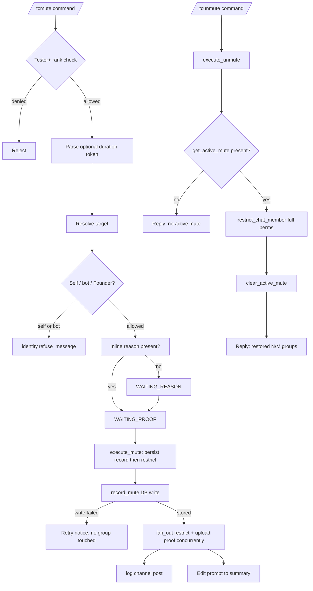

# Muting

This document describes the current federation mute and unmute behavior implemented by `tcbot/modules/mute.py` (the `/tcmute` and `/tcunmute` entry points), `tcbot/modules/helper/pipelines/mute_flow.py` (the `_execute_mute` and `execute_unmute` executors), `tcbot/utils/time_and_date.py` (the duration helpers), `tcbot/modules/helper/pipelines/reason_flow.py` (the shared proof/reason conversation), and `tcbot/database/mutes_db.py` (the mute decisions in `moderation_actions` and the `active_mutes` view).

For the ban flow, see [`banning.md`](banning.md). For the kick flow, see
[`kicking.md`](kicking.md). For role auto-demotion on mute, see
[`../roles/demote.md`](../roles/demote.md). For shared helpers, see
[`../../architecture/helpers.md`](../../architecture/helpers.md). For the
database layer, see [`../../architecture/database.md`](../../architecture/database.md).



## Purpose

A federation mute restricts a user from sending messages, media, stickers, and polls across all active connected groups at once, plus the primary groups (`cfg.main_group`). Mutes may be timed (with a duration token) or permanent (`until_date=None`). The mute flow accepts an optional inline reason and optional proof, posts a federation mute log, and writes one mute decision to `moderation_actions`; the `active_mutes` view projects the decisions that are in force, so unmute and group-connect replay can find them. Targets that hold a federation role are auto-demoted when the mute is enforced.

`/tcunmute` clears the active-mute record and restores full send permissions across the same set of groups.

## Commands and aliases

| Command | Alias | Purpose | Access |
|---|---|---|---|
| `/tcmute` | `/tcm` | Apply a federation-wide mute to a user. | Tester and above via `basic_mod_only`. |
| `/tcunmute` | `/tcunm`, `/tcum` | Restore full send permissions across all connected groups. | Tester and above via `basic_mod_only`. |

Commands use the project's configured prefixes; slash commands are examples.

Federation origin: `/tcmute`, `/tcunmute`, `/tckick`, and the warn family require a connected or primary group; private chats and disconnected groups are refused. A connection-state outage blocks the action with a retry notice instead of proceeding.

## `/tcmute` flow

The mute command is a `ConversationHandler` built by `reason_flow.build_modaction_conv(reason, proof, ...)` and inherits all reason/proof state machine semantics from the shared factory. The mute conversation factory is wired with `escape_filter=_UNMUTE_CMDS` so that `/tcunmute` typed during a mute conversation is delivered to the unmute handler instead of being swallowed by the mute fallback.

1. A moderator runs `/tcmute <target> [duration] [reason]` or replies to a message with `/tcm [duration] [reason]`.
2. The bot resolves the executor role and target in parallel.
3. The executor must have at least Tester rank.
4. The target must resolve to a Telegram user ID.
5. The bot rejects attempts to mute itself or the executor's own account via `identity.refuse_message`.
6. The bot parses an optional duration token from the first remaining argument.
7. If an inline reason was supplied, the bot skips directly to proof collection (`WAITING_PROOF`). Otherwise it prompts for a reason (`WAITING_REASON`).
8. Reason is skippable via the `Skip` button.
9. Proof is skippable via the `Skip` button.
10. `_execute_mute` restricts the target across all active connected groups plus primary groups, writes the active-mute record, posts the mute log, and edits the prompt to a summary.

## Duration token format

The duration regex is `_DURATION_RE` in `tcbot/utils/time_and_date.py`:

```python
_DURATION_RE = re.compile(r"^(\d+)(ye|mo|[smhdw])$", re.IGNORECASE)
```

| Token | Unit |
|---|---|
| `s` | seconds |
| `m` | minutes |
| `h` | hours |
| `d` | days |
| `w` | weeks (7 days) |
| `mo` | months (30 days) |
| `ye` | years (365 days) |

`parse_duration("3d")` returns `timedelta(days=3)`. A token that fails the regex never matches the duration guard and stays in the reason text. A regex-valid but unparsable token (timedelta overflow or above the 100-year `_MAX_DURATION_DAYS=36500` cap) makes `parse_duration` return `None`, and the token is kept as reason text as well: it is popped from the arg list only after a successful parse, so moderator input is never silently dropped.

`fmt_duration(td, locale)` renders:

- `total < 60` -> `Ns`
- `< 1 hour` -> `Nm`
- `< 1 day` -> `Nh`
- `< 7 days` -> `Nd`
- `< 30 days` -> `Nw`
- `< 1 year` -> `Nmo`
- else -> `Nye`

A `None` duration renders as the localized `muting.duration.permanent` label (English default: `permanently`) and is passed to `restrict_chat_member` with `until_date=None`, producing a permanent restriction.

## Target resolution and reason parsing

The target can be specified by:

- Replying to a message from the target.
- Passing a numeric user ID after the command.
- Passing an `@username` after the command, when resolvable.

`cmd_mute` strips the target token first, then attempts to parse the duration token from the head of the remaining list. Anything left after the duration is the inline reason:

```text
/tcmute @username 3d spamming in chat
# target: @username
# duration: 3d
# reason: spamming in chat

/tcm 123456789 1w
# target: 123456789
# duration: 1w
# reason: empty - bot prompts

/tcmute @username
# target: @username
# duration: none (permanent)
# reason: empty - bot prompts
```

The reason prompt and proof prompt are stamped with `extra_info` (`<code id>: <duration>`) so the moderator sees the duration even when no reason was typed inline.

When the command replies to a user message, the quoted sender is the default target, with one exception: a leading numeric ID or `@username` that verifies as a real user different from the quoted sender overrides the reply, because a typed ID is deliberate intent while a quote is often just context. That override token is consumed as the target before duration parsing. Anything unverified (a reason starting with a number, an unknown ID) or fuzzy (partial-name search) keeps the reply target, and a restated ID naming the quoted user themself is still dropped from the reason as a duplicate. The shared `extraction.extract_mod_target(update, args, bot)` helper owns both the resolution and the consumed-or-reason decision.

Inline reasons share the same 1000-character cap as typed reasons (`reason_flow.MAX_REASON_LEN`). Overlong inline input fails fast with the shared retry notice before any prompt is sent; typed input exceeding the cap stays in `WAITING_REASON` with the same text.

## Reason and proof behavior

The mute conversation uses `BuildReason("mute")` and `BuildProof("mute")` (both default to `skip_allowed=True`). The reason keyboard exposes `Skip` and `Cancel`; the proof keyboard exposes `Skip`, `Done`, and `Cancel`:

- Reason: text, `Skip`, `Cancel`.
- Proof: photo, video, GIF, file, `Skip`, `Done`, `Cancel`.

The `_ModActionFlow` class in `reason_flow.py` enforces the same race-safe semantics described in [`kicking.md`](kicking.md): proof buffering until `Done`, double-submit guard via the `mute_executing` key of the conversation scope, fallback cancel on any unrecognized command.

## Auto-demote at mute time

If the target holds a federation role, the role is removed when the mute is enforced, not when the command starts. `_execute_mute` calls `demote_before_enforcement(..., trigger="mute")` right before the restriction fan-out.

The demote runs at enforcement time because the reason and proof steps are still cancelable. A demote at the entry would strip the target's role, post the federation demote log, and DM the target that they were muted even when the moderator cancelled the flow and no mute ever happened.

`demote_before_enforcement` removes the role record, posts the federation demote log, and DMs the target. The step is best-effort: a role lookup or demote failure is logged loudly and the mute proceeds, because the mute record is already stored. The target keeps their rank only until a later join-time enforcement pass removes it.

## `execute_mute` behavior

`_execute_mute(bot, update, meta)` lives in `tcbot/modules/helper/pipelines/mute_flow.py`. The executor reads target ID, name, reason, admin, duration, proof messages, and the prompt chat/ID from the `meta` dict.

Execution order:

1. Resolve the origin chat from the update; abort before any side effect when it is absent.
2. Build the active-groups list: `groups_db.active_groups()` plus any primary groups (`cfg.main_group`) that are not already present. A fetch outage aborts with a retry notice and no group is touched.
3. Persist `db.mutes_db.record_mute(...)` first. A failing write aborts with a retry notice and no group is touched (fail-closed, mirroring the ban flow and the warn auto-ban): enforcing chats without a stored decision would leave a restriction that `/tcunmute` refuses to lift.
4. Build the restriction `ChatPermissions(can_send_messages=False)` and the `until_date` value (`utc_now() + duration` or `None` for permanent).
5. Remove the target's effective role via `demote_before_enforcement(..., trigger="mute")` (best-effort; the mute proceeds even if the demote fails).
6. Fan `restrict_chat_member` across the group list with `fan_out(...)` while uploading proof to `cfg.proofs` concurrently (caption `messages.proof_caption_new`). Failed calls are counted with `count_transient_errors(results)`; an upload failure degrades to no proof link.
7. Run two parallel side-effects via `asyncio.gather(..., return_exceptions=True)`:
    - `bot.send_message(cfg.logs, mute_log, ..., reply_markup=proof_kb)`.
    - `bot.edit_message_text(summary, chat_id=prompt_chat, message_id=prompt_id, ..., reply_markup=proof_kb)` so the moderator sees the result inline.
8. If the prompt edit fails, a fallback `msg.reply_text(summary, ..., reply_markup=proof_kb)` is issued.

The summary text reads `<user> has been muted <duration>. Reason: <reason>. Applied to <ok>/<total> groups.`

The fan-out errors are counted but do not roll back the DB mute record; group connect replay will retry missing restrictions on the next reconnect.

## `/tcunmute` flow

`cmd_unmute(update, ctx)` is registered as a plain `MessageHandler` rather than a `ConversationHandler` step. The flow is:

1. Resolve target.
2. Reject unresolved target with `replies.err_cannot_resolve(locale)`.
3. Run `identity.classify` and `resolve_and_check` in parallel (Tester minimum). If the executor is outranked or the target is self/bot, `identity.refuse_message` short-circuits.
4. Emit `identity.staff_notice("unmute", ident, cfg.community_name)` when applicable so staff-only targets see the heads-up.
5. Delegate to `execute_unmute(update, ctx, target_id, target_name)`.

`execute_unmute` is the unmute executor:

1. Guard: `db.mutes_db.get_active_mute(target_id)` must return a record. If `None`, reply `<user> has no active federation mute.` and stop. This guard prevents a misleading "restored N/N groups" reply for a no-op. A failed read fails closed with a retry reply instead of refusing a real unmute.
2. Build the full-perms `ChatPermissions` with all messaging permissions enabled.
3. Fetch active groups with `db.groups_db.active_groups()`. A fetch outage aborts with a retry reply before anything is touched, so the active record stays and a retry works.
4. Fan `restrict_chat_member(chat_id, target_id, permissions=full_perms)` across the connected groups plus the primary groups and count transient failures.
5. Clear the active-mute decision with `db.mutes_db.clear_active_mute(target_id)` before announcing. A clear failure aborts with a retry reply and no success message, so a failed clear never announces a restored user. When any group failed, the decision is kept instead and the failure notice asks for a retry, so a re-run re-drives the full fan-out.
6. Run two parallel side-effects via `asyncio.gather(..., return_exceptions=True)`:
   - `bot.send_message(cfg.logs, unmute_log, ...)`.
   - `msg.reply_text(reply, ...)`.

The reply reads `<user> has been unmuted.` followed by the applied line, which names how many groups were restored.

### Unmute failure reporting

The fan-out outcome is reported through the shared `replies.applied_summary` helper, the same one the ban and the warn threshold ban use, so the four federation executors report a partial enforcement the same way.

- A complete unmute renders the `muting.applied.full` line: `Restored in <total>/<total> groups.`
- A partial unmute renders `muting.note.unmute_partial`, which says the user was unmuted in some groups only and names the groups that failed, followed by the `muting.applied.partial` line with the restored and failed counts. The mute decision is kept, so a later `/tcunmute` reaches the groups that failed.
- A total failure renders `muting.note.unmute_failed` followed by the `muting.applied.none` line, which names every group that refused and points at the bot's admin rights. The mute decision is kept.

A benign Telegram refusal (the user was never in the chat, the chat is gone) counts as applied: there was nothing to restore there.

## Database impact

A mute is one row in `moderation_actions` with `action_type = 'mute'`. The live state and the history are the same row: an active mute is a decision whose `status` is `active`, and lifting it moves the row to `revoked`. The `active_mutes` view projects the rows that are in force.

`record_mute` writes the decision and the case that holds it in one transaction, so a mute without an investigation cannot exist. A second mute of an already-muted user is a new decision that supersedes the old one: the history keeps the first mute and its reason, and only the newest decision is in force. The stored deadline never moves backwards, so a timed mute cannot shorten a longer restriction and a permanent mute is never downgraded to a timed one.

`MuteDoc` document fields:

| Field | Meaning |
|---|---|
| `target_user_id` | Muted Telegram user ID. |
| `chat_id` | Group chat ID where the mute command was issued. |
| `reason` | Moderator-provided reason or localized `replies.no_reason(locale)` text. |
| `actor_user_id` | Telegram user ID of the moderator. |
| `timestamp` | UTC mute creation time. |
| `duration_secs` | Optional; total seconds when the mute is timed, absent for a permanent one. |

`ActiveMuteDoc` document fields (the `active_mutes` view):

| Field | Meaning |
|---|---|
| `user_id` | Muted Telegram user ID. |
| `until_date` | UTC datetime when the restriction expires, or `None` for permanent. |
| `timestamp` | UTC decision-write time. |

The `active_mutes` view filters on `status = 'active'` and on the deadline (`expires_at IS NULL OR expires_at > now()`), so an expired timed mute is not in force even before the daily sweep moves it to its expired state.

The active mute is consumed by:

- `execute_unmute` to decide whether to proceed.
- `on_bot_added` -> `connection.complete_join` -> `mutes_db.active_mute_docs()` so newly connected groups replay the mute immediately via `restrict_chat_member`.

## Logs and keyboards

Mute-related templates are defined in `messages/` (`audit_logs.py`):

| Template | Used for |
|---|---|
| `proof_caption_new` | Caption on mute proof uploads. |
| `mute_log` | Federation log entry posted by `execute_mute`. |
| `unmute_log` | Federation log entry posted by `execute_unmute`. |

The reply and federation log use `keyboards.action_proof_kb(target_id, proof_link)`. The keyboard exposes a single `Proof <target_id>` URL button when a proof link was generated; the button is omitted when no proof was uploaded.

## Edge cases

- A duration token that fails the regex is silently dropped and treated as part of the reason text.
- A demote failure is logged loudly and the mute still proceeds; the target's rank is repaired by a later join-time enforcement pass.
- `execute_unmute` with no active mute record replies `<user> has no active federation mute.` and does not fan `restrict_chat_member` across the groups.
- A failed active-mute read fails closed with a retry notice instead of being treated as "no active mute".
- A failed group-list fetch inside `execute_unmute` aborts with the same retry notice before any group is touched, so the active record stays and a retry works; the unmute never ends silently.
- `get_active_mute` filters out expired timed mutes at query time, so a stale `active_mutes` row never produces a misleading "restored N/N groups" success.
- The `_UNMUTE_CMDS` filter is passed to the mute conversation factory as `escape_filter`, so `/tcunmute` typed during `WAITING_REASON` or `WAITING_PROOF` reaches the unmute handler instead of cancelling the mute conversation.
- `restrict_chat_member` with `until_date=None` produces a permanent restriction on Telegram's side; the bot does not schedule a timed unban through APScheduler.
- Mute enforcement in newly connected groups is handled at connect time by `connection.complete_join` -> `active_mute_docs`, not by a scheduler job.

## Behavior reference

Key behaviors to keep in mind:

1. `/tcmute` requires Tester rank.
2. `/tcmute <target> <duration> <reason>` parses the duration token before the reason text.
3. `/tcmute` without a target is rejected with `replies.err_cannot_resolve(locale)`.
4. Self-mute and bot-mute attempts are rejected by `identity.refuse_message`.
5. Higher-rank or equal-rank targets are rejected by `resolve_and_check`.
6. Role-holding targets are auto-demoted when the mute is enforced.
7. Reason is skippable; skipped reason records as the localized `replies.no_reason(locale)` text.
8. Proof is skippable; skipped proof records nothing.
9. The `_UNMUTE_CMDS` filter is excluded from the mute conversation fallback so unmute can interrupt a pending mute conversation.
10. `execute_mute` restricts across `active_groups()` plus `cfg.main_group`, deduplicated.
11. `execute_mute` writes the mute decision before it restricts any group, so group connect can replay an active mute.
12. `execute_unmute` refuses to fan unrestrict calls when no active mute record exists.
13. The `until_date` value matches the value passed to `restrict_chat_member`; `None` means permanent.
14. Expired timed mutes are excluded from `get_active_mute` and `active_mute_docs` by query-time filtering, and the daily sweep moves the expired decisions to their expired state.
15. Federation log send failure does not roll back the mute.
16. Newly connected groups reapply active mutes on connect via `connection.complete_join`.
