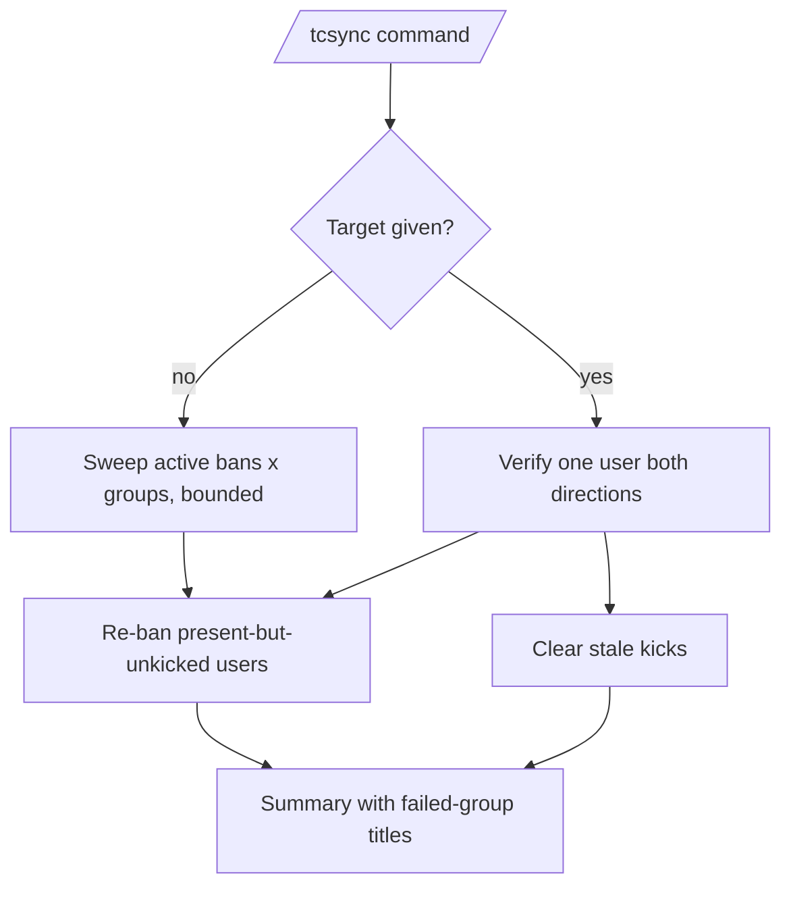

# Sync

This document describes the enforcement-reconciliation behavior implemented by
`tcbot/modules/sync.py` (the `/tcsync` command plus the shared sweep core)
and the optional scheduled sweep in `tcbot/database/scheduler.py`.

For the ban flow that this reconciles, see [`banning.md`](banning.md). For the
unban flow, see [`unbanning.md`](unbanning.md). For shared helpers, see
[`../../architecture/helpers.md`](../../architecture/helpers.md). For the
database layer, see [`../../architecture/database.md`](../../architecture/database.md).

## Purpose

Fan-out enforcement can miss groups (transient Telegram failures, bot
demoted at fan-out time, groups connected later without a replay). The join
handler and connect replay close most of those gaps, but a banned user who is
already inside a missed group, or a stale kick surviving an unban, has no
trigger left. Sync re-drives enforcement on demand instead of waiting for
one.

## Command surface

Aliases (matched in any prefix configured by `cfg.prefixes`):

- `/tcsync` · `/tcsynchronize`

| Command | Who can use | Purpose |
|---|---|---|
| `/tcsync` | Developer and above (`@mod_only`) | Sweep every active ban against every connected group plus the main group, bounded. |
| `/tcsync <target>` | Developer and above | Verify one user both directions in every connected group plus the main group. |

The target is resolved by `extraction.extract_target`; accepts a reply, user ID, or resolvable `@username`.

Federation origin: `/tcsync` may start from bot DM or any connected or primary group. Non-benign `BadRequest` refusals now count as failures under `is_benign_telegram_error`, not as skipped absences, so a permission or validation failure surfaces in the failed count instead of disappearing into the skip total.

Executor rank gates the role stripping: the sweep removes stale staff rank from banned or muted holders before enforcing. A Developer may not strip an Admin role (only the Founder may), so the bare command resolves the executor rank first and passes it into the sweep; a failed rank lookup refuses the command. The scheduled job has no human executor and keeps system-sweep semantics, which may strip any staff role as a reconcile of existing records.

## How a run works

1. The bot replies `Syncing enforcement state...` with its own status message (kept for the final edit, since the operator's command message cannot be edited by the bot).
2. Bare run: builds the `(banned user x connected group)` cross product capped at 200 pairs (`take_pairs`, stable order, truncation flagged), then the `(muted user x connected group)` pairs with the remaining budget. Ban pairs take budget first so a huge mute backlog can never starve the ban sweep. Both ID lists are sorted before pairing, so the sweep order (and which pairs truncate) is identical run to run. Targeted run: one user against every connected group (bounded by group count).

   Two bounds keep the sweep inside the Telegram per-group rate. Telegram admits 20 requests a minute per group and one pair costs up to two requests (the membership probe plus the enforcement write), so each group stops at 8 pairs per run and the ban and mute passes share that one budget. Without the cap a small federation queued every probe behind the rate limiter and the queued probes were cancelled by their own timeout, which the sweep then reported as enforcement failures that never happened. Because the cap means one run cannot check every banned user in every group, each run starts where the previous one stopped, so the users past the cap are covered by the next run instead of being starved.

   The sweep scope is the connected groups plus the main group, merged through `groups_db.with_primary_groups`, exactly the set the ban, mute, and unban executors enforce in. The main group is not part of `federated_groups`, so it never appears in `active_groups()`; without it in scope, a drift in the main group could never be repaired because sync would never look there. The main group leads the sweep order so it always fits inside the pair budget; the connected groups follow in ascending ID order, so the sweep order (and which pairs truncate) stays identical run to run.
3. Each pair probes membership with a bounded `get_chat_member` (3 s), then enforces through `fan_out`:
   - Active ban + present and not kicked: `ban_chat_member` (`enforced`).
   - Already kicked, absent, or privileged (admin/owner): skipped, never counted as failure.
   - Active mute + present and unrestricted: `restrict_chat_member` (`remuted`). Already restricted, banned, absent, or privileged members are skipped; restricted non-muted users are never unrestriced, so manual admin restrictions survive a sweep.
   - Targeted run without an active ban + still kicked: `unban_chat_member` (`unenforced`).
   - Unexpected failures: `error` (retryable).
4. Benign Telegram refusals (`USER_NOT_PARTICIPANT` and friends, via `is_benign_telegram_error`) count as absent, never as failures.
5. The status message is edited to the summary; on edit failure the summary is sent as a reply instead.

## Staff rank reconciliation

Both the bare sweep and the targeted run strip federation roles from banned or muted holders before enforcement, so a banned user cannot keep moderating. The gate is the executor rank: `can_demote_admin` requires the Founder to remove an Admin role, and every other staff role follows the normal rank rule. The bare command resolves the executor rank with a fresh read and refuses when the lookup fails; the scheduled sweep passes no executor rank and therefore reconciles every staff role.

## Scheduled sweep (opt-in)

When `SYNC_INTERVAL_HOURS` is greater than 0, `scheduler.start()` registers
`tcbot.enforcement_sync` (interval trigger, `replace_existing`,
`misfire_grace_time` 86400, `coalesce`), which runs the same bounded bare
sweep and logs the counts (no operator message exists in that context). A
missing bot reference or any failure logs and returns; the next interval
re-drives. Setting the value back to 0 removes a stale schedule on the next
startup. Default `0` (disabled, manual `/tcsync` only).

## Database impact

Reads `active_groups()`, `active_ban_user_ids()` / `get_active_ban(user_id)`, `active_mute_docs()` / `get_active_mute(user_id)`, then per-miss `ban_chat_member` / `restrict_chat_member` / `unban_chat_member`. Sync also clears stale staff roles (`admin`, `developer`, `tester`) from banned or muted holders before enforcing, mirroring direct auto-demote. No ban or mute records are created, modified, or deactivated.

## Logging behavior

Per-miss enforcement logs at info level; unexpected pair failures log a
warning with user and chat IDs. Scheduled runs log one summary line with
checked/enforced/skipped/failed/truncated counts.

## Edge cases

- No active bans (bare run) or no connected groups: the summary reports zeros; nothing is touched.
- Group-list or ban-list fetch outage: the command replies with the groups-load retry notice; nothing is touched.
- Unresolvable target: replies with the cannot-resolve notice.
- Pair cap reached: the summary notes the truncation; re-running continues from the same stable order, so repeated runs converge.
- Rate limiting: the command is capped at 2 runs per 5 minutes (`mod_only` gate applies first).

## Behavior reference

- `/tcsync` never creates, modifies, or deactivates ban or mute records.
- Skipped pairs (absent, already enforced, privileged) are not failures.
- Targeted runs cover both directions plus mute re-apply; bare runs cover the ban direction plus mute re-apply.
- The scheduled sweep is off unless `SYNC_INTERVAL_HOURS > 0`.

## Validation hints

- `tests/test_syncing.py` covers pair bounding, outcome classification per status, summary rendering with fakes (no I/O), and the primary-group scope of the sweep.
- `uv run ruff check tcbot/modules/sync.py` plus an import check of the module.
