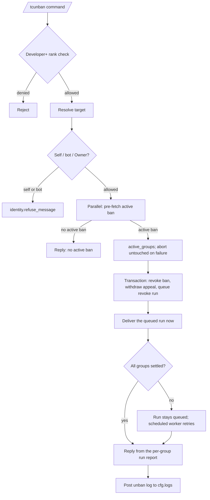

# Unbanning

This document describes the current federation unban behavior implemented by `tcbot/modules/unban.py` (the `/tcunban` entry point), `tcbot/modules/helper/pipelines/unban_flow.py` (the `execute_unban` executor), and `tcbot/database/enforcement_db.py` (the durable delivery run). Persistent ban state lives in `tcbot/database/bans_db/`; only the unban-relevant helpers are documented here.

For the ban flow that creates the records this command clears, see
[`banning.md`](banning.md). For the appeal flow that can also trigger an unban,
see [`appeals.md`](appeals.md). For the check command showing ban
history, see [`check.md`](check.md). For shared helpers, see
[`../../architecture/helpers.md`](../../architecture/helpers.md). For the
database layer, see [`../../architecture/database.md`](../../architecture/database.md).



## Purpose

`/tcunban` clears an active federation ban by revoking the underlying `moderation_actions` ban decisions and unbanning the target across every active connected group plus the primary groups (`cfg.main_group`). The revocation and the delivery intent land in one transaction, and the queued enforcement run owns the per-group work. The appeal-approve path uses the same run model through `bans_db.approve_appeal_and_queue_unban`.

The Developer minimum rank (instead of Moderator) is enforced because unban is irreversible at the database level and a low-rank moderator could otherwise quietly undo an Owner ban.

## Commands and aliases

| Command | Alias | Purpose | Access |
|---|---|---|---|
| `/tcunban` | `/tcunb` | Revoke an active federation ban and unban across connected groups. | Developer and above via `mod_only`. |

Commands use the project's configured prefixes; slash commands are examples.

## `/tcunban` flow

`/tcunban` is registered as a plain `MessageHandler`, not a `ConversationHandler`. The flow is:

1. A moderator runs `/tcunban <target>` or replies to a message with `/tcunb`.
2. The bot resolves the executor role and target in parallel.
3. The executor must have at least Developer rank.
4. The target must resolve to a Telegram user ID.
5. The bot rejects attempts to unban itself via `identity.refuse_message`.
6. The bot speculatively pre-fetches the active ban record in parallel with `identity.classify` and `resolve_and_check` so that `execute_unban` skips a redundant DB round-trip when the refusal check passes.
7. `execute_unban` fetches active groups first, aborts with the ban record intact when the list cannot be loaded, re-runs the fresh executor-versus-target gate, then revokes the ban, withdraws its pending appeal, and queues a `revoke` enforcement run in one transaction.
8. The run is delivered immediately. If the process dies or Telegram fails, the scheduled enforcement worker still owns every target.

## Target resolution

The target can be specified by:

- Replying to a message from the target.
- Passing a numeric user ID after the command.
- Passing an `@username` after the command, when resolvable by the project's extraction helper.

There is no inline reason for unban; the unban log records the moderator and the `ban_id` only.

## Parallel pre-fetch

`cmd_unban` runs three independent calls in a single `asyncio.gather`:

```python
ident, pre_ban, role_result = await asyncio.gather(
    identity.classify(ctx.bot, admin.id, target_id, target_fname or str(target_id)),
    db.bans_db.get_active_ban(target_id),
    resolve_and_check(msg, admin.id, target_id, min_role="developer"),
    return_exceptions=True,
)
```

When the refusal check passes, the pre-fetched `pre_ban` is passed straight to `execute_unban(..., pre_ban=pre_ban)`. The `pre_ban` argument is optional; callers without a pre-fetch get the default `None` and `execute_unban` performs its own `get_active_ban`.

The Developer minimum is intentional: unbanning a higher-ranked target would silently invert the role-vs-state invariant because unban also clears all active bans for the user, which is irreversible.

## `execute_unban` behavior

`execute_unban(update, ctx, target_id, target_fname, *, pre_ban=None)` lives in `tcbot/modules/helper/pipelines/unban_flow.py`. The executor:

1. Uses the caller-supplied `pre_ban` when present, otherwise falls back to `db.bans_db.get_active_ban(target_id)`.
2. If no active ban is found, replies `<user> has no active federation ban.` and stops.
3. Reads `ban_id` from the record for the federation log.
4. Fetches active groups with `db.groups_db.active_groups()` **sequentially** before any mutation: a fetch outage aborts with the ban record intact, so a retry re-drives the full scope.
5. Adds primary groups (`cfg.main_group`) to the list when they are not already present.
6. Calls `db.bans_db.revoke_ban_and_queue_unban(target_id, requested_by, chat_ids, review_chat_id=..., review_message_id=...)`. One transaction revokes every active ban, withdraws pending appeals, releases review slots, queues a `revoke` run with one target per chat, and queues the review-card edit when the ban carried one.
7. Delivers the queued run with `enforcement_worker.deliver_queued_run(ctx.bot, run_id)`. A scheduled worker may already own it; that is not an error.
8. Reads `db.enforcement_db.run_report(run_id)`. The reply reports the per-group outcome: full success, the names of failed groups, or a queued notice when the run is still pending or a requested group left the federation before its target was queued.
9. Posts the unban log and replies with the run outcome. The review-card edit was queued inside the revocation transaction, so the notification worker closes the card even when the process stops before a direct edit.

The reply does not include an appeal-resolution message; a pending appeal is recorded as `withdrawn` with the ban inside the same transaction.

## Database impact

Unban uses these helpers:

| Helper | Purpose |
|---|---|
| `get_active_ban(user_id)` | Returns the active ban document that is still in force. Used by the manual command path and revalidated by the appeal flow. |
| `revoke_ban_and_queue_unban(user_id, requested_by, chat_ids, *, review_chat_id=None, review_message_id=None)` | Revokes every active ban, withdraws pending appeals, releases review slots, queues the durable unban run, and queues the review-card edit in one transaction. Returns `(revoked_count, run_id)`. |
| `approve_appeal_and_queue_unban(ban_id, reviewer_id, reviewer_name, requested_by, chat_ids)` | Accepts the pending appeal, revokes the ban, releases the review slot, and queues the same run in one transaction. |
| `make_ban_id()` | Not used here; only listed because the helper file is shared. |

`moderation_enforcement_runs`, `moderation_enforcement_targets`, and `moderation_enforcement_attempts` hold the durable delivery. A run that cannot finish stays queued (or failed with a due retry), and the scheduled worker claims it again. The ban record is already `revoked`; the run is the recovery path, so `/tcunban` does not need a second command to repair a partial group.

## Logs

Unban log templates are defined in `messages/` (`audit_logs.py`):

| Template | Used for |
|---|---|
| `unban_log` | Manual federation unban log (this command). |
| `appeal_unban_log` | Unban log generated by approved appeal. |

The unban log includes:

- Community name.
- Moderator mention (anonymous-admin runs attribute to id `0` / `anonymous admin` instead of the target, so the entry never reads as a self-unban).
- Target mention and user ID.
- The deactivated `ban_id`.
- Date.

## Edge cases

- An unban attempt with no active ban record replies `<user> has no active federation ban.` and queues nothing.
- A concurrent unban that loses the race sees `revoked == 0` and returns the same idempotent no-record reply instead of claiming a new change.
- `unban_chat_member` is called with `only_if_banned=True`, so it is a no-op in groups where the user is not currently banned.
- A failed Telegram delivery leaves the run queued. The scheduled worker retries the target up to three times with a five-minute delay. After that budget is spent, `/tcrepair retry <run_id> [chat_id]` re-drives the existing run or one group without queueing a second unban.
- The Developer rank minimum (`mod_only`) prevents a Moderator from unbanning an Owner or Admin. The rank check, the identity classification, and the active-ban pre-fetch are issued together; the refusal is evaluated before `execute_unban`, and a fresh gate runs again immediately before the revocation.
- A staff target re-promoted while banned is demoted first through `demote_before_unban(..., trigger="unban")`; a failed demote blocks the unban.
- Federation log send failure does not roll back the decision or the run.

## Behavior reference

1. `/tcunban` requires Developer rank.
2. `/tcunban` without a target is rejected with `replies.err_cannot_resolve(locale)`.
3. Higher-rank or equal-rank targets are rejected by `resolve_and_check`.
4. Self-unban and bot-unban attempts are rejected by `identity.refuse_message`.
5. Owner is always treated as not federation-bannable, so unban is a no-op for Owner targets.
6. The active ban pre-fetch runs in parallel with `identity.classify` and `resolve_and_check`.
7. `execute_unban` refuses to queue an unban when no active ban record exists.
8. The decision and the unban run are written together; a failed write leaves the ban active.
9. `unban_chat_member` is called with `only_if_banned=True`.
10. The reply reports the per-group run outcome and names failed groups.
11. A run another worker already claimed is reported as queued.
12. The scheduled enforcement worker retries unfinished targets without a new moderation decision.
13. An exhausted delivery can be re-driven with `/tcrepair retry <run_id> [chat_id]`.
14. The unban log is sent to `cfg.logs` with `messages.unban_log`.
15. The appeal-approve path uses the same atomic decision plus run model.
16. A staff target with an active ban is demoted before the decision; a failed demote blocks the unban.
