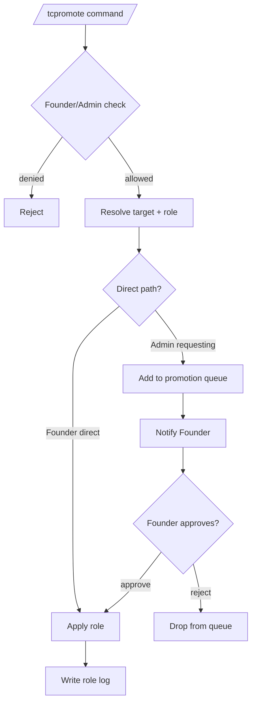

# Promote

This document describes the current promotion behavior implemented by `tcbot/modules/admins.py` (command + callback handlers) and `tcbot/modules/helper/pipelines/promote_flow.py` (the `Promote` class and shared logic).

For role hierarchy and rules, see [`roles.md`](roles.md). For the demote flow,
see [`demote.md`](demote.md). For shared helpers, see
[`../../architecture/helpers.md`](../../architecture/helpers.md). For the
database layer, see
[`../../architecture/database.md`](../../architecture/database.md).



## Purpose

Promotion assigns one of the federation roles (Admin, Developer, or Tester) to a user. Founder is not assignable through `/tcpromote`; ownership transfer uses `/transferowner` instead.

## Command surface

Aliases (matched in any prefix configured by `cfg.prefixes`):

- `/tcpromote` · `/tcp`
- `/tcpromoterequests` · `/tcreqs`
- `/tcpromotelist` · `/tcplist`

| Command | Who can use | Purpose |
|---|---|---|
| `/tcpromote <target> [role]` | Founder, Admin | Assigns a role directly, or sends a request when Admin promotes to Admin. |
| `/tcpromoterequests` | Anyone | User submits a request for themselves to become Admin. |
| `/tcpromotelist` | Founder, Admin (`@staff_only`) | Lists pending Admin promotion requests. |

The target is resolved by `extraction.extract_target`; accepts a reply, user ID, or resolvable `@username`.

A target with an active federation ban cannot gain a role. The ban is enforced per group by Telegram and not by the bot's own role resolution, so a banned holder of a staff role would keep moderating from every chat where the ban did not land. The guard fails closed: a failed ban lookup refuses the promotion instead of granting rank on an unknown state. It applies to the direct command, the role-picker callback, the public request path, and the Founder's approval of a queued request, so a request filed before the ban landed cannot be approved into a role.

Both the command and the role-picker callback apply the same identity refusal (`identity.refuse_message("promote", ...)`), so neither entry point can grant a role to the anonymous-admin placeholder or a Telegram service account.

A bare role token with no reply target (e.g. `/tcpromote developer`) is treated as role-only input: the command asks for an explicit target instead of fuzzy-matching the token against cached names, so a cached namesake can never be promoted by accident. Promote a namesake by ID, `@username`, or reply.

## Role aliases

The first argument after the target accepts these tokens (case-insensitive):

| Argument | Resolves to |
|---|---|
| `admin` | `admin` |
| `developer` · `dev` | `developer` |
| `tester` · `test` | `tester` |

Omitting the role triggers the inline button menu built by `keyboards.promote_role_kb()`.

## `Promote` class API

`pipelines/promote_flow.py` exposes a single `Promote` class with three entry points used by the command and callbacks. The module-level `ROLE_ALIASES` dict is exported for use by the command parser.

```python
from tcbot.modules.helper.pipelines.promote_flow import ROLE_ALIASES, Promote

Promote.available_roles_for(executor_role)  # list[str]
await Promote.execute(
    bot,
    admin_id,
    admin_fname,
    executor_role,
    target_id,
    target_fname,
    current_role,
    role,
)  # tuple[ok, reply_text]
await Promote.request_admin(
    bot, admin_id, target_id, target_fname, target_username=None
)  # tuple[ok, reply_text]
```

| Member | Purpose |
|---|---|
| `Promote.available_roles_for(executor_role)` | Returns the roles an executor with `executor_role` can assign. |
| `Promote.execute(...)` | Full role-assignment flow used by `/tcpromote` (command + inline button). Routes to `assign_admin`, `assign_subrole`, or `request_admin` depending on requested role and executor role. A target with an active ban is refused before any role is written. |
| `Promote.request_admin(...)` | Enqueues an Admin promotion request and notifies the Founder via DM, with the log channel as a fallback. |
| `assign_admin(...)` | Founder-only path that upserts `tc_admins`, removes any existing Developer/Tester role, sends the promotion log, and DMs the target. |
| `assign_subrole(...)` | Founder/Admin path for Developer/Tester role; atomically replaces any previous custom role via `users_roles.set_role` (upsert, no separate remove step), sends the promotion log, and DMs the target. |

## Permission matrix

| Executor | Direct role choices | Admin promotion |
|---|---|---|
| Founder | Admin / Developer / Tester | Direct assign |
| Admin | Developer / Tester | Submits request to Founder |
| Developer / Tester / no-role | N/A | N/A (no permission) |

The executor's role is enforced by the `@decorators.staff_only` decorator on `cmd_promote`; the actual decision logic inside `Promote.execute` then rejects rank-equal or rank-higher targets.

## Guardrails

`Promote.execute` rejects the following:

- Target is Founder (`That's the Founder - can't assign a role over them.`)
- Target already holds the requested role or a higher role.
- Admin tries to assign Admin to someone who is already Admin (handled by the rank check above).
- Promoting a user who is currently Admin into Developer/Tester (must demote first).

The command-level handler `cmd_promote` rejects self-promotion, the bot itself, Telegram, and anonymous-admin targets before delegating. Other (third-party) bots are not detected: `extract_target` returns only an ID and name, so they classify as regular users and can be promoted; only staff can trigger this, and the role is removable via `/tcdemote`.

## Direct Founder promotion to Admin

When the Founder issues `/tcpromote @user admin`:

1. `users_roles.add_admin(target_id, founder_id)` upserts into `tc_admins`.
2. If the target previously held Developer or Tester, `users_roles.remove_role(target_id)` clears `tc_roles`.
3. `users_cache.upsert_user(target_id, None, target_fname)` refreshes the member cache.
4. A `messages.promoted(role="admin", ...)` log is sent to `cfg.logs`.
5. The target is DM'd a welcome notification.
6. The command replies with `Done. <mention> - <code id> is now a <community> Admin.`

## Founder/Admin promotion to Developer/Tester

When Founder or Admin assigns Developer/Tester:

1. `users_roles.set_role(target_id, role, assigned_by)` atomically upserts into `tc_roles` (no separate remove step; the upsert replaces any existing Developer/Tester entry).
2. `users_cache.upsert_user(...)` refreshes the cache.
3. A `messages.promoted(role=role, ...)` log is sent to `cfg.logs`.
4. Target is DM'd.

## Admin request to promote to Admin

Admins cannot directly assign Admin. `Promote.execute` detects this and delegates to `Promote.request_admin`, which:

1. Checks for an existing pending request via `queues_db.get_request(target_id)`.
2. Inserts a new `promotion_requests` document with `status="pending"` via `queues_db.enqueue(...)`.
3. Resolves the Founder's user ID via `users_roles.get_owner_id()`.
4. DMs the Founder a review card with Approve / Reject buttons (`keyboards.promo_decision_kb`).
5. Falls back to posting in `cfg.logs` when the Founder DM fails.
6. Returns `Submitted - the Founder has been notified and will review it shortly.`

Only one pending request per target is allowed.

## `/tcpromoterequests` behavior

A user submits a request for themselves to become Admin. `cmd_promote_request` fetches the caller's existing effective role and any open pending request in parallel via `asyncio.gather`. It refuses if the caller already holds a federation role (no request needed) or already has a pending request. `identity.classify` is intentionally not called here because the caller is both the executor and the target, which would always produce an `Identity("self")` refusal - incorrect for a self-submission flow. Otherwise it delegates to `Promote.request_admin` with `admin_id = user.id` and `target_id = user.id`, and the same DM/log/queue path applies. Only one pending request per requester is allowed.

## Callback routing

| Button | Callback data | Handler |
|---|---|---|
| Role option | `promo_role:<role>:<target_id>:<executor_id>` (legacy without executor still works) | `on_promote_role_btn` |
| Cancel | `promo_role_cancel:<target_id>:<executor_id>` (legacy `:<target_id>` still works) | `on_promote_role_cancel` |
| Approve / Reject (Founder DM) | `promo_approve:<request_id>` / `promo_reject:<request_id>` | `on_promo_decision` |

All callbacks re-check the tapper's current effective role (Founder/Admin) before applying any write, so a user who lost permission between selecting and confirming is rejected with an alert. New prompts carry the opener in both the role buttons and the cancel button, so only that staffer can act on or collapse the picker; a different tapper gets an alert and the prompt stays live. Legacy taps without an executor segment act as the tapper with the rank re-check. The role and demote-confirm callbacks re-run the same identity refusal as the command path, so the anonymous-admin placeholder, a Telegram service account, and the tapper themselves cannot be reached through a callback either.

### Approval path

1. `queues_db.resolve(request_id, "approved", admin.id)` marks the request resolved. The claim is atomic, so a concurrent approve and reject cannot both win; the loser finds the request already resolved and stops.
2. `users_roles.add_admin(target_id, admin.id)` upserts `tc_admins`.
3. Best-effort cleanup mirrors the direct Founder path: `users_roles.remove_role(target_id)` clears any stale Developer/Tester row (otherwise it resurrects on the next demote) and `users_cache.upsert_user(...)` refreshes the display name. Failures only log; the promotion already committed.
4. `messages.promote_approved_log(...)` is sent to `cfg.logs`.
5. Target is DM'd a welcome notification.
6. The review message is edited to append `- Approved by <admin name>` and the keyboard is removed.

The resolve happens before the grant on purpose: the atomic claim decides the race, and granting first would leave a target promoted even when the request was resolved by the other button.

### Rejection path

1. `queues_db.resolve(request_id, "rejected", admin.id)`.
2. `messages.promote_rejected_log(...)` is sent to `cfg.logs`.
3. Target is DM'd a rejection notification.
4. The review message is edited to append `- Rejected by <admin name>`.

## Logs

All promotion paths share a single log builder for consistency:

| Function | Trigger |
|---|---|
| `messages.promoted(target_id, target_fname, role, by_id, by_fname)` | Direct role assignment (Admin/Developer/Tester). Title: `New <community> Promoted`. |
| `messages.promote_request_log(...)` | A new Admin promotion request is created. |
| `messages.promote_approved_log(...)` | The Founder approves a pending request. |
| `messages.promote_rejected_log(...)` | The Founder rejects a pending request. |

The unified `promoted` builder places the role as a field below the user (`Role: Admin`) so the title stays the same regardless of which role is assigned.

## Edge cases

- The effective-role cache (`effective_role_cache` in `tcbot/database/cache/`) is invalidated by every write so subsequent reads see the new role.
- A user holds at most one live role: the direct Founder path and the approval path both clear any Developer/Tester row when granting Admin, and Developer/Tester assignment is a single atomic upsert.
- DM notification failures are tolerated through `asyncio.gather(..., return_exceptions=True)` or explicit fallback logging; promotion still completes.
- Pending requests are not deleted after approval/rejection; they are flagged with `status`, `resolved_date`, and `resolved_by`.
- `cmd_promote` and `cmd_demote` share `resolve_executor_target` plus `classify_and_load_role` in `tcbot/modules/helper/decorators/` (executor role + target, then classify + role, both parallel and fail-closed); the role-button and demote-confirm callbacks share `check_callback_staff` (rank re-check alongside `q.answer()` so the spinner clears in one round trip). Cancellation always propagates.
- `Promote.request_admin` propagates `CancelledError` from the enqueue/owner fetch instead of coercing it into a queue verdict.

## Behavior reference

- Founder can promote any role directly.
- Admin can promote Developer / Tester directly.
- Admin promoting to Admin enqueues a request rather than writing `tc_admins`.
- Duplicate pending requests for the same target are rejected.
- Non-Founder cannot approve/reject promotion requests.
- Self-promotion, bot promotion, and promotion-of-Founder are rejected.
- Inline role-button menu re-checks executor role at click time.
- Only the prompt opener can complete or cancel the inline role picker; other staff get an alert.
