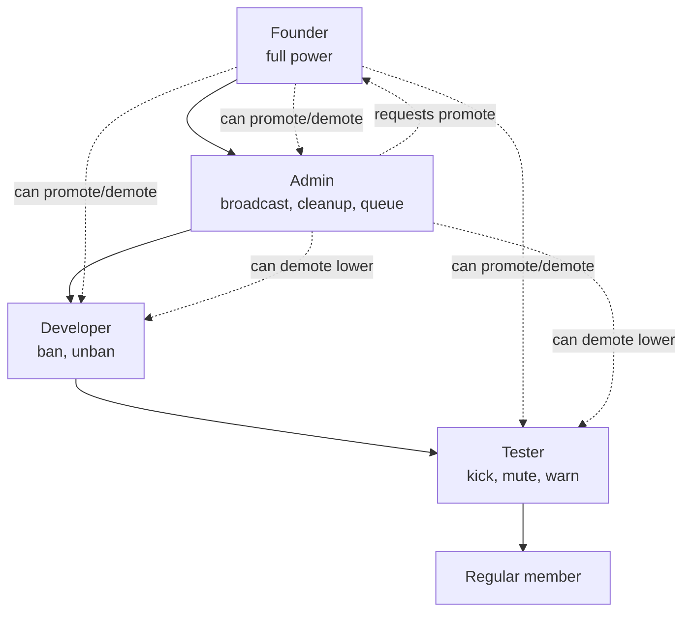
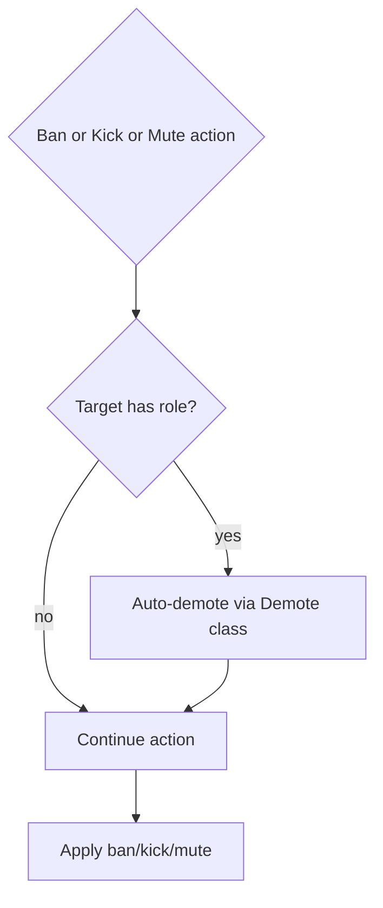

# Roles

This document describes the current role and staff-management behavior implemented by `tcbot/modules/admins.py`, `tcbot/modules/helper/pipelines/promote_flow.py`, `tcbot/modules/helper/pipelines/demote_flow.py`, `tcbot/modules/helper/guards.py` (for `resolve_and_check`), `tcbot/modules/helper/identity.py` (for target identity refusals), `tcbot/database/users_roles.py`, and `tcbot/database/queues_db.py`.

For promote command details, see [`promote.md`](promote.md). For demote command
details, see [`demote.md`](demote.md). For module structure, see
[`../../architecture/modules.md`](../../architecture/modules.md). For shared
helpers, see [`../../architecture/helpers.md`](../../architecture/helpers.md).
For the database layer, see [`../../architecture/database.md`](../../architecture/database.md).

Every staff-management command except `/tcpromoterequests` (`/tcpromote`, `/tcdemote`, `/transferowner`, `/tcunwarn`, `/resetwarns`) classifies the target through `identity.classify(...)` and refuses disallowed identities (self, this bot, Telegram service account, other bots, Founder, and higher-rank staff where applicable) via `identity.refuse_message(action, ident)` before mutating state. `/tcpromoterequests` is the exception: the caller is both executor and target, which would always produce a self-refusal, so it instead checks `get_effective_role` and `queues_db.get_request` directly to reject callers who already have a role or a pending request.

## Purpose

The role system controls who can perform moderation and administrative actions. It combines one Founder/owner, Admin records, and custom Developer/Tester roles into a single effective hierarchy used across bans, kicks, warnings, unbans, promotion flows, and role protection.

## Effective role hierarchy

Effective roles are resolved by `users_roles.get_effective_role(user_id)`:

1. Read the active `role_assignments` row of the user.
2. Map its `role_key` back to the application vocabulary.
3. Cache the result in `effective_role_cache`.

Only `developer` and `tester` are accepted as custom roles: `set_role` refuses anything else on write, and resolution ignores an unknown stored value (logged as an error, treated as no role) so a legacy or hand-edited row can never grant privilege.

The rank table is:

| Effective role | Rank | Catalog role key |
|---|---:|---|
| `founder` | 4 | `owner` |
| `admin` | 3 | `admin` |
| `developer` | 2 | `developer` |
| `tester` | 1 | `moderator` |
| `None` | 0 | No role |

`ROLE_LABEL` maps these internal names to display labels: Founder, Admin, Developer, Tester.

The catalog calls the last tier `moderator`; the handlers call it `tester`. `ROLE_KEY_BY_APP_ROLE` and `APP_ROLE_BY_ROLE_KEY` are the only place the two vocabularies meet.

## Permission model

The helper `role_rank(role)` converts an effective role into its numeric rank. Executor-versus-target checks go through `guards.resolve_and_check()`, which allows the action only when the executor rank is strictly greater than the target rank. If either role lookup fails, the check fails closed with a retry reply rather than treating the failed lookup as a user with no role; cancellation always propagates.

The rule is applied at two moments. The entry command compares the roles when the moderator starts the flow, and `guards.enforcement_refusal()` compares them again when the action is enforced, because the reason and proof steps stay open for a minute. A target promoted in that window would otherwise be actioned by a moderator who no longer outranks them, so the ban, kick, mute, and warn executors re-read both roles fresh and refuse the action. The enforcement verdict also carries the tier the action needs, so a moderator demoted below that tier during the same window is refused there. The refusal happens before anything is recorded, so it leaves no audit row, no ban record, no warning counter, and no orphan proof behind. A role lookup that fails refuses the action as well.

Common moderation thresholds:

| Action | Minimum effective role |
|---|---|
| `/tcban` | Developer |
| `/tcunban` | Developer/Admin/Founder via `mod_only` |
| `/tckick` | Tester |
| `/tcwarn` | Tester |
| `/tcunwarn` | Tester/Admin/Founder via `basic_mod_only` |
| `/resetwarns` | Tester/Admin/Founder via `basic_mod_only` |
| Appeal decision buttons | Founder or Admin via `users_roles.get_effective_role` (fresh read) |
| `/tcpromote` | Founder or Admin |
| `/tcdemote` | Founder or Admin |
| `/transferowner` | Founder only |
| `/tcpromotelist` | Founder or Admin via `staff_only` |
| Promotion approve/reject buttons | Founder only |

### The permission catalog

The schema carries a permission catalog next to the role assignments:
`permission_definitions` names the capabilities, `role_permissions` says
which role holds which one, and `role_definitions` gives every role its
priority. The catalog is the reference the tier model is checked against.

`users_roles.has_permission(user_id, permission_key)` is the single
authorization primitive of the schema. It calls the database function
`actor_has_permission`, which reads the active assignment and walks down
to the permission list. It returns `False` for a user without an
assignment, an expired assignment, or an unknown permission, so a failure
never grants privilege.

The handlers gate a command on a tier rather than on a permission key, so
the two have to agree. `tests/test_rbac_catalog.py` pins that: for every
gated command it names the capability and the tier the handler enforces,
and the test fails when the seeded grants no longer match the tier model.
A change to either side has to be a change to both.

| Capability | Tiers that hold it |
|---|---|
| `moderation.ban`, `moderation.unban` | Founder, Admin, Developer |
| `moderation.kick`, `moderation.mute`, `moderation.unmute`, `moderation.warn`, `moderation.unwarn`, `moderation.reset_warnings` | every tier |
| `moderation.review_appeals`, `roles.promote`, `roles.demote` | Founder, Admin |
| `roles.transfer_ownership`, `roles.review_promotion_requests`, `community.leave_all`, `community.speedtest` | Founder only |
| `community.broadcast`, `community.cleanup`, `groups.remove` | Founder, Admin |

## Persistent tables

| Collection | Purpose | Key fields |
|---|---|---|
| `role_definitions` | The role catalog: the display name and the priority of every role. | `role_key`, `display_name`, `priority` |
| `permission_definitions` | The permission catalog: the capability keys and their resource. | `permission_key`, `resource` |
| `role_permissions` | Which role holds which permission. | `role_key`, `permission_key` |
| `role_assignments` | The staff assignments, with their status and their expiry. | `user_id`, `role_key`, `status`, `assigned_by_user_id`, `assigned_at`, `expires_at`, `revoked_at` |
| `promotion_requests` | Stores pending/resolved staff promotion requests. | `request_id`, `target_id`, `username`, `first_name`, `requested_role_key`, `promoted_by`, `status`, `requested_date`, `resolved_date`, `resolved_by` |

A demotion revokes the assignment row, it never deletes it, so the history of who held which role stays readable. Indexes are ensured for one active assignment per user, at most one active owner, and the role and status filters. `promotion_requests` carries a unique `request_id`, a compound `(target_id, status)`, a compound `(status, requested_date)` that serves the pending-list sort, and a partial unique index on `target_id` restricted to `status: "pending"` so each user has at most one open request (the dedup guard both `cmd_promote_request` and the Admin request path rely on).

Role and owner/admin writes invalidate relevant cache entries so permission checks see updated state. Effective-role and owner reads are cached: the per-user effective role serves from an L1 cache with a 60 s TTL and the owner ID from one with a 300 s TTL, so repeated authorization checks (auth decorators, `is_staff`, rate-limit tiering, promotion-request guards) cost zero database round trips on a hit. `set_owner` clears the entire effective-role cache because the previous owner's key is unknown.

## `/tcpromote` behavior

`/tcpromote` assigns a role or starts an approval request, depending on executor role and target role.

Aliases:

- `/tcpromote`
- `/tcp`

Accepted role arguments:

| Argument | Normalized role |
|---|---|
| `admin` | `admin` |
| `developer` | `developer` |
| `dev` | `developer` |
| `tester` | `tester` |
| `test` | `tester` |

Target resolution supports reply, user ID, and resolvable username.

### Promotion permissions

| Executor | Direct role choices |
|---|---|
| Founder | Admin, Developer, Tester |
| Admin | Developer, Tester |
| Developer/Tester/unroled | No promotion access |

If the command omits the role argument, the bot shows an inline role-selection menu using `keyboards.promote_role_kb(...)`.

Role-selection callback data:

| Button | Callback data |
|---|---|
| Role option | `promo_role:<role>:<target_id>:<executor_id>` (legacy without executor still works) |
| Cancel | `promo_role_cancel:<target_id>:<executor_id>` (legacy without executor still works) |

The callback requires the prompt opener and re-checks the executor's current effective role before executing. If a different staffer taps, the bot answers with an alert and leaves the prompt live. If the opener lost permission, the bot answers with an alert and removes the markup when possible.

### Promotion guardrails

The promotion executor rejects these cases:

- The executor is not Founder/Admin.
- The target cannot be resolved.
- The executor tries to promote themselves.
- The target is the bot.
- The target is Founder.
- The target already has the requested role or a higher role.
- The target is already Admin and the requested role is Developer/Tester; they must be demoted first.

### Direct Founder promotion to Admin

When Founder promotes a target to Admin:

1. `users_roles.add_admin(target_id, founder_id)` grants the `admin` role.
2. If the target had a Developer/Tester role, `users_roles.remove_role(target_id)` revokes it.
3. `users_cache.upsert_user(...)` caches the display name.
4. A `promoted` log (with `role="admin"`) is sent to `cfg.logs`.
5. The target is notified by DM when possible.
6. The command message is updated/replied with a success message.

### Founder/Admin promotion to Developer or Tester

When Founder or Admin assigns Developer/Tester:

1. `users_roles.set_role(target_id, role, assigned_by)` grants the role in one transaction that revokes the assignment it replaces, so the user never holds two active roles.
2. `users_cache.upsert_user(...)` caches the display name.
3. A `promoted` log (with the assigned role) is sent to `cfg.logs`.
4. The target is notified by DM when possible.

### Admin request to promote someone to Admin

Admins cannot directly assign Admin. When an Admin tries to promote a target to Admin:

1. The bot checks for an existing pending request for that target.
2. A new request is inserted into `promotion_requests` with status `pending`.
3. The Founder is fetched from the active owner assignment.
4. The Founder is notified by DM with Approve/Reject buttons if possible.
5. If the Founder DM fails or no owner ID exists, the request is posted to the logs channel as a fallback.
6. The command replies that the request was submitted.

The pending-request guard is target-based: only one pending Admin promotion request is allowed for the same target.

## `/tcpromoterequests` behavior

Aliases:

- `/tcpromoterequests`
- `/tcreqs`

This command lets a user submit a request for themselves to become Admin.

Flow:

1. Anonymous-admin senders (GroupAnonymousBot) are rejected before any lookup.
2. The caller's effective role and any open pending request are fetched in parallel.
3. A caller who already holds a federation role (Founder, Admin, Developer, or Tester) is told no request is needed.
4. A caller who already has a pending request is told the request is pending.
5. Otherwise, the bot enqueues a new `promotion_requests` document with `target_id` equal to the user's ID and `Promote.request_admin` notifies the Founder.
6. The Founder is notified by DM with approve/reject buttons when possible.
7. The logs channel is used as a fallback notification destination.
8. The user receives a confirmation that the request was submitted.

## Promotion request callbacks

Approve/reject buttons are generated by `keyboards.promo_decision_kb(request_id)`.

| Button | Callback data |
|---|---|
| `Approve` | `promo_approve:<request_id>` |
| `Reject` | `promo_reject:<request_id>` |

Only the Founder can use these callbacks. The handler checks `users_roles.is_owner(admin.id, fresh=True)` before reading the request, so a transfer in another process takes effect immediately instead of lingering for the cache TTL.

### Approval

Approval does the following:

1. Adds the target to `role_assignments` with `users_roles.add_admin(...)`.
2. Marks the request `approved` with `queues_db.resolve(...)`.
3. Best-effort cleanup mirrors the direct Founder path: clears any stale Developer/Tester row and refreshes the member cache (otherwise the stale row resurrects on the next demote).
4. Sends a `promote_approved_log` to `cfg.logs`.
5. Notifies the target by DM when possible.
6. Edits the review message to append who approved it and removes the keyboard.

### Rejection

Rejection does the following:

1. Marks the request `rejected` with `queues_db.resolve(...)`.
2. Sends a `promote_rejected_log` to `cfg.logs`.
3. Notifies the target by DM when possible.
4. Edits the review message to append who rejected it and removes the keyboard.

## `/tcpromotelist` behavior

Aliases:

- `/tcpromotelist`
- `/tcplist`

This command is staff-only and lists all pending promotion requests. The output includes:

- Target mention.
- Target ID.
- Username when known.
- Request ID.

If no pending requests exist, the bot replies `No pending promotion requests.`

## `/tcdemote` behavior

Aliases:

- `/tcdemote`
- `/tcd`

Demotion removes an Admin, Developer, or Tester role after a confirmation step.

Flow:

1. Founder/Admin runs `/tcdemote <target>` or replies with `/tcdemote`.
2. The bot resolves executor role and target in parallel.
3. The executor must currently be Founder or Admin.
4. The target must hold a removable role.
5. Founder cannot be demoted through this command.
6. Admin targets can only be demoted by Founder.
7. The bot sends a confirmation keyboard.

Confirmation callback data:

| Button | Callback data |
|---|---|
| `Confirm` | `demote_confirm:<target_id>:<executor_id>` (legacy without executor still works) |
| `Cancel` | `demote_cancel:<target_id>:<executor_id>` (legacy without executor still works) |

The confirmation callback requires the prompt opener and re-checks executor permission and target role before writing. A different staffer tapping gets an alert and the prompt stays live. It revokes the active assignment of the target, whatever role it holds, so no stale row can resurrect the privilege on the next demote.

On success:

- A `demoted` log is sent to `cfg.logs`.
- The target is notified by DM when possible.
- The confirmation message is edited with a success message and keyboard removed.

Cancel answers the callback and edits the message to say no changes were made. New prompts carry the opener, so only that staffer can cancel; legacy callbacks keep working.

## `/transferowner` behavior

Aliases:

- `/transferowner`
- `/tfowner`

Only the current Founder can transfer ownership.

Flow:

1. The target is resolved by reply, user ID, or username.
2. Identity refusal rejects self-transfer, the bot, Telegram, other bots, anonymous-admin, and Founder targets.
3. `resolve_and_check(..., min_role="developer")` refuses transferring to a staff target of equal or higher rank, the current Founder included.
4. Any non-Founder role the target already holds is cleared first via `Demote.remove_role`, so the post-transfer state holds exactly one Founder with no residual Admin/Developer/Tester assignment.
5. `users_roles.set_owner(target_id)` swaps the owner in one transaction: the active assignments of the new owner and of the old owner are revoked and the new owner assignment is inserted, all under an advisory lock, so a crash between them cannot leave the community without a Founder.
6. The in-process error-reporter owner is refreshed to the new owner.
7. The previous Founder is kept as Admin via `users_roles.add_admin(...)`; a failure here stays visible as a WARNING line telling the operator to grant Admin manually.
8. The owner cache is updated and the effective-role cache is cleared entirely.
9. An `ownership_transferred` log is sent to `cfg.logs` in parallel with the reply.
10. The command replies with the new owner mention.

After transfer, the previous Founder becomes Admin and the new target becomes Founder.

## Auto-demotion on moderation actions

`Demote.execute(..., trigger="ban"|"kick"|"mute")` from `pipelines/demote_flow.py` is used before ban/kick/mute when the target has a lower staff role than the executor.

Behavior:

- The target's active role assignment is revoked, so no stale assignment survives in the other collection.
- Send the same `demoted` log to `cfg.logs` as manual demotion (the log never notes the trigger).
- DM the target that their role was removed because they were banned, kicked, or muted.

Ban, kick, and mute command modules block equal/higher-ranked targets before calling auto-demotion, so auto-demotion only applies to lower-ranked staff targets.

A single warning below the warn limit does not auto-demote. However, when the warn limit is reached, `warn_flow` calls `Demote.execute(trigger="ban")` and then exempts the staff target from the auto-ban (staff are never auto-banned via warnings); the threshold warn itself is still recorded. Individual warnings below the threshold leave the role intact.

## Logs

Role and promotion logs are built in `messages/` (`audit_logs.py`):

| Template | Trigger |
|---|---|
| `promoted(target_id, target_fname, role, by_id, by_fname)` | Founder/Admin promotes a user to the named role (Admin, Developer, or Tester). |
| `demoted(target_id, target_fname, role, by_id, by_fname)` | Role removed. Identical for manual demotion and auto-demote during a ban, kick, or mute (the log template has no trigger parameter). |
| `ownership_transferred` | Founder transfers ownership. |
| `promote_request_log` | Admin promotion request created. |
| `promote_approved_log` | Founder approves a promotion request. |
| `promote_rejected_log` | Founder rejects a promotion request. |

## Edge cases

- Effective role cache can make reads fast, but writes invalidate affected users or clear the cache when ownership changes.
- A user holds at most one live role: both the direct Founder path and the approval path clear any Developer/Tester row when granting Admin.
- Direct Founder promotion to Admin removes existing Developer/Tester custom role, and promotion-request approval now does the same.
- Promotion and demotion callbacks re-check current permissions at click time; losing permission after the menu was created blocks the callback.
- Founder cannot be assigned over or demoted through the normal role commands.
- Admin cannot demote Admin; Founder is required.
- Admin cannot directly promote a target to Admin; a request is created instead.
- Pending promotion requests are not deleted after approval/rejection; they are marked with `status`, `resolved_date`, and `resolved_by`.
- DM notification failures are tolerated in most role flows through `asyncio.gather(..., return_exceptions=True)` or explicit fallback logging.

## Behavior reference

Key role-system behaviors to keep in mind:

1. `get_effective_role` returns the role of the active assignment, mapped to the application vocabulary.
2. `role_rank(None)` returns `0`.
3. `resolve_and_check` allows the action only when executor rank is strictly higher than target rank.
4. Founder can directly promote Admin/Developer/Tester.
5. Admin can directly promote Developer/Tester.
6. Admin attempting to promote Admin creates a pending request.
7. Duplicate pending promotion requests for the same target are rejected.
8. Non-Founder cannot approve/reject promotion request callbacks.
9. Founder approval grants the admin role and resolves the request.
10. Founder rejection resolves the request without granting Admin.
11. `/tcdemote` blocks self-demotion and Founder demotion.
12. Admin cannot demote Admin.
13. Confirm demotion revokes the active role assignment of the target.
14. Transfer ownership makes the old Founder an Admin and replaces the owner assignment.
15. Ban/kick/mute auto-demotes lower-ranked staff targets and logs the role removal.
16. Equal-rank and higher-rank targets are protected from ban/kick/mute/warn actions.
