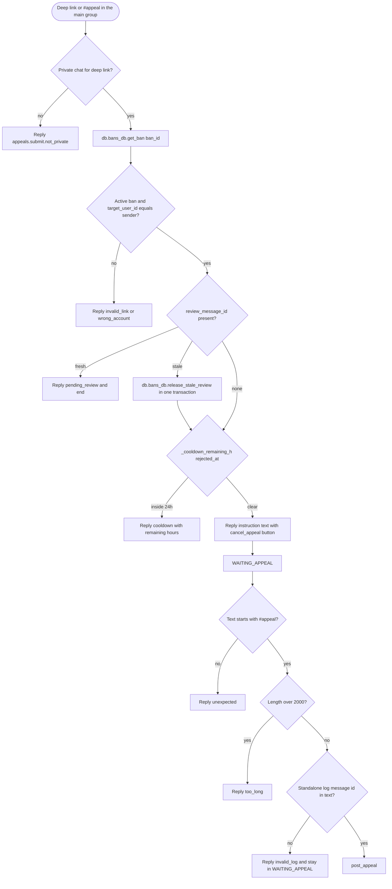
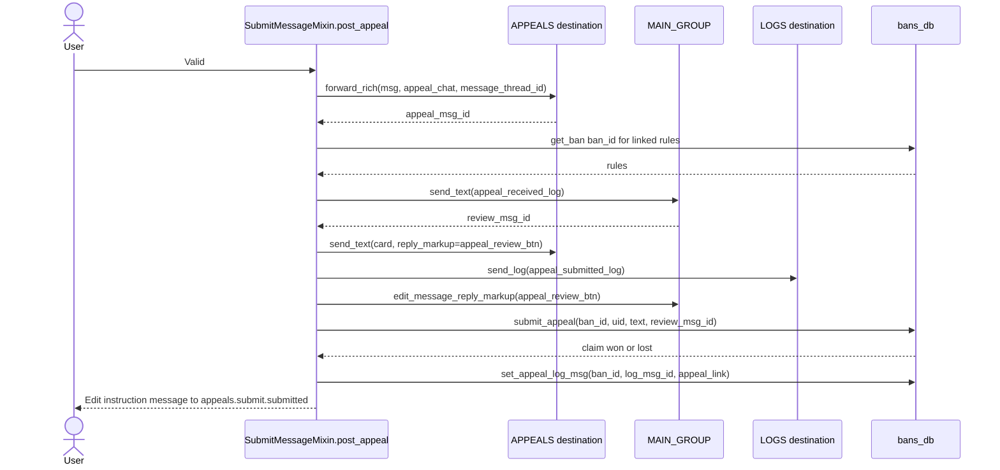
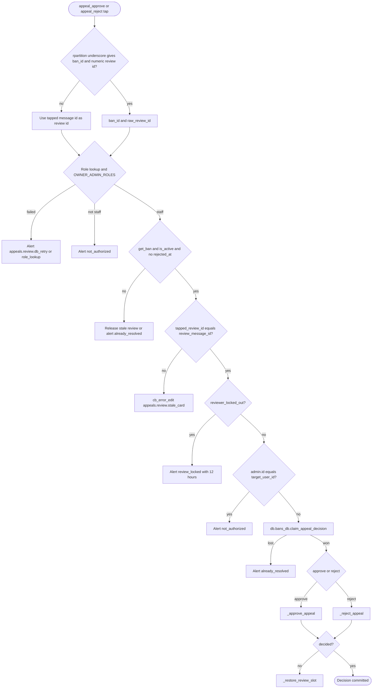
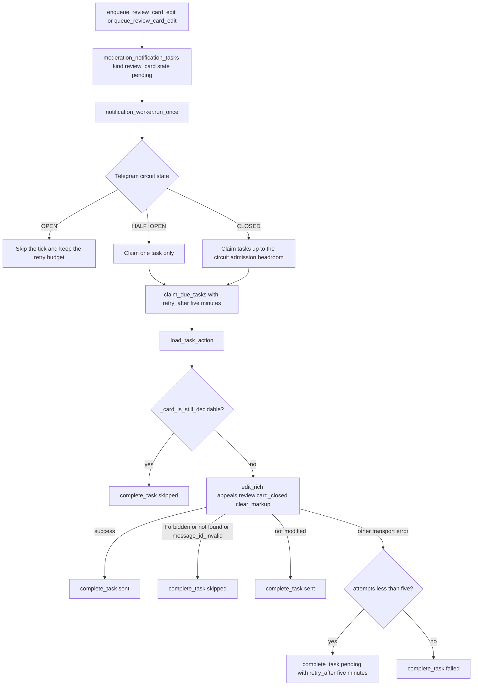

# Appeals

This page traces an appeal from its deep link or group tag through validation,
the atomic submit and review-slot claim, the staff decision, the durable card
edit, and the unban continuation. The authorization gate is in
[Permissions](permissions.md); the worker outbox is in
[Persistence](persistence.md#notification-worker-outbox).

## Entry points

| Entry | Filter or handler | Gate |
|---|---|---|
| Private deep link | `_APPEAL_START_CMDS` in `modules/appeals.py` matches `<prefix>start appeal_<ref>` for every configured prefix with `filters.private` | `appeal.build_handler`, entry `_on_entry`. |
| Main-group tag | `MessageHandler(filters.text & ~ALL_PREFIXES_CMD_FILTER & filters.regex(r"(?i)^\s*#appeal"), on_group_appeal)` | `cfg.is_primary_group(chat.id)`, then the sender's active ban. |
| Staff decision | `CallbackQueryHandler(on_appeal_decision, pattern=r"^appeal_(approve|reject)_\S+$")` | `THROTTLE_STAFF`, then `AppealReviewMixin.on_decision`. |

`REF_PATTERN` is `r"[a-z0-9]{10,32}"`, and `_ARG_PATTERN` wraps it as
`appeal_({REF_PATTERN})`. `match_prefixed_arg()` in `utils/prefixes.py` is the
single parser for both the handler filter and `_on_entry`, so every configured
prefix works. The full reference range is accepted because an imported legacy
decision carries a longer public reference. `starts_with_appeal_tag()` is
case-insensitive and checks the stripped prefix `#appeal`.

The group path ties the message to the sender's own active ban through
`db.bans_db.get_active_ban(user.id)`; it stores `appeal_ban_id` and
`appeal_log_msg_id` in the flow scope and delegates to the same
`SubmitMessageMixin._on_message` used by the DM path.

## Submission



The instruction prompt is built by `instruction_text()` from
`appeals.instruction.*` catalog keys. Its message id is kept as
`appeal_instruction_msg_id` in `flow_scope(ctx)` and used for the
live-card guard in `_on_cancel` and for the submitted-state edit.

The three scope keys owned by the submit flow are `appeal_ban_id`,
`appeal_log_msg_id`, and `appeal_instruction_msg_id`. `_clear_appeal_state()`
removes them on every terminal path.

## Atomic submit and review posting



The review card id is the decision token, so the main card is posted first and
its keyboard is attached only after `review_msg_id` is known. A keyboard attach
failure deletes the main and APPEALS cards and treats the post as failed; a lost
claim deletes both cards, replies `appeals.submit.pending_review`, and ends the
conversation. `throw_if_cancelled()` preserves cancellation when the three
concurrent post operations are gathered with `return_exceptions=True`.

`appeal_review_btn(ban_id, review_message_id)` in `buttons/appeal.py` emits
`appeal_approve_<ban_id>_<review_message_id>` and
`appeal_reject_<ban_id>_<review_message_id>` with SUCCESS and DANGER styles.

### Database helpers

| Helper | File | Contract |
|---|---|---|
| `submit_appeal(ban_id, appellant_user_id, appeal_text, review_message_id)` | `bans_db/_writes.py` | One transaction: conditional slot claim plus `moderation_appeals` insert with `status="pending"`. Returns `True` only for the claim winner. |
| `set_review_if_absent(ban_id, msg_id)` | `bans_db/_writes.py` | Conditional UPDATE setting `review_message_id` and `review_timestamp`; loser matches no row. |
| `release_stale_review(ban_id, review_message_id)` | `bans_db/_writes.py` | One transaction: drop the reviewed slot only when `_slot_holds(msg_id)`, then withdraw pending appeals. |
| `restore_review(ban_id, review_msg_id, review_timestamp)` | `bans_db/_writes.py` | Hand a consumed slot back only when the slot is free and `_pending_appeal_exists()`. |
| `set_appeal_log_msg(ban_id, msg_id, appeal_link)` | `bans_db/_writes.py` | Update `appeal_link` metadata and append a `moderation_messages` row of kind `appeal_log`. |
| `claim_appeal_decision(ban_id, review_msg_id)` | `bans_db/_writes.py` | Consume the slot only when `_slot_holds(review_msg_id)`; the single winner may decide. |
| `approve_appeal_and_queue_unban(...)` | `bans_db/_lifecycle.py` | One transaction: appeal to `accepted`, ban to `revoked`, drop review keys, queue a `revoke` enforcement run. |
| `reject_appeal(ban_id, reviewer_id, reviewer_name)` | `bans_db/_lifecycle.py` | One transaction: appeal to `rejected` with `resolved_at`, reviewer fields, and drop review keys. |
| `revoke_ban_and_queue_unban(...)` | `bans_db/_lifecycle.py` | Staff `/tcunban` path; withdraws pending appeals and can queue a card edit. |

Slot keys live in ban metadata as `META_REVIEW_MESSAGE = "review_message_id"`
and `META_REVIEW_TIMESTAMP = "review_timestamp"`, defined in `bans_db/_shared.py`.
`_slot_is_free()` checks the extracted value, `_slot_holds(msg_id)` compares it as
text, `_merge_metadata()` merges a JSONB patch, and `_drop_review_keys()`
subtracts both keys.

## Time windows

| Window | Constant or source | Value | Effect |
|---|---|---|---|
| Reviewer lock | `LOCK_HOURS` in `appeal_review.py` | `12` hours | `reviewer_locked_out()` blocks a non-actor reviewer while `utc_now() - review_timestamp < 12h`. The original ban actor is not blocked. |
| Stale review | `_STALE_REVIEW_HOURS` in `appeal_submit.py` | `72` hours | `_is_stale_review()` allows `release_stale_review()` once the stored review is older than 72 hours. |
| Rejection cooldown | `_REJECTION_COOLDOWN_HOURS` and `_REJECTION_COOLDOWN` | `24` hours | `_cooldown_remaining_h()` returns whole hours left from `rejected_at`, rounded up; a value other than `None` blocks a new submission. |
| Appeal deadline | `_in_force()` in `bans_db/_shared.py` | `expires_at is NULL OR expires_at > utc_now()` | The atomic claim and the approve path both require an in-force ban, so a timed ban whose deadline passed cannot be decided. |
| Maximum appeal text | `_MAX_APPEAL_LEN` | `2000` characters | Longer text gets `appeals.submit.too_long` and stays in `WAITING_APPEAL`. |
| Restore bound | `_RESTORE_TIMEOUT_S` | `5.0` seconds | `asyncio.wait_for` bounds `restore_review()` on the failure and cancellation paths. |

`rejected_at` is composed in `bans_db/_compose.py` from the appeal's
`resolved_at`. The 12-hour window is a reviewer lock, not an appeal deadline.

## Staff decision path



The query is answered per branch, never up front: Telegram accepts one answer,
so an early ack would swallow the refusal alerts. `answer_ack(q)` runs only after
the decision is committed.

### Approve

1. `get_effective_role(target_id, fresh=True)` and `get_first_name` run in
   parallel. A failed role lookup ends with `appeals.review.db_retry` and no decision.
2. `guards.outranks(approver_role, target_role)` is a critical check: approving
   strips a federation role and lifts the ban in every group, so an Admin must
   not outrank-decide a peer Admin.
3. `db.groups_db.active_groups()` feeds `with_primary_groups(..., (cfg.main_group,))`
   to build `chat_ids`.
4. A staff target first passes `demote_before_unban(..., trigger="appeal")`;
   `may_proceed == False` fails closed with `appeals.review.demote_blocked`.
5. `approve_appeal_and_queue_unban(ban_id, admin.id, admin.first_name, admin.id, chat_ids)`
   commits the acceptance, revokes the ban, drops the review keys, and queues a
   `revoke:appeal:v1` run in one transaction.
6. `moderation_enforcement.deliver_queued_run(bot, run_id)` runs the unban now;
   `run_report` and `report_count(report, "failed_count")` log any groups left to retry.
7. Four independent notifications are gathered: the target DM
   `appeals.decision.approve_dm`, the card edit `appeals.decision.approve_card`,
   the edited log `messages.appeal_approved_edit`, and a separate
   `messages.appeal_unban_log`.

### Reject

`_reject_appeal` repeats the fresh role lookup and outrank gate, then calls
`reject_appeal(ban_id, admin.id, admin.first_name)`. A `False` result replies
`appeals.review.already_resolved`. On success it acknowledges, edits the card to
`appeals.decision.reject_card`, sends `appeals.decision.reject_dm` in the
target's locale, and edits the appeal log through `messages.appeal_rejected_edit`.

On either path, a failed card edit calls
`db.notifications_db.enqueue_review_card_edit(action_id, cfg.main_group, review_id)`
so the card is closed by the outbox worker. A path that ends without a decision
calls `_restore_review_slot()`, which re-raises `asyncio.CancelledError` and never
masks the original failure.

## Durable card edits



`notification_worker.py` owns `_MAX_ATTEMPTS = 5`, `_RETRY_DELAY =
timedelta(minutes=5)`, and `_MAX_TASKS_PER_TICK = 10`. `claim_due_tasks()` uses
`FOR UPDATE SKIP LOCKED` and increments `attempts` inside one transaction.
`complete_task(expected_attempts=..., expected_message_id=...)` applies the
update only while the same claim is still the current pending row, so a delayed
retry cannot settle a re-queued task. A `BadRequest` or `Forbidden` calls
`release_probe(reached_service=True)`; a transport failure calls
`record_failure()`. The edit goes through `edit_rich` with `clear_markup=True`,
so the decided card loses its Approve and Reject buttons. A claim the circuit
cannot admit is released with its attempt count intact instead of consuming the
retry budget.

## Audit and notification builders

| Builder in `modules/helper/messages/audit_logs.py` | Used for |
|---|---|
| `appeal_received_log(target_id, target_fname, ban_id, appeal_link, rules)` | Review card in MAIN_GROUP and the APPEALS copy. |
| `appeal_submitted_log(target_id, target_fname, ban_id, appeal_link)` | Initial log posted with `send_log`. |
| `appeal_approved_edit(...)` | Edited log after approval. |
| `appeal_rejected_edit(...)` | Edited log after rejection. |
| `appeal_unban_log(...)` | Separate unban log after approval. |

`LogBuilder` in the same module owns `field`, `code_field`, `mention_field`,
`link_field`, `raw`, `section`, `date`, and `build`. All user-facing DMs and cards
are rendered through the rich transport described in [Transport](transport.md);
no parse mode is selected.

## Freshness checks

A review payload is bound to the card it was rendered on. `on_decision` uses
`payload.rpartition("_")` and compares the tapped review id with
`ban["review_message_id"]`; a mismatch is a critical stale-card condition and
produces `appeals.review.stale_card`. Legacy payloads without the id fall back to
the tapped message id, so a card posted before the suffix existed works while a
replaced card is refused.

The submit prompt guards its cancel button by comparing
`appeal_instruction_msg_id` with `q.message.message_id`. It does not use
`scope.callback_is_current()`; the shared freshness helper and its call sites are
listed in [reference/callbacks.md](../reference/callbacks.md).

## Edge cases

- A legacy card without a review id falls back to the tapped message id, so a
  replaced card is still refused by the live-card check.
- An unknown prefixed command such as `.appeal` is not an appeal entry. With no
  live appeal, the fallback passes it to the next flow instead of ending a
  session or clearing state.
- A link for an inactive ban, a different account, or an undecidable timed ban
  is refused.
- A failed card edit does not fail the decision; the outbox owns the retry.
- An OPEN Telegram circuit pauses the notification worker so retry budgets are
  preserved.
- A `#appeal` message containing an ordinary long word is not mistaken for a
  malformed ban reference; the sender's active ban is the only authority.

## Validation

```bash
uv run pytest tests/ -q -k appeal
```

Relevant tests include `tests/test_appeal_*.py` and
`tests/test_notification_worker.py`.
