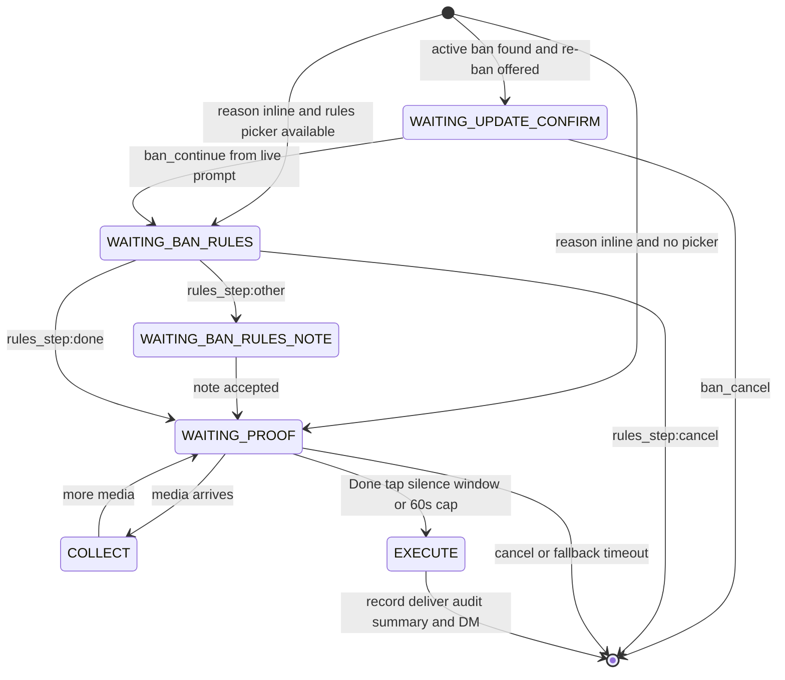
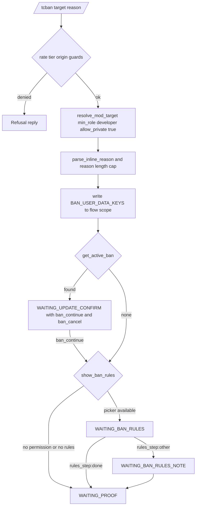
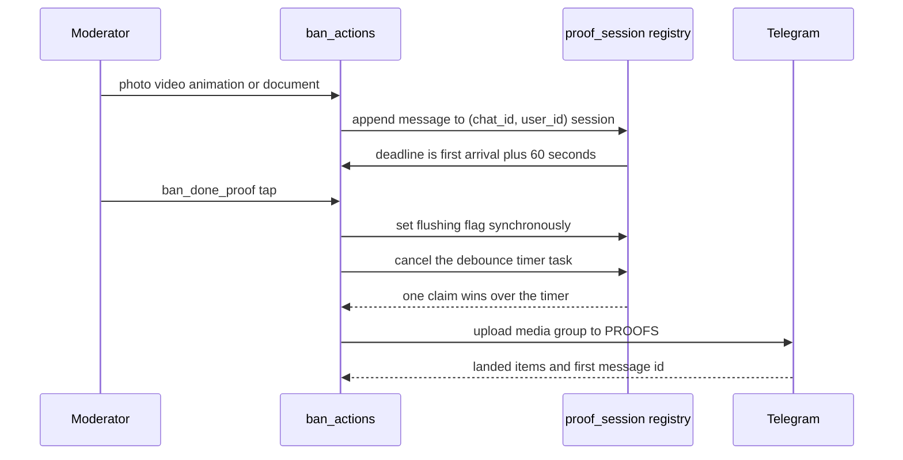
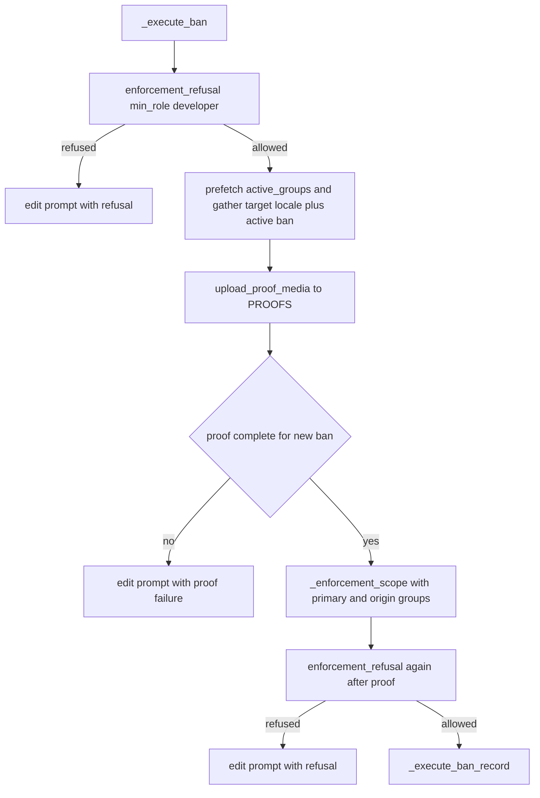
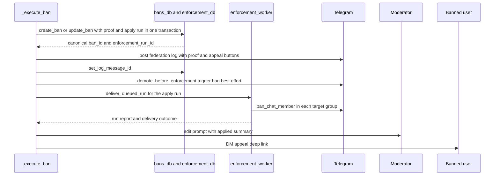
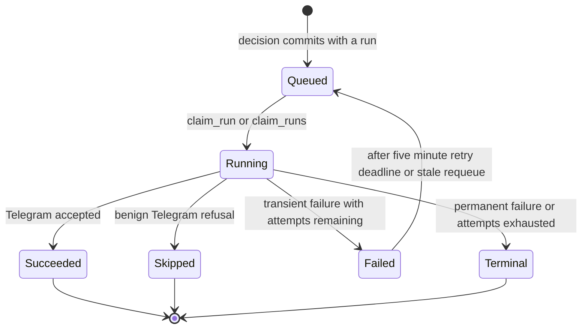

# Banning

This document follows one federation ban from command entry to appeal delivery.
It is the worked example for the whole system: the spine is in
[system.md](system.md), the authorization chain in
[permissions.md](permissions.md), and the worker lifecycle in
[persistence.md](persistence.md).

## Purpose and ownership

A federation ban records a `ban` decision in `moderation_actions` and applies a
Telegram ban across all active connected groups plus the primary groups. A ban
requires a reason and landed proof, archives every uploaded item, posts a
federation log with an appeal deep link, and queues durable enforcement. Proof
and log message ids, the appeal link, and the review slot are part of the
decision document.

Ownership: the command entry lives in `bans.py`; the conversation and executor
live in `ban_actions.py`, `ban_confirmation.py`, and `ban_rules_step.py`; proof
collection lives in `proof_steps.py` and `proof_session.py`; durable delivery
lives in `enforcement_worker.py`; persistence lives in `bans_db/` and
`moderation_db.py`.

## Commands and access

| Command | Alias | Access | Origin |
|---|---|---|---|
| `/tcban <target> <reason>` | `/tcb` | Developer and above (`mod_only`) | Bot DM or a connected or primary group. |

The handler uses `ratelimiter(THROTTLE_FEDERATION)` outermost, then `mod_only`,
then `log_execution`. A disconnected group is refused, and a connection-state
outage blocks the action rather than letting a non-federation chat drive
federation-wide enforcement.

Targets resolve by reply, numeric ID, or `@username`. A typed ID or username
that verifies as a real user different from the quoted sender overrides the
reply; a restated ID naming the quoted user is dropped from the reason. A reason
is required and shares the common 1000-character cap. Overlong inline reasons
fail fast before any role lookup. See
[Extraction and user data](extraction-user-data.md).

## Conversation states and callbacks



| State | Value | Meaning |
|---|---|---|
| `WAITING_PROOF` | 0 | Collecting proof media. |
| `WAITING_UPDATE_CONFIRM` | 1 | Confirming a re-ban of an active ban. |
| `WAITING_BAN_RULES` | 2 | Picking published rules to cite. |
| `WAITING_BAN_RULES_NOTE` | 3 | Entering an optional rules note. |

| Callback | Effect |
|---|---|
| `ban_continue` | Continue a re-ban from a live prompt. |
| `ban_cancel` | Cancel the prompt. |
| `ban_done_proof` | Flush collected proof now. |
| `rules_step:pick:<id>` | Toggle a published rule item. |
| `rules_step:done` | Accept the selection and continue. |
| `rules_step:other` | Enter a note. |
| `rules_step:clear` | Clear the selection. |

The rules picker is skipped when no rules are published or the moderator lacks
`rules.view`. The re-ban confirmation shows existing and new reasons plus
`View Log` and `View Proof` links. Prompt freshness is checked with
`scope.callback_is_current()` using `ban_prompt_chat_id` and
`ban_prompt_msg_id`, so a tap from an older prompt is discarded. The callback
path through the rules picker records the id of the message it edits, so the
freshness guard stays active there too.

## Entry to proof collection



The active-ban lookup fails closed: an outage replies with the database retry
notice and clears the flow scope instead of degrading into a fresh ban that
wastes a proof round.

`ban_confirmation.py` owns `stale_ban_callback()`. `on_ban_update_continue()`
answers the query, re-checks the tapper with `recheck_executor_rank(min_role="developer")`,
then delegates to `show_ban_rules()`. The picker stores selections in
`ban_rules` and the note in `ban_rules_note`, and reads
`rules_db.published_rules()`.

## Proof flush



The session is keyed by `(chat_id, user_id)` and carries a snapshot of the flow
scope. `_flush_session()` owns the session from its first await. It sleeps in
slices bounded by `cfg.album_debounce` and the hard 60-second deadline, then
flips `flushing` as a synchronous claim so `Done` and the timer cannot both
execute. Its `finally` block removes the registry entry and clears that
conversation's ban keys only when it still holds the same session. At shutdown
`drain_proof_sessions()` waits for running flushes up to 30 seconds, then
cancels those still in their silence window. See [Proof](proof.md).

## Enforcement gate and decision write

The enforcement path re-checks the executor twice: once before any proof upload
or record write, and again immediately before the decision is written. A
refusal edits the prompt and leaves no record, proof, or fan-out behind.



`_enforcement_scope()` merges connected groups, the configured primary group,
and the originating group. A ban issued from bot PM has no group origin, so the
scope is the primary group alone. A failed connected-group fetch still leaves
the origin group enforced, and the summary carries a scope warning.

`demote_before_enforcement(trigger="ban")` runs after the record commits and
before delivery on a best-effort basis. A role-lookup failure is logged loudly
and enforcement still runs, so a transient database outage cannot block the
action. See [Permissions](permissions.md#demote-gates-best-effort-versus-fail-closed).

## Decision, delivery, audit, and summary



`create_ban()` and `update_ban()` write the decision, open and close its case,
archive proof, link selected rules, and queue the `apply` run with idempotency
key `moderation:{action_id}:apply:v1` in one transaction. A unique partial index
permits one active ban per user; the loser of an insert race reuses or supersedes
the canonical record, so the log, appeal link, and target button all name the
surviving record.

Proof is mandatory for a new ban. A partial gallery, measured by
`expected_item_count` against landed items, aborts the ban. A re-ban may carry
the previous proof batch forward, and `update_ban()` reads the entire prior
evidence batch rather than just its first message.

## Enforcement worker retry lifecycle



An OPEN circuit pauses the worker entirely so no attempt is burned without a
delivery; a HALF_OPEN circuit claims a single probe. Claims are sized by the
breaker's `admission_headroom` and delivered in chunks so a mid-batch opening
cannot skip a claimed target. Each target has three attempts. `_record_target()`
appends an attempt row and moves the target to `succeeded`, `skipped`, or
`failed` with a five-minute retry deadline. A refusal from a demoted bot or lost
membership is a permanent failure with no retry deadline, so it stays visible
for operator repair. `redrive_run()` lets an operator bring failed targets
forward without creating a new decision. Full detail is in
[Persistence](persistence.md#enforcement-worker-lifecycle).

## Audit, summary, and appeal handoff

`messages.ban_log()` and `messages.ban_update_log()` build the federation log
posted to `cfg.logs` through `send_log`. The keyboard carries a proof link and an
appeal deep link built by `links.appeal_deep_link()`. The moderator's prompt is
edited in place with the applied, failed, and pending counts from
`delivery_outcome()`. The target receives a DM with the same deep link; a
`Forbidden` there is expected. The proof caption uses `proof_caption_new` for a
new ban and `proof_caption_update` for a re-ban.

## Edge cases

- An active-ban lookup failure fails closed with the database retry notice and
  clears the flow scope instead of starting a proof round that would abort.
- A new ban with partial or missing proof is refused before any record is
  written. A re-ban may carry the full previous evidence batch forward.
- A failed group ban is recorded per target and retried; it does not roll back
  the decision. A group that refused because the bot lost rights is a permanent
  failure and stays visible for operator repair.
- A timed decision that expired while its run waited is cancelled rather than
  served late.
- The demote step is best effort: a role-lookup failure is logged and ban
  enforcement still runs.
- The proof conversation is per chat and per user, so simultaneous flows stay
  isolated.
- A late command sent while a flush is already executing does not cancel the ban.
- Other registered commands sent during proof collection pass through to their
  own handlers; re-entering the ban command still ends the pending flow.

## Exact names

| Name | Owner | Role |
|---|---|---|
| `cmd_ban_start` | `bans.py` | Validated entry point. |
| `_ask_update_confirm` | `bans.py` | Re-ban prompt and prompt identity. |
| `ban_conversation` | `ban_actions.py` | ConversationHandler factory. |
| `on_proof_received` | `ban_actions.py` | Buffer proof into a session. |
| `on_done_proof` | `ban_actions.py` | Claim and run the flush from Done. |
| `_flush_session` | `ban_actions.py` | Debounce timer flush owner. |
| `_execute_ban` | `ban_actions.py` | Full enforcement orchestration. |
| `_execute_ban_record` | `ban_actions.py` | Decision write and federation log. |
| `on_ban_update_continue` | `ban_confirmation.py` | Re-ban confirmation handler. |
| `stale_ban_callback` | `ban_confirmation.py` | Prompt freshness guard. |
| `show_ban_rules` | `ban_rules_step.py` | Rules picker entry. |
| `demote_before_enforcement` | `demote_actions.py` | Best-effort pre-fanout demote. |
| `run_once`, `deliver_queued_run` | `enforcement_worker.py` | Durable delivery. |

## Persistence touchpoints

| Table or helper | Writer | Purpose |
|---|---|---|
| `moderation_actions` | `bans_db._writes` | Ban decision and lifecycle. |
| `moderation_cases` | `moderation_db` | One investigation per incident. |
| `moderation_evidence_uploads`, `moderation_evidence_items` | `moderation_db` | Landed proof batch. |
| `moderation_messages` | `bans_db._writes` | Federation log references. |
| `moderation_enforcement_runs`, `_targets`, `_attempts` | `enforcement_db` | Durable apply queue and ledger. |
| `moderation_appeals` | `bans_db._writes` | Appeal record and review slot. |
| `moderation_notification_tasks` | `notifications_db` | Durable review-card edits. |

## Validation

```bash
uv run pytest tests/ -q -k ban
```

Relevant tests include `tests/test_ban_*.py`, `tests/test_proof_items.py`, and
`tests/test_enforcement_worker.py`.
