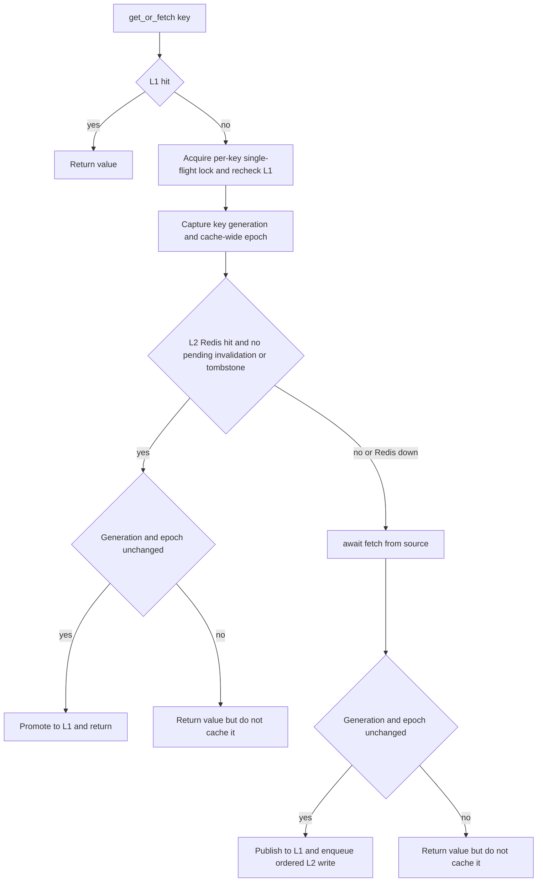
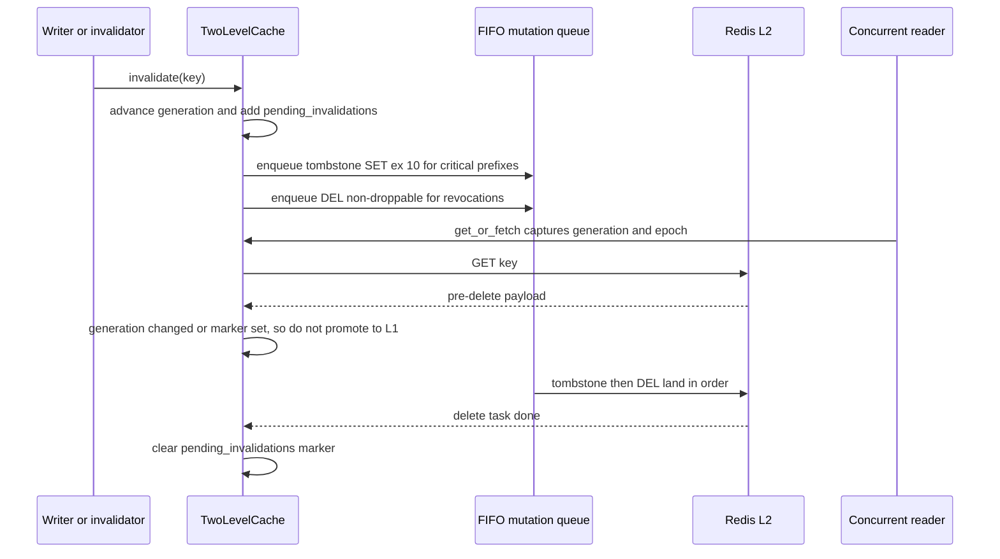
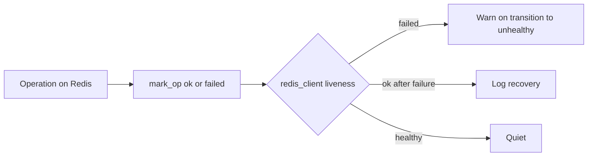

# Two-level cache

This document describes the in-process L1 cache, the optional Redis L2 cache,
and the invalidation guards that keep revoked roles, connections, and locales
from being served again. The write boundary is in
[Persistence](persistence.md); the TTL table is also in
[the database layer](../architecture/database.md).

## Layers and ownership

`TwoLevelCache[T]` owns both layers and the per-key single-flight lock.
`TTLCache[T]` is the L1 only: a `cachetools.TTLCache` with time-based expiry and
LRU eviction at `maxsize`. `CACHE_MISS` is a distinct sentinel, because `None`
is a valid cached value. Redis is L2 and optional; when it is absent the cache
behaves like a plain in-memory TTL cache and call sites need no configuration
change.

Redis keys use the `v2` namespace: `tcbot:<prefix>:v2:<key>`. The tagged JSON
wire format must stay byte-compatible with entries already in Redis.

## `get_or_fetch`

The per-key lock serializes concurrent misses for one key so only one source
read runs. Different keys remain fully parallel. `put_many()` stores multiple
entries in L1 and enqueues one non-transactional Redis pipeline for
non-revocation caches. `peek()` and `peek_many()` read
L1 and L2 without a database fetch; `peek_many` uses `MGET` in chunks of 500.
Peek values may be stale by design and are for display hints only, not
authoritative state.

## Tagged JSON codec

`codec.py` uses `msgspec` for JSON. A `datetime` is tagged before encoding so a
value written by either the current or the retired codec decodes identically.

| Operation | Behavior |
|---|---|
| `_tag_scalars` | Replaces `datetime` with `{"__tcbot_type__": "datetime", "value": <isoformat>}`; recursively walks dicts, lists, and tuples; stringifies non-string mapping keys. |
| `_restore_tagged` | Restores bottom-up; only a mapping with exactly the tag key and `value` key becomes a `datetime`. |
| Unknown tag | Stays a plain mapping, so a legacy `objectid` payload remains a mapping. |
| Bad payload | A decode failure is a cache miss, not an outage; it is logged at DEBUG. |

Cached values are server-derived, so a user-controlled dict with the tag shape
does not normally reach the wire. Timestamps are pre-tagged in Python because
msgspec natively flattens datetimes to bare strings.

## Invalidation and the stale-read race

Every write or invalidation advances the key `generation`. `clear_all` also
advances the cache-wide `epoch` before and after the Redis sweep. An in-flight
`get_or_fetch` captures both and discards its result if either changed, so a
read that started before a revocation cannot republish the old value into L1.

`invalidate(key)` removes L1, advances generation, and enqueues a Redis delete.
The key stays in `_pending_invalidations` until the delete task actually
finishes, so a local reader cannot republish the old L2 value while the delete
is still queued. For revocation prefixes it first enqueues a short-lived
tombstone (`SET ... EX 10`, key `tcbot:<prefix>:v2:tombstone:<key>`) that other
processes check before trusting an L2 hit. This narrows the cross-process window
where a reader could fetch the old value before another process's queued delete
lands.

### Queued Redis mutations and `clear_all`

`enqueue_redis_mutation()` chains writes, deletes, and clears FIFO per
`(prefix, event loop)` using a shielded predecessor, so a slow write cannot
complete after a newer delete. The queue is bounded:

| Depth per prefix and loop | Behavior |
|---|---|
| 200 queued | A droppable op drops with a warning. |
| 1000 queued | A critical op evicts the oldest droppable op not yet started; otherwise the critical op drops. |
| 2000 queued | Absolute backstop; even a critical op drops to keep memory bounded. |

Revocation prefixes (`role`, `conn`, `groups`, `owner`) and locale deletions
(`ulocale`, `glocale`, `clocale`) take the non-droppable delete path.
Display-name hints (`umention`) remain droppable. A dropped revocation leaves
the old value visible until the key TTL, which is recoverable.

`clear_all()` sweeps `tcbot:<prefix>:v2:*` with `SCAN` and `UNLINK` in batches of
100 instead of blocking `KEYS`. It clears L1, bumps the epoch on both sides of
the sweep, enqueues non-droppably, and waits at most 10 s. A dropped sweep is
logged as an explicit failure and still closes the local window; a timeout
continues with L1 cleared while the sweep finishes in the background.

## Cached singletons and TTL table

All TTLs are seconds. L2 intentionally outlives L1.

| Cache | Prefix | L1 TTL | L2 TTL | L1 maxsize | Purpose |
|---|---|---|---|---|---|
| `effective_role_cache` | `role` | 60 | 90 | 2048 | Effective federation role |
| `connected_cache` | `conn` | 120 | 180 | 512 | Is a chat connected |
| `active_groups_cache` | `groups` | 30 | 45 | 4 | Active group list, key `__all__` |
| `owner_id_cache` | `owner` | 300 | 360 | 4 | Owner id, key `__owner__` |
| `user_mention_cache` | `umention` | 300 | 600 | 4096 | Mention name pair hints |
| `user_locale_cache` | `ulocale` | 300 | 600 | 4096 | Per-user locale |
| `group_locale_cache` | `glocale` | 300 | 600 | 512 | Per-group locale |
| `community_locale_cache` | `clocale` | 300 | 600 | 4 | Community default locale, key `__community__` |

Role and owner reads fail closed: a failed lookup propagates instead of caching
a degraded role, and enforcement gates use `fresh=True` to bypass caches. Locale
changes are two-level so a change in one process reaches every other process;
their deletes are treated as revocations even though the cache fill itself is
droppable. Erasure sweeps invalidate mention, role, and locale caches for every
processed account after commit.

## Behavior when Redis is down

| Situation | Behavior |
|---|---|
| `REDIS_URL` unset | Logs "in-memory cache only"; no Redis client is created. |
| Connection fails at boot | `connect_if_configured()` never raises; the process runs on L1. |
| Redis fails after boot | `ensure_connected()` retries at most once per 30 s backoff window, so a recovered Redis is picked up without a restart. |
| Any L2 get fails | A miss, not an error. `mark_op(False)` records unhealthiness and logs the transition. |
| L2 write or delete fails | Logged at DEBUG; L1 already serves or has dropped the value. |
| Socket timeouts | Connect 2 s, socket 0.5 s, pool 64 connections with `socket_keepalive=True`, health check every 30 s. Operations rely on the socket timeout, not `wait_for`, because cancelling a Redis command leaves its reply unread on a pooled connection. |
| Shutdown | `drain_redis_mutations()` waits up to 5 s for queued mutations so they are not lost with the loop. |

A long outage only extends staleness to the affected key TTL. The cache never
blocks a handler or a moderation decision on Redis availability.

## Fresh reads and authorization

`TwoLevelCache.refresh()` routes a `fresh=True` read to the source and publishes
only when the key generation and epoch are unchanged. This is the path used by
every authorization-critical read: owner id, effective role, and connection
state. A demotion, transfer, or disconnect in another process therefore takes
effect immediately for moderation commands while display reads keep the cached
fast path. See [Permissions](permissions.md).
