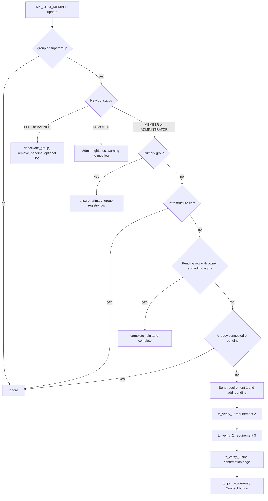
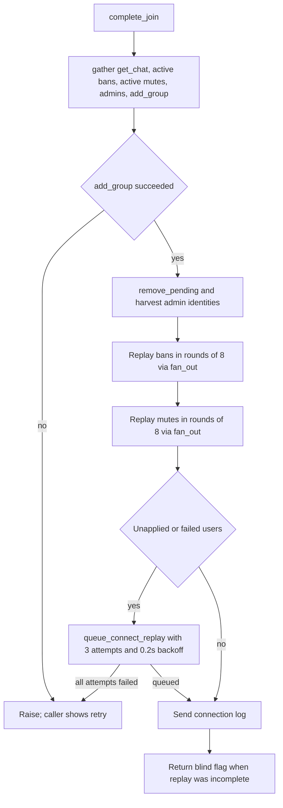
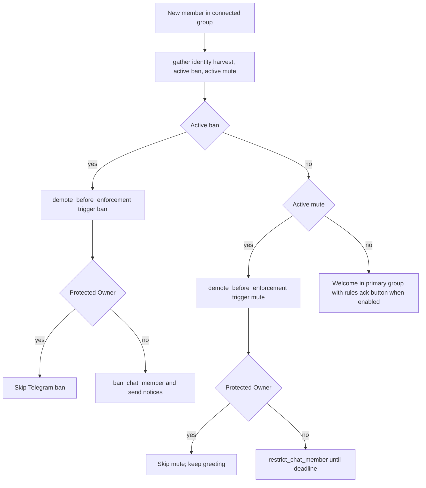
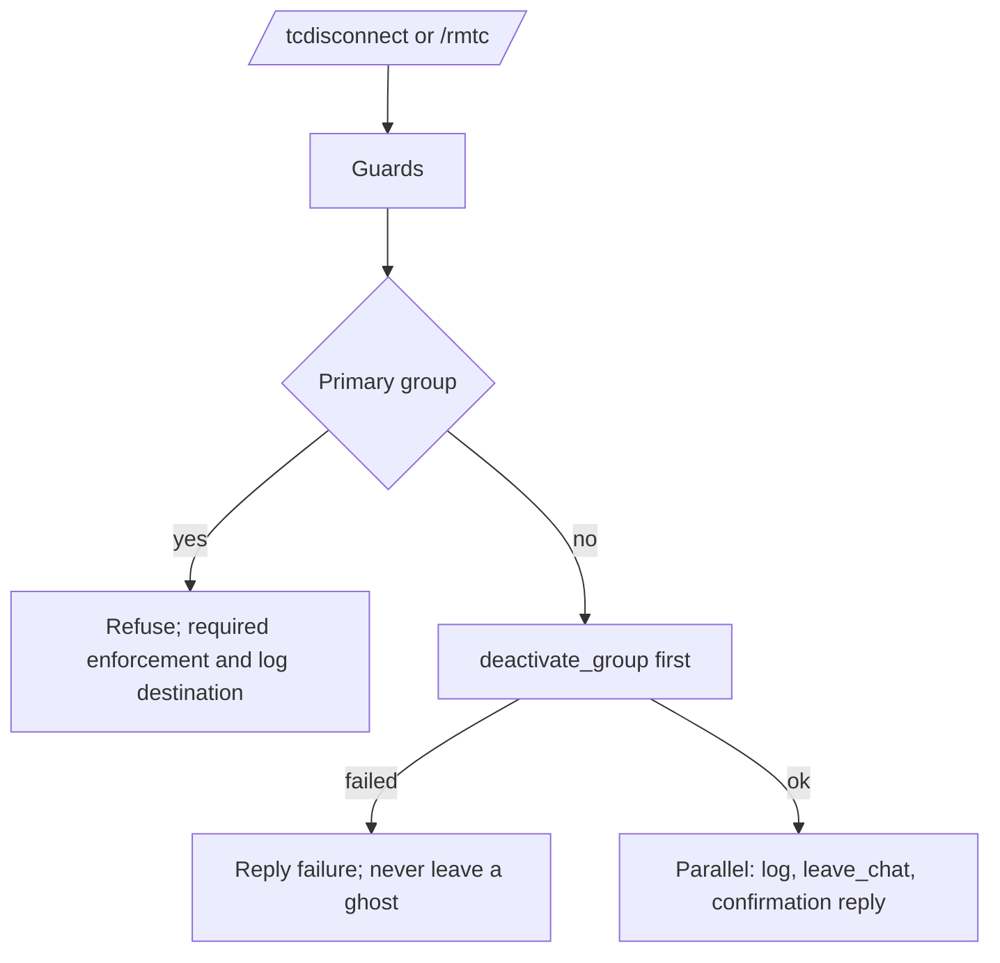

# Connection and join enforcement

This document describes how a group joins the federation, how active bans and
mutes are replayed into it, and how join events are enforced afterward. Related
pipelines: [Roles](roles.md), [Persistence](persistence.md),
[Cache](cache.md), and [Banning](banning.md).

## `/tcconnect` manual flow

`cmd_tcconnect()` is group-only and refuses channels. Telegram administrator
rights in the group are the authorization, so there is no separate federation
approval step. The handler gathers four independent checks in one round trip:
the sender's membership, `is_connected(fresh=True)`, `get_pending()`, and the
bot's membership. Database failures fail closed.

```mermaid
flowchart TD
    CMD[/tcconnect in group] --> TYPE{group or supergroup}
    TYPE -->|no| NO[Reply group only]
    TYPE -->|yes| INFRA{Infrastructure chat}
    INFRA -->|yes| NO
    INFRA -->|no| ANON{Anonymous admin}
    ANON -->|yes| NO
    ANON -->|no| CHECKS["gather member, is_connected, pending, bot member"]
    CHECKS --> ROLE{Sender admin or creator}
    ROLE -->|no| NO
    ROLE -->|yes| PRIM{Primary group}
    PRIM -->|yes| NO
    PRIM -->|no| DBOK{Database reads healthy}
    DBOK -->|no| FAIL[Reply connect failed]
    DBOK -->|yes| DUP{Already connected or pending}
    DUP -->|yes| NO
    DUP -->|no| PERMS{Bot has required rights}
    PERMS -->|no| NO
    PERMS -->|yes| JOIN[complete_join]
    JOIN --> OK[Confirmation or blind replay warning]
```

Required bot rights are `can_delete_messages`, `can_restrict_members`, and
`can_invite_users`. The newer `can_send_welcome_messages` grant is audited
separately and produces an operator note, since no Bot API method sets the
native welcome message.

| Guard | Source | Outcome on failure |
|---|---|---|
| Chat type | `cmd_tcconnect` | Refuse with a group-only reply. |
| Infrastructure chat | `cfg.is_infrastructure_chat` | Refuse; log, proof, appeal, and main destinations are not managed groups. |
| Anonymous admin | `identity.is_anon_admin` | Refuse; the placeholder name cannot be attributed. |
| Sender role | `get_chat_member` with lookup timeout | Administrator or creator required. |
| Primary group | `cfg.is_primary_group` | Refuse; already an enforcement destination. |
| Connection state | `groups_db.is_connected(fresh=True)` | Fail closed on a database error. |
| Pending state | `groups_db.get_pending` | Fail closed on a database error. |
| Bot rights | `BuildConnection.check_perms` | Refuse and add a pending row for later retry. |

## Bot-added flow

`on_bot_added()` handles `MY_CHAT_MEMBER` updates and is the single owner of
bot-added, promoted, demoted, and removed handling.



An anonymous add stores owner `0` and leaves the verification pages for the group
creator, because auto-completing it would write owner `0`. A pending row with no
attributable owner follows the same path. The four pages are the three membership
requirements from `about/keanggotaan.md` (admin approval is recorded, the group is
listed in the official channel, and approval stands) followed by a final
confirmation. Each step is owner-only; `Connect` appears only on the confirmation
page, so a group cannot skip the requirements. On removal, the group is deactivated
first and a log is posted only when it was connected. A demotion from administrator
to member sends a warning to the moderator log, except in primary groups.

| Callback | Effect |
|---|---|
| `tc_verify_1`, `tc_verify_2`, `tc_verify_3` | Owner-only; advance to the next requirement or the final confirmation. Other users get an alert and keep the shared keyboard live. |
| `tc_join` | Owner-only; verifies bot rights and connection state, then calls `complete_join`. Other users get an alert and keep the shared keyboard live. |
| `tc_cancel` | Removes the pending row, logs the rejection, edits the prompt, and leaves the chat. |

Primary groups ignore join decisions. Permission refusals use an alert instead
of removing the shared prompt's keyboard, so any member cannot destroy the
owner's only Connect button.

## Replay of active decisions

`complete_join()` is the shared connector for the manual command and the
bot-added prompt. `add_group()` must succeed or the whole connect fails. Active
ban user ids and active mute documents are fetched before the replay starts.



The replay is bounded by a 20 s time budget and a per-list cap of 500 users.
Telegram admits roughly 20 requests a minute per group, so a long list cannot
be enforced in one pass. The deadline is checked between rounds of 8; a list
over the cap is truncated and the remainder is treated as pending. A request
whose result is not a benign no-op is also pending.

Whatever the budget, cap, or a stopped replay leaves unapplied is still an active
decision. `enforcement_db.queue_connect_replay()` writes one bounded, idempotent
`apply` run per decision against the one new chat. The queue write is the
durability boundary and is retried 3 times with 0.2 s backoff; exhausting it
raises, because the group is already active and a lost queue write would leave
active decisions unenforced with no durable record. A connection whose replay
was truncated, timed out, or partly failed returns a "blind" flag and shows a
warning instead of a clean success.

## Join-time enforcement in `greeting.py`

Connection is not the only enforcement point. `greeting.py` re-checks active
decisions whenever someone joins a connected group.

| Handler | Trigger | Behavior |
|---|---|---|
| `on_new_member` | `NEW_CHAT_MEMBERS` | Enforce in every connected group; greet only in the primary group. |
| `on_join_request` | `ChatJoinRequest` | Decline banned users in connected groups; fail closed on a ban-read error. |
| `on_join_request_approved` | `CHAT_MEMBER` via join request | Re-apply a ban or mute, since approval produces no new-member service message. |

`_handle_member()` harvests identity and reads the active ban and mute in
parallel under a global semaphore of 10. A cancelled read propagates, never
degrades into a clean greet. A failed enforcement read suppresses the welcome,
because greeting an unverified user as safe is worse than staying silent.



`demote_before_enforcement()` returns a protected-owner verdict for the Owner
role, which cannot be demoted. Owners are never banned or muted on join, even
when they carry an active decision from before a transfer. The demote itself is
best effort: a role-lookup failure is logged loudly and enforcement still runs,
so a transient database outage cannot block the moderation action.

## Disconnect, force-remove, and listing



`/tcdisconnect` is group-only and checks `is_connected(fresh=True)` and
`can_manage_group(..., fresh=True)` (federation staff or the group creator).
`/rmtc` is staff-only and takes an explicit numeric chat ID. Both refuse primary
groups, deactivate the database row before leaving, and fan out the log, leave,
and reply in parallel. A deactivation failure leaves the bot in the group and
reports the failure rather than leaving a ghost group that is still active in
the database.

`/tcgroups` lists active groups through the shared `active_groups()` cache (L1
30 s, L2 45 s), so toggling detail does not keep a divergent per-user copy. The
`groups_details` and `groups_simple` callbacks switch views. A failed read shows
an error and keeps the keyboard so a re-tap retries; it never renders an empty
list that would claim zero groups.

## Primary group handling

Primary groups (the main and exec destinations) are infrastructure, not managed
groups. They are always enforcement destinations for ban, unban, mute, warn, and
federation logs, because every fan-out appends them through
`with_primary_groups()`. The connect command, the join-decision callback,
`/tcdisconnect`, and `/rmtc` all refuse them. `ensure_primary_group()` anchors
the identity row and an INACTIVE connection row so a group that was removed and
re-added keeps its ability to hold chat-scoped decisions without ever joining
the federation connected set; a removed row is never reactivated. Configured
infrastructure chats (`MAIN_GROUP`, `MAIN_CHANNEL`, `APPEALS`, `LOGS`,
`LOGS_ERRORS`, `PROOFS`) are refused on every connect entry point. Users can
still discuss, appeal, and run commands in `MAIN_GROUP`: the federation-origin
gate short-circuits on `is_primary_group`. The join prompt is sent through the
rich transport so its Connect/Cancel buttons render as rich buttons.

## Exact names and validation

| Name | Owner | Role |
|---|---|---|
| `cmd_tcconnect` | `connect.py` | Manual group entry. |
| `on_bot_added` | `connected_flow.py` | `MY_CHAT_MEMBER` event owner; registered in `connect.py`. |
| `complete_join` | `connected_flow.py` | Shared connector and replay. |
| `queue_connect_replay` | `enforcement_db.py` | Durable remainder queue. |
| `on_new_member`, `on_join_request`, `on_join_request_approved` | `greeting.py` | Join-time enforcement. |

```bash
uv run pytest tests/ -q -k connect
```

Relevant tests include `tests/test_connect_*.py`, `tests/test_complete_join.py`,
and `tests/test_greeting_semaphore.py`.
