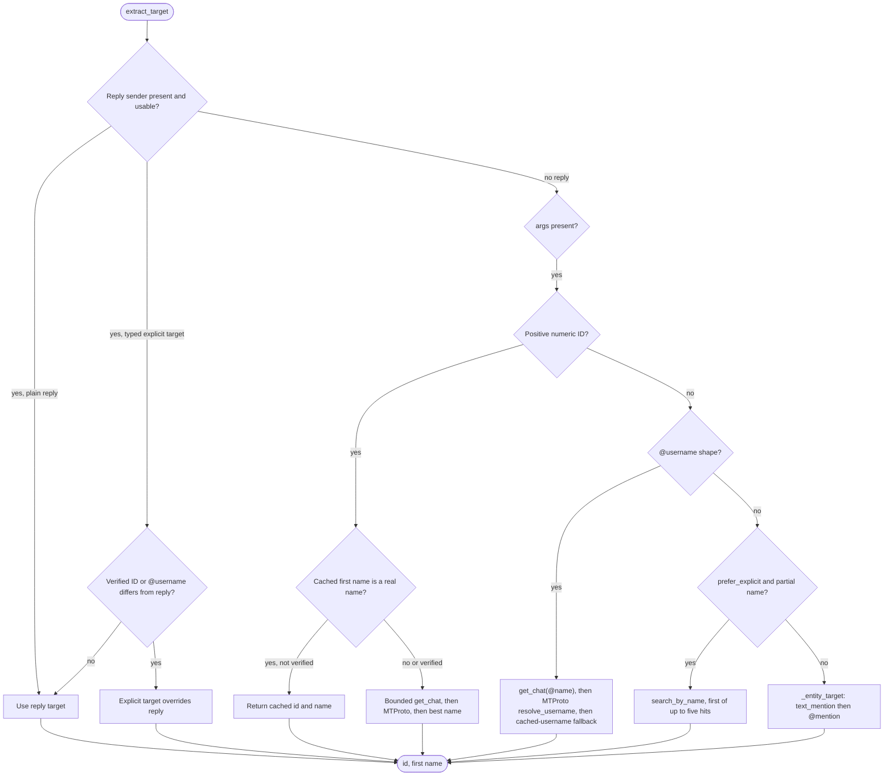
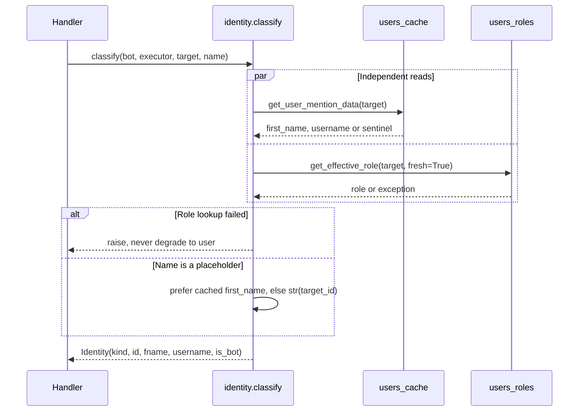

# Target and user data resolution

Purpose: describe how a command turns a reply, token, or mention into a Telegram
user id, how that identity is classified and cached, and how it is rendered back
to a person. The authorization use of the resulting kind is in
[Permissions](permissions.md).

## Target resolution priority

`extract_target(update, args, bot, prefer_explicit=False)` in
`modules/helper/extraction/resolve.py` resolves the moderation target. The order
is deliberate and shared by the command entries through `extract_mod_target()`.

Priority list:

1. **Reply target.** `reply_uid()` is the synchronous core. GroupAnonymousBot
   (`1087968824`), the Telegram service account (`777000`), channel senders, and
   group senders never count.
2. **Args with a full numeric ID or `@username`.** A typed ID or username that
   verifies as a real Telegram user different from the quoted sender overrides
   the reply; a reason that merely starts with a number does not.
3. **Args with a partial name.** `users_cache.search_by_name()` runs a
   server-side prefix query capped at five results. It runs only with
   `prefer_explicit=True`, used by read-only views such as `/check`, because
   fuzzy matching can point at the wrong person.
4. **Text-mention entity, then `@mention` entity**, in `_entity_target()`.

With `prefer_explicit=True`, any resolving arg wins over the reply; if it
resolves to nobody, the reply still stands. `extract_mod_target()` wraps
`extract_target()` and also reports whether `args[0]` was consumed as the
target, so entries split reason text without reimplementing the override rule.
Only users resolve: a negative token is a chat id and is rejected before any
lookup; an `@username` that resolves to a non-private chat yields no hit.

## Bounded Telegram lookups and MTProto fallback

| Constant or function | Value or role |
|---|---|
| `TELEGRAM_LOOKUP_TIMEOUT` | `3.0` s in `utils/transport.py`. |
| `_GET_CHAT_TIMEOUT` | Alias of `TELEGRAM_LOOKUP_TIMEOUT`, used by `_safe_get_chat()`. |
| `TELEGRAM_ACTION_TIMEOUT` | `20.0` s, for state-changing calls. |
| `get_chat` wrappers | `asyncio.wait_for(bot.get_chat(ident), timeout=_GET_CHAT_TIMEOUT)`; a failure is a miss, not an exception. |
| `db.mtproto.resolve_username(arg)` | Deterministic exact-username resolve when the Bot API misses an account. |
| `_cached_username_target(arg)` | Last-resort exact username lookup via `users_cache.get_by_username()`. |
| `db.mtproto.is_available()` | Gate on the cached-username fallback. |

The cached-username fallback is used only when MTProto is unavailable.
Usernames can be released and reassigned, so while a live resolver exists an
unknown username must stay unknown rather than resolve to a previous holder.
`@mention` entity offsets are UTF-16 code units, so `_entity_target()` slices
the `utf-16-le` bytes; a split surrogate fails to decode and the entity is
skipped.

Live verification of a target's name uses `_fetch_live_identity()` in
`extraction/refresh.py`: one bounded `get_chat`, then `mtproto.resolve_user()`,
then a bounded `get_chat_member` sweep over connected groups. The sweep is
capped by `_RESOLVE_SWEEP_CONCURRENCY = 10` and `_RESOLVE_SWEEP_TIMEOUT = 15.0` s.
The Bot API cannot enumerate group members, so unknown users resolve per id
across the groups the bot has joined.

## Identity classification

`identity.classify(bot, executor_id, target_id, target_fname, target_is_bot=None)`
returns a frozen `Identity(kind, target_id, fname, username, is_bot)`.

| `IdentityKind` | Meaning |
|---|---|
| `self` | Executor targeted themselves. |
| `this_bot` | This bot is the target. |
| `other_bot` | Any other Telegram bot. |
| `telegram` | Telegram service account (`777000`). |
| `anon_admin` | GroupAnonymousBot placeholder (`1087968824`). |
| `owner`, `admin`, `developer`, `moderator` | Federation role holder. |
| `user` | Regular user with no federation role. |

The role is read fresh, because the protected-target refusal table is keyed on
role kind: a cached `"user"` could hide an Owner for a full TTL and let an
action reach its prompt. A role-lookup failure is raised, never degraded.
Display names that are placeholders (`is_placeholder_name()`: an empty string,
`User <id>`, or a bare numeric string) are replaced by the cached name, falling
back to `str(target_id)`.

`identity.verify_not_bot()` returns `True` (human), `False` (bot), or `None`
(unknown). It checks a quoted sender first, then one bounded `get_chat_member`
probe, then one MTProto `is_bot_user` lookup. Ownership transfer fails closed on
`None`; promotion uses the best-effort positive-only gate `is_proven_bot()` so
off-group promotions still work. Cancellation always propagates. See
[Permissions](permissions.md) for how the resulting kind drives refusals and
[Roles](roles.md) for the verified-human gate on transfer.

## User cache writes and batch reads

The member cache is `user_mention_cache`, a two-level cache keyed by user id with
an L1 memory layer and optional Redis L2. Its value is a `[first_name, username,
last_name]` triple; the all-`None` triple is the not-found sentinel.

| Function | Behavior |
|---|---|
| `upsert_user(uid, username, first_name, last_name)` | Insert or update the profile. `None` means "unknown, preserve existing"; an explicit empty string clears. A complete write populates the mention cache; a partial write invalidates it. |
| `upsert_user_if_changed(...)` | Compare the full triple against the cached value and skip the DB write when unchanged. Returns whether a write happened. |
| `harvest_user_identity(...)` | For live `User` objects only. `None` means "absent on Telegram" and is written as `""` so removals propagate. |
| `ensure_users(sess, *ids)` | Idempotently create identity rows inside the caller's transaction so dependent writes do not fail the foreign key. |
| `get_user_mention_data(uid)` | `(first_name, username)` through L1 to L2 to DB; converts the sentinel to `str(uid)`. |
| `get_first_name(uid, fallback)` | Same path; returns the caller's fallback for the sentinel. |
| `get_mention_data_batch(ids)` / `get_first_names_batch(ids)` | One L1 pass, one Redis `MGET` for misses, then one DB `IN` query for the remainder. |

Batch reads capture `user_mention_cache.revision()` before their DB query and
skip publishing rows if an invalidation landed during the read, so an erasure or
profile update cannot be undone by a stale batch. `remember_identity()` mirrors
a resolved identity into L1 only: a transient resolve failure must not publish a
not-found sentinel to Redis, while positive identities are already durable in
`telegram_users`.

`sync_user_identity(bot, uid, max_age_seconds=_SYNC_MAX_AGE_S)` is the full
detail-view protocol: read the cached document, return it if complete and
fresher than 7 days, otherwise fetch live, return stale values if live is
unreachable, then persist the live triple and refresh L1. Callers gate
background refreshes with `identity_needs_refresh()`; `launch_identity_refresh()`
fires the sync through the `TaskTracker` named `identity refresh` so the view
itself stays instant.

## Mention formatting

All clickable user mentions are ID-based. `utils.i18n.user_ref(user_id, name,
username=None)` delegates to `modules/helper/rich/link.py`, which
ignores `username` and renders `<a href="tg://user?id={user_id}">{name}</a>` for
a positive id. A non-positive id renders as bold text, so an anonymous admin or
service account is never linked. The numeric id is the single source of truth;
a reusable username can change and is never used in the link.

`code()` renders ids inside literal code spans, and `bold()` wraps static
labels. Do not combine `user_ref(x)` and `code(x)` for the same value. The test
file `tests/test_formatter.py` pins these shapes.

## Erasure and username validation

| Item | Definition |
|---|---|
| `safe_username(username)` | Returns the value only when it matches `^[A-Za-z0-9_]{5,32}$`, otherwise `None`. |
| `get_by_username(username)` | Exact case-folded username lookup in `telegram_users`, used by the cached-username fallback. |
| `is_placeholder_name(name)` | True for empty, `User <id>`, or bare numeric names. |
| `erasure_db.request_erasure(user_id, reason)` | Queues an account erasure by calling the SQL function `request_user_erasure(:user_id, :reason, 'operator')`. |

The erasure function refuses an unknown user, an already erased user, and an
empty reason in the database layer, so callers do not duplicate those rules.
Username shape validation stays in `safe_username()` at the input boundary; the
cache stores usernames exactly as observed on real updates and only the lowercase
form is indexed for lookup. Erasure cache invalidation follows the sweep order
described in [Persistence](persistence.md).
