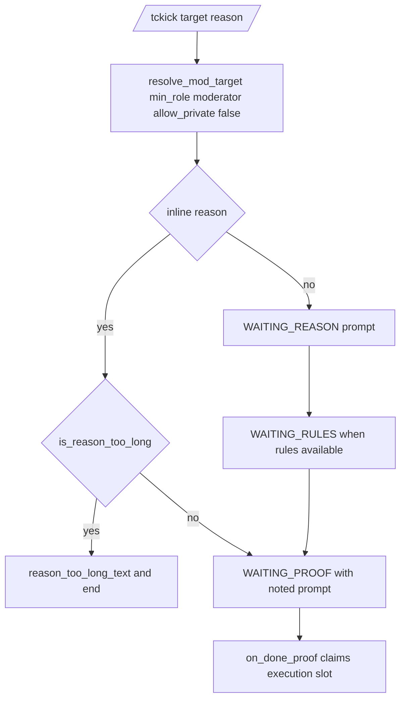
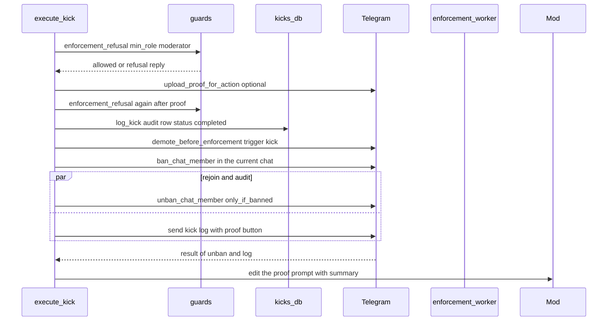
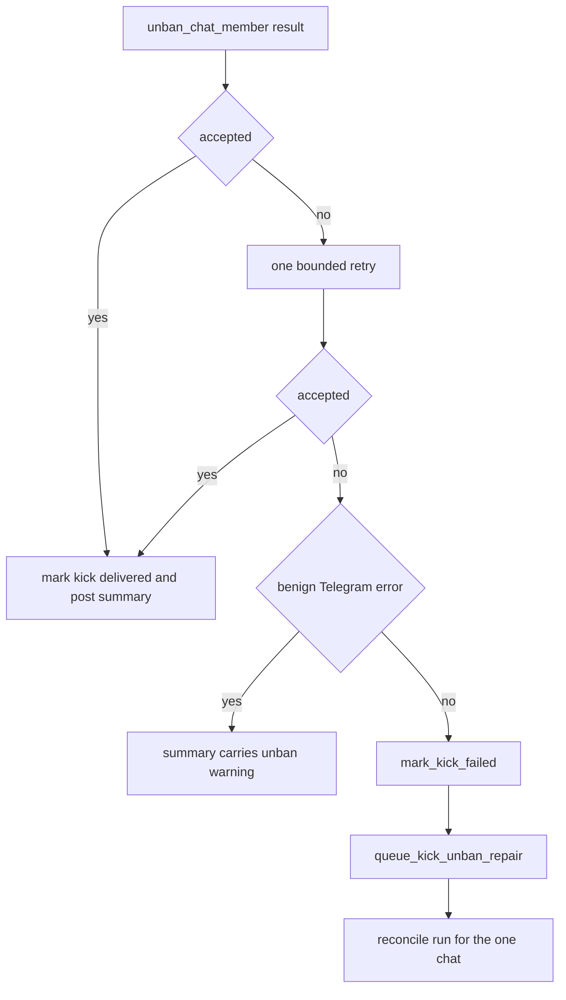

# Kicking

This document describes the group kick pipeline: its conversation, the
ban-then-unban enforcement in one chat, optional proof and audit, and the
durable reconcile run that repairs a failed rejoin. The shared spine is in
[system.md](system.md).

## Scope and entry

A kick acts in the current chat only and is implemented as a Telegram ban
immediately followed by an unban with `only_if_banned=True`, which lets the user
rejoin. Because Telegram rejects ban attempts in private chats, `cmd_kick` in
`modules/kick.py` resolves its target with `allow_private=False`. The decorators
are `ratelimiter(THROTTLE_MODERATION)`, `basic_mod_only` (moderator tier), and
`log_execution`.



The conversation is built by `kick_conversation()` through
`reason_flow.build_modaction_conv()` with `BuildReason("kick",
skip_allowed=False)`, `BuildProof("kick")`, `min_role="moderator"`, and
`rules_enabled=True`. The executor adapter `_exec_kick()` pops the kick keys
from the flow scope and calls `execute_kick()`.

## Conversation states and callbacks

| Owner | State | Value |
|---|---|---|
| `reason_flow.py` | `WAITING_REASON` | 0 |
| `reason_flow.py` | `WAITING_PROOF` | 1 |
| `reason_flow.py` | `WAITING_RULES` | 2 |
| `reason_flow.py` | `WAITING_RULES_NOTE` | 3 |

| Callback data | Meaning |
|---|---|
| `kick_cancel` | Cancel the live kick prompt. |
| `kick_done_proof` | Flush collected proof and execute. |
| `kick_skip_proof` | Execute without proof. |
| `rules_step:pick:<id>` | Toggle a rules selection. |
| `rules_step:done` | Confirm rules selection. |
| `rules_step:other` | Enter an optional note. |
| `rules_step:clear` | Clear selection. |

Done and Skip claim the `kick_executing` flag in the flow scope before their
first await, so a double tap cannot run the executor twice.
`recheck_executor_rank(min_role="moderator")` re-verifies the tapper before
execution. See [Proof](proof.md) for the shared collection model.

## Kick executor

`execute_kick()` in `kick_flow.py` runs the same two-position enforcement gate as
ban and mute, but at the moderator tier. The gate runs once before proof upload
and audit, and again immediately before the audit record, so a target promoted
across the proof window cannot be kicked by a moderator who no longer outranks
them.



Proof is optional for a kick. A failed upload is logged and degrades to a kick
without evidence. The audit row is written before enforcement, so an applied
kick can never be unaudited; the row starts `completed` and is moved to `failed`
if the ban or its follow-up unban fails. `demote_before_enforcement(trigger="kick")`
runs best effort after proof. The user-facing summary is composed only after the
unban result is known, so the moderator never sees success while the target is
still banned.

## Failed unban and reconcile run

The unban and the federation log send run in parallel with
`asyncio.gather(return_exceptions=True)`.



The reconcile run is durable work with idempotency key
`moderation:{action_id}:kick-unban:v1` and exactly one target, the kick's own
chat. The worker accepts a `reconcile` run when the action type is `kick` and
its status is `completed` or `failed`. It cancels the run when `active_ban` is
true: a federation ban now holds the target, and the repair unban would lift
that ban. On a successful unban the worker calls `_close_repaired_kick()`, which
moves the kick row from `failed` back to `completed`.

| Helper | Owner | Role |
|---|---|---|
| `log_kick` | `kicks_db.py` | Insert audit row and archive optional proof. |
| `mark_kick_failed` | `kicks_db.py` | Move `completed` to `failed`. |
| `mark_kick_completed` | `kicks_db.py` | Close a repaired kick. |
| `queue_kick_unban_repair` | `enforcement_db.py` | Queue the one-chat reconcile run. |
| `_close_repaired_kick` | `enforcement_worker.py` | Restore completed status. |

A kick that fails at the ban step cancels any in-flight proof upload, marks the
audit row failed, and replies with the kick error. Because a kick records no
federation ban, the reconcile run is the only durable repair for a target left
banned.

## Logging and edge cases

`messages.kick_log()` builds the federation log posted to `cfg.logs` with a proof
button when evidence landed. Reason and proof prompts use the rich transport
with no parse mode. Module and flow failures log through the module logger with
the target and action identifiers.

- A failed ban cancels any in-flight proof upload and marks the audit row failed.
- A failed unban gets one bounded retry. If it still fails with a benign
  Telegram refusal, the summary carries a warning; otherwise the row is marked
  failed and the reconcile run is queued.
- A kick never creates a federation ban, so the reconcile run is the only
  durable repair for a target left banned.
- Self, bot, Telegram, anonymous-admin, and Owner targets are refused by
  `identity.classify()`, with lower staff roles demoted first.

## Exact names and validation

| Name | Owner | Role |
|---|---|---|
| `cmd_kick` | `kick.py` | Validated entry point. |
| `kick_conversation` | `kick_flow.py` | ConversationHandler factory. |
| `execute_kick` | `kick_flow.py` | Full enforcement orchestration. |
| `_exec_kick` | `kick_flow.py` | Adapter from flow scope to executor. |

```bash
uv run pytest tests/ -q -k kick
```

Relevant tests include `tests/test_kick_guard.py` and `tests/test_kick_summary.py`.
