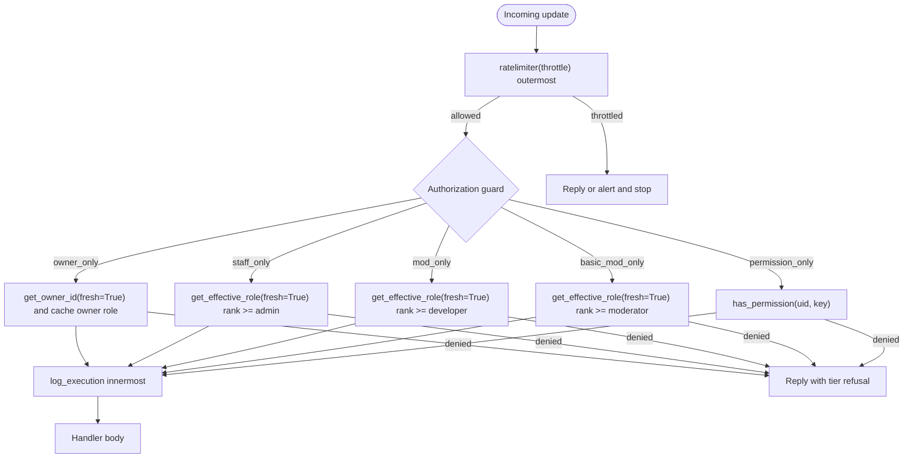
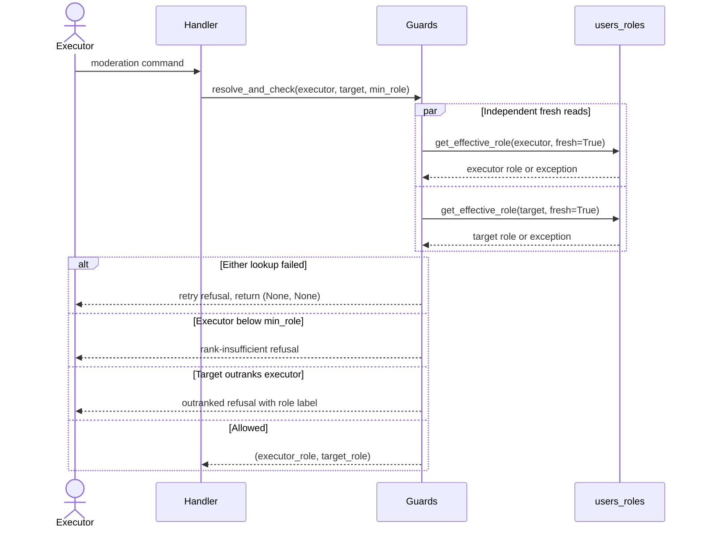
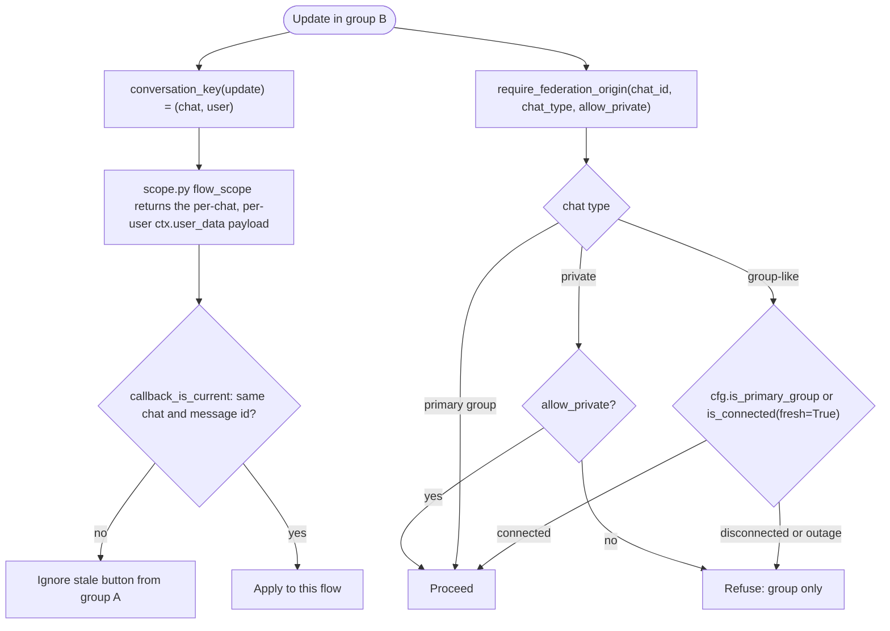

# Permissions and authorization

Purpose: define how the bot decides who may act, on whom, and in which chat,
with every ambiguous case resolved against denying the action. The shared spine
is in [system.md](system.md); the tier hierarchy itself is owned by
`database/users_roles.py`.

## Tier hierarchy

| Tier | `ROLE_RANK` | `ROLE_LABEL` | Assignable | Set membership |
|---|---|---|---|---|
| `owner` | 4 | Owner | No, set only by transfer or seed | `OWNER_ADMIN_ROLES` |
| `admin` | 3 | Admin | Yes, by Owner only | `STAFF_ROLES`, `OWNER_ADMIN_ROLES` |
| `developer` | 2 | Developer | Yes | `STAFF_ROLES`, `VALID_ROLES` |
| `moderator` | 1 | Moderator | Yes | `STAFF_ROLES`, `VALID_ROLES` |

Related constants: `RoleName = Literal["owner", "admin", "developer", "moderator"]`,
`VALID_ROLES = ("developer", "moderator")`, `STAFF_ROLES = frozenset({"admin",
"developer", "moderator"})`, `OWNER_ADMIN_ROLES = frozenset({"owner", "admin"})`.
`role_rank()` maps an unknown or missing role to `0`; `get_effective_role()`
ignores stored values outside `ROLE_RANK`. `guards.required_rank()` maps an
unknown tier name to `_UNKNOWN_TIER_RANK = 99`, so a typo can only refuse.

## Decorator order and the tier gates

Handlers apply decorators in a fixed order so the cheap flood guard runs first
and the authorization guard runs before the handler body.

Rules:

- `ratelimiter()` is outermost, the required authorization guard is second,
  and `log_execution` is innermost. Message-event handlers are exempt from
  per-handler rate limits.
- Tier gates live in `modules/helper/decorators/auth.py`: `owner_only`,
  `staff_only` (`min_role="admin"`), `mod_only` (`min_role="developer"`), and
  `basic_mod_only` (`min_role="moderator"`).
- `owner_only` reads the owner id fresh and calls
  `users_roles.cache_effective_role(uid, "owner")`. Without that cache fill the
  rank check later in the same request could read the previous Owner's role and
  refuse a transfer's own target.
- All tier gates reject `identity.is_anon_admin()` before any lookup. A
  role-lookup failure sends a retry reply instead of failing silently;
  cancellation is re-raised.

## Permission catalog and `permission_only`

`permission_only(permission_key)` gates a capability directly through the
database instead of assuming a role rank implies that capability. It calls
`users_roles.has_permission(uid, key)`, which runs the SQL function
`actor_has_permission(user_id, permission_key)` in `database/schema/functions/rbac.sql`.
That function resolves the active assignment, walks its role permissions, and
returns false for a missing, expired, or unknown permission.

| Item | Value |
|---|---|
| Decorator | `decorators.permission_only(key)` in `decorators/auth.py` |
| Check | `db.users_roles.has_permission(uid, key)` |
| Key format | `^[a-z][a-z0-9_]*\.[a-z][a-z0-9_]*$` (`permission_definitions` check constraint) |
| Catalog helpers | `permission_catalog()`, `permissions_for(user_id)`, `role_catalog()` |
| Current direct uses | `rules.manage` on the rules editors; `rules.view` checked by reason and rule flows |

The seed catalog in `database/schema/seed.sql` defines keys across the `audit`,
`automation`, `community`, `groups`, `members`, `moderation`, `roles`, and
`rules` resources. Representative grants:

| Permission | admin | developer | moderator | owner |
|---|---|---|---|---|
| `roles.promote` | yes | no | no | yes |
| `roles.demote` | yes | no | no | yes |
| `roles.review_promotion_requests` | no | no | no | yes |
| `roles.transfer_ownership` | no | no | no | yes |
| `rules.manage` | yes | no | no | yes |
| `rules.view` | yes | yes | yes | yes |

`permission_only` fails closed: a lookup exception produces the role-lookup
refusal and the handler is not called.

## Executor and target checks

The decorator answers "may this user run this command at all". The guards in
`modules/helper/guards.py` answer "may this executor act on this specific
target". Both are required; neither substitutes for the other.

| Function | Purpose | Success result |
|---|---|---|
| `resolve_and_check(msg, executor_id, target_id, min_role=...)` | Freshly read both roles, check tier and outrank, reply on refusal | `(executor_role, target_role)`, or `(None, None)` after replying |
| `classify_and_check(bot, admin_id, target_id, target_name, msg, action=..., min_role=...)` | Run `identity.classify` and `resolve_and_check` in parallel; fail closed | `(Identity, target_role)`, or `None` after replying |
| `enforcement_verdict(executor_id, target_id, min_role=...)` | Re-check tier and outrank at enforcement time | `EnforcementVerdict` plus optional label |
| `enforcement_refusal(...)` | Single owner of verdict to refusal-prose mapping | Refusal text or `None` |
| `recheck_executor_rank(msg, executor_id, min_role=...)` | Re-verify a demoted moderator cannot enforce from a late tap | `bool` |
| `check_callback_staff`, `check_callback_executor` | Answer the callback spinner and re-check rank | Role string or `None` |
| `outranks(executor_role, target_role)` | Single owner of the rank comparison; equal rank refuses; a role-less target passes | `bool` |
| `can_demote_admin(executor_role, target_role)` | Demoting an Admin needs the Owner; the Owner is never demotable | `bool` |
| `banned_target_refusal(target_id, ...)` | A banned target must not gain rank; fails closed on lookup error | Refusal text or `None` |

Fail-closed rules that apply everywhere: both roles are read with `fresh=True`;
a role-lookup failure refuses; `throw_if_cancelled()` re-raises cancellation;
`identity.classify()` raises on a failed role lookup rather than degrading the
target to `"user"`; `permission_only`, the tier gates, and the guard checks all
reject on lookup failure.

## Protected targets

`identity.classify()` produces an `Identity` with a `kind` from `IdentityKind`.
`identity.refuse_message(action, ident, locale)` and
`identity.refuse_role(action, role, ...)` consult `_REFUSE_KEYS`, the single
table of refused `(action, kind)` pairs. A `None` return means the caller proceeds.

| Action | Refused identity kinds |
|---|---|
| `ban`, `kick`, `mute` | `self`, `this_bot`, `telegram`, `anon_admin`, `owner` |
| `warn` | `self`, `this_bot`, `telegram`, `other_bot`, `anon_admin`, `owner` |
| `unban` | `self`, `this_bot`, `telegram`, `anon_admin`, `owner`, `admin`, `developer`, `moderator` |
| `unmute` | `self`, `this_bot`, `telegram`, `other_bot`, `anon_admin`, `owner` |
| `promote` | `self`, `this_bot`, `telegram`, `other_bot`, `anon_admin`, `owner`, `admin` |
| `demote`, `transfer`, `unwarn`, `resetwarns` | `self`, `this_bot`, `telegram`, `other_bot`, `anon_admin`, `owner` |

Special IDs: `TELEGRAM_USER_ID = 777000` (service account) and
`ANONYMOUS_BOT_ID = 1087968824` (GroupAnonymousBot placeholder). Lower staff
roles are deliberately absent from the ban, kick, and mute rows because those
paths demote the target first; refusing here would make the documented demote
unreachable. See [Roles](roles.md) for the demote gates.

## Demote gates: best effort versus fail closed

| Gate | Policy | Used by |
|---|---|---|
| `demote_before_enforcement` | Best effort. A lookup or demote failure is logged loudly and enforcement still runs. | Ban, kick, mute, join enforcement, and deferred ban/mute delivery. |
| `demote_before_unban` | Fail closed. A failed or no-op demote while the role still resolves blocks the unban (`UnbanGate.DEMOTE_FAILED` or `UnbanGate.ROLE_SURVIVED`). | `/tcunban`, appeal approval. |

The best-effort rule exists because the moderation record already exists when
the demote runs, so a transient database failure must not block enforcement.
A queued apply can be delivered minutes or days after the decision, so the
worker and the replay path run the same gate before claiming targets and still
cancel for a target promoted to Owner in the meantime. Unban and appeal
approval fail closed because a staff holder must never keep rank after a ban
lifts; the appeal path re-reads the reviewer's rank before its irreversible
demote.

## Role cache freshness

| Cache | L1 TTL | Redis TTL | Prefix |
|---|---|---|---|
| `effective_role_cache` | 60 s | 90 s | `role` |
| `owner_id_cache` | 300 s | 360 s | `owner` |

- Display reads use the cached path of `get_effective_role()` and `get_owner_id()`.
  Enforcement reads pass `fresh=True`, which routes through `TwoLevelCache.refresh()`.
- `refresh()` only publishes when the key's generation and the cache epoch are
  unchanged. A demotion or transfer that commits while a fresh read is in flight
  discards the stale result instead of resurrecting the revoked role for a TTL.
- Role writes call `effective_role_cache.invalidate(user_id)`. An ownership
  transfer calls `_publish_owner()`, which uses the generation-guarded refresh,
  verifies exactly one active owner row, then calls `effective_role_cache.clear_all()`.

## Cross-group isolation

- Conversations are registered `per_chat=True, per_user=True`. `flow_scope(ctx)`
  returns the per-chat, per-user `ctx.user_data` payload directly, so a second
  action in another group cannot overwrite the first one's target and reason.
  `clear_flow_scope()` drops the scope's keys, and `callback_is_current()`
  rejects buttons from an older prompt or a callback with no recorded identity.
- `guards.require_federation_origin()` allows private chats only when
  `allow_private` is set, short-circuits on `cfg.is_primary_group(chat_id)` or
  `cfg.is_infrastructure_chat(chat_id)`, and
  otherwise requires `groups_db.is_connected(chat_id, fresh=True)`. A disconnected
  group or a lookup outage blocks the action.
- Callback prompts may carry the opener as a trailing `:{executor}` segment.
  `cancel_owner_mismatch()` and `action_owner_mismatch()` alert a different
  tapper and leave the prompt live. A legacy payload without the owner segment
  falls through to the caller's own rank check.

Related: [Roles](roles.md), [Extraction and user data](extraction-user-data.md),
[Rate limiting](ratelimit.md).
