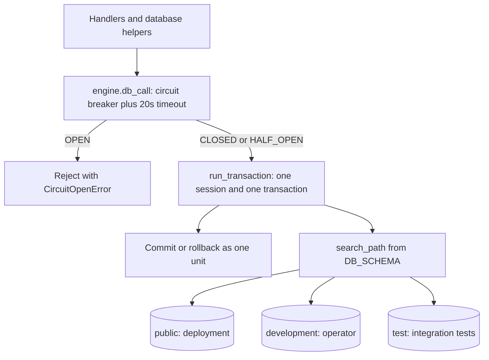
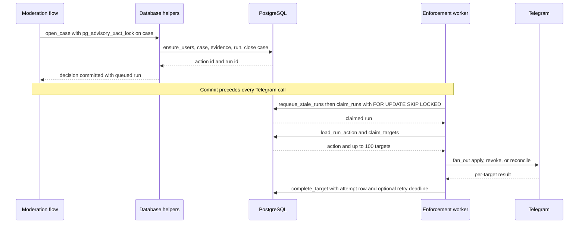
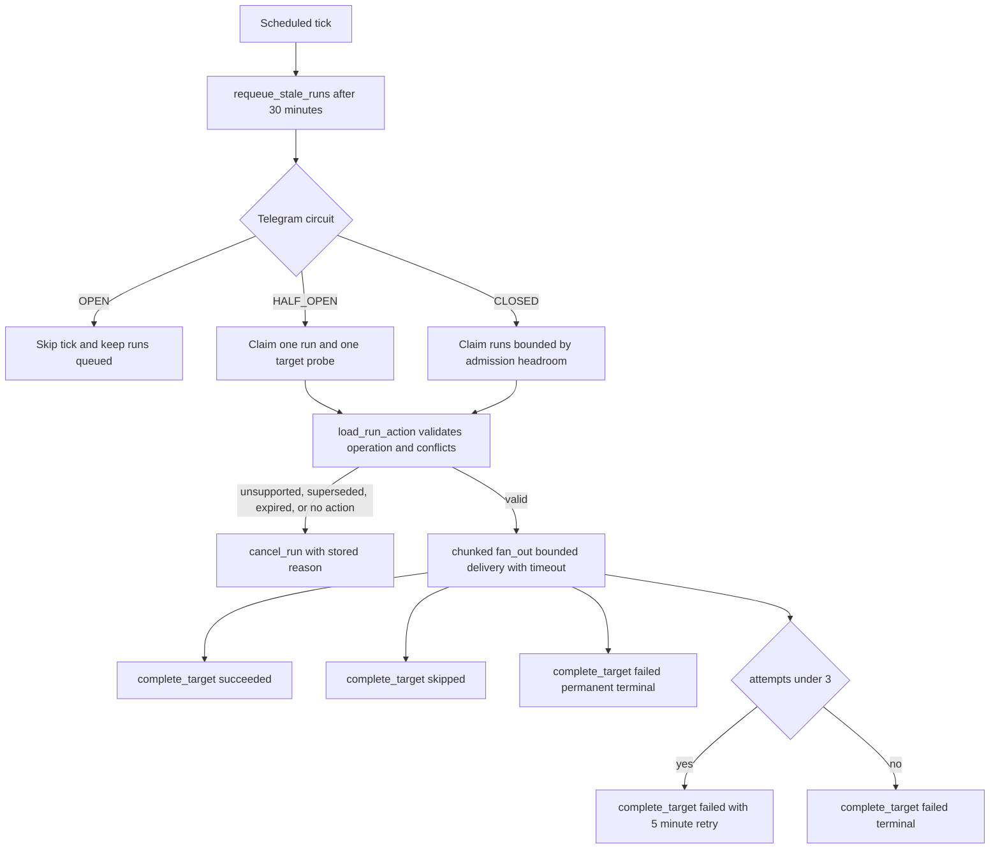
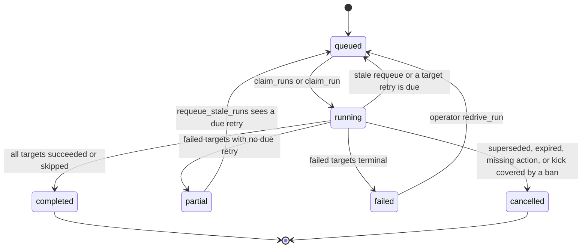
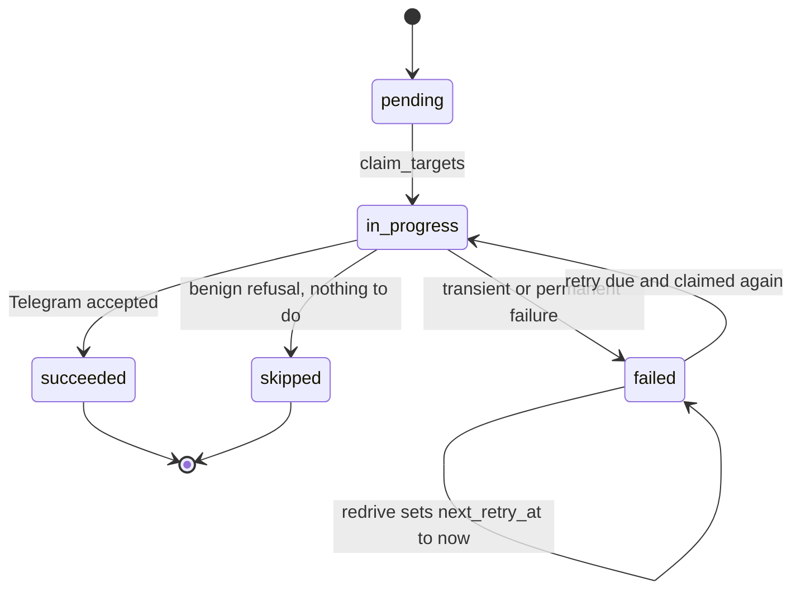
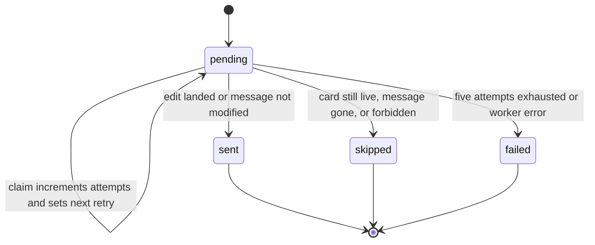
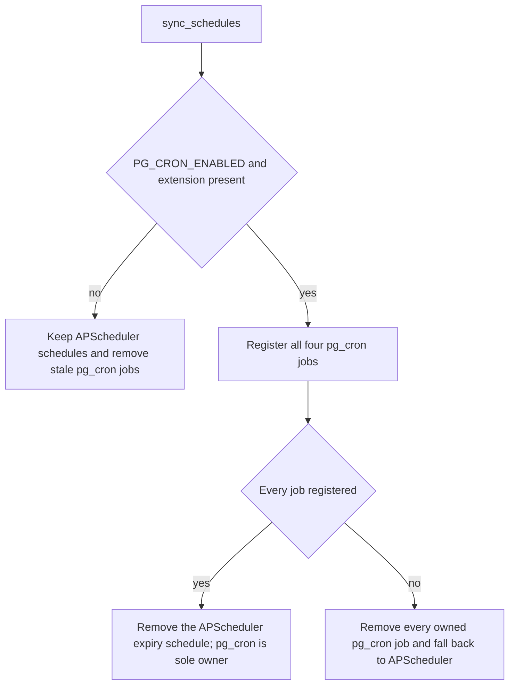
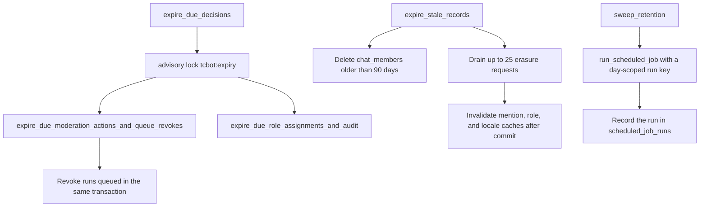

# Persistence, workers, and schedules

This document describes how a moderation decision becomes durable state, how its
Telegram delivery is queued and retried, and which jobs own expiry and retention.
The write boundary is owned by `database/engine.py` and described in
[the database layer](../architecture/database.md).

## Storage topology and schemas

The process writes to exactly one PostgreSQL schema, selected by `DB_SCHEMA`
through the libpq `search_path`. The project uses three schemas and no fourth.

| Schema | Owner | Purpose |
|---|---|---|
| `public` | The deployment | Default schema; `DB_SCHEMA` defaults to it. |
| `test` | Integration tests | Built and emptied by `tests/postgres_support.py`; never holds deployment data. |
| `development` | A developer | Used by operator scripts and selected by `DB_SCHEMA=development`. |

`connection_options.schema_options()` pins `-c search_path=<DB_SCHEMA> -c timezone=UTC`
on every engine, including the migration connection and the APScheduler job
store. Schema objects always land in the schema the connection was pointed at,
read from the search path rather than `current_schema()`.

## Write boundary

Every read and write goes through `engine.db_call(op, timeout=20.0)`, so the
event loop never blocks on database I/O and a dead database fails fast for
every caller.

| Boundary | Behavior |
|---|---|
| `db_call` | Runs one operation through the `postgres` circuit breaker and a 20 s `asyncio.timeout`. |
| `run_transaction` | Runs a callback on one session; all statements commit or roll back together. It already uses `db_call`, so callers must not nest another. |
| `session` | Commits on success, rolls back on failure; rollback is best effort and never replaces the original exception. |
| `read_connection` | Autocommit read path using the shared `_read_engine` proxy so checkouts skip per-call `execution_options()`; a SELECT avoids the cost of closing a transaction. |
| Circuit `postgres` | Opens after 5 consecutive transient failures; one HALF_OPEN probe after 60 s; a success closes it. |
| Counted failures | Dropped connections, refused sockets, driver timeouts, pool timeouts, caller-side timeouts. |
| Ignored failures | SQLSTATE `40001`, `40P01`, `55P03`, `57014` (serialization failure, deadlock, lock refusal, statement cancellation) prove the link is healthy. |

### Decision and enforcement run in one transaction

A decision is never committed without the run that delivers it. The flow opens
a case under an advisory lock, archives proof, links selected rules, queues the
enforcement run with a stable idempotency key, and closes the case, all on the
session given by `run_transaction`. The Telegram call happens only after the
commit.

A manual unban, an approved appeal, and a kick repair follow the same rule: the
decision status, appeal settlement, review-slot release, and the `revoke` or
`reconcile` run are written in one transaction.

## Enforcement worker lifecycle

The database records decisions and per-group delivery work in three tables:
`moderation_enforcement_runs` (one action, one `apply`, `revoke`, or `reconcile`
operation, an idempotency key, a status), `moderation_enforcement_targets` (one
chat per run), and `moderation_enforcement_attempts` (one row per delivery
attempt). `MAX_ATTEMPTS` is 3, shared by the worker and the stale-run requeue.

An OPEN circuit skips the claim entirely, because a slot skipped by the breaker
never reaches Telegram and must not consume one of the three attempts. HALF_OPEN
admits a single probe so a recovering circuit cannot burn the federation retry
budget. `run_once` claims at most 10 runs per tick; each run delivers in chunks
sized by the breaker's `admission_headroom`, so a circuit that opens mid-batch
cannot leave later claimed targets skipped without a call.

| Run status | Meaning |
|---|---|
| `queued` | Waiting to be claimed by a worker tick. |
| `running` | Owned by a worker; targets are being delivered. |
| `completed` | Every target succeeded or was skipped. |
| `partial` | At least one target failed and no retry is due. |
| `failed` | Delivery failed with no in-flight target. |
| `cancelled` | Terminal and explained under `metadata.cancel_reason`. |

| Target status | Meaning |
|---|---|
| `pending` | Not yet claimed. |
| `in_progress` | Delivery in flight; a stale one is released after 30 minutes. |
| `succeeded` | Telegram accepted the ban, restriction, or unban. |
| `skipped` | Benign refusal, such as a user who is not in the group. |
| `failed` | Delivery refused; carries `error_kind`, `last_error_detail`, and an optional `next_retry_at`. |

The target trigger only accepts `in_progress` to `succeeded`, `skipped`, or
`failed`. A retry is a `failed` row with a due deadline, never a return to
`pending`. A target stranded past the stale window becomes `failed` with a due
retry, or terminal with `attempts_exhausted` when its budget is spent, so a
Telegram outage cannot grant a fourth delivery.

`load_run_action` evaluates conflict guards in the same query: a `revoke` is
cancelled when a newer active decision of the same type is in force, a kick
`reconcile` is cancelled when an active federation ban holds the target, and an
`apply` whose deadline passed while queued is cancelled rather than served late.

### Repair redrive

`redrive_run()` is the operator path back into a failed run. It locks the run,
refuses one already `queued` or `running`, refuses a `cancelled` run, and moves
every failed target (or only the requested chat) to a due retry deadline before
returning the run to `queued`. The original decision and run are kept, so a
repair never files a second verdict. `/tcrepair` exposes the unsettled runs and
this retry. See also [Unbanning](unbanning.md).

## Notification worker outbox

`moderation_notification_tasks` is the durable outbox for review-card edits
whose direct Telegram update failed. The manual-unban revocation queues its card
edit in the same transaction as the decision, so a settled appeal cannot leave
a live-looking card.

| Task state | Meaning |
|---|---|
| `pending` | Due for an edit; claim advances `attempts` and sets `next_retry_at`. |
| `sent` | The card was closed in Telegram, or Telegram reported "not modified". |
| `skipped` | Still the live review of an active decision with a pending appeal, or the message is gone or forbidden. |
| `failed` | Terminal after 5 attempts at 5 minute intervals, an invalid identifier, or a worker error at the ceiling. |

The worker pauses on an OPEN Telegram circuit and admits one probe in HALF_OPEN.
`complete_task(..., expected_attempts=..., expected_message_id=...)` applies the
update only while the exact claim is still the current pending row, so a
re-queued task with a newer card cannot be overwritten by a previous worker
result. A card that is still the live review with a pending appeal is skipped
instead of closed. See [Appeals](appeals.md).

## Scheduler and pg_cron ownership

APScheduler 3.11.3 runs an `AsyncIOScheduler` with a `SQLAlchemyJobStore` table
`apscheduler_jobs` in the configured schema. Schedules are reconciled on startup
by comparing stored jobs once in memory, and UTC is explicit. The runtime passes
the enforcement and notification worker callables into the scheduler, so the
storage layer never imports Telegram delivery modules.

| APScheduler job ID | Cadence | Purpose |
|---|---|---|
| `tcbot.expiry_daily` | 24 h | Expire decisions and queue revokes; removed when pg_cron owns this. |
| `tcbot.promotion_expiry_hourly` | 1 h | Mark stale promotion requests `expired`. |
| `tcbot.enforcement_worker` | 5 min | Drain the enforcement run queue once. The ID is stable for persisted schedules; the callable now lives in `moderation_enforcement.py`. |
| `tcbot.notification_worker` | 5 min | Retry due review-card edits once. |
| `tcbot.erasure_every_10m` | 10 min | Drain up to 25 queued account erasures. |
| `tcbot.retention_daily` | 24 h | Apply schema retention policies. |
| `tcbot.stale_cleanup_daily` | 24 h | Delete stale memberships and drain erasures. |

Retired schedule IDs removed on every startup are `tcbot.warn_expiry_daily`,
`tcbot.db_cleanup_weekly`, and `tcbot.enforcement_sync`. Their functions stay
importable so a persisted job record can still be deserialized.

pg_cron is opt-in through `PG_CRON_ENABLED` and only used when the extension
exists. Its job names match the `scheduled_jobs` registry keys.

| pg_cron job | Schedule | Purpose |
|---|---|---|
| `moderation.expire` | `*/5 * * * *` | Expire decisions and queue revokes. |
| `role.expire` | `*/10 * * * *` | Expire role assignments with audit events. |
| `enforcement.reconcile` | `*/5 * * * *` | Release stranded enforcement targets. |
| `scheduler.drift` | `*/15 * * * *` | Audit the registry against `cron.job`. |

A partial hand-off removes all pg_cron jobs this module owns, including entries
from an earlier boot, so the two owners can never run the same sweep at once.

## Expiry, retention, and erasure

The APScheduler expiry transaction holds a cross-instance advisory lock, so two
schedulers cannot expire the same rows or queue duplicate revokes. When pg_cron
owns the expiry work, the scheduled-job registry claim is the duplicate guard
instead: the hand-off removes the APScheduler job, and the SQL sweep is
idempotent. A failed removal leaves both owners firing, but the claim and the
idempotent status updates still prevent a duplicate revoke. Warning expiry needs
no row rewrite because warn counters read the deadline at query time. A timeout
fails the run loudly instead of reporting a completed expiry. Erasure and
membership cleanup are separate transactions; their cache invalidation runs
before the failure verdict so an erased name cannot be served from either cache
layer for the whole TTL. The retention sweep uses a day-scoped run key, so two
instances firing minutes apart still produce one sweep for the day.
