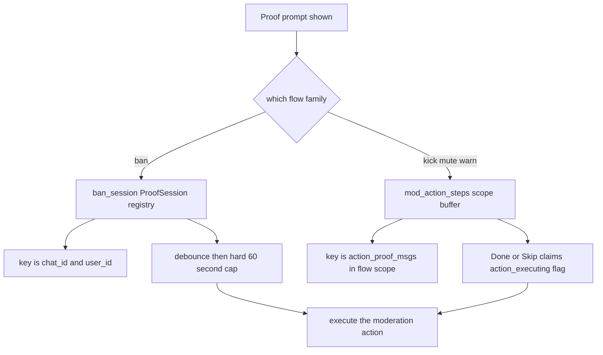
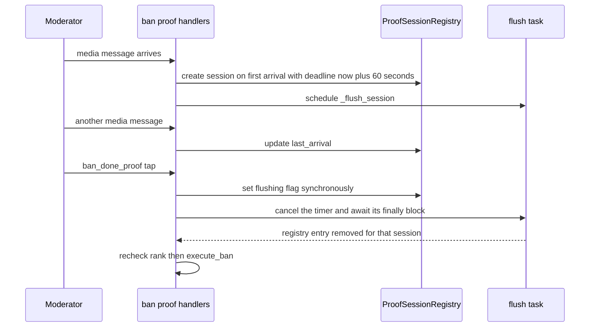
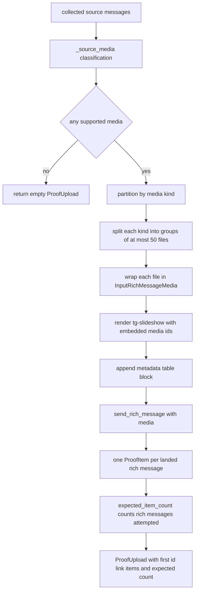
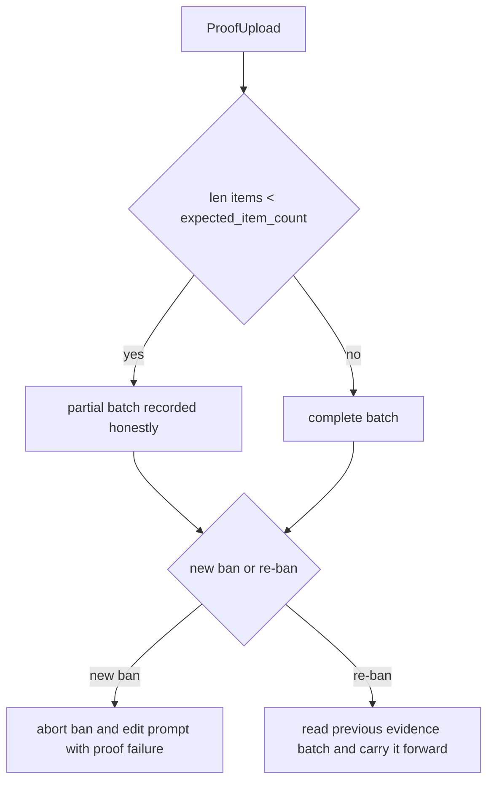

# Proof

This document describes the proof pipeline shared by ban, kick, mute, and warn:
the accepted media shapes, album debounce and the 60-second cap, the Done and
timer flush claim, the upload to `PROOFS`, landed items, partial galleries, and
the archive written with the decision. It is used by
[banning](banning.md), [kicking](kicking.md), [muting](muting.md), and
[warning](warning.md).

## Accepted media

`PROOF_MEDIA_FILTER` in `proof_steps.py` is the single owner of which message
shapes count as evidence:

```python
PROOF_MEDIA_FILTER = (
    filters.photo | filters.video | filters.animation | filters.document
)
```

Photos, videos, animations, and documents are accepted. Voice notes, video
notes, and stickers are rejected. Every proof receiver and every unexpected-type
handler uses the same filter, so the two cannot drift apart within a flow or
across flows.

`BuildProof(action, skip_allowed=...)` owns the proof-step keyboard through
`buttons.proof_step_btn()`:

| Callback data | Meaning |
|---|---|
| `<action>_skip_proof` | Execute without proof, when allowed. |
| `<action>_done_proof` | Flush collected proof and execute. |
| `<action>_cancel` | Cancel the flow. |

The ban path uses `BuildProof("ban", skip_allowed=False)`, so proof is mandatory
there. Kick, mute, and warn use the default `skip_allowed=True`.

## Two collection models



The ban flow needs a timed auto-flush because it forbids Skip and must not hang
on an abandoned proof. `ProofSession` in `proof_session.py` holds the messages,
a meta snapshot of the conversation scope, the deadline, the last arrival, and
the flush task. The other flows use the `_ProofStepMixin` in `mod_action_steps.py`,
which buffers media into scope and waits for an explicit Done or Skip.

## Debounce and flush claim



`_flush_session()` loops in slices bounded by the smaller of `cfg.album_debounce`
and the remaining time, and breaks on silence or the hard cap. The hard cap is
`_PROOF_COLLECT_MAX_S = 60.0`, so a very large debounce value cannot leave a ban
unflushed indefinitely. Setting `flushing` is a synchronous claim, so Done and
the timer can never execute the same session. The `finally` block removes the
registry entry only when it still holds the same session and clears that
conversation's ban keys, so a successor session keeps its own entry.

`drain_proof_sessions()` is called at shutdown. It waits for running flushes up
to 30 seconds, then cancels those still waiting. A running flush already owns
its decision and fan-out, so it is never cancelled mid-execution.

## Upload to `PROOFS`



`upload_proof_items()` sends every artifact as a rich message containing a
`tg-slideshow`. Sources are partitioned by media kind first, then each kind is
chunked to at most 50 files, so one slideshow never mixes `img`, `video`, and
document-backed items. Each file becomes an `InputRichMessageMedia` with a short
id, and the slideshow HTML references it through `tg://photo`, `tg://video`, or
`tg://document` links. There is no plain media send and no fallback: a chunk
that fails is logged and counted as missing, so the archive records a partial
batch instead of hiding lost evidence.

Every slideshow is followed by its identifying metadata table. `ProofItem` records the landed
rich message id, the first file's media metadata, and the source ids.
`to_document()` converts it to the `EvidenceItemDoc` shape stored in the
archive. `ProofUpload.landed` is true when at least one rich message reached
the channel, and `documents()` returns every landed slideshow row.

A failed upload returns an empty `ProofUpload` instead of raising, because the
moderation action is the important side effect. The ban executor checks `landed`
itself.

## Partial galleries and the ban proof requirement



The ban executor aborts a new ban when the gallery is partial or nothing landed,
so `/check` and the audit log never reference evidence that never arrived. A
re-ban may keep the previous proof; `update_ban()` then reads the entire prior
evidence batch, not just its first message, so media types and item counts stay
accurate. A re-ban cannot attach an incomplete inherited proof, so the moderator
supplies a complete one. Kick, mute, and warn treat proof as optional and simply
attach whatever landed.

## Archive and landed items

`moderation_db.archive_proof()` writes the upload row and its items inside the
decision transaction. The same transaction opens the case, writes the
`moderation_actions` decision, and closes the case. Either the decision and its
proof both commit, or neither does.

| Helper | Owner | Role |
|---|---|---|
| `PROOF_MEDIA_FILTER` | `proof_steps.py` | Accepted media shapes. |
| `BuildProof` | `proof_steps.py` | Keyboard and prompts. |
| `proof_step_btn` | `buttons/flows.py` | Skip, Done, Cancel callbacks. |
| `upload_proof_media` | `proof_post.py` | Upload owner and `ProofUpload`. |
| `upload_proof_items` | `proof_post.py` | Rich slideshow chunking and embedded media. |
| `rich.media.slideshow` | `rich/media.py` | Slideshow markup referencing embedded media ids. |
| `rich.send_msg.send_rich` | `rich/send_msg.py` | Rich transport used for every proof artifact. |
| `ProofSession`, `proof_sessions` | `proof_session.py` | Ban session storage and drain. |
| `_flush_session` | `ban_session.py` | Debounce timer and claim. |
| `demote_before_enforcement` | `demote_actions.py` | Runs after proof before enforcement. |
| `archive_proof` | `moderation_db.py` | Durable evidence rows. |

The proof metadata is built by `messages.proof_caption_new()` for new decisions
and `messages.proof_caption_update()` for re-bans, where it carries the previous
proof link. Both return a compact Field/Value rich table; it follows the
slideshow as a separate block in the same message, because a Telegram caption
only accepts inline text and cannot hold a table. See [Transport](transport.md)
for the rich send path.

## Edge cases

- A proof upload that outlives a demotion or target promotion is followed by a
  fresh enforcement gate immediately before the decision write.
- A slideshow chunk that failed is a partial batch, not a complete proof, and a
  new ban is refused from it.
- An animation is embedded as a document-backed rich attachment while its
  `ProofItem` keeps the animation media type, so the archive still reports the
  original evidence kind.
- A late `Done` tap while a flush is already running is ignored; the first claim
  wins.
- A cancelled proof flush releases only its own session, leaving a newer
  collection for the same user in place.

## Validation

```bash
uv run pytest tests/ -q -k proof
```

Relevant tests include `tests/test_proof_items.py`, `tests/test_ban_flush_cleanup.py`,
and `tests/test_moderation_enforcement.py`.
