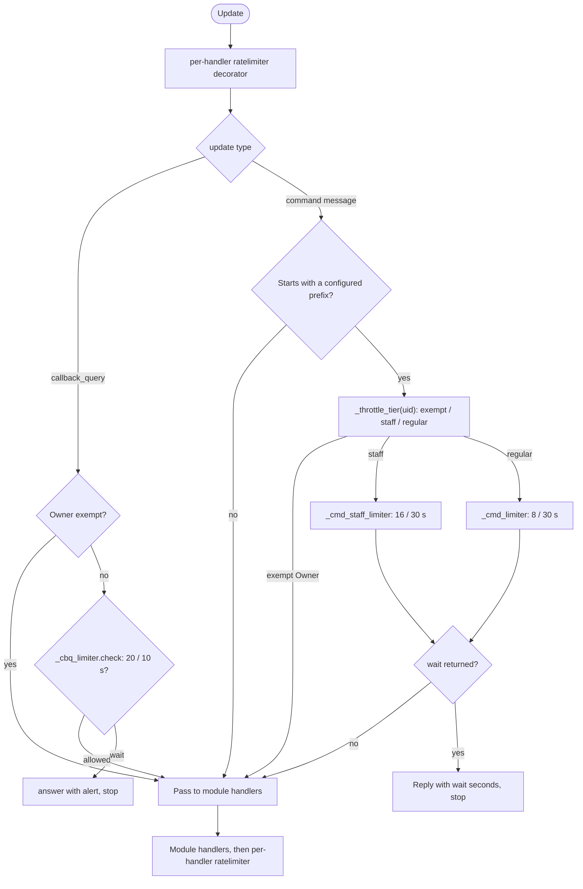
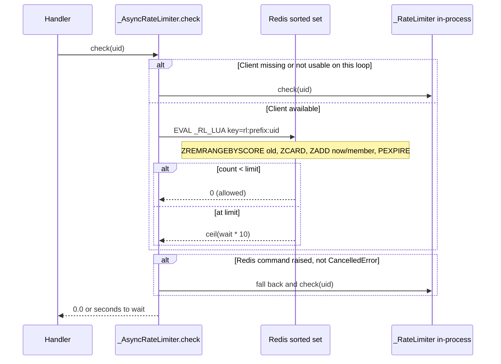
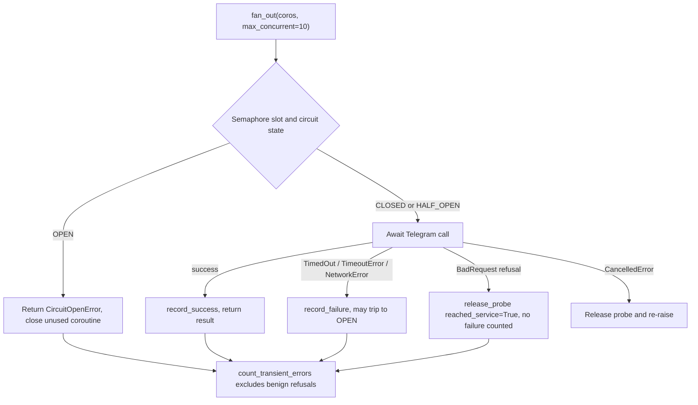

# Rate limiting and flood control

Purpose: describe the per-handler throttle tiers, the global flood handler, the
Redis-backed sliding window with its in-process fallback, and how rate limits
cooperate with the Telegram circuit breaker. The concurrency contract is shared
with [Persistence](persistence.md) and [Cache](cache.md).

## Two layers of throttling

Every update first passes a global per-user flood handler, then the decorated
command applies a per-handler quota. The global ceiling and the handler budget
are independent: the first stops bursts across all commands, the second paces
each destructive command individually.

| Layer | Owner | Scope |
|---|---|---|
| Global | `global_rate_limit_handler` in `decorators/ratelimit.py` | One bucket per user for commands, one for button presses; registered at handler group `-1`. |
| Per handler | `ratelimiter(throttle)` decorator | One bucket per `(user, wrapped function)`. |

Rate limiting is applied by the per-handler `ratelimiter()` decorator. There is
no globally registered flood handler in the Kurigram runtime. It returns
immediately for plain chat messages that do not start with a configured prefix,
so ordinary conversation is never rate limited.

## Shared throttle tiers

`@dataclass(frozen=True) class Throttle(limit, period)` gives `limit` calls per
`period` seconds, per user, per handler. The Redis key includes the wrapped
function name, so two handlers on the same tier keep independent buckets.
`decorators/__init__.py` re-exports all tiers.

| Constant | Limit | Period | Typical use |
|---|---|---|---|
| `THROTTLE_READ` | 8 | 30 s | Read-only commands such as help, stats, group and warn listings |
| `THROTTLE_CALLBACK` | 15 | 30 s | Buttons that only open a view |
| `THROTTLE_CALLBACK_DEEP` | 20 | 30 s | Buttons that open a paginated drill-down |
| `THROTTLE_STAFF` | 10 | 30 s | Staff state changes and approval callbacks |
| `THROTTLE_MODERATION` | 5 | 60 s | Destructive moderation: ban, kick, mute, warn, promote, demote |
| `THROTTLE_FEDERATION` | 3 | 60 s | Commands that fan out across every group |
| `THROTTLE_BULK` | 3 | 300 s | Long cleanup and leave-all operations, transfer, promotion requests |
| `THROTTLE_CRITICAL` | 1 | 300 s | A single destructive operation per window |

`admins.py` uses `THROTTLE_MODERATION` on promote and demote commands,
`THROTTLE_BULK` on transfer and promotion-request submission, and
`THROTTLE_STAFF` on the role-picker, confirmation, and decision callbacks. See
[Roles](roles.md) for those flows.

## The `ratelimiter` decorator

`ratelimiter(throttle)` wraps a handler and constructs an `_AsyncRateLimiter`
with `max_calls=throttle.limit`, `window=throttle.period`, and
`prefix=f"h:{func.__module__}.{func.__name__}"`. Each call:

- resolves the invoking user id; without one it calls the handler directly;
- calls `_is_exempt(uid)` and skips the quota entirely for the current Owner;
- calls `_limiter.check(uid)`, and if it returns a wait time, answers a callback
  with an alert or replies to the message with the wait text, then returns
  without calling the handler;
- otherwise awaits the handler.

A throttle reply uses `replies.rate_limit_text(wait, locale, plain=True)`.
Cancellation propagates through `_is_exempt()` and the limiter check.

## Global buckets and Owner bypass

| Bucket | Limit | Prefix | Users |
|---|---|---|---|
| `_cmd_limiter` | 8 / 30 s | `cmd` | Regular users' command messages |
| `_cmd_staff_limiter` | 16 / 30 s | `cmd_staff` | Moderator rank and above |
| `_cbq_limiter` | 20 / 10 s | `cbq` | All non-owner callback presses |

`_throttle_tier(uid)` uses one cached `get_effective_role(uid)` read to return
`exempt` for the Owner, `staff` for rank `moderator` or above, and `regular`
otherwise. `_is_exempt(uid)` uses the cached `get_owner_id()` (300 s L1 TTL,
invalidated on transfer). Both fail closed: a lookup error yields `regular` for
the tier and `False` for exemption, so an outage never loosens throttling. A
synchronous compare against the configured initial owner is deliberately
avoided, because after a transfer that account is no longer the Owner and would
stay exempt forever.

## Redis sorted-set window and in-process fallback

`_RL_LUA` is an atomic sorted-set sliding window. Its arguments are the key,
current time, window, limit, and a unique member (`time.time_ns()` string). It
returns `0` when allowed, or `ceil(wait * 10)` when denied; the caller converts
that back to seconds rounded to one decimal. `_AsyncRateLimiter` uses
`key = f"rl:{prefix}:{uid}"` and `PEXPIRE` of `ceil(window * 1000) + 1000` ms.

When Redis is unavailable (no client, a client bound to another event loop, or
a command error), the call falls through to the synchronous `_RateLimiter`,
which keeps per-user `deque` timestamps and prunes entries outside the window.
Memory is bounded by periodic cleanup once the bucket count exceeds `10_000`.
Rate limiting is never silently disabled.

A deliberate constraint: the Redis call is bounded by the client's socket
timeout, not by `asyncio.wait_for()`. Cancelling a waiter would abandon an
in-flight Redis command with its reply unread on the pooled connection,
desyncing the next cache operation that reuses it. The same rule governs the
two-level cache in `database/cache/twolevel.py`.

## Flood wait and retry storm avoidance

- A throttled command answers once with the computed wait and stops, so the user
  gets no duplicate work.
- A throttled callback answers with `show_alert=True` so the client spinner
  clears immediately.
- The wait is derived from the oldest timestamp in the window, so a user sees
  a real countdown rather than a generic refusal.
- The global handler short-circuits non-command messages and Owner traffic,
  and applies the strictest bucket on any lookup failure.
- Telegram `RetryAfter` from the rate limiter is waited out with a bounded
  retry budget: the request is retried after the requested delay while the
  other requests are paused, which is the behaviour Telegram asks for.

## Telegram circuit breaker and bounded fan-out

Rate limiting is per user; the circuit breaker protects the Telegram transport
as a whole. Federation-wide enforcement uses `utils.dispatch.fan_out()`, which
bounds concurrency and integrates the breaker.

| Item | Value |
|---|---|
| `fan_out` default `_MAX_CONCURRENT` | 10 concurrent Telegram calls (Telegram allows roughly 30 messages per second globally) |
| `gather_bounded` | Same bounded contract for pure database bursts, with no circuit interaction |
| `telegram` breaker | `failure_threshold = 5`, `recovery_timeout = 60.0` s |
| `postgres` breaker | `failure_threshold = 5`, `recovery_timeout = 60.0` s |
| Breaker states | `CLOSED`, `OPEN`, `HALF_OPEN` (one probe in flight) |

`fan_out` admits slots lazily through a semaphore. While the circuit is `OPEN`,
a slot is skipped immediately with `CircuitOpenError` instead of firing a call
that would time out, and the unused coroutine is closed. Successes call
`record_success()`. `TimedOut`, builtin `TimeoutError`, and `NetworkError` call
`record_failure()`. A `BadRequest` is an API refusal, not congestion, so it
calls `release_probe(reached_service=True)` and does not count against the
breaker. `CancelledError` always propagates so shutdown is never coerced into
per-group failure data. The breaker's `admission_headroom` property reports how
many calls a closed circuit can still admit; the enforcement worker sizes its
claims with it.

`count_transient_errors()`, `transient_groups()`, and `summarize_fanout()` turn
the result list into operator-facing counts. Benign refusals such as
`USER_NOT_PARTICIPANT` or `CHAT_NOT_FOUND` count as applied, because there was
nothing to enforce in that group; only transient failures are reported as
failed groups. This combination of per-user throttles, bounded concurrency, and
circuit gating prevents one flood of commands or one stalled Telegram endpoint
from turning into a retry storm.

Related reading: [Permissions](permissions.md), [Roles](roles.md),
[Extraction and user data](extraction-user-data.md).
