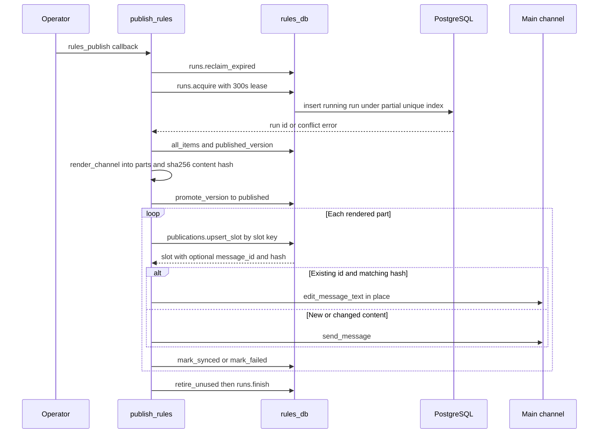
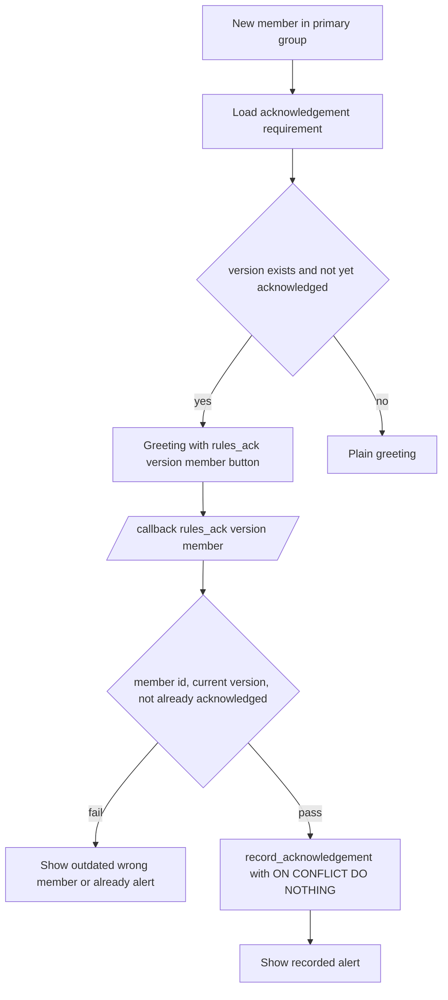

# Community rules pipeline

This document covers the staff rules editor, publication to the main channel,
member acknowledgment, and the shared rules picker used by moderation flows.
The user-facing feature page is [features/rules.md](../features/rules.md).

## Draft model

A rule set owns categories and versions. One draft per set and working locale
exists at a time; published versions are immutable. `open_draft()` clones the
current published items into a new draft together with a snapshot of the
category catalogue, so a later rename or reorder cannot change what an older
version displayed. `editor_allowed()` re-checks `rules.manage` on every editor
surface and fails closed when the lookup fails.

## Editor conversation

`build_rules_conv()` in `rules_editor.py` drives the editor. Entry points are the
`/tcrules` message and the `/start tcrules` deep link used by the group's Open in
PM button, both in the moderator's private chat. Entry first opens the language
picker built from the available i18n catalogs; choosing a locale opens that
locale's draft. One interactive state handles every panel callback and text
step; the pending step is stored in the conversation scope. A second state holds
the discard confirmation, and a third accepts an uploaded Markdown document.

| State | Value | Input | Next step |
|---|---|---|---|
| `WAITING_EDITOR_MENU` | 0 | Callback or typed step | Add, rename, reorder, or delete categories; add items; upload `.md`; preview draft as a public-style menu; publish; go Back to the language picker. |
| `WAITING_CONFIRM_DISCARD` | 5 | Yes or no callback | Delete the draft or leave it untouched. |
| `WAITING_MARKDOWN` | 6 | `.md` document | Parse headings into items, store them in the draft, and return to the category list. |

A stale moderation picker `rules_step:cancel` is answered and ignored so it
cannot close an unrelated editor session; the editor exits through Close or the
discard confirmation. Input limits are title 200, body 3500, and URL 500
characters; a URL must start with `https://` or `http://`. Category slugs are derived by
lowercasing the title and replacing runs of non-alphanumeric characters with a
hyphen, then capped at 40 characters so the longest callback stays inside
Telegram's 64-byte limit. The main panel offers Back to the language picker and
Close, and shows Publish and Discard only once the draft has items. Every
sub-menu, including the preview, offers both Back and Close. Uploaded Markdown
uses the bundled document shape: the H1 names the category, each H2 becomes an
item titled `Category: Section`, and bold, italic, inline code, lists, and
`---` dividers render as rich blocks.

```mermaid
flowchart TD
    CMD[/tcrules in private chat] --> LANG[Choose rules language]
    LANG --> SET[get_or_create_community_set]
    SET --> DRAFT[open_draft cloning published items]
    DRAFT --> PANEL[Editor panel with edit preview publish discard]
    PANEL -->|rules_edit_draft| CATS[Category list with CRUD callbacks]
    PANEL -->|rules_preview| PREV[Preview: draft categories like /rules, Back to editor]
    PANEL -->|rules_publish| PUBLISH[publish_rules pipeline]
    PANEL -->|rules_discard| CONF{WAITING_CONFIRM_DISCARD}
    CONF -->|rules_discard_yes| DEL[discard_draft]
    CONF -->|rules_discard_no| END[Leave draft unchanged]
    CATS -->|rules_cat_add| TITLE[Category title in scope]
    CATS -->|rules_cat_key| ITEMS[Item list with add_item]
    TITLE --> CATS
    ITEMS -->|rules_item_add| IT[Title body URL in scope]
    IT --> ITEMS
```

Category and item CRUD live in `rules_db`: `add_category`, `rename_category`,
`move_category`, `delete_category`, `list_categories`, `add_item`, and
`list_items`. Every mutation touches the draft, never a published version.
Typed answers are routed by the pending step stored in the conversation scope,
so every button and text prompt has a reachable handler.

## Publication

`publish_rules()` runs under a database lease, not a background retry loop. The
database commits first and Telegram is touched second. A failed channel
operation is recorded on its slot and reconciled by the next publish.



`MAIN_CHANNEL` must be configured or publishing is refused. `runs.acquire()`
inserts a `running` row guarded by a partial unique index on `(rule_set_id,
chat_id)` where `status = 'running'`; a concurrent publish fails immediately
rather than waiting. `reclaim_expired()` first marks stale running rows (lease
expiry over 300 s) as `failed` so a crashed publish cannot block the channel
forever.

The channel text is split into parts of at most 4000 UTF-16 units by
`render_channel()`, grouped by category with a version and timestamp footer.
Each part's final rendered text is hashed with SHA-256 and stored on its slot.
A slot with a message id and matching hash is edited in place; a changed or
missing message is sent fresh. `mark_failed(missing=True)` clears the stale id,
so a deleted channel post is not retried forever.

| Run state | Meaning |
|---|---|
| `running` | Lease held; one publish owns this set and channel. |
| `completed` | Every slot synced or retired. |
| `partial` | At least one slot failed; the next publish reconciles it. |
| `failed` | The publish aborted and the error was recorded. |

| Slot state | Meaning |
|---|---|
| `pending` | Slot refreshed with a new hash, awaiting Telegram. |
| `synced` | Channel message matches the slot content. |
| `missing` | Telegram could not find the message; the id was cleared. |
| `failed` | A transient channel error was recorded for the next publish. |
| `retired` | No longer part of the rendered representation. |

## Member acknowledgment

Acknowledgment is a greeting-only surface. `_ack_markup()` in `greeting.py`
attaches one "I agree" button to the welcome message in the primary group when
a published version exists and the member has not yet accepted that exact
version. The `requires_acknowledgement` flag is no longer consulted. A rules
read failure never blocks the welcome: the greeting is sent without a button.



The callback payload is `rules_ack:<version>:<member>`. `_acknowledge()` verifies
the tapping user is the named member, the version is still the current published
version, and no prior acknowledgment exists.
Duplicate taps are safe because the insert is `ON CONFLICT DO NOTHING`.
Acknowledgment never appears on channel posts or in the `/rules` menu.

## Shared rules picker

`rules_picker.py` provides action-agnostic picker helpers: `callback_for`,
`item_id_from_callback`, `toggle`, and `picker_text`. The flow stores selected
item ids and an optional note in its conversation scope, then passes them to the
decision writer, which links them to the case through
`moderation_db.link_case_rules()`.

| Callback | Effect |
|---|---|
| `rules_step:pick:<id>` | Toggle one published rule item. |
| `rules_step:done` | Accept the selection and continue to proof. |
| `rules_step:other` | Ask for the optional "Other" note. |
| `rules_step:clear` | Clear the selection. |
| `rules_step:cancel` | Cancel the moderation flow. |

Ban owns a dedicated step in `ban_rules_step.py` with `WAITING_BAN_RULES` (2) for
the picker and `WAITING_BAN_RULES_NOTE` (3) for the note, storing `ban_rules` and
`ban_rules_note` in scope. Kick, mute, and warn share the generic picker step in
`mod_action_steps.py`, which uses the same callbacks with its own scope key. The
picker therefore has a single implementation and a single callback vocabulary
across all four moderation actions. With no published rules or no `rules.view`
permission the step is skipped.

## Database impact

Drafts and published data live in `rule_sets`, `rule_set_versions`,
`rule_categories`, `rule_category_content`, `rule_items`,
`rule_publication_runs`, `rule_publications`, and `rule_acknowledgements`.
Localized category labels and descriptions are seeded into
`rule_category_content` and resolved for the reader's locale on every public
rules read. Published versions are immutable; every mutation touches a draft.
Publication commits to the database before touching Telegram.
See [Persistence](persistence.md) for the shared write boundary.

## Logging and edge cases

The public menu paginates one topic at a time. Each page is a rich payload with
a position marker; its keyboard carries Prev, Next, and Close only, and the
target index is clamped before the page is rendered. Legacy category, menu, and
More callbacks remain registered for keyboards sent before pagination.
`rules.publish.result` reports synced and failed slot counts. Editor
authorization failures and publication errors are logged with the set id and
operator id.

- A crashed publish is reclaimed by the lease and reconciled by the next run.
- A deleted channel post is treated as missing and re-sent.
- A rules read failure in the greeting path sends the welcome without a button.
- A stale acknowledgment tap is refused with a localized alert.
- Category slugs are capped so the longest callback stays within 64 bytes.

## Exact names and validation

| Name | Owner | Role |
|---|---|---|
| `build_rules_conv` | `rules_editor.py` | ConversationHandler factory. |
| `editor_allowed` | `rules_editor.py` | Re-check of `rules.manage`. |
| `publish_rules` | `rules_publish.py` | Leased channel publication. |
| `_ack_markup`, `_acknowledge` | `greeting.py`, `rules.py` | Welcome-time acknowledgment. |
| `callback_for`, `toggle`, `picker_text` | `rules_picker.py` | Shared picker helpers. |

```bash
uv run pytest tests/ -q -k rules
```

Relevant tests include `tests/test_rules_*.py` and
`tests/test_keyboard_locale_contract.py`.
