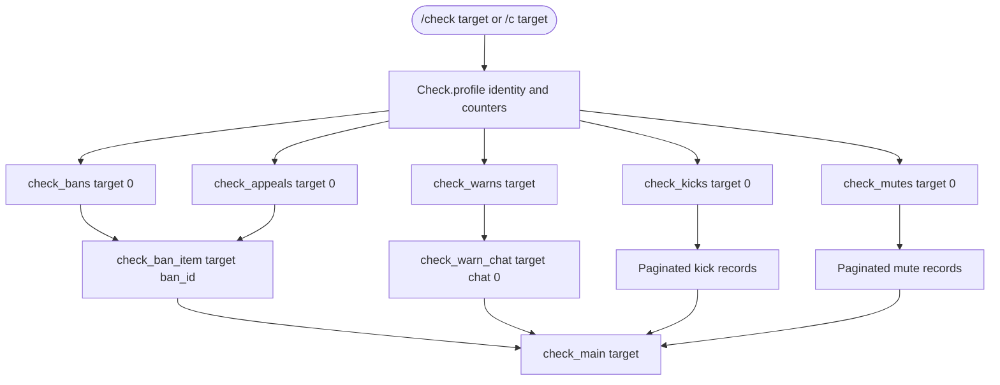
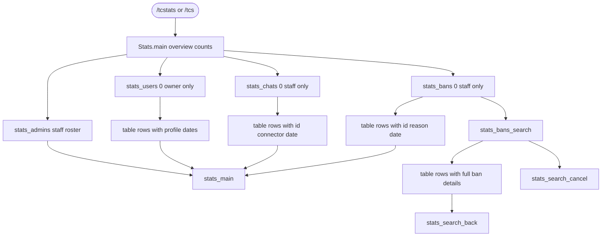
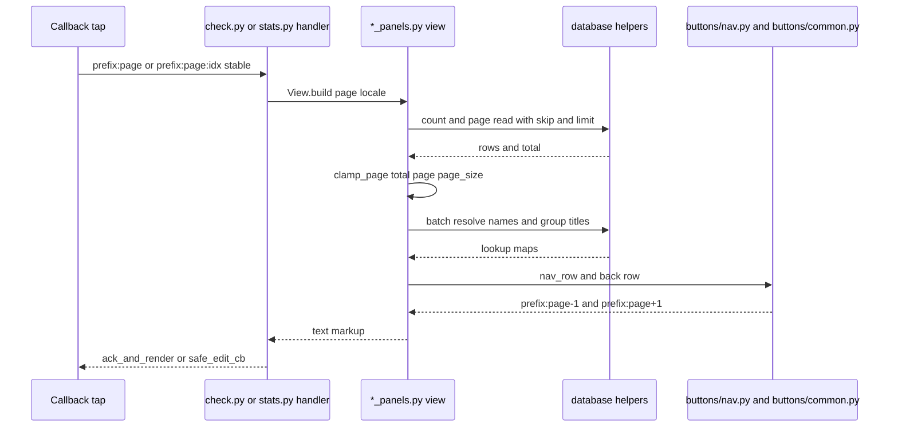

# Check and statistics views

This page documents the `/check` and `/tcstats` drill-down trees, their
pagination and callback navigation, the batched database reads behind each
panel, the rich rendering helpers, and the access tiers on the staff-only panes.
The callback registry is in [reference/callbacks.md](../reference/callbacks.md).

## Commands and entry points

| Command | Aliases | Handler | Rate limiter |
|---|---|---|---|
| `/checkme` | `/cme` | `check.py::cmd_checkme` | `THROTTLE_READ` |
| `/check` | `/c` | `check.py::cmd_check` | `THROTTLE_READ` |
| `/tcstats` | `/tcs` | `stats.py::cmd_stats` | `THROTTLE_READ` |

All three commands are available to any user. The overview counts in `/tcstats`
are public; the drill-down panes are gated when opened, as described in
[Access tiers](#access-tiers).

`/checkme` reads the caller role and active ban in parallel with
`asyncio.gather(..., return_exceptions=True)`. A failed ban read fails closed
with `checking.error.status_retry` instead of a clean verdict. An active ban
always renders `build_ban_summary()` with `checkme_ban_btn()`, even for staff, so
a banned staff member keeps the appeal link.

## `/check` drill-down tree



`/check` resolves its target with
`extract_target(update, args, ctx.bot, prefer_explicit=True)`, so a typed id or
username wins over a quoted message. `Check.profile()` then runs one
`asyncio.gather` of ten independent reads plus an optional `identity.classify()`.
Per-group warn counts are summed into the federation total so no second query is
needed. See [Extraction and user data](extraction-user-data.md).

| Pane | Callback | Renderer |
|---|---|---|
| Profile | `check_main:<target_id>` | `check_panels.py::CheckProfileMixin.profile` |
| Ban list | `check_bans:<target_id>:<page>` | `CheckBansMixin.bans_list` via `_ban_list_render` |
| Ban detail | `check_ban_item:<target_id>:<ban_id>` | `CheckBansMixin.ban_detail` using `build_ban_detail()` |
| Appeal list | `check_appeals:<target_id>:<page>` | `CheckBansMixin.appeals_list` via `_ban_list_render` |
| Warn groups | `check_warns:<target_id>` | `CheckEventsMixin.warns_by_group` |
| Warns in one group | `check_warn_chat:<target_id>:<chat_id>:<page>` | `CheckEventsMixin.warns_in_group` |
| Kicks | `check_kicks:<target_id>:<page>` | `CheckEventsMixin.kicks_list` via `_per_chat_event_list` |
| Mutes | `check_mutes:<target_id>:<page>` | `CheckEventsMixin.mutes_list` via `_per_chat_event_list` |

`/checkme` has its own two-pane tree. `checkme_detail:<ban_id>` calls
`on_checkme_detail`, which verifies `ban["target_user_id"] == q.from_user.id`
before rendering `build_ban_detail()` with `checkme_detail_back_btn()`.
`checkme_back:<ban_id>` returns to `build_ban_summary()` with `checkme_ban_btn()`.
Both handlers answer the callback and edit through `safe_edit_cb()`.

## `/tcstats` drill-down tree



Each list is one rich table. A row carries the whole record, so there is no
per-item detail card and no numbered drill-in buttons. The keyboard keeps only
Prev/Next, the Search shortcut on bans, and Back.

The overview gathers the owner id, role counts, active ban count, active group
count, total users, and the viewer's owner status and effective role in one
`asyncio.gather(return_exceptions=True)`. A `degraded` notice is added when any
core count failed. The staff roster lists Owner, Admins, Developers, and
Moderators with batched mention data; names that are placeholders are resolved
live with a bounded lookup and a bounded fan-out.

| Pane | Callback | Renderer |
|---|---|---|
| Overview | `stats_main` | `stats_panels.py::OverviewViews.main` |
| Staff roster | `stats_admins` | `OverviewViews.staff_roster` |
| Cached users | `stats_users:<page>` | `PeopleViews.users_list` (User, ID, Username, First seen, Last seen) |
| Connected groups | `stats_chats:<page>` | `ChatViews.chats_list` (Group, ID, Connected by, Date) |
| Active bans | `stats_bans:<page>` | `BanViews.bans_list` (User, ID, Reason, Ban ID, Date) |
| Ban search | `stats_bans_search` | `SearchViews.open_search`, `search_run`, `search_results` (User, ID, Reason, Ban ID) |
| Search back | `stats_search_back` | `SearchViews.search_results` |

`stats_main_btn(show_staff=..., show_users=...)` hides drill-down buttons when
the viewer lacks the rank; the callbacks re-check rank fresh, so a crafted or
stale tap cannot open a gated pane.

The ban search accepts a plain message only in private chat
(`filters.ChatType.PRIVATE & filters.TEXT & ~ALL_PREFIXES_CMD_FILTER`). A numeric
query calls `get_active_ban(int(query))`; a name query calls
`users_cache.search_by_name(q, limit=_SEARCH_LIMIT)` and then
`bans_db.active_bans_for_users(uids)`. `_SEARCH_LIMIT` is `30`. Results render as
a rich table with an explicit empty state, and the keyboard offers New Search
and Back. Search context is stored in `ctx.user_data` and cleared on exit.

## Pagination and navigation



| View family | Page size | Page callbacks |
|---|---|---|
| `/check` ban, appeal, warn, kick, mute lists | `_PAGE_SIZE = 5` in `check_panels.py` | `<prefix>:<page - 1>`, `<prefix>:<page + 1>` |
| `/tcstats` users, groups, bans | `_PAGE_SIZE = 5` in `stats_panels.py` | Same `nav_row` shape |
| `/tcstats` search results | `_SEARCH_LIMIT = 30` hits, no paging row | No item callbacks |

`utils/pagination.py` owns `clamp_page(total, page, page_size)` and
`paginate(items, page, page_size)`. `buttons/nav.py::nav_row(page, total_pages,
cb_prefix, locale)` emits a previous button when `page > 0` and a next button
when `page < total_pages - 1`. `buttons/drills.py::stats_list_nav_btn` combines
that row with the optional Search shortcut and Back; no numbered item callbacks
are emitted. Telegram allows up to 32768 UTF-8 characters, 500 blocks, and 20
table columns per rich message, so five rows of four or five short cells stay
well inside the limit.

Every drill-down ends with a back row: `check_main:<target_id>` for `/check`,
`check_warns:<target_id>` for the warns-in-group list, and `stats_main` or
`stats_search_back` for `/tcstats`.

## Batched database reads

| Helper | Owner | Used by |
|---|---|---|
| `get_mention_data_batch(user_ids)` | `users_cache.py` | `Stats.staff_roster` resolves every staff name in one call. |
| `get_first_names_batch(user_ids)` | `users_cache.py` | Warn, kick, mute, ban-list, and search rows resolve actor or target names. |
| `get_user_mention_data(user_id)` | `users_cache.py` | Stats owner line, group detail connected-by line. |
| `get_group_titles(chat_ids)` | `groups_db.py` | Check warn and event lists, stats group rows. |
| `user_bans`, `user_appealable_bans`, `user_ban_count`, `user_appeal_count` | `bans_db/_queries.py` | Check ban and appeal pages. |
| `active_bans_page`, `active_ban_count`, `active_bans_for_users`, `get_active_ban` | `bans_db/_queries.py` | Stats ban pages and search. |
| `user_warn_groups`, `user_total_warns`, `warn_count`, `get_warns` | `warns_db.py` | Check warn panes. |
| `user_kicks`, `user_kick_count`, `user_mutes`, `user_mute_count` | `kicks_db.py`, `mutes_db.py` | Check kick and mute panes. |
| `all_users_page`, `total_users`, `search_by_name` | `users_cache.py` | Stats user pages and search. |
| `active_groups` | `groups_db.py` | Stats group list and detail. |

`Check.profile()` gathers its ten reads in one `asyncio.gather`. Each paginated
list resolves its total and display name in parallel, then fetches the page
because that needs the clamped page number. `_per_chat_event_list()` gathers group
titles and actor names in one batch after the page read, avoiding one lookup per
row. A failed count falls back to the fetched row count so a partial outage still
renders the rows that could be read.

## Rich rendering

All panels are assembled as localized rich text and delivered through
`reply_rich()`, `safe_edit_cb()`, or `ack_and_render()` from
[Transport](transport.md). The shared renderers are:

| Helper | Responsibility |
|---|---|
| `ban_info.build_ban_detail` | Full ban detail card plus proof link, used by `/check` and `/checkme`. Stats ban rows show the key fields inline instead. |
| `ban_info.build_ban_summary` | `/checkme` ban summary card and back navigation. |
| `messages/panels.py::about_msg` | About section index rendered from `about.index.*` catalog keys; each of the three section pages uses `about.section.*`. |
| `messages/panels.py::render_groups` | Group list as a compact rich table: one Group column in the simple view and Group plus ID in Details. Truncated at `_MAX_RENDER_CHARS = 3800` to stay under the Telegram text limit. |
| `messages/rules.py` | Rules read view, categories, items, and selected summary. |

Dynamic values are wrapped with `Safe()` only after passing through `code()`,
`bold()`, `italic()`, `user_ref()`, or `fmt_dt()`. The `t()` call owns escaping of
ordinary placeholders. `Check` and `Stats` view builders return a
`(text, InlineKeyboardMarkup)` pair; handlers never build text themselves.

Staff rows whose cached name is only a numeric fallback are resolved live with
a bounded lookup so the roster stays readable. `buttons/check.py` caps a group
title in a warn button at `_WARN_GROUP_TITLE_MAX = 24` characters.

## Access tiers

| Pane | Requirement | Enforcement |
|---|---|---|
| `/check`, `/checkme`, overview counts | Any user | No authorization decorator; only `THROTTLE_READ` and `log_execution`. |
| `/checkme` detail and back callbacks | The ban must belong to the tapping user | `on_checkme_detail` and `on_checkme_back` compare `ban["target_user_id"]` with `q.from_user.id`. |
| Stats staff panes (`stats_admins`, `stats_chats`, `stats_bans`, search callbacks) | Moderator or higher | `_require_staff_pane` calls `guards.staff_access(user_id, min_role="moderator")`. |
| Stats free-text ban search | Moderator or higher | `_require_staff_input` calls the same gate and replies with a plain notice. |
| Stats users pane (`stats_users:<page>`) | Owner only | `_require_owner_list` calls `guards.staff_access(user_id, min_role="owner")`. |

`_pane_access()` treats `guards.StaffAccess.LOOKUP_FAILED` as a retry alert and
fails closed; `guards.StaffAccess.DENIED` gets a staff-only or owner-only alert.
`OverviewViews.main()` computes `show_staff` and `show_users` from the viewer's
fresh role. Buttons are a convenience, not the gate: every `stats_*` callback
re-checks rank before it renders. See [Permissions](permissions.md).

## Edge cases

- A degraded overview shows unavailable fields rather than zeros.
- A page beyond the available range is clamped to the last page by `clamp_page`.
- A failed background refresh leaves the cached value visible; it does not
  block the view.
- Search is read-only and never exposes proof media directly, only a link.
- A lookup outage never renders an empty history that would claim zero records.

## Validation

```bash
uv run pytest tests/ -q -k stats
```

Relevant tests include `tests/test_stats_roles.py`, `tests/test_check_pagination.py`,
and `tests/test_pagination.py`.
