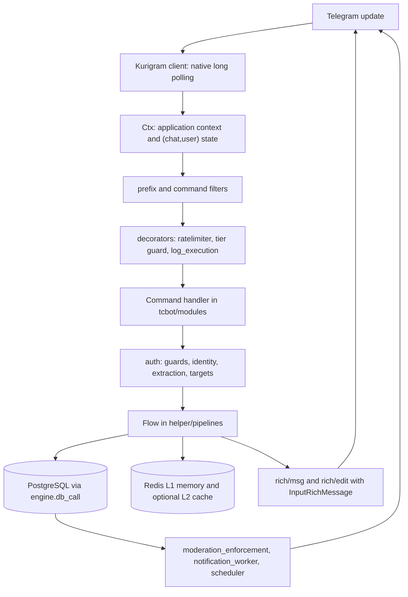
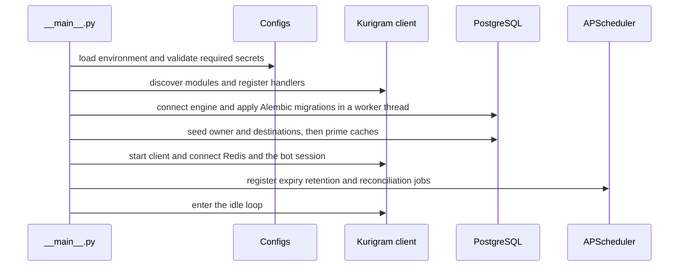
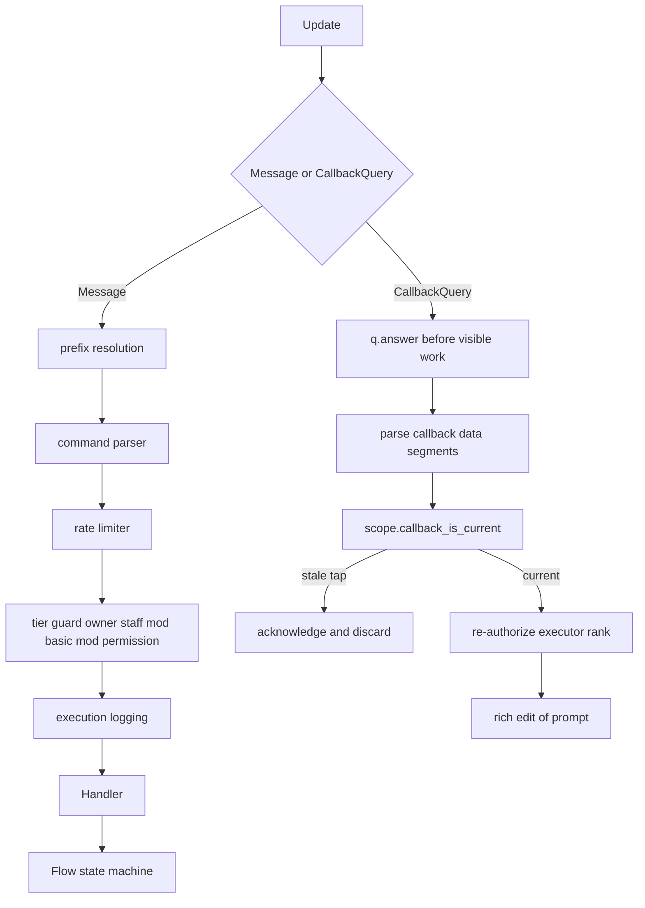
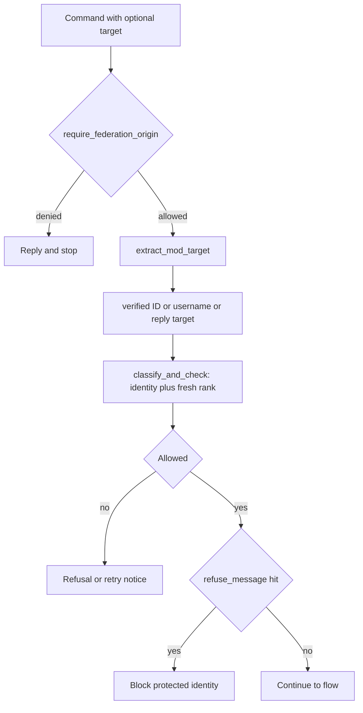

# System spine

This is the anchor flow page. It describes the runtime spine from startup through
update dispatch, authorization, persistence, and transport. The domain flows are
listed in the [flow index](README.md). The main domain pages are
[Banning](banning.md), [Unbanning](unbanning.md), [Kicking](kicking.md),
[Muting](muting.md), [Warning](warning.md), [Proof](proof.md),
[Appeals](appeals.md), [Connection](connection.md), [Roles](roles.md),
[Community rules](rules.md), and [Check and statistics](statistics.md).

## Topology

`flowchart` is used because the subject is the shape of the system and the
direction of data between components.

The single Kurigram client is created by `tcbot/database/mtproto.py` and owns the
bot session. It receives updates through long polling; there is no webhook path,
HTTP receiver, or second framework in the application.

## Startup sequence

`sequenceDiagram` is used because startup is an ordered set of calls between the
application, the database, the scheduler, and the Telegram transport.

Module discovery and the `MODULES_LOAD` and `MODULES_NO_LOAD` filters are
centralized in `tcbot/modules/__init__.py`. All deployments use the same
Kurigram long-polling transport. Shutdown runs `_shutdown_subsystems()` to stop
the scheduler, drain proof uploads, identity refreshes and error reports, then
close the client and every external connection.

## Update dispatch layers

Decorator order is fixed: `ratelimiter()` outermost, the required authorization
guard second, and `log_execution` innermost. Message-event handlers are exempt
from per-handler rate limits. Callback queries always call `q.answer()` first.

Rate limiting is applied by the per-handler `ratelimiter()` decorator; there is no
globally registered flood handler. Flow state is keyed by `(chat, user)` in the
bounded TTL store owned by `modules/helper/context.py`, so two moderators acting
in different groups cannot overwrite each other's target, reason or prompt.

The application-level `ConversationHandler` in `modules/helper/handlers.py` groups
a flow's entry points, state handlers and fallbacks into native Kurigram handlers.
Its command fallback is narrowed with `build_conversation_escape_filter()` from
`utils/prefixes.py`: every registered command except the flow's own re-entry
commands passes through to its own handler. A moderator who sends `/tcunban`
during ban proof collection therefore unbans the target instead of silently
cancelling the ban, while re-entering the same command still ends the previous
flow. Commands a module adds must be listed in `_ALL_COMMANDS` so they escape as
well.

## Authorization and target resolution

Every moderation entry passes through the same chain. `guards.resolve_and_check()`
reads both roles fresh, refuses an executor below `min_role`, refuses an equal or
higher ranked target through `outranks()`, and fails closed on a lookup error.
`guards.classify_and_check()` runs `identity.classify()` alongside the rank check.

There are two rank gates on a ban. The entry gate is `resolve_and_check()` with
`min_role="developer"` plus the `mod_only` decorator. The enforcement gate is
`guards.enforcement_refusal()` with the same tier, re-read fresh after the proof
window. A target promoted mid-window cannot be actioned by a moderator who no
longer outranks them. The full authorization contract is in
[Security](../architecture/security.md).

## Persistence and transport boundary

All database work goes through `engine.db_call()` or `engine.run_transaction()`,
which apply the circuit breaker and the call timeout. Decisions, cases, proof,
messages, and appeals live in the community moderation tables. Durable per-group
work lives in `moderation_enforcement_runs`, `moderation_enforcement_targets`,
and `moderation_enforcement_attempts`.

User-facing messages render through `rich/msg.py` and `rich/edit.py` using
Kurigram's native `InputRichMessage`. Keyboards are rich buttons; cells that
cannot be expressed as rich buttons keep their inline keyboard. Plain notices and
callback alerts stay unparsed. No parse mode is used anywhere. Every decision
commits to PostgreSQL before any Telegram call, and unfinished per-group
deliveries are queued for the workers described in [Runtime](../architecture/runtime.md).
