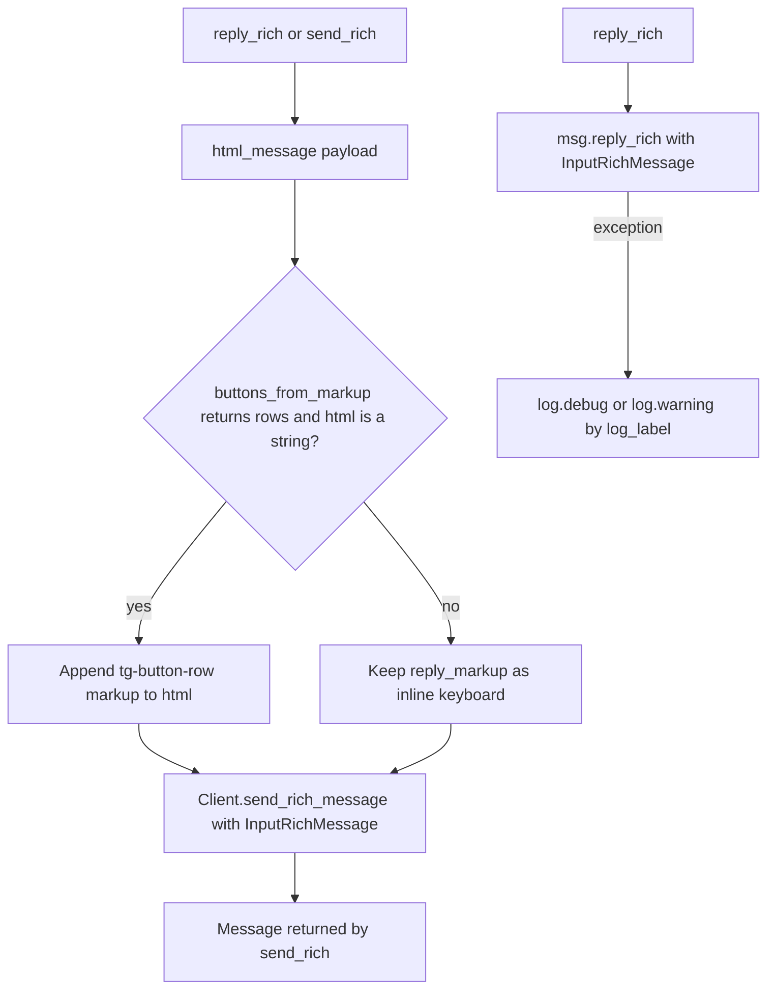
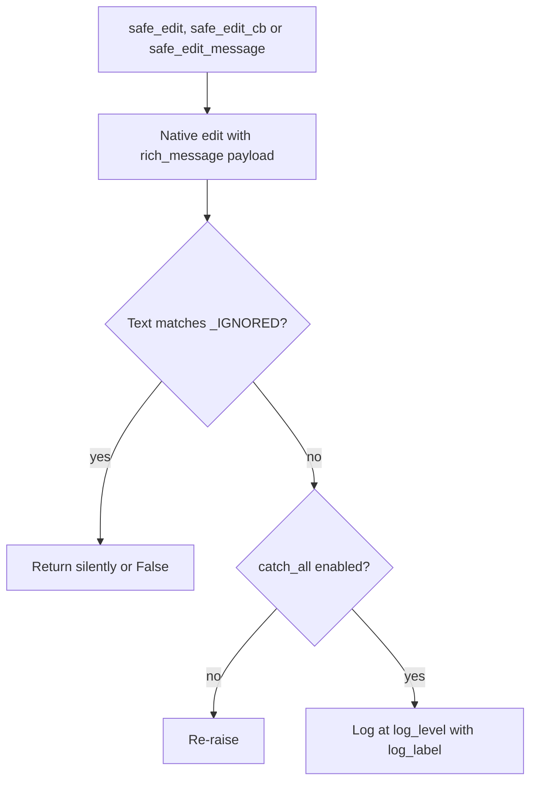
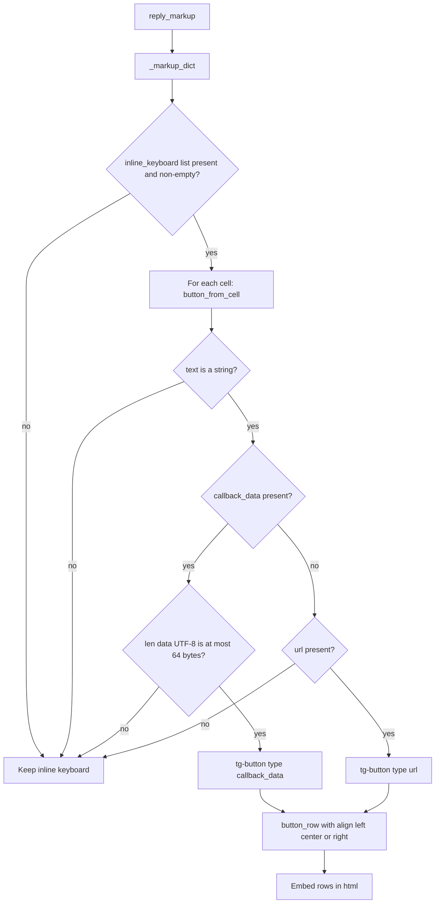

# Rich message transport

This page documents the rich-only message path: how every user-facing payload
is assembled, sent, edited, answered, and logged, and exactly when an inline
keyboard is kept instead of being converted to rich buttons. Callback names and
state constants are in [reference/callbacks.md](../reference/callbacks.md).

## Payload shape

`modules/helper/rich/msg.py` owns payload assembly and sends.
`html_message(*blocks, rtl=False, skip_entity_detection=False)` returns a
dictionary with `html` as the newline-joined non-empty blocks. It adds `is_rtl`
and `skip_entity_detection` only when requested. `blocks_message(blocks)` returns
`{"blocks": blocks}` for callers that supply explicit block objects.

`_message_with_buttons(message, reply_markup)` converts the markup with
`buttons_from_markup()` and, when rows exist and `message["html"]` is a string,
appends the rows to the HTML with a newline. It returns `(payload, embedded)`.
The send and edit helpers always embed convertible buttons as rich markup.
Conversion is all-or-nothing: one unmappable cell keeps the whole keyboard as
native inline markup instead of embedding any rich button rows.

| Field | Set by | Meaning |
|---|---|---|
| `html` | `html_message`, `_message_with_buttons` | Newline-joined rich HTML, including any converted `<tg-button-row>` blocks. |
| `is_rtl` | `html_message(rtl=True)` | Right-to-left layout hint. |
| `skip_entity_detection` | `html_message(skip_entity_detection=True)` | Disable automatic entity detection. |
| `blocks` | `blocks_message(blocks)` | Explicit block payload; buttons are not embedded into it. |
| `rich_message` | `send_rich`, `edit_rich` | API key carrying the payload above. |
| `reply_markup` | `send_rich`, `edit_rich` | Inline keyboard kept as fallback when conversion did not embed it. |

## Send and reply

| Helper | Signature summary | Returns |
|---|---|---|
| `send_rich` | `send_rich(bot, chat_id, message, *, reply_markup=None, message_thread_id=None, disable_notification=None, reply_to_message_id=None)` | `Message` |
| `reply_rich` | `reply_rich(msg, text, *, log_label="reply", parse_mode=None, **kwargs)` | `None` |
| `html_message` | `html_message(*blocks, rtl=False, skip_entity_detection=False)` | payload dictionary |
| `blocks_message` | `blocks_message(blocks)` | payload dictionary |

`reply_rich` is the single fire-and-forget reply owner for commands and flows. It
calls `msg.reply_rich()` with a native `InputRichMessage`, so rich HTML is rendered
by Kurigram itself. There is no bot lookup, no test-double fallback and no
capability check. `parse_mode` is accepted for call-site compatibility and
discarded with `_ = parse_mode`.

## Edits

| Helper | Signature summary | Notes |
|---|---|---|
| `edit_rich` | `edit_rich(bot, chat_id, message_id, message, *, reply_markup=None)` | Calls `bot.edit_message_text(..., rich_message=InputRichMessage(...))` and returns the edited `Message`. |
| `safe_edit` | `safe_edit(msg, text, *, log_level="warning", log_label=None, catch_all=False, parse_mode=None, **kwargs)` | Edits via `msg.edit_text(rich_message=...)`. |
| `safe_edit_cb` | `safe_edit_cb(q, text, *, log_level="warning", log_label=None, catch_all=False, parse_mode=None, **kwargs)` | Edits via `q.edit_message_text(rich_message=...)`. |
| `safe_edit_message` | `safe_edit_message(bot, chat_id, message_id, text, *, log_level="warning", log_label=None, catch_all=False, parse_mode=None, **kwargs)` | Edits by id via `bot.edit_message_text(rich_message=...)`. |
| `cb_error_edit` | `cb_error_edit(q, text, *, log_label, parse_mode=None, log_level="warning")` | `safe_edit_cb` with an explicitly empty inline keyboard and `catch_all=True`. |
| `clear_markup_cb` | `clear_markup_cb(q)` | Removes the inline keyboard only; keeps `_IGNORED` BadRequests silent. |

`_IGNORED` contains `"message is not modified"`, `"message to edit not found"`,
and `"chat not found"`. `_edit_via()` and `safe_edit_message()` return `True`
on success or an unchanged message, and `False` when the target message is
gone so a caller that owns a durable slot can send a fresh post instead of
re-editing a dead id. Unexpected exceptions are logged and return `False`, or are
re-raised when `catch_all` is false. `parse_mode` is accepted and ignored by the
safe helpers.

## Inline keyboard to rich buttons

`modules/helper/rich/button.py` owns `buttons_from_markup(reply_markup)` and
`button_from_cell(cell)`. `buttons_from_markup` is all-or-nothing: one unmappable
cell makes the whole keyboard stay inline. `_markup_dict()` accepts a dict directly
or calls `to_dict()` on a Kurigram markup object.

Before the button rows, `_message_with_buttons()` inserts a divider unless the
HTML already ends with one, so the last content line never sits flush against
the keyboard. That separator is added only when buttons are embedded.

The rich button tags are `<tg-button ...>label</tg-button>` inside
`<tg-button-row align="...">`. `button()` in `rich/button.py` can emit callback,
url, copy-text, Web App, login URL, three switch-inline-query variants, and
disabled buttons for direct rich callers. `button_from_cell()` maps every one of
those Kurigram cell types, so normal keyboards ship as rich buttons.

| Condition | Result |
|---|---|
| `callback_data` longer than 64 bytes (`_CALLBACK_MAX_BYTES = 64`) | Whole keyboard stays inline. |
| `web_app`, `login_url`, `switch_inline_query*`, `copy_text`, or `disabled` cell | Converted to the matching rich button type. |
| Cell without string `text` | `button_from_cell()` returns `None`; whole keyboard stays inline. |
| Cell with an action that is not one of the mapped types | `button_from_cell()` returns `None`; whole keyboard stays inline. |
| Cell with no action at all | Rendered as a disabled rich button. |
| Unsupported Kurigram style value | Style is dropped to `None`; the button still converts. |
| Payload has `blocks` rather than `html` | `_message_with_buttons()` does not embed; `reply_markup` stays inline. |
| No markup at all | No buttons in either representation. |

Accepted Kurigram styles are `primary`, `success`, `danger`, and `link`. Friendly
names map as `default` to empty, `blue` to `primary`, `green` to `success`, and
`red` to `danger`. Rows hold up to eight buttons; an unknown alignment is
ignored. Which style each button uses is a semantic decision documented in
[Buttons](../reference/buttons.md).

## Multiline text to rich blocks

Rich HTML collapses plain newline characters, so a catalog string or a view
built with `"\n".join(lines)` must be grouped into real blocks before sending.
`rich/text.py::blocks()` owns that conversion:

| Input lines | Rich output |
|---|---|
| Consecutive `` `/command` `` lines, optionally followed by a second `` `/alias` `` code span | A two-column table with Command and Alias, or Details for rows with no alias. |
| `- ...` | A rich bullet list. |
| `1. ...` | A rich ordered list. |
| Other lines, separated by blank lines | Paragraphs. |
| Already-structured markup | Returned verbatim, so owning renderers keep their tables and lists. |
| A single plain line | Returned verbatim, preserving short notices exactly. |

Help sections use this conversion, so the Admin Commands & Aliases section is
a table headed by the module name rather than one long bullet. Stats and check
detail views apply the same helper to their assembled text.

Key-value cards use richer structure directly. The ban detail card is an `h3`
heading, a divider, and a compact striped table whose cells are marked raw so
mentions and code spans stay live. That keeps identity, reason, ban id, and
date scannable without a run of bullets. The appeal instruction prompt uses an
`h2` heading, a rich checklist for its three required sections, and a
preformatted example block.

## Callback answers

| Helper | Behavior |
|---|---|
| `answer_ack(q)` | `q.answer()` with no text; never raises. |
| `answer_alert(q, text)` | `q.answer(text, show_alert=True)`; never raises. |
| `answer_and_edit(q, text, **kwargs)` | `q.answer()` and `safe_edit_cb()` in one `asyncio.gather(..., return_exceptions=True)`. |
| `ack_and_render(q, data_coro)` | `q.answer()` parallel to a data coroutine returning `(text, markup)`, then `safe_edit_cb()`. |
| `cb_error_edit(q, text, *, log_label, ...)` | Ack-style replacement of the message with a notice and no keyboard. |
| `clear_markup_cb(q)` | `q.edit_message_reply_markup(reply_markup=InlineKeyboardMarkup([]))` to remove the keyboard. |

Callback answers are plain text and have no rich equivalent. Handlers call
`await q.answer()` before visible work; the shared answer helpers are used where
the call site needs either a silent ack or an alert. `callback_args`,
`callback_args_optional`, and `callback_numbers` in `rich/edit.py` split `q.data`
on `:` and return `None` on malformed payloads.

## Parse mode

No parse mode is selected anywhere in the application. `reply_rich`,
`safe_edit`, `safe_edit_cb`, `safe_edit_message`, and `cb_error_edit` accept a
`parse_mode` argument and discard it. Direct Kurigram fallback calls pass no parse
mode; the decided-appeal card closure is the one plain-text edit and passes
`parse_mode=None` explicitly, as traced in [Appeals](appeals.md#durable-card-edits).
There is no application-level default parse-mode setting in `__main__.py`.

User-facing wording comes from `t()` in `utils/i18n.py`, which owns the `Safe`
marker and the shared markup helpers `esc`, `bold`, `italic`, `underline`,
`strike`, `code`, `pre`, `link`, `user_ref`, and `safe_username`. Catalogs use
one style convention: `` `code` `` for commands and IDs, `*bold*` for field
labels, and `~italic~` for short secondary qualifiers. Titles use `heading()`
at the panel boundary, and a divider separates content from any keyboard.
Rich HTML escaping for button labels and attributes is `esc()` in
`rich/style.py`, backed by `html.escape`. The richer formatting primitives live in `rich/formats.py`
(`heading`, `paragraph`, `quote` with an optional author, `pull_quote`,
`highlight` with an optional author, `code`, `pre`, `code_block`, `footnote`,
`footnote_ref`, `divider`, `footer`, `anchor`, `math`, `math_block`, `time_tag`,
`emoji`), `rich/style.py` (`bold`, `italic`, `underline`, `strike`, `spoiler`,
`subscript`, `superscript`), `rich/list.py` (`bullet_list`, `ordered_list` with
`start`/`marker`/`reversed_order`, `checklist`, `details`), `rich/table.py`
(`table`), and `rich/media.py` (`photo`, `video`, `slideshow`, `collage`).
`rich/text.py` exposes `style(text)`, a verbatim passthrough, and `blocks()`,
which converts a rendered multiline fragment into rich block markup. Rich
messages carry their own markup, so sends and edits must use the rich helpers;
a direct Kurigram send leaves the HTML tags visible to users.

## Audit logs and deep links

`modules/helper/messages/audit_logs.py` owns `LogBuilder`, a fluent builder with
`detail_field`, `field`, `code_field`, `mention_field`, `link_field`, `raw`,
`section`, `date`, and `build`. Field entries render as rich bulleted lists;
`raw` keeps free-form prose and `section` inserts a divider between lists.
`send_log(bot, text, **kwargs)` in `rich/edit.py` always posts to `cfg.logs`
(chat and thread) through `send_rich`.

| Builder group | Names |
|---|---|
| Ban and proof | `ban_log`, `ban_update_log`, `proof_caption_new`, `proof_caption_update`, `unban_log` |
| Kick, mute, warn | `kick_log`, `mute_log`, `unmute_log`, `warn_log`, `unwarn_log`, `resetwarns_log` |
| Appeals | `appeal_received_log`, `appeal_submitted_log`, `appeal_approved_edit`, `appeal_rejected_edit`, `appeal_unban_log` |
| Roles | `promoted`, `demoted`, `ownership_transferred`, `promote_request_log`, `promote_approved_log`, `promote_rejected_log` |
| Groups and broadcast | `group_connected_log`, `group_connection_rejected_log`, `group_disconnected_log`, `group_bot_removed_log`, `broadcast_log` |

`modules/helper/rich/link.py` owns every link builder:

| Function | Output |
|---|---|
| `chat_id_to_link_id(chat_id)` | Strip the `-100` supergroup prefix for a `t.me/c/` URL. |
| `message_link(chat_id, message_id, thread_id=None)` | `https://t.me/c/<id>/<message_id>` plus `?thread=<id>` when provided. |
| `appeal_deep_link(bot_username, ban_id)` | `https://t.me/<username>?start=appeal_<ban_id>`, or empty when the username is unknown. |
| `resolve(bot, chat_id)` | Public username or invite link, cached for 300 s with the shared 3 s lookup timeout (`TELEGRAM_LOOKUP_TIMEOUT`). |
| `display(bot, chat_id)` | `resolve()` result, falling back to the numeric chat id. |
| `forget(chat_id)`, `clear()` | Drop one cached link or every cached link. |

A URL button is dropped when its link is empty: `additional_menu_btn()`,
`group_start_btn()`, `checkme_ban_btn()`, `appeal_button_btn()`, and
`join_ban_btn()` all omit that button rather than send a dead link.

## Error reports

`error_reporter.py` builds a rich payload with `build_error_report_payload()`
using `rich.formats.heading`, `rich.list.details`, `rich.list.bullet_list`,
`rich.formats.code`, and `rich.formats.pre`. Every dynamic value passes through
`_scrub_secrets()` before placement in the HTML. `_ship_throttled()` sends to
the configured error destination with `send_rich`, capped at 20 reports per 60
seconds and rolling the suppressed count into one summary.
`send_to_owner()` sends the same rich payload to the owner DM through
`send_rich`. Sentry is opt-in through `SENTRY_DSN` and uses the same redaction
hook.

## Transport tuning

`utils/transport.py` owns the shared budgets: `HTTP_READ_TIMEOUT = 60`,
`HTTP_WRITE_TIMEOUT = 30`, `HTTP_CONNECT_TIMEOUT = 30`,
`HTTP_POOL_TIMEOUT = 15`, `TELEGRAM_LOOKUP_TIMEOUT = 3.0`,
`TELEGRAM_ACTION_TIMEOUT = 20.0`, and `API_POOL_SIZE = 16`. The notification
worker wraps its card edit in `asyncio.timeout(TELEGRAM_ACTION_TIMEOUT)`.
