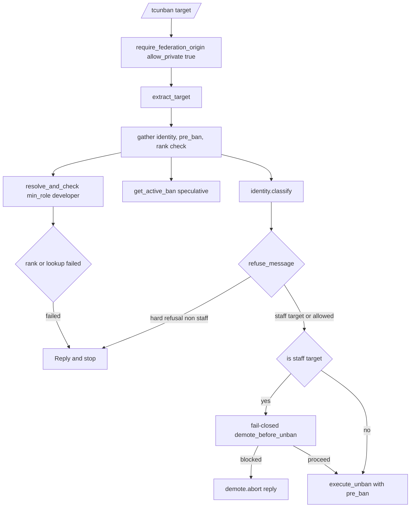
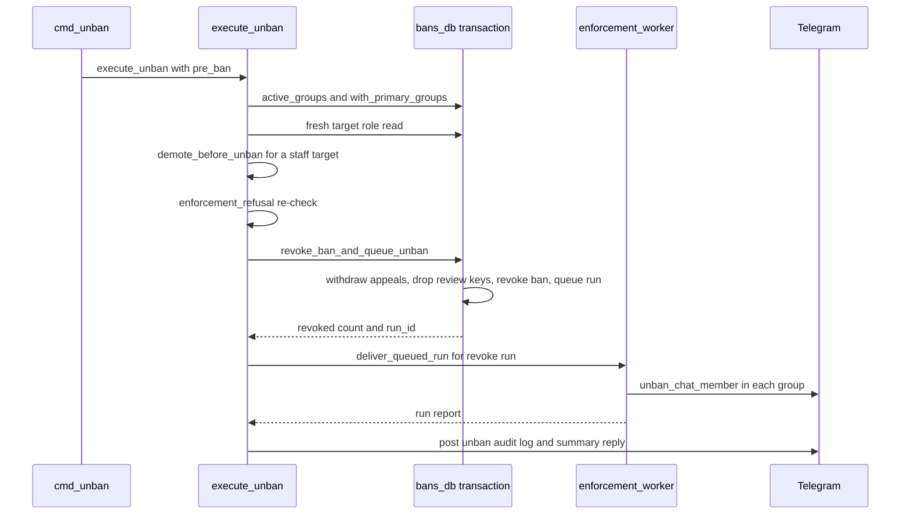
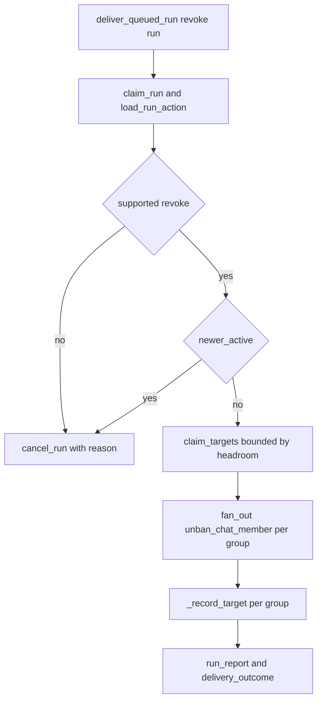
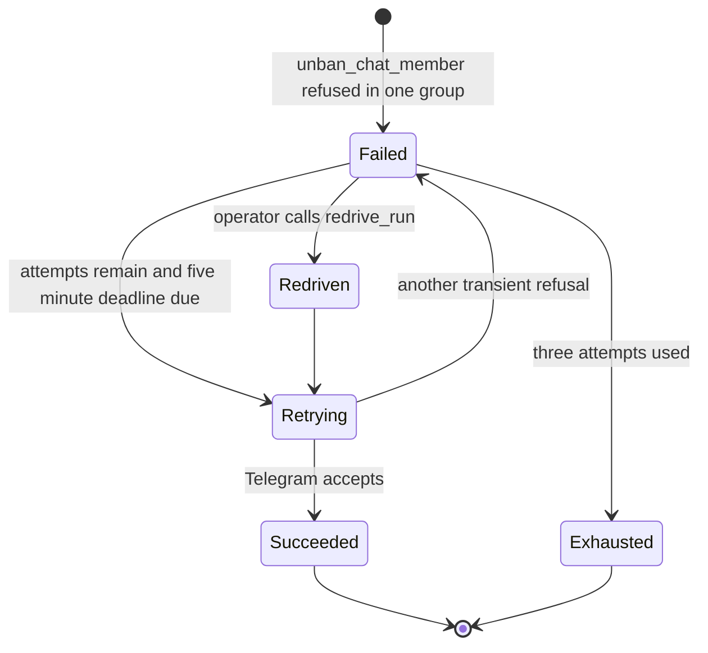

# Unbanning

This document describes how `/tcunban` and appeal approval lift a federation
ban, including the fail-closed demote gate, the atomic revoke and queue
transaction, per-group delivery, appeal slot handling, and partial failure
repair. The shared spine is in [system.md](system.md) and the worker in
[persistence.md](persistence.md).

## Entry and authorization

`cmd_unban` in `modules/unban.py` uses the decorator order
`ratelimiter(THROTTLE_MODERATION)`, `mod_only` (developer tier), and
`log_execution`. It allows a private origin because unban is a federation-wide
decision. It runs three independent reads in parallel with
`asyncio.gather(return_exceptions=True)`: `identity.classify()`, a speculative
`bans_db.get_active_ban()`, and `guards.resolve_and_check(min_role="developer")`.
`throw_if_cancelled()` preserves shutdown semantics.



## Fail-closed demote gate

A staff target is never federation-bannable, so "nothing to undo" is normally
the right reply. The exception is a target re-promoted while banned: the active
ban prevents the join-time enforcement in `greeting.py` from ever running, so
the rank would survive the unban. `_cleanup_role()` in `unban.py` reconciles the
two independent fresh reads, because the identity classification and the rank
check can disagree when a promotion lands between them.

`demote_before_unban()` in `demote_actions.py` is the single owner of this gate. It
calls `Demote.execute(trigger="unban")` and returns a `UnbanGate`:

| `UnbanGate` value | Meaning | Caller behavior |
|---|---|---|
| `PROCEED` | A role row was removed, or no live staff role remains. | Continue to `execute_unban`. |
| `DEMOTE_FAILED` | `Demote.execute(trigger="unban")` raised. | Reply `demote.abort.body` and stop. |
| `ROLE_SURVIVED` | No row was cleared but the target still resolves as staff. | Reply `demote.abort.body` and stop. |

Unlike `demote_before_enforcement()` for ban, kick, and mute, this gate fails
closed. The `may_proceed` property is the single check the caller uses. See
[Permissions](permissions.md#demote-gates-best-effort-versus-fail-closed).

## Revoke and queue transaction

`execute_unban()` in `unban_actions.py` accepts an optional `pre_ban` to skip the
speculative read. It fetches the active groups before revoking, because
deactivating first and then discovering the list cannot be loaded would leave
chats banning a user with no record to retry from. It then re-runs
`guards.enforcement_refusal(min_role="developer")` after the group load.

The entry-time staff verdict is not authoritative for that window: a target can
be promoted or granted a role while the group list loads. `execute_unban()`
therefore re-reads the target role fresh and applies `demote_before_unban()` when
the target holds a staff role at enforcement time. A role read that fails blocks
the unban, so a staff holder cannot keep federation rank after the revocation.

`bans_db.revoke_ban_and_queue_unban()` performs one transaction:

1. Lock the active ban row or rows with `FOR UPDATE`.
2. `ensure_users()` the acting staff member so the run's foreign key cannot fail.
3. Withdraw every pending appeal on those actions.
4. Move the ban to `revoked`, set `revoked_at`, and drop the review-slot metadata keys.
5. Queue one `revoke` run per action with idempotency key
   `moderation:{action_id}:revoke:manual:v1` and the full group list.
6. Queue a review-card edit in `notifications_db` when a review chat and message
   were supplied.



`revoked == 0` or a missing `run_id` means another process already revoked the
ban, so the reply is the idempotent "no active ban" notice. A failed transaction
replies with the database retry notice and leaves the ban record intact.

## Per-group delivery and outcomes

The worker delivers the `revoke` operation only when the action status is
`expired` or `revoked` and the action type is `ban` or `mute`. A revoke run is
cancelled when `load_run_action()` reports `newer_active`: a later decision of
the same type is in force, and lifting this restriction would undo the newer
ban.



`delivery_outcome()` treats a requested group that left the federation as
pending rather than silently dropping it from the total, because the queue only
records active connected chats. `execute_unban()` maps that to a queued notice,
a partial notice when `report_settled()` is true but some targets failed, or a
full notice otherwise. Groups that failed are named in the summary.

## Appeal slot handling

The ban decision owns a review slot in its metadata. The same transaction that
revokes a ban drops that slot and withdraws pending appeals, so a live-looking
card can never promise a decision that is already gone.

| Helper | Transaction | Effect on the slot |
|---|---|---|
| `set_review_if_absent` | Conditional UPDATE | Claim a free slot atomically. |
| `submit_appeal` | Claim plus appeal insert | One appeal in flight per decision. |
| `claim_appeal_decision` | Conditional UPDATE | Consume the exact review message. |
| `restore_review` | Conditional UPDATE | Hand the slot back only for a pending appeal. |
| `release_stale_review` | Withdraw plus slot free | Free a stale card without touching a newer one. |
| `approve_appeal_and_queue_unban` | Accept plus revoke plus queue | Close the appeal and queue `revoke:appeal:v1`. |
| `reject_appeal` | Reject plus slot free | Reopen the decision to new appeals. |

The approval path rolls back the whole unit if the ban cannot be revoked, so an
accepted appeal never sits on an active ban. See [Appeals](appeals.md).

## Partial failure and repair



A failed target is retried by the scheduled worker while it has attempts left
and its chat is still connected. `requeue_stale_runs()` reopens a run that holds
a due retry. `list_unsettled_runs()` exposes queued, running, partial, and failed
runs to operators, separating runs the worker will retry from runs with
exhausted targets. `redrive_run(run_id, chat_id=None)` brings failed targets
forward without creating a new decision; a run still owned by a worker or
already cancelled is left alone.

A group that disconnected during the proof window has no target row. When it
reconnects, `queue_connect_replay()` queues a fresh `apply` run for every active
ban or mute in that chat, so the restriction is restored rather than the earlier
unban being lost. See [Connection](connection.md).

## Exact names

| Name | Owner | Role |
|---|---|---|
| `cmd_unban` | `unban.py` | Command entry point. |
| `_cleanup_role` | `unban.py` | Reconcile two fresh role reads. |
| `demote_before_unban` | `demote_actions.py` | Fail-closed role cleanup gate. |
| `UnbanGate` | `demote_actions.py` | `PROCEED`, `DEMOTE_FAILED`, `ROLE_SURVIVED`. |
| `execute_unban` | `unban_actions.py` | Durable unban executor. |
| `revoke_ban_and_queue_unban` | `bans_db._lifecycle` | Atomic revoke, appeal cleanup, queue. |
| `approve_appeal_and_queue_unban` | `bans_db._lifecycle` | Appeal approval transaction. |
| `deliver_queued_run` | `enforcement_worker.py` | Immediate run delivery. |
| `delivery_outcome` | `enforcement_db.py` | Total, applied, failed, pending. |
| `redrive_run` | `enforcement_db.py` | Operator repair. |

## Validation

```bash
uv run pytest tests/ -q -k unban
```

Relevant tests include `tests/test_unban_flow.py`, `tests/test_demote_*.py`, and
`tests/test_enforcement_worker.py`.
