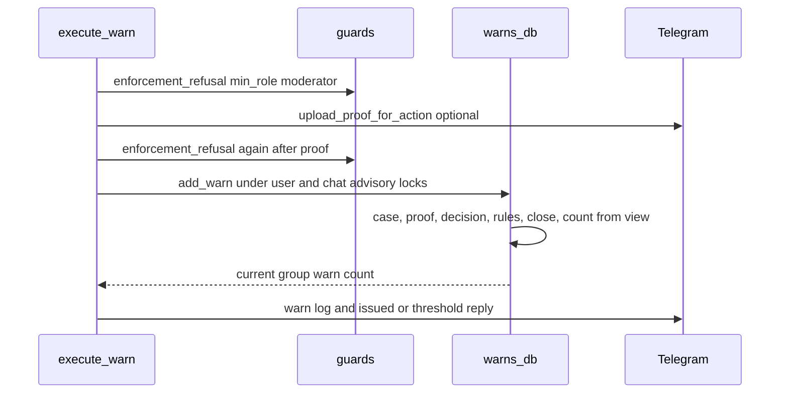
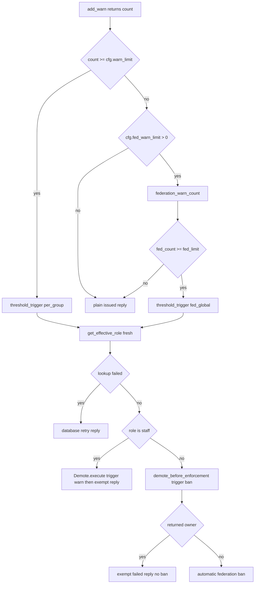
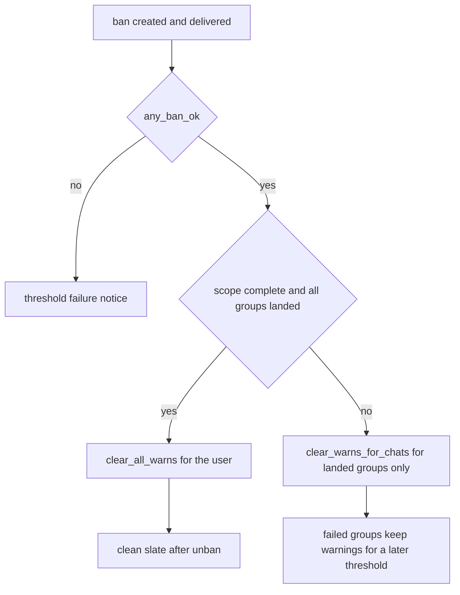

# Warning

This document describes the warning pipeline: how warns are filed, how the
per-group and federation thresholds trigger an automatic ban, how staff are
exempted, and how warnings are cleared after a successful or partial enforcement.
The shared spine is in [system.md](system.md).

## Entry and filing

`cmd_warn` in `modules/warns.py` uses `ratelimiter(THROTTLE_MODERATION)`,
`basic_mod_only` (moderator tier), and `log_execution`. It resolves with
`allow_private=False` and `bot_check=True`, because a warning is scoped to the
origin group and a proven bot cannot accumulate meaningful warnings. A staff
target emits `identity.staff_notice()` but the warning still proceeds.

The conversation is built by `warn_conversation()` with
`BuildReason("warn", skip_allowed=False)`, `BuildProof("warn")`,
`min_role="moderator"`, and `rules_enabled=True`. An escape filter keeps
`/tcunwarn`, `/warns`, and `/resetwarns` out of the reason fallback. The executor
adapter `_exec_warn()` pops the warn keys and calls `execute_warn()`.

| Callback data | Meaning |
|---|---|
| `warn_cancel` | Cancel the live warn prompt. |
| `warn_done_proof` | Flush collected proof and execute. |
| `warn_skip_proof` | Execute without proof. |
| `rules_step:pick:<id>` | Toggle a rules selection. |
| `rules_step:done` | Confirm selection. |
| `rules_step:other` | Enter an optional note. |
| `rules_step:clear` | Clear selection. |

## Filing a warning

`execute_warn()` runs the enforcement rank gate twice at `min_role="moderator"`
and uploads optional proof before filing. `warns_db.add_warn()` takes a
user-wide advisory lock and then a per-chat lock, opens a case, archives optional
proof, inserts a completed `warn` decision with an expiry derived from
`cfg.warn_expiry_days`, links rules, closes the case, and reads the count from
the `warn_counts` view in the same transaction.



The two-lock order is fixed: the user lock always comes first, so a filing and a
clear cannot deadlock on the per-chat lock. The count read inside the transaction
always agrees with the row that was just written.

## Threshold evaluation and exemption



| Threshold | Condition | Notice key |
|---|---|---|
| `per_group` | `count >= cfg.warn_limit` (default 3, minimum 1) | `warnings.autoban.notice_per_group` |
| `fed_global` | `cfg.fed_warn_limit > 0` (default 0, disabled) and `federation_warn_count >= cfg.fed_warn_limit` | `warnings.autoban.notice_fed` |
| none | Neither condition holds | `warnings.issued.body` |

A failed `federation_warn_count()` read aborts with an honest failure reply
rather than silently skipping a federation threshold. The role read fails closed
as well.

Staff members are exempt from the threshold ban. `Demote.execute(trigger="warn")`
removes the role instead, and the reply distinguishes a real demotion from a
failed one based on the return value. `demote_before_enforcement(trigger="ban")`
then runs again immediately before the ban so a promotion between the exemption
read and the ban cannot leave rank after the ban lands. If that gate reports
`owner`, the protected role stops the automatic ban. See
[Permissions](permissions.md#demote-gates-best-effort-versus-fail-closed).

## Automatic ban and clearing rules

For a threshold ban, `execute_warn()` gathers `active_groups()` and
`get_active_ban()`. The origin group joins the scope through
`with_primary_groups(groups, (cfg.main_group,), chat_id)`. When no ban is active
it calls `bans_db.create_ban(action_origin="automated", origin_chat_id=chat_id, ...)`
with the warn proof attached but not required, then posts the log, queues and
delivers the apply run, and reads `delivery_outcome()` plus
`landed_report_chat_ids()`.



`any_ban_ok` is true when a ban row exists, at least one group accepted the ban,
or a delivery is still pending. A pending delivery is not a creation failure.
Clearing is deliberately conservative:

- A complete enforcement clears every group so a later unban cannot re-ban on
  stale counts.
- A partial enforcement clears only groups where the ban landed. Failed groups
  keep their warnings so the threshold can fire again when enforcement succeeds.
- A reduced scope is never complete, even when every known group accepted the
  ban, because groups that could not be loaded were never attempted.

## Expiry, management, and history

`cfg.warn_expiry_days` sets `expires_at` when the warning is filed; a value of
`0` creates no expiry. The `warn_counts` view, `get_warns()`, and
`remove_last_warn()` all exclude expired decisions at query time, so an expired
warning is history rather than an active warning. Clearing moves rows to
`revoked` instead of deleting them, preserving the audit trail.

| Command | Executor | Behavior |
|---|---|---|
| `/tcunwarn` | `execute_unwarn` | Reads count, revokes the newest live warning, logs new count. |
| `/warns` | `execute_warnlist` | Renders up to 50 newest warnings under an honest total header. |
| `/resetwarns` | `execute_resetwarns` | Clears all warnings in the current group and logs the count. |

All management commands fail closed with the database retry notice on a read or
write failure, and treat a zero count as a "no warnings" reply rather than an
error.

## Database impact

Warnings are `moderation_actions` rows with `action_type = 'warn'` and
`scope_type = 'chat'`. `warns_db` owns `add_warn`, `federation_warn_count`,
`clear_all_warns`, and `clear_warns_for_chats`. The `warn_counts` view,
`get_warns()`, and `remove_last_warn()` exclude expired decisions at query
time. `cfg.warn_expiry_days = 0` disables expiry. Every mutation of one target
takes a user-wide transaction lock, with a per-chat lock layered on top for a
filing. See [Persistence](persistence.md) for the case and evidence write path.

## Logging and edge cases

`messages.warn_log()`, `messages.unwarn_log()`, and `messages.resetwarns_log()`
build the federation log posts. Threshold notices and issued replies use catalog
keys. Failures log with the target and chat identifiers.

- A total enforcement failure leaves warnings in place and reports a threshold
  failure notice.
- A ban delivery still pending is reported as pending, not failed.
- Expired warnings remain in history but no longer count toward a threshold.
- The `>=` limit is deliberate: after a total failure the count still equals
  the limit, so the next warning re-fires the auto-ban.
- Concurrent warnings reach the threshold in order and both land instead of one
  getting a database-failure retry reply.

## Exact names and validation

| Name | Owner | Role |
|---|---|---|
| `cmd_warn` | `warns.py` | Command entry point. |
| `execute_warn` | `warn_actions.py` | Filing and threshold orchestration. |
| `_clear_warns_after_threshold_ban` | `warn_actions.py` | Complete versus partial clearing. |
| `execute_unwarn` | `warn_actions.py` | Single warn removal. |
| `execute_warnlist` | `warn_actions.py` | Paginated history view. |
| `execute_resetwarns` | `warn_actions.py` | Group-wide clear. |
| `add_warn` | `warns_db.py` | Locked filing transaction. |
| `federation_warn_count` | `warns_db.py` | Federation-wide live sum. |
| `clear_all_warns`, `clear_warns_for_chats` | `warns_db.py` | Threshold clearing paths. |

```bash
uv run pytest tests/ -q -k warn
```

Relevant tests include `tests/test_warn_*.py`.
