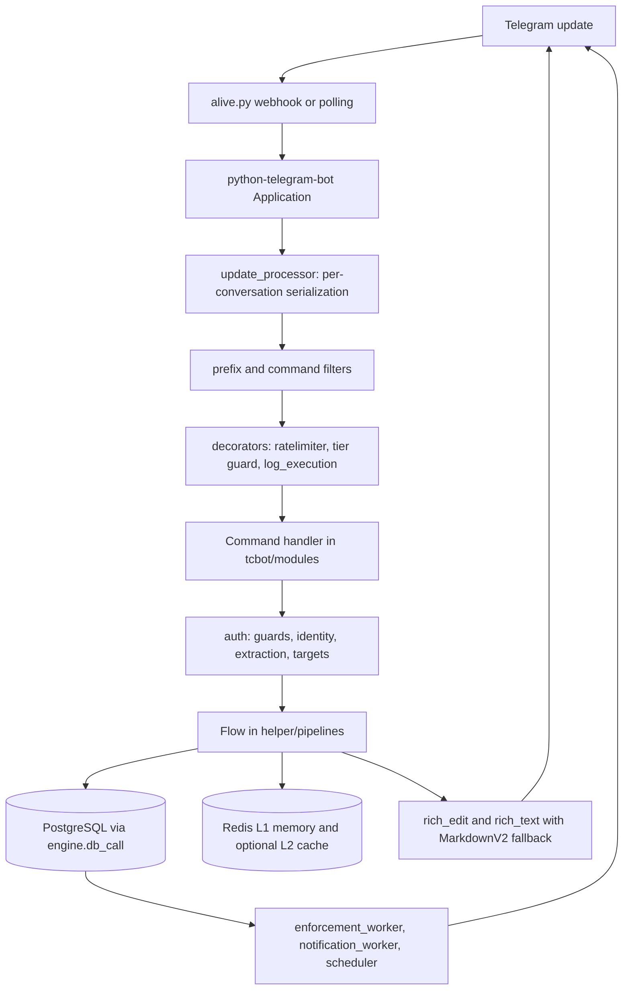
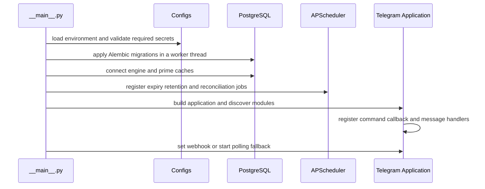
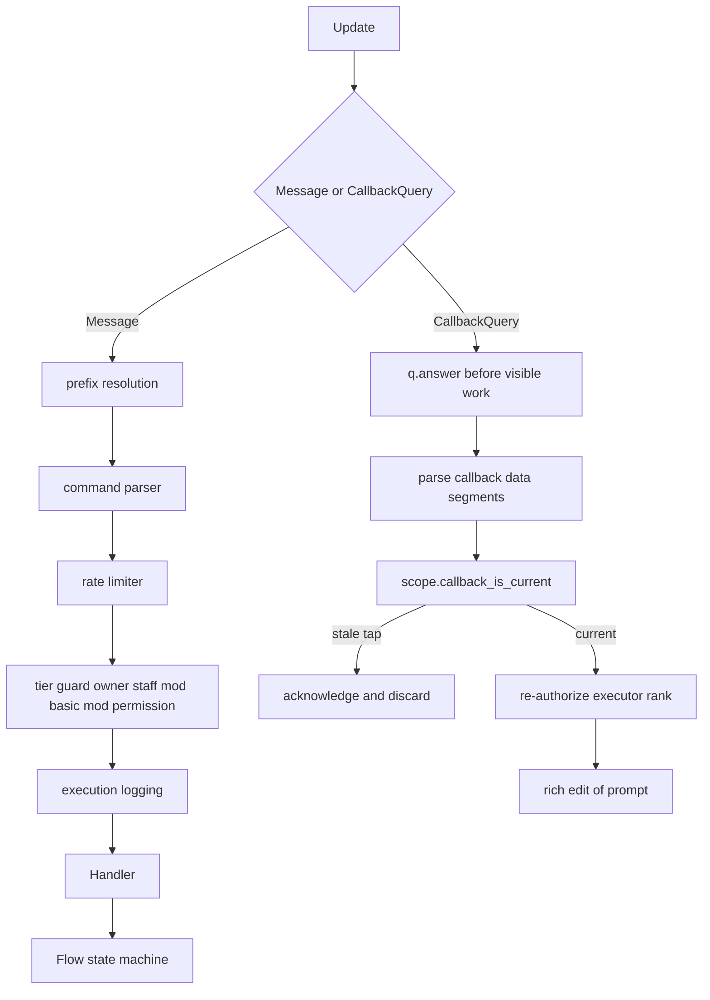
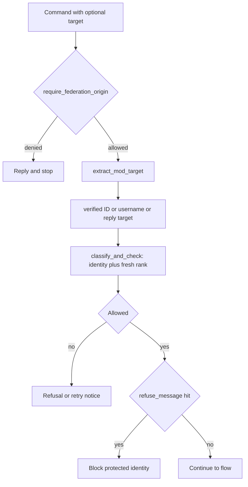
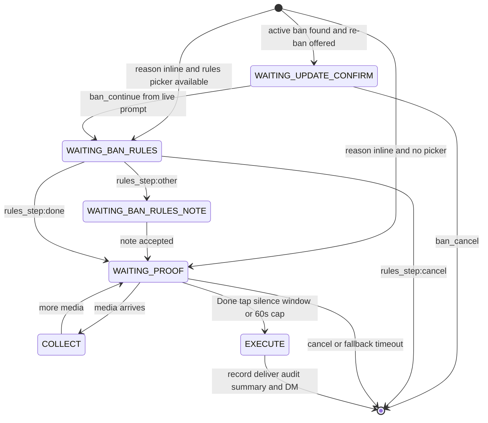
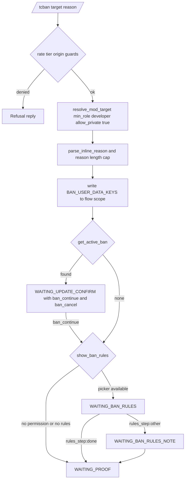
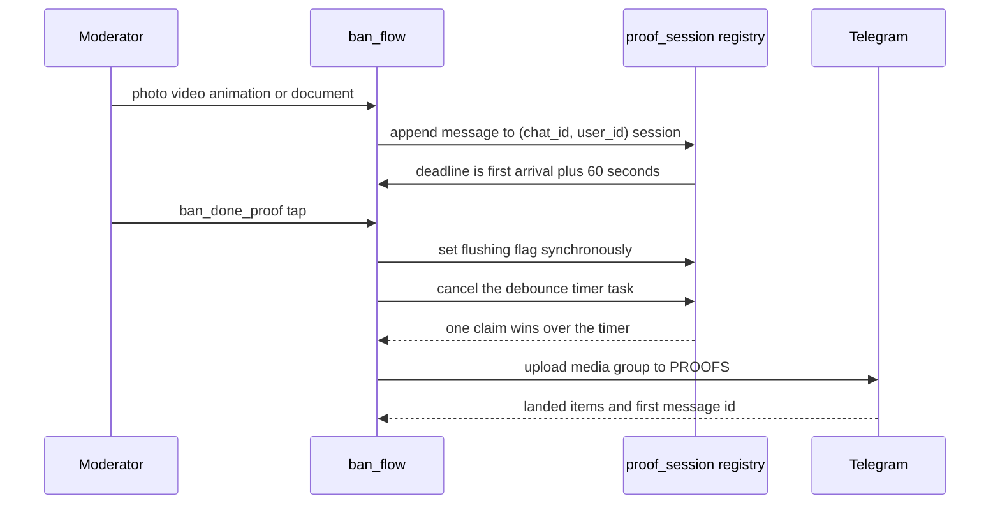
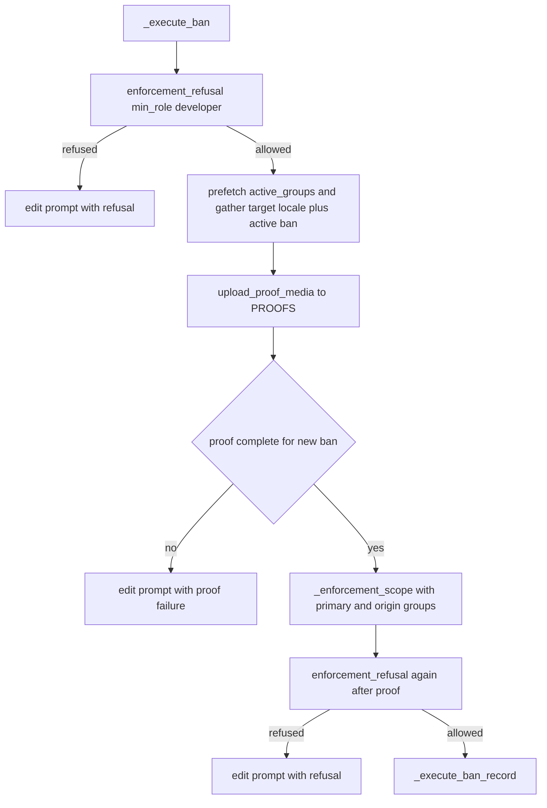
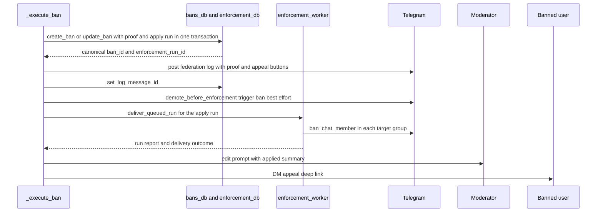
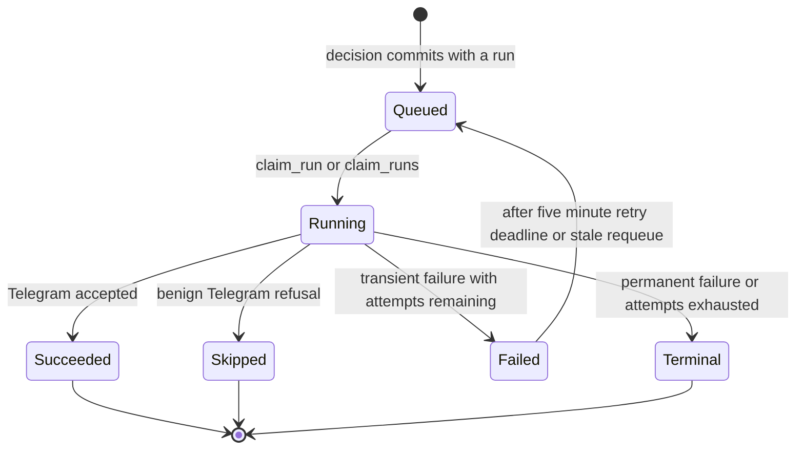

# Banning: the full system spine and the ban pipeline

This document is the anchor reference for TCF Bot. It describes the runtime spine from startup through update dispatch, authorization, persistence, rich transport, and workers, then follows one federation ban from command entry to appeal delivery.

The sibling documents own other domains and link back here for the shared spine: [unbanning.md](unbanning.md), [kicking.md](kicking.md), [muting.md](muting.md), [warning.md](warning.md), and [proof.md](proof.md). Appeal submission and review are detailed in [appeals.md](appeals.md).

## 1. System spine

### 1.1 Topology

`flowchart` is used because the subject is the shape of the system and the direction of data between components.

### 1.2 Startup sequence

`sequenceDiagram` is used because startup is an ordered set of calls between the application, the database, the scheduler, and the Telegram transport.

Module discovery and the `MODULES_LOAD` and `MODULES_NO_LOAD` filters are centralized in `tcbot/modules/__init__.py`. The application owns a single PTB lifecycle. Webhook is the production path; local development may fall back to polling.

### 1.3 Update dispatch layers

Handler decorator order is fixed: `ratelimiter()` outermost, the required authorization guard second, and `log_execution` innermost. Message-event handlers are exempt from per-handler rate limits. Callback queries always call `q.answer()` first.

### 1.4 Authorization and target resolution

Every moderation entry passes through the same chain. `guards.resolve_and_check()` reads both roles fresh, refuses an executor below `min_role`, refuses an equal or higher ranked target through `outranks()`, and fails closed on a lookup error. `guards.classify_and_check()` runs `identity.classify()` alongside that rank check.

There are two rank gates on a ban. The entry gate is `resolve_and_check()` with `min_role="developer"` plus the `mod_only` decorator. The enforcement gate is `guards.enforcement_refusal()` with the same tier, re-read fresh after the proof window. This dual gate prevents a target promoted mid-window from being actioned by a moderator who no longer outranks them.

### 1.5 Persistence and transport boundary

All database work goes through `engine.db_call()` or `engine.run_transaction()`, which apply the circuit breaker and the call timeout. Decisions, cases, proof, messages, and appeals live in the community moderation tables. Durable per-group work lives in `moderation_enforcement_runs`, `moderation_enforcement_targets`, and `moderation_enforcement_attempts`. Cached reads use the two-level cache with a Redis L2 boundary and in-memory L1 fallback.

User-facing messages render through `rich_edit.py` and `rich_text.py`. Keyboards are rich buttons with the inline keyboard kept as the MarkdownV2 fallback. Plain notices and callback alerts stay unparsed. No HTML parse mode is used anywhere.

## 2. Ban flow, end to end

### 2.1 Conversation states

### 2.2 Entry to proof collection

`flowchart` is used because this part of the flow is a decision tree with several early exits.

The active-ban lookup fails closed: an outage replies with the database retry notice and clears the scope instead of degrading into a fresh ban that wastes a proof round.

### 2.3 Re-ban confirmation and rules picker

`ban_confirmation.py` owns `stale_ban_callback()`, which uses `callback_is_current()` with `ban_prompt_chat_id` and `ban_prompt_msg_id`. A tap from an older prompt is answered and discarded. `on_ban_update_continue()` calls `q.answer()`, re-checks the tapper with `recheck_executor_rank(min_role="developer")`, then delegates to `show_ban_rules()`.

The picker in `ban_rules_step.py` stores selections in `ban_rules` and the optional note in `ban_rules_note`. It asks `users_roles.has_permission(uid, "rules.view")` and reads `rules_db.published_rules()`. With no published rules or no permission it goes straight to the proof prompt.

### 2.4 Proof flush

The proof session is keyed by `(chat_id, user_id)` and carries a snapshot of the flow scope. `_flush_session()` owns the session from its first await. It sleeps in slices bounded by `cfg.album_debounce` and the hard 60 second deadline, then flips `flushing` as a synchronous claim so `Done` and the timer cannot both execute. Its `finally` block removes the registry entry and clears that conversation's ban keys. At shutdown `drain_proof_sessions()` waits for running flushes up to 30 seconds, then cancels those still in their silence window.

### 2.5 Enforcement gate and decision write

The enforcement path re-checks the executor twice: once before any proof upload or record write, and again immediately before the decision is written. A refusal edits the prompt and leaves no record, no proof, and no fan-out behind.

`_enforcement_scope()` merges the connected groups, the configured primary group, and the originating group. A ban issued from the bot PM has no group origin, so the scope is the primary group alone. A failed connected-group fetch still leaves the origin group enforced, and the summary carries a scope warning.

### 2.6 Decision, delivery, audit, and summary

`create_ban()` and `update_ban()` write the decision, open and close its case, archive proof, link selected rules, and queue the apply run with idempotency key `moderation:{action_id}:apply:v1` in one transaction. A unique partial index permits one active ban per user; the loser of an insert race reuses or supersedes the canonical record, so the log, appeal link, and target button all name the surviving record.

The proof is mandatory for a new ban. A partial gallery, measured by `expected_item_count` against landed items, aborts the ban. A re-ban may carry the previous proof batch forward. See [proof.md](proof.md) for the upload details.

### 2.7 Enforcement worker retry lifecycle

`stateDiagram-v2` is used because this is the lifecycle of one durable delivery target.

`run_once()` first calls `requeue_stale_runs()`. An OPEN Telegram circuit pauses the worker entirely so no attempt is burned without a delivery; a HALF_OPEN circuit claims a single probe only. One tick claims at most 10 runs and one run delivers at most 100 targets per pass. Each target has three attempts. `_record_target()` appends an attempt row and moves the target to `succeeded`, `skipped`, or `failed` with a five minute retry deadline. `redrive_run()` lets an operator bring failed targets forward without creating a new decision.

### 2.8 Audit, summary, and appeal handoff

The federation log is posted to `cfg.logs` through `messages.ban_log()` or `messages.ban_update_log()`. The log keyboard carries the proof link and an appeal deep link built by `appeal_deep_link(bot_username, ban_id)`. The moderator prompt is edited in place with `banning.summary.body`, including the applied, failed, and pending counts from `delivery_outcome()`. The target receives a DM with the same deep link and `appeal_button_btn()`. A `telegram.error.Forbidden` on that DM is treated as expected. See [appeals.md](appeals.md) for the submit and review sequence.

## 3. Exact names for this flow

### 3.1 States

| Owner | State | Value |
|---|---|---|
| `reason_flow.py` | `WAITING_REASON` | 0 |
| `reason_flow.py` | `WAITING_PROOF` | 1 |
| `reason_flow.py` | `WAITING_RULES` | 2 |
| `reason_flow.py` | `WAITING_RULES_NOTE` | 3 |
| `ban_flow.py` | `WAITING_PROOF` | 0 |
| `ban_flow.py` | `WAITING_UPDATE_CONFIRM` | 1 |
| `ban_rules_step.py` | `WAITING_BAN_RULES` | 2 |
| `ban_rules_step.py` | `WAITING_BAN_RULES_NOTE` | 3 |

### 3.2 Callback data

| Callback data | Owner | Meaning |
|---|---|---|
| `ban_cancel` | `ban_flow.py` and `ban_rules_step.py` | Cancel the live ban prompt |
| `ban_continue` | `ban_confirmation.py` | Continue a re-ban from a live prompt |
| `ban_done_proof` | `ban_flow.py` | Flush collected proof now |
| `rules_step:pick:<id>` | `ban_rules_step.py` | Toggle one rules item |
| `rules_step:done` | `ban_rules_step.py` | Confirm the rules selection |
| `rules_step:other` | `ban_rules_step.py` | Enter an optional custom note |
| `rules_step:clear` | `ban_rules_step.py` | Clear the selection |

### 3.3 Functions

| Function | Owner | Role |
|---|---|---|
| `cmd_ban_start` | `bans.py` | Validated entry point |
| `_ask_update_confirm` | `bans.py` | Re-ban prompt and prompt identity |
| `ban_conversation` | `ban_flow.py` | ConversationHandler factory |
| `on_proof_received` | `ban_flow.py` | Buffer proof into a session |
| `on_done_proof` | `ban_flow.py` | Claim and run the flush from Done |
| `_flush_session` | `ban_flow.py` | Debounce timer flush owner |
| `_execute_ban` | `ban_flow.py` | Full enforcement orchestration |
| `_execute_ban_record` | `ban_flow.py` | Decision write and federation log |
| `on_ban_update_continue` | `ban_confirmation.py` | Re-ban confirmation handler |
| `stale_ban_callback` | `ban_confirmation.py` | Prompt freshness guard |
| `show_ban_rules` | `ban_rules_step.py` | Rules picker entry |
| `demote_before_enforcement` | `demote_flow.py` | Best-effort pre-fanout demote |
| `run_once` and `deliver_queued_run` | `enforcement_worker.py` | Durable delivery |

### 3.4 Persistence touchpoints

| Table or helper | Writer | Purpose |
|---|---|---|
| `moderation_actions` | `bans_db._writes` | Ban decision and lifecycle |
| `moderation_cases` | `moderation_db` | One investigation per incident |
| `moderation_evidence_uploads` | `moderation_db` | Landed proof batch |
| `moderation_messages` | `bans_db._writes` | Federation log references |
| `moderation_enforcement_runs` | `enforcement_db` | Durable apply and revoke queue |
| `moderation_appeals` | `bans_db._writes` | Appeal record and review slot |
| `notifications_outbox` | `notifications_db` | Durable review-card edits |

## 4. Continue reading

- [unbanning.md](unbanning.md): fail-closed demote gate, atomic revoke and queue, per-group delivery.
- [kicking.md](kicking.md): ban-then-unban and reconcile repair.
- [muting.md](muting.md): timed state machine, replay, and unmute.
- [warning.md](warning.md): thresholds, exemption, and clear rules.
- [proof.md](proof.md): media filter, debounce, upload, and archive.
- [appeals.md](appeals.md): appeal submission and staff decisions.
