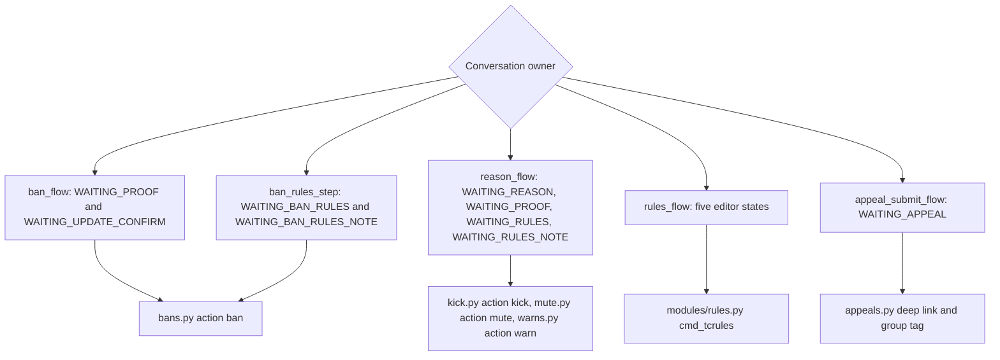
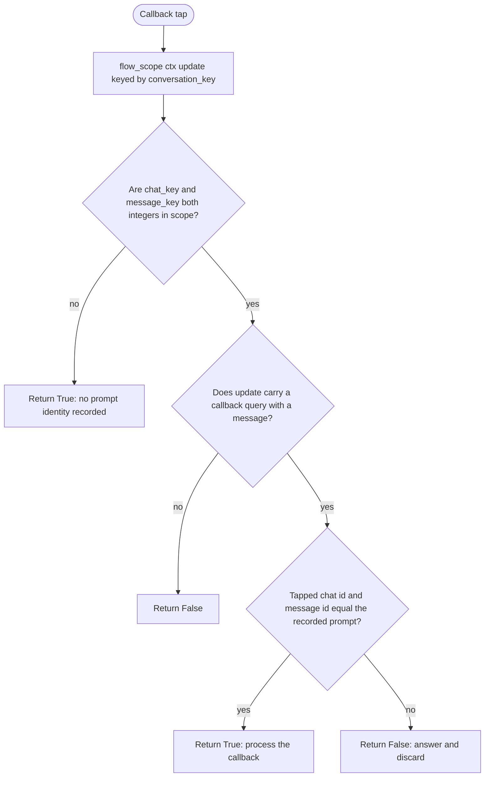

# State and callback registry

This page is the exhaustive registry of every `WAITING_*` conversation state and every `callback_data` namespace in the checkout. Names and patterns are exact; do not introduce parallel spellings.

Related pages: [appeals.md](appeals.md) for the appeal payloads, [transport.md](transport.md) for callback answers and inline-to-rich conversion, and [statistics.md](statistics.md) for the paged check and stats views.

## State families

## Conversation states

| Domain | Constant | Value | Owner |
|---|---|---|---|
| Ban | `WAITING_PROOF` | `0` | `tcbot/modules/helper/pipelines/ban_flow.py` |
| Ban | `WAITING_UPDATE_CONFIRM` | `1` | `tcbot/modules/helper/pipelines/ban_flow.py` |
| Ban rules | `WAITING_BAN_RULES` | `2` | `tcbot/modules/helper/pipelines/ban_rules_step.py` |
| Ban rules | `WAITING_BAN_RULES_NOTE` | `3` | `tcbot/modules/helper/pipelines/ban_rules_step.py` |
| Kick, mute, warn | `WAITING_REASON` | `0` | `tcbot/modules/helper/pipelines/reason_flow.py` |
| Kick, mute, warn | `WAITING_PROOF` | `1` | `tcbot/modules/helper/pipelines/reason_flow.py` |
| Kick, mute, warn | `WAITING_RULES` | `2` | `tcbot/modules/helper/pipelines/reason_flow.py` |
| Kick, mute, warn | `WAITING_RULES_NOTE` | `3` | `tcbot/modules/helper/pipelines/reason_flow.py` |
| Rules editor | `WAITING_CATEGORY_TITLE` | `1` | `tcbot/modules/helper/pipelines/rules_flow.py` |
| Rules editor | `WAITING_ITEM_TITLE` | `2` | `tcbot/modules/helper/pipelines/rules_flow.py` |
| Rules editor | `WAITING_ITEM_BODY` | `3` | `tcbot/modules/helper/pipelines/rules_flow.py` |
| Rules editor | `WAITING_ITEM_URL` | `4` | `tcbot/modules/helper/pipelines/rules_flow.py` |
| Rules editor | `WAITING_CONFIRM_DISCARD` | `5` | `tcbot/modules/helper/pipelines/rules_flow.py` |
| Appeal | `WAITING_APPEAL` | `0` | `tcbot/modules/helper/pipelines/appeal_submit_flow.py` |

`check_flow.py`, `stats_flow.py`, and all other flows define no `WAITING_*` state. The stats search uses the `ctx.user_data` keys `stats_search_active`, `stats_search_results`, `stats_search_msg_id`, `stats_search_chat_id`, and `stats_last_query` instead.

## Callback namespace by domain

The `Built by` column names the keyboard factory. The `Handled by` column names the module whose `CallbackQueryHandler` pattern matches it. A pattern shown with `<...>` is the exact f-string shape emitted by the factory.

### Ban

| Callback pattern | Built by | Handled by |
|---|---|---|
| `ban_cancel` | `buttons/ban.py::ban_confirm_btn`, `buttons/flows.py::proof_step_btn` | `ban_flow.py` with `^ban_cancel$`; also `^rules_step:cancel$` stops the rules step |
| `ban_continue` | `buttons/ban.py::ban_confirm_btn` | `ban_flow.py` with `^ban_continue$` |
| `ban_done_proof` | `buttons/flows.py::proof_step_btn` | `ban_flow.py` with `^ban_done_proof$` |
| `ban_skip_proof` | `buttons/flows.py::proof_step_btn` when `skip_allowed` | No handler is registered in `ban_flow.py`; the ban proof step auto-flushes after `cfg.album_debounce` |
| `rules_step:pick:<item_id>` | `buttons/rules.py::picker_btn` | `ban_rules_step.py` with `^rules_step:pick:\d+$`; also `reason_flow.py` when rules are enabled |
| `rules_step:done` | `buttons/rules.py::picker_btn` | `ban_rules_step.py` and `reason_flow.py` |
| `rules_step:other` | `buttons/rules.py::picker_btn` | `ban_rules_step.py` and `reason_flow.py` |
| `rules_step:clear` | `buttons/rules.py::picker_btn` | `ban_rules_step.py` and `reason_flow.py` |
| `rules_step:cancel` | `buttons/rules.py::picker_btn` | `ban_rules_step.py`, `reason_flow.py`, and `rules_flow.py` fallback |

`buttons/ban.py` also builds URL-only buttons `action_proof_btn`, `appeal_button_btn`, `join_ban_btn`, `detail_btn`, and the log/proof links in `ban_confirm_btn`; these carry no `callback_data`.

### Kick, mute, and warn

`BuildReason` is constructed with `action="kick"` in `kick.py`, `action="mute"` in `mute.py`, and `action="warn"` in `warns.py`.

| Callback pattern | Built by | Handled by |
|---|---|---|
| `<action>_cancel` for `kick`, `mute`, `warn` | `buttons/flows.py::reason_step_btn`, `proof_step_btn` | `reason_flow.py` with `^<action>_cancel$` |
| `<action>_skip_reason` | `buttons/flows.py::reason_step_btn` when `skip_allowed` | `reason_flow.py` registers it only when `skip_allowed`; all three consumers use `skip_allowed=False`, so it is not emitted |
| `<action>_skip_proof` | `buttons/flows.py::proof_step_btn` when `skip_allowed` | `reason_flow.py` registers `^<action>_skip_proof$` unconditionally; the three consumers use `skip_allowed=False`, so the button is not rendered |
| `<action>_done_proof` | `buttons/flows.py::proof_step_btn` | `reason_flow.py` with `^<action>_done_proof$` |
| `rules_step:pick:<item_id>`, `rules_step:done`, `rules_step:other`, `rules_step:clear`, `rules_step:cancel` | `buttons/rules.py::picker_btn` | `reason_flow.py` states `WAITING_RULES` and its fallback |

### Appeals

| Callback pattern | Built by | Handled by |
|---|---|---|
| `appeal_approve_<ban_id>_<review_message_id>` | `buttons/appeal.py::appeal_review_btn` | `appeals.py` with `^appeal_(approve|reject)_\S+$`, then `AppealReviewMixin.on_decision` |
| `appeal_reject_<ban_id>_<review_message_id>` | `buttons/appeal.py::appeal_review_btn` | Same handler |
| `appeal_approve_<ban_id>`, `appeal_reject_<ban_id>` | Legacy cards without the review suffix | Same handler; it falls back to the tapped message id |
| `cancel_appeal` | `buttons/appeal.py::appeal_cancel_btn` | `appeal_submit_flow.py` with `^cancel_appeal$` |

### Roles

| Callback pattern | Built by | Handled by |
|---|---|---|
| `promo_approve:<request_id>` | `buttons/admin.py::promo_decision_btn` | `admins.py` with `^(promo_approve|promo_reject):` |
| `promo_reject:<request_id>` | `buttons/admin.py::promo_decision_btn` | Same handler |
| `promo_role:<role>:<target_id>[:<executor_id>]` | `buttons/admin.py::promote_role_btn` | `admins.py` with `^promo_role:[a-z]+:\d+(:\d+)?$` |
| `promo_role_cancel:<target_id>[:<executor_id>]` | `buttons/admin.py::promote_role_btn` | `admins.py` with `^promo_role_cancel:\d+(:\d+)?$` |
| `demote_confirm:<target_id>[:<executor_id>]` | `buttons/admin.py::demote_confirm_btn` | `admins.py` with `^demote_confirm:\d+(:\d+)?$` |
| `demote_cancel:<target_id>[:<executor_id>]` | `buttons/admin.py::demote_confirm_btn` | `admins.py` with `^demote_cancel:\d+(:\d+)?$` |

The optional executor segment lets a handler refuse a different tapper. Without it the legacy two-part shapes remain valid.

### Rules

| Callback pattern | Built by | Handled by |
|---|---|---|
| `rules_ack:<version_id>:<member_id>` | `buttons/rules.py::ack_btn` | `rules.py` with `^rules_ack:\d+:\d+$` |
| `rules_show:<category_key>` | `buttons/rules.py::rules_menu_btn` | `rules.py` with `^rules_show:` |
| `rules_menu` | `buttons/rules.py::category_back_btn` | `rules.py` with `^rules_menu$` |
| `rules_panel` | `buttons/rules.py::categories_btn` back row | `rules.py` with `^rules_panel$` |
| `rules_publish` | `buttons/rules.py::editor_panel_btn` | `rules.py` with `^rules_publish$` |
| `rules_cat_rename:<key>`, `rules_cat_up:<key>`, `rules_cat_down:<key>`, `rules_cat_del:<key>` | `buttons/rules.py::categories_btn` | `rules.py` with `^rules_cat_(rename|up|down|del):.+` |
| `rules_edit_draft` | `buttons/rules.py::editor_panel_btn` | `rules_flow.py` conversation entry point `^rules_edit_draft$` |
| `rules_discard_yes`, `rules_discard_no` | `buttons/rules.py::confirm_btn` | `rules_flow.py` state `WAITING_CONFIRM_DISCARD` |
| `rules_preview`, `rules_discard`, `rules_settings` | `buttons/rules.py::editor_panel_btn` | No handler registered in this checkout |
| `rules_cat:<key>`, `rules_cat_add`, `rules_item:<item_id>`, `rules_item_add`, `rules_categories`, `rules_page:<page>` | `buttons/rules.py::categories_btn`, `items_btn`, `rules_menu_btn` | No handler registered in this checkout |

### Check

| Callback pattern | Built by | Handled by |
|---|---|---|
| `checkme_detail:<ban_id>` | `buttons/check.py::checkme_ban_btn` | `check.py` with `^checkme_detail:` |
| `checkme_back:<ban_id>` | `buttons/check.py::checkme_detail_back_btn` | `check.py` with `^checkme_back:` |
| `check_main:<target_id>` | `buttons/check.py::check_back_row` | `check.py` with `^check_main:\d+$` |
| `check_bans:<target_id>:<page>` | `buttons/check.py::check_profile_btn` | `check.py` with `^check_bans:\d+:\d+$` |
| `check_ban_item:<target_id>:<ban_id>` | `check_flow.py::_ban_list_render` | `check.py` with `^check_ban_item:\d+:[a-z0-9]+$` |
| `check_appeals:<target_id>:<page>` | `buttons/check.py::check_profile_btn` | `check.py` with `^check_appeals:\d+:\d+$` |
| `check_warns:<target_id>` | `buttons/check.py::check_profile_btn` | `check.py` with `^check_warns:\d+$` |
| `check_warn_chat:<target_id>:<chat_id>:<page>` | `buttons/check.py::check_warn_groups_btn`, `buttons/nav.py::nav_row` | `check.py` with `^check_warn_chat:\d+:-?\d+:\d+$` |
| `check_kicks:<target_id>:<page>` | `buttons/check.py::check_profile_btn` | `check.py` with `^check_kicks:\d+:\d+$` |
| `check_mutes:<target_id>:<page>` | `buttons/check.py::check_profile_btn` | `check.py` with `^check_mutes:\d+:\d+$` |

`buttons/check.py::checkme_ban_btn` returns `None` when the bot username is unknown, which drops the callback and appeal buttons entirely.

### Statistics

| Callback pattern | Built by | Handled by |
|---|---|---|
| `stats_main` | `buttons/stats.py::stats_back_btn`, `buttons/drills.py::stats_list_btn` | `stats.py` with `^stats_main$` |
| `stats_admins` | `buttons/stats.py::stats_main_btn` | `stats.py` with `^stats_admins$` |
| `stats_users:<page>` | `buttons/stats.py::stats_main_btn` | `stats.py` with `^stats_users:\d+$` |
| `stats_user_item:<page>:<idx>[:<user_id>]` | `buttons/drills.py::stats_list_btn` | `stats.py` with `^stats_user_item:\d+:\d+(:[^:]+)?$` |
| `stats_chats:<page>` | `buttons/stats.py::stats_main_btn` | `stats.py` with `^stats_chats:\d+$` |
| `stats_chat_item:<page>:<idx>[:<chat_id>]` | `buttons/drills.py::stats_list_btn` | `stats.py` with `^stats_chat_item:\d+:\d+(:[^:]+)?$` |
| `stats_bans:<page>` | `buttons/stats.py::stats_main_btn` | `stats.py` with `^stats_bans:\d+$` |
| `stats_ban_item:<page>:<idx>[:<ban_id>]` | `buttons/drills.py::stats_list_btn` | `stats.py` with `^stats_ban_item:\d+:\d+(:[^:]+)?$` |
| `stats_bans_search` | `buttons/drills.py::stats_search_row`, `stats_search_results_btn` | `stats.py` with `^stats_bans_search$` |
| `stats_search_item:<idx>[:<ban_id>]` | `buttons/drills.py::stats_search_results_btn` | `stats.py` with `^stats_search_item:\d+(:[^:]+)?$` |
| `stats_search_back` | `stats_flow.py::SearchViews.search_detail` back button | `stats.py` with `^stats_search_back$` |
| `stats_search_cancel` | `buttons/drills.py::stats_search_panel_btn`, `stats_search_results_btn` | `stats.py` with `^stats_search_cancel$` |

The optional stable id segment in item callbacks is verified by `_parse_item_callback()` so a list mutation between render and tap cannot show a different record. Three-part legacy callbacks keep working without that check.

### Menus and help

| Callback pattern | Built by | Handled by |
|---|---|---|
| `about_menu` | `buttons/menus.py::main_menu_btn` | `about.py` with `^about_menu$` |
| `help_menu` | `buttons/menus.py::main_menu_btn`, `buttons/topics.py::back_to_help_btn` | `help.py` with `^help_menu$` |
| `help_menu_group` | `buttons/menus.py::group_start_btn` | `help.py` with `^help_menu_group$` |
| `helpc_main` | `buttons/topics.py::back_to_help_cmd_btn` | `help.py` with `^helpc_main$` |
| `helps_<module>:<index>` | `buttons/topics.py::module_help_btn` | `help.py` with `^(helps|helpcs)_\w+:\d+$` |
| `helpcs_<module>:<index>` | `buttons/topics.py::module_help_btn` | Same handler |
| `help_<module>`, `helpc_<module>` | `buttons/topics.py::help_topics_menu_btn`, `help_topics_btn` | `help.py` with `^(help|helpc)_\w+$` |
| `additional_menu` | `buttons/menus.py::main_menu_btn` | `additional.py` with `^additional_menu$` |
| `privacy_menu` | `buttons/menus.py::main_menu_btn`, `buttons/topics.py::privacy_policy_sections_btn` | `privacy.py` with `^privacy_menu$` |
| `privacy_policy_menu` | `buttons/topics.py::privacy_btn` | `privacy.py` with `^privacy_policy_menu$` |
| `privacy_section_<n>` | `buttons/topics.py::privacy_policy_sections_btn` | `privacy.py` with `^privacy_section_\d+$` |
| `back_to_start` | `buttons/common.py::back_row`, `buttons/menus.py`, `buttons/topics.py` | `start.py` with `^back_to_start$` |
| `menu_groups_simple`, `menu_groups_details` | `buttons/menus.py::groups_menu_btn` | `start.py` with `^(menu_groups|menu_groups_simple)$` and `^menu_groups_details$` |
| `menu_groups` | No builder in this checkout; the `start.py` pattern keeps the legacy value valid | `start.py` with `^(menu_groups|menu_groups_simple)$` |
| `groups_details`, `groups_simple` | `buttons/menus.py::tcgroups_btn` | `groups.py` with `^groups_details$` and `^groups_simple$` |

### Language

| Callback pattern | Built by | Handled by |
|---|---|---|
| `language_menu` | `buttons/menus.py::main_menu_btn` | `language.py` with `^language_menu$` |
| `lang:list:user`, `lang:list:group` | `language.py` | `language.py` with `^lang:list:(user\|group)$` |
| `lang:set:<scope>:<code>` | `buttons/language.py::language_list_btn` | `language.py` with `^lang:set:(user\|group):[A-Za-z]{2}(?:-[A-Za-z]{2})?$` |

A selected locale gets a plain checkmark text prefix in the button label.

### Connection

| Callback pattern | Built by | Handled by |
|---|---|---|
| `tc_join` | `buttons/flows.py::connect_join_btn` with `BuildConnection.join_callback` default | `connect.py` with `^(tc_join\|tc_cancel)$`, dispatched by `connected_flow.py::on_join_decision` |
| `tc_cancel` | `buttons/flows.py::connect_join_btn` with `BuildConnection.cancel_callback` default | Same handler |

### Pagination

| Callback pattern | Built by | Handled by |
|---|---|---|
| `<prefix>:<page - 1>` | `buttons/nav.py::nav_row` when `page > 0` | The owning panel handler for that prefix |
| `<prefix>:<page + 1>` | `buttons/nav.py::nav_row` when `page < total_pages - 1` | The owning panel handler for that prefix |

Known prefixes are `check_bans:<target_id>`, `check_warn_chat:<target_id>:<chat_id>`, `check_kicks:<target_id>`, `check_mutes:<target_id>`, `check_appeals:<target_id>`, `stats_users`, `stats_chats`, and `stats_bans`. Page arithmetic is owned by `utils/pagination.py::clamp_page(total, page, page_size)` and `paginate(items, page, page_size)`; pages are zero-based and clamped into `[0, total_pages - 1]`.

## Freshness rule

`scope.callback_is_current(update, scope, *, chat_key, message_key)` in `tcbot/modules/helper/scope.py` compares `query.message.chat.id` and `query.message.message_id` with the values recorded at flow entry. The check is permissive when no integer identity was recorded. Stale taps are answered with `q.answer()` and discarded.

| Call site | Freshness keys |
|---|---|
| `reason_flow.py::ReasonMixin._callback_is_live` | `<action>_prompt_chat` and `<action>_prompt_id`, set in `ReasonMixin.__post_init__` from `self.action` |
| `ban_confirmation.py::stale_ban_callback` | `ban_prompt_chat_id` and `ban_prompt_msg_id` |
| `ban_rules_step.py` | Calls `stale_ban_callback()` before each rules-step action |
| `ban_flow.py` | Calls `stale_ban_callback()` on the update-continue and proof paths |
| `appeal_submit_flow.py::_on_cancel` | Inline check of `appeal_instruction_msg_id` against the tapped message id, not the shared helper |

`flow_scope(ctx, update)` stores the payload under `ctx.user_data["tc_flow_scopes"]` keyed by `conversation_key(update)`, so one moderator's conversations in different chats cannot overwrite each other. `clear_flow_scope()` removes either the whole payload or selected keys and drops empty entries.
