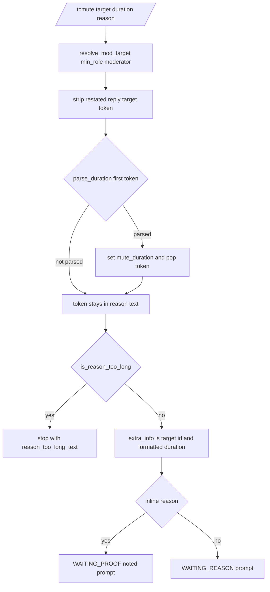
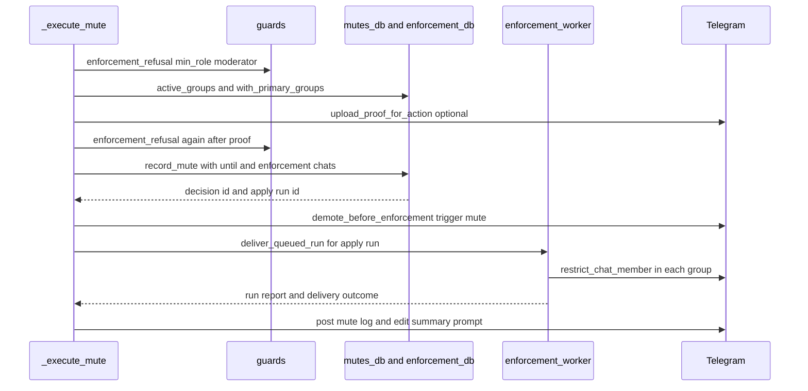
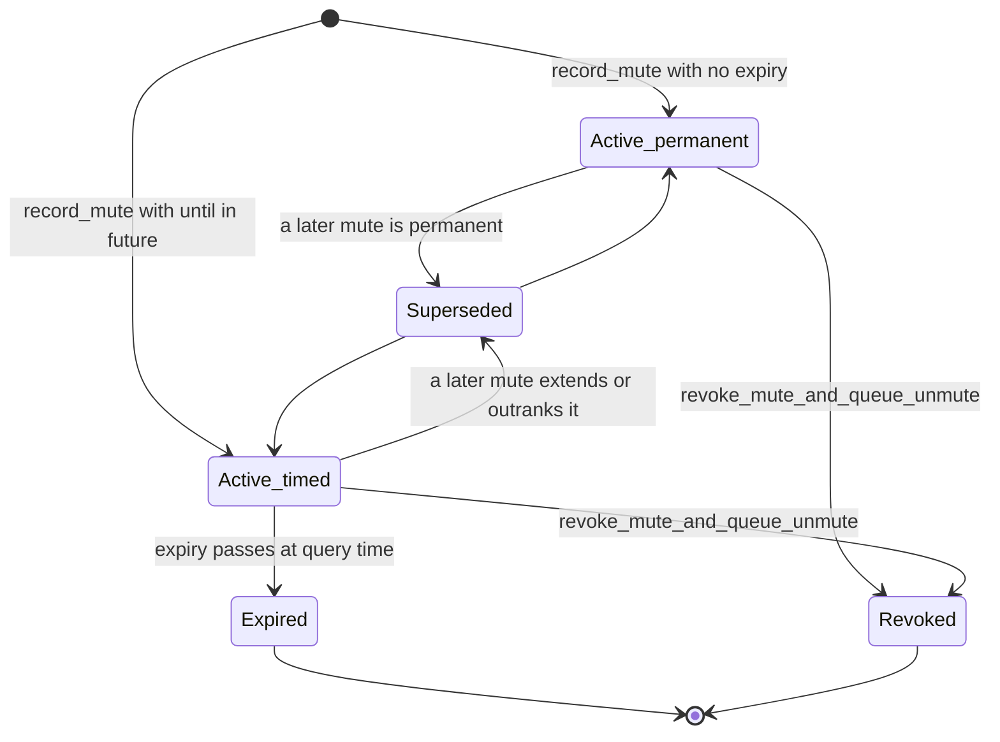
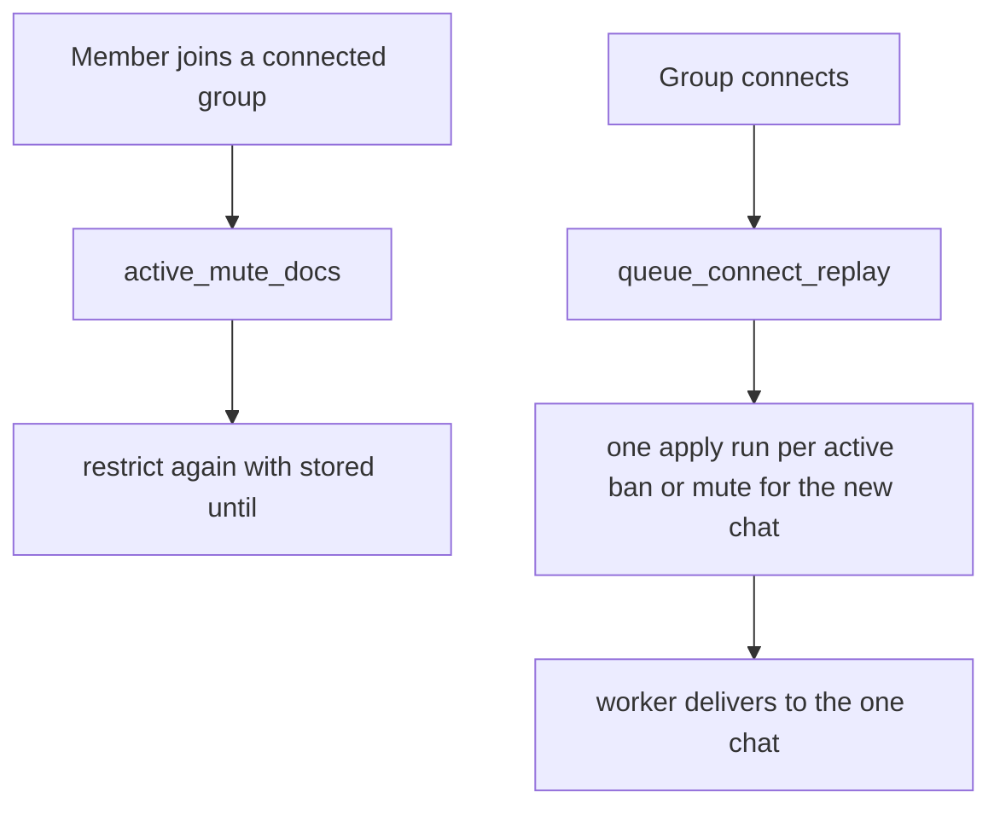

# Muting: duration parsing, timed state, replay, and unmute

This document describes the mute pipeline: duration parsing at command entry, the conversation, the apply and revoke decisions, the timed state machine, join and connect replay, and unmute. The shared spine is in [banning.md](banning.md).

## 1. Entry and duration parsing

`cmd_mute` in `tcbot/modules/mute.py` uses `ratelimiter(THROTTLE_MODERATION)`, `basic_mod_only` (moderator tier), and `log_execution`. It resolves with `allow_private=False` because a restriction is a Telegram group action. After target resolution it strips a restated reply target, then tries the first remaining token with `parse_duration()` from `time_and_date.py`. A token is popped only when it parses; an unparsable token stays in the reason text so text is never silently dropped.

`cmd_unmute` is a single-action command that delegates to `targets.run_staff_action(action="unmute", min_role="moderator", execute=execute_unmute)`. The mute conversation is built by `mute_conversation()` with `BuildReason("mute", skip_allowed=False)`, `BuildProof("mute")`, `rules_enabled=True`, and an escape filter so `/tcunmute` is not swallowed as a reason.

## 2. Conversation states and callbacks

| Owner | State | Value |
|---|---|---|
| `reason_flow.py` | `WAITING_REASON` | 0 |
| `reason_flow.py` | `WAITING_PROOF` | 1 |
| `reason_flow.py` | `WAITING_RULES` | 2 |
| `reason_flow.py` | `WAITING_RULES_NOTE` | 3 |

| Callback data | Meaning |
|---|---|
| `mute_cancel` | Cancel the live mute prompt |
| `mute_done_proof` | Flush collected proof and execute |
| `mute_skip_proof` | Execute without proof |
| `rules_step:pick:<id>` | Toggle a rules selection |
| `rules_step:done` | Confirm rules selection |
| `rules_step:other` | Enter an optional note |
| `rules_step:clear` | Clear selection |

The executor adapter `_exec_mute()` copies the `mute_` keys out of the flow scope and calls `_execute_mute()`. Done and Skip claim the execution slot before their first await and re-check the tapper's rank.

## 3. Apply decision and delivery

`_execute_mute()` in `mute_flow.py` computes `until = utc_now() + duration` for a timed mute, or `None` for a permanent mute, and builds `ChatPermissions(can_send_messages=False)`. It runs the enforcement rank gate twice, at `min_role="moderator"`, before and after the optional proof upload.

`mutes_db.record_mute()` writes the decision, case, optional proof archive, rule links, and apply run in one transaction with idempotency key `moderation:{action_id}:apply:v1`. A failed write aborts before any group is touched. `demote_before_enforcement()` is best effort: it must never block enforcement after the decision is committed.

## 4. Timed state machine

A mute is one decision in `moderation_actions`, keyed by a partial unique index that allows one active mute per target. `record_mute()` serializes per user with an advisory lock. When a later mute arrives it supersedes the prior one: a new permanent mute clears the expiry, and a new timed mute keeps the later of the new deadline and the stored deadline. The stored `duration_seconds` is the remaining lifetime, while the moderator's original request is kept in metadata.

Expiry is evaluated at query time by `get_active_mute()` and `active_mute_docs()` using `expires_at is null or expires_at > now()`, so no background sweep is needed for an honest active view. An apply run whose decision expired while it waited is cancelled by the worker instead of muting a user after the deadline.

## 5. Unmute and replay

`execute_unmute()` loads the active mute, fetches the groups before revoking, and calls `mutes_db.revoke_mute_and_queue_unmute()` to move the decision to `revoked` and queue a `revoke` run in one transaction with idempotency key `moderation:{action_id}:revoke:manual:v1`. The worker restores full permissions with `ChatPermissions.all_permissions()`. `revoked == 0` is an idempotent "no active mute" reply.

Join handling replays active mutes through `active_mute_docs()`. When a group connects, `enforcement_db.queue_connect_replay(chat_id, user_ids)` reads every active ban or mute for those users and queues one bounded apply run per decision with idempotency key `moderation:{action_id}:connect-replay:{chat_id}:{event}:{type}:v1`. A revoke run is cancelled by the worker when `newer_active` is true, so a replayed restriction cannot undo a newer decision.

## 6. Exact names

| Name | Owner | Role |
|---|---|---|
| `cmd_mute` and `cmd_unmute` | `mute.py` | Command entry points |
| `parse_duration` and `fmt_duration` | `time_and_date.py` | Duration parsing and display |
| `_execute_mute` | `mute_flow.py` | Apply orchestration |
| `execute_unmute` | `mute_flow.py` | Revoke orchestration |
| `record_mute` | `mutes_db.py` | Decision, case, proof, apply run |
| `revoke_mute_and_queue_unmute` | `mutes_db.py` | Atomic revoke and revoke run |
| `get_active_mute` and `active_mute_docs` | `mutes_db.py` | In-force views |
| `queue_connect_replay` | `enforcement_db.py` | Durable replay for a new chat |

## 7. Continue reading

- [banning.md](banning.md): system spine and enforcement worker lifecycle.
- [unbanning.md](unbanning.md): the parallel revoke path for bans.
- [kicking.md](kicking.md): the chat-scoped ban-then-unban action.
- [warning.md](warning.md): the auto-ban a threshold can trigger.
- [proof.md](proof.md): shared proof collection and archive.
