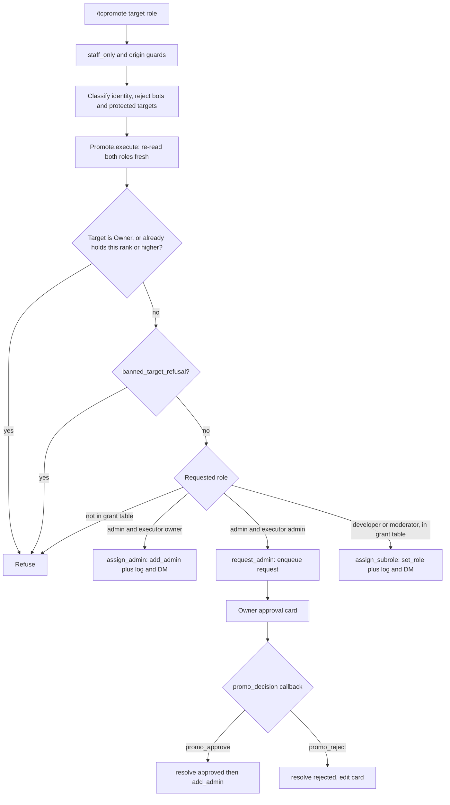
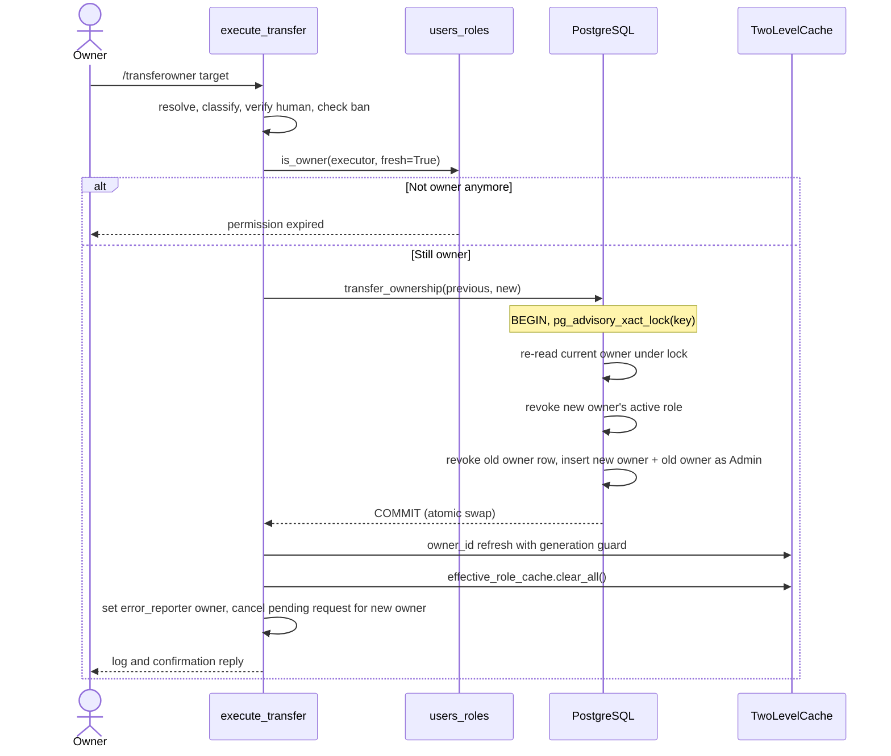

# Roles, promotion, and ownership

Purpose: describe how federation roles are granted and revoked, how promotion requests reach the Owner, and how ownership moves atomically.

## Role vocabulary

The tables in `tcbot/database/users_roles.py` own the vocabulary. The database seed in `tcbot/database/schema/seed.sql` assigns each role a priority (owner 100, admin 80, developer 60, moderator 40) and a permission bundle.

| Constant | Value |
|---|---|
| `ROLE_RANK` | `owner=4`, `admin=3`, `developer=2`, `moderator=1` |
| `ROLE_LABEL` | `Owner`, `Admin`, `Developer`, `Moderator` |
| `VALID_ROLES` | `("developer", "moderator")`, the only directly assignable custom roles |
| `ROLE_ALIASES` | `admin`, `developer`, `dev`, `moderator`, `mod` |
| `RoleName` | `Literal["owner", "admin", "developer", "moderator"]` |

`set_role()` rejects anything outside `VALID_ROLES`, because `get_effective_role()` returns the stored value verbatim and a hand-edited `"admin"` or `"owner"` row would grant real privilege. `role_rank()` maps an unknown stored value to `0`, and `get_effective_role()` ignores any stored role outside `ROLE_RANK`.

## Direct promotion versus queued request

`/tcpromote` is a staff command. It resolves the target, classifies the identity, rejects bots and protected targets, then calls `Promote.execute()`. The single owner of the grant table is `Promote.available_roles_for(executor_role)`:

| Executor | Roles offered / granted |
|---|---|
| `owner` | `admin`, `developer`, `moderator` |
| `admin` | `developer`, `moderator` |
| anything else | none |

Only the Owner grants the Admin tier outright. When an Admin targets `admin`, the command diverts to `request_admin()` and creates a request for the Owner to decide.

`Promote.execute()` re-reads both roles with `fresh=True` at the mutation point, because classification and the bot probe can take seconds and a demotion in that window must not still grant rank. A failed lookup refuses the grant. The grant table is also re-checked here, so a new caller cannot hand out a tier the picker would not offer.

`assign_admin()` and `assign_subrole()` write the role, perform a best-effort display-name upsert, then send the audit log and a direct message to the target in one bounded gather. The assignment revokes the role the target previously held in the same transaction, so no second cleanup write is needed; a later revocation would also strip the role just granted.

## The Owner approval card

`request_admin()` in `promote_flow.py` guards against a banned target, checks for an existing request, then enqueues the request and looks up the Owner in parallel. The card is sent to the Owner by DM with the `promo_decision_btn(request_id)` keyboard, falling back to the log channel when the DM fails. Concurrent submissions resolve through the unique pending index rather than duplicating the queue.

`on_promo_decision` (in `admins.py`) delegates to `execute_promo_decision()` in `promo_decision_flow.py`. Its contract:

| Step | Behavior |
|---|---|
| Callback prefixes | `promo_approve:{request_id}`, `promo_reject:{request_id}` |
| Authorization | `is_owner(admin.id, fresh=True)`; failure alerts and leaves the shared card untouched |
| Status check | A request whose status is not `pending` is refused early to avoid a second success message |
| Owner target | Refused on approve: rewriting an Owner assignment as Admin would leave the federation ownerless |
| Ban guard | `banned_target_refusal()` on approve; a request filed before a ban must not grant rank |
| Claim order | `queues_db.resolve()` runs before `add_admin()` on approve, and before editing the card on reject, so the atomic claim decides a concurrent tap race |
| Acknowledge | `answer_ack()` after the decision is reached but before the notification fan-out, so the spinner stops exactly once |

If `add_admin()` fails after a won claim, the request stays approved and an operator grants the role manually. That availability gap is preferred to granting rank against a losing reject.

## Demotion and its triggers

`Demote.execute(bot, target_id, target_fname, target_role, executor_id, executor_fname, trigger=None)` removes the active role, posts a federation log, and DMs the target. It returns whether a role row was actually removed. The `trigger` selects the DM wording only.

| Trigger | Path | Wording |
|---|---|---|
| `None` | Manual `/tcdemote` confirmation | `demote.dm.manual` |
| `ban`, `kick`, `mute` | Demote before enforcement fan-out | `demote.dm.auto`, verb selected by trigger |
| `warn` | Warn-threshold exemption, demote instead of ban | `demote.dm.warn` |
| `unban` | Fail-closed pre-unban gate | `demote.dm.unban` |
| `appeal` | Appeal-approval pre-unban gate | `demote.dm.appeal` |

Join enforcement runs with `executor_id=0`. All four enforcement triggers use `demote_before_enforcement()`, which returns the demoted role or `None` and never raises; the moderation record already exists, so a demote failure must not block enforcement. The Owner role is never demotable; a found owner is returned so the caller can refuse the enforcement.

`/tcunban` and appeal approval use `demote_before_unban()` and the `UnbanGate` enum instead:

| `UnbanGate` | Meaning |
|---|---|
| `PROCEED` | The role was removed or was already gone; unban may continue |
| `DEMOTE_FAILED` | `Demote.execute()` raised; block the unban |
| `ROLE_SURVIVED` | The demote was a no-op but the target still resolves to a staff role; block the unban |

A no-op demote re-reads the live role with `fresh=True`. Only a role outside `STAFF_ROLES` permits the unban. Manual demotion command and callbacks additionally apply `guards.can_demote_admin()`: demoting an Admin requires the Owner, and the Owner is never a demotion target. See [permissions.md](permissions.md) for the protected-target table and the fresh-read rules.

## Ownership transfer

`cmd_transfer` is Owner-only and delegates to `execute_transfer()` in `transfer_flow.py`. The target must resolve, classify as non-protected, verify as a human, and hold no active ban. `verify_not_bot()` returns `True` / `False` / `None`, and transfer fails closed on `None` because a bot owner would brick federation leadership. The executor's ownership is re-read with `fresh=True` at the mutation point so a stale prompt cannot act after a transfer or demotion.

`users_roles.transfer_ownership(previous_owner_id, new_owner_id)` runs in one transaction under the advisory lock `_OWNER_TRANSFER_LOCK_KEY = 7_313_919_265_517_001`:

- The current owner is re-read under the lock. If it differs from the prompt's opener, the transfer raises and no role is modified.
- The new owner's active assignments are revoked before the owner row is written, because a user holds one active role.
- The old owner row is revoked and the new owner row is inserted with `assigned_by_user_id = previous_owner_id`.
- The previous Owner is granted `admin` in the same transaction, so a failure cannot leave them with no role.

After commit, `_publish_owner()` performs a generation-guarded `owner_id_cache.refresh()`, verifies exactly one active owner row, and calls `effective_role_cache.clear_all()` to sweep both cache layers. The generation guard discards a refresh that overlapped another write, so two overlapping transfers cannot publish out of order. If the refresh itself fails, the cache is invalidated instead of failing the already-committed command. `ensure_initial_owner()` uses the same lock when seeding the first owner and revokes a lower role the configured owner may already hold on a restored database.

## Promotion request expiry

The queue lives in the `promotion_requests` table. One open request per target is enforced by the `uq_promotion_requests_pending_target` partial unique index.

| Item | Value |
|---|---|
| `PROMOTION_REQUEST_TTL_DAYS` | Default `7`; minimum `0`; `0` disables expiry |
| `expires_at` | Set to `requested_at + TTL days` when the TTL is positive, otherwise `NULL` |
| `expire_stale_requests()` | Marks `pending` rows with `expires_at <= now()` as `expired`, stamps `resolved_at`, and records the note `Expired without a decision` |
| Expiry timing | `queues_db.enqueue()` expires stale rows before inserting, so an abandoned request frees the one-pending slot |
| Statuses | `pending`, `approved`, `rejected`, `cancelled`, `expired` |

Expiry keeps the request history readable and makes the old card visibly terminal. The approval path also refuses a request whose status is no longer `pending`, and a transfer cancels any pending request for the new owner so a pre-transfer card cannot be approved later. Related reading: [permissions.md](permissions.md), [extraction-user-data.md](extraction-user-data.md), [ratelimit.md](ratelimit.md).
