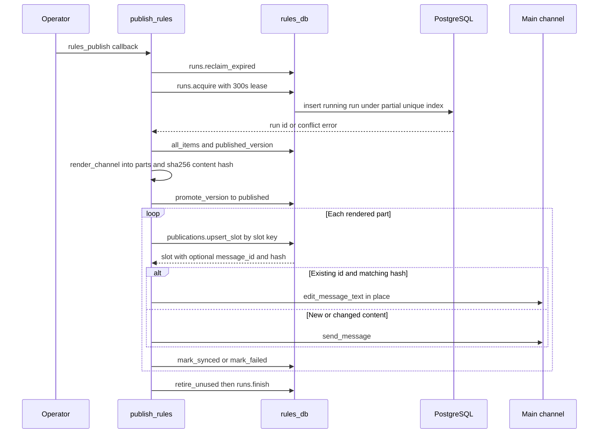
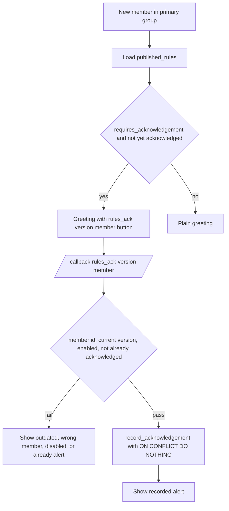

# Community rules pipeline

This document covers the staff rules editor, publication to the main channel, member acknowledgment, and the shared rules picker used by moderation flows.

Related pipelines: [connection.md](connection.md), [persistance.md](persistance.md), [cache.md](cache.md), and [banning.md](banning.md).

## Draft model

A rule set owns categories and versions. One draft per set and working locale exists at a time; published versions are immutable. `open_draft()` clones the current published items into a new draft together with a snapshot of the category catalogue, so a later rename or reorder cannot change what an older version displayed. `editor_allowed()` re-checks `rules.manage` on every editor surface and fails closed when the lookup fails.

## Editor conversation

`build_rules_conv()` in `rules_flow.py` drives the editor. The single entry point is the `rules_edit_draft` callback. Five `WAITING_*` states cover three text inputs, a URL input, and a discard confirmation.

| State | Value | Input | Next step |
|---|---|---|---|
| `WAITING_CATEGORY_TITLE` | 1 | Category title | `add_category` or `rename_category`, then category list. |
| `WAITING_ITEM_TITLE` | 2 | Item title | Stores the title and asks for the body. |
| `WAITING_ITEM_BODY` | 3 | Item body | Stores the body and asks for the optional URL. |
| `WAITING_ITEM_URL` | 4 | URL or empty | `add_item`, then item list. |
| `WAITING_CONFIRM_DISCARD` | 5 | Yes or no callback | Delete the draft or leave it untouched. |

The fallback callback `rules_step:cancel` ends the conversation without changing the draft. Input limits are title 200, body 3500, and URL 500 characters; a URL must start with `https://` or `http://`. Category slugs match `^[a-z0-9][a-z0-9._-]*$` and are capped at 40 characters so the longest callback stays inside Telegram's 64-byte limit.

```mermaid
flowchart TD
    CMD[/tcrules in private chat] --> SET[get_or_create_community_set]
    SET --> DRAFT[open_draft, cloning published items]
    DRAFT --> PANEL[Editor panel with edit, preview, publish, discard, settings]
    PANEL -->|rules_edit_draft| CATS[Category list with CRUD callbacks]
    PANEL -->|rules_preview| PREV[Render draft as channel would show it]
    PANEL -->|rules_publish| PUBLISH[publish_rules pipeline]
    PANEL -->|rules_discard| CONF{WAITING_CONFIRM_DISCARD}
    CONF -->|rules_discard_yes| DEL[discard_draft]
    CONF -->|rules_discard_no| END[Leave draft unchanged]
    CATS -->|rules_cat_add| TITLE[WAITING_CATEGORY_TITLE]
    TITLE --> BODY[WAITING_ITEM_TITLE]
    BODY --> URL[WAITING_ITEM_BODY]
    URL --> ITEMS[WAITING_ITEM_URL then add_item]
```

Category and item CRUD live in `rules_db`: `add_category`, `rename_category`, `move_category`, `delete_category`, `list_categories`, `add_item`, and `list_items`. Every mutation touches the draft, never a published version.

The callback payloads below are the exact strings emitted by the editor keyboards. Registered handlers are named where a module owns one; several payloads are currently emitted by a builder without a dedicated registered handler, so they are listed by purpose only.

| Editor callback | Emitted by | Purpose |
|---|---|---|
| `rules_edit_draft` | `editor_panel_btn` | Conversation entry point, handled by `rules_flow.panel`. |
| `rules_preview` | `editor_panel_btn` | Preview request; renderer is `rules_flow.preview`. |
| `rules_publish` | `editor_panel_btn` | Publication, handled by `rules.on_rules_publish` with `rules.manage`. |
| `rules_discard` | `editor_panel_btn` | Requests the discard confirmation. |
| `rules_discard_yes`, `rules_discard_no` | `confirm_btn` | Delete the draft or keep it; handled by the conversation discard state. |
| `rules_step:cancel` | Picker and editor keyboards | Conversation fallback, handled by `rules_flow.cancel`. |
| `rules_cat:<key>` | `categories_btn` | Select a category by key. |
| `rules_cat_rename:<key>` | `categories_btn` | Ask for a new category title; handled by `rules.on_rules_cat_action`. |
| `rules_cat_up:<key>`, `rules_cat_down:<key>` | `categories_btn` | Reorder; handled by `rules.on_rules_cat_action`. |
| `rules_cat_del:<key>` | `categories_btn` | Delete; handled by `rules.on_rules_cat_action`. |
| `rules_cat_add` | `categories_btn` | Add a category. |
| `rules_item:<id>` | `items_btn` | Select an item by id. |
| `rules_item_add` | `items_btn` | Add an item. |
| `rules_categories`, `rules_panel` | `back_row` | Return to the category list or the editor panel; `rules_panel` is handled by `rules.on_rules_panel`. |

The read-only `/rules` menu uses a separate set of payloads: `rules_menu`, `rules_page:<n>`, `rules_show:<key>`, and a Back button that also emits `rules_menu`. `rules_menu` and `rules_show:` are handled in `rules.py`. Category views are rendered as rich tables where the client supports them, with a MarkdownV2 fallback.

## Publication

`publish_rules()` runs under a database lease, not a background retry loop. The database commits first and Telegram is touched second. A failed channel operation is recorded on its slot and reconciled by the next publish.



`MAIN_CHANNEL` must be configured or publishing is refused. `runs.acquire()` inserts a `running` row guarded by a partial unique index on `(rule_set_id, chat_id)` where `status = 'running'`; a concurrent publish fails immediately with "already running" rather than waiting. `reclaim_expired()` first marks stale running rows (lease expiry over 300 s) as `failed` so a crashed publish cannot block the channel forever.

The channel text is split into parts of at most 4000 UTF-16 units by `render_channel()`, grouped by category with a version and timestamp footer. Each part's final rendered text is hashed with SHA-256 and stored on its slot. A slot with a message id and a matching hash is edited in place; a changed or missing message is sent fresh. `mark_failed(missing=True)` clears the stale message id, so a deleted channel post is not retried forever.

| Run state | Meaning |
|---|---|
| `running` | Lease held; one publish owns this set and channel. |
| `completed` | Every slot synced or retired. |
| `partial` | At least one slot failed; the next publish reconciles it. |
| `failed` | The publish aborted and the error was recorded. |

| Slot state | Meaning |
|---|---|
| `pending` | Slot refreshed with a new hash, awaiting Telegram. |
| `synced` | Channel message matches the slot content. |
| `missing` | Telegram could not find the message; the id was cleared. |
| `failed` | A transient channel error was recorded for the next publish. |
| `retired` | No longer part of the rendered representation. |

## Member acknowledgment

Acknowledgment is a greeting-only surface. `_ack_markup()` in `greeting.py` attaches one "I agree" button to the welcome message in the primary group when the published rule set has `requires_acknowledgement` enabled and the member has not yet accepted that exact version. A rules read failure never blocks the welcome: the greeting is sent without a button.



The callback payload is `rules_ack:<version>:<member>`. `_acknowledge()` verifies the tapping user is the named member, the version is still the current published version, acknowledgment is enabled, and no prior acknowledgment exists. Duplicate taps are safe because the insert is `ON CONFLICT DO NOTHING`. Acknowledgment never appears on channel posts or in the `/rules` menu.

## Shared rules picker

`rules_step.py` provides action-agnostic picker helpers: `callback_for`, `item_id_from_callback`, `toggle`, and `picker_text`. The flow stores selected item ids and an optional note in its conversation scope, then passes them to the decision writer, which links them to the case through `moderation_db.link_case_rules()`. When no rules are published or the moderator lacks `rules.view`, the picker step is skipped and the flow continues to proof.

| Callback | Effect |
|---|---|
| `rules_step:pick:<id>` | Toggle one published rule item. |
| `rules_step:done` | Accept the selection and continue to proof. |
| `rules_step:other` | Ask for the optional "Other" note. |
| `rules_step:clear` | Clear the selection. |
| `rules_step:cancel` | Cancel the moderation flow. |

Ban owns a dedicated step in `ban_rules_step.py` with `WAITING_BAN_RULES` (2) for the picker and `WAITING_BAN_RULES_NOTE` (3) for the note, storing `ban_rules` and `ban_rules_note` in scope. Kick, mute, and warn share the generic picker step in `reason_flow.py`, which uses the same callbacks and the `rules_step` helpers with its own scope key. The picker therefore has a single implementation and a single callback vocabulary across all four moderation actions.
