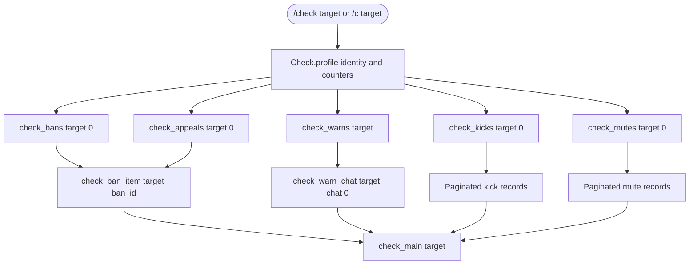
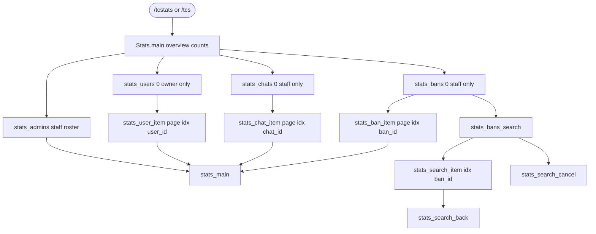
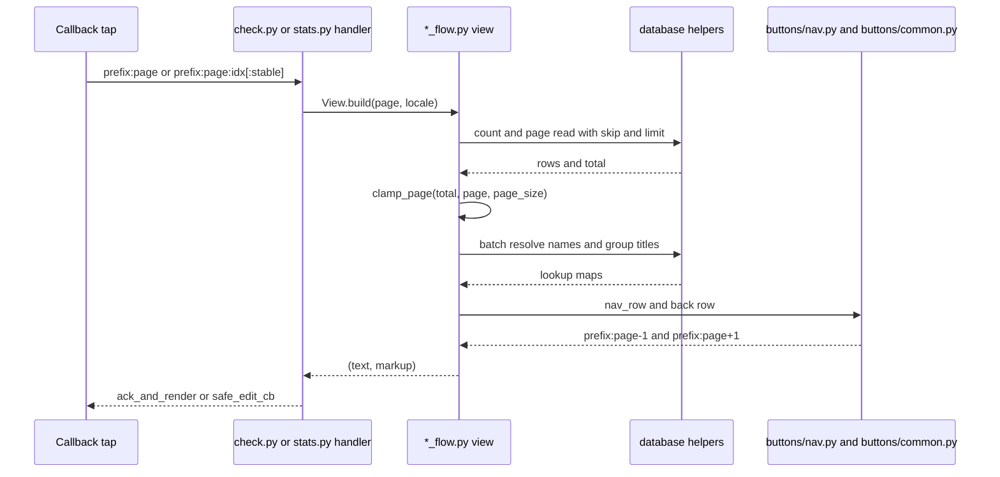

# Check and statistics views

This page documents the `/check` and `/tcstats` drill-down trees, their pagination and callback navigation, the batched database reads behind each panel, the rich rendering helpers, and the access tiers on the staff-only panes.

Related pages: [callbacks.md](callbacks.md) for the full callback registry, [transport.md](transport.md) for the rich-message helpers and keyboard conversion, and [appeals.md](appeals.md) for the appeal cards listed in these views.

## Commands and entry points

| Command | Aliases | Handler | Rate limiter |
|---|---|---|---|
| `/checkme` | `/cme` | `check.py::cmd_checkme` | `decorators.THROTTLE_READ` |
| `/check` | `/c` | `check.py::cmd_check` | `decorators.THROTTLE_READ` |
| `/tcstats` | `/tcs` | `stats.py::cmd_stats` | `decorators.THROTTLE_READ` |

All three commands are available to any user. The overview counts in `/tcstats` are public; the drill-down panes are gated when opened, as described in [Access tiers](#access-tiers).

`/checkme` reads the caller role and active ban in parallel with `asyncio.gather(..., return_exceptions=True)`. A failed ban read fails closed with `checking.error.status_retry` instead of a clean verdict. An active ban always renders `build_ban_summary()` with `checkme_ban_btn()`, even for staff, so a banned staff member keeps the appeal link.

## `/check` drill-down tree

`/check` resolves its target with `extraction.extract_target(update, args, ctx.bot, prefer_explicit=True)`, so a typed id or username wins over a quoted message. `Check.profile()` then runs one `asyncio.gather` of ten independent reads plus an optional `identity.classify()`. Per-group warn counts are summed into the federation total so no second query is needed.

| Pane | Callback | Renderer |
|---|---|---|
| Profile | `check_main:<target_id>` | `check_flow.py::CheckProfileMixin.profile` |
| Ban list | `check_bans:<target_id>:<page>` | `CheckBansMixin.bans_list` via `_ban_list_render` |
| Ban detail | `check_ban_item:<target_id>:<ban_id>` | `CheckBansMixin.ban_detail` using `build_ban_detail()` |
| Appeal list | `check_appeals:<target_id>:<page>` | `CheckBansMixin.appeals_list` via `_ban_list_render` |
| Warn groups | `check_warns:<target_id>` | `CheckEventsMixin.warns_by_group` |
| Warns in one group | `check_warn_chat:<target_id>:<chat_id>:<page>` | `CheckEventsMixin.warns_in_group` |
| Kicks | `check_kicks:<target_id>:<page>` | `CheckEventsMixin.kicks_list` via `_per_chat_event_list` |
| Mutes | `check_mutes:<target_id>:<page>` | `CheckEventsMixin.mutes_list` via `_per_chat_event_list` |

`/checkme` has its own two-pane tree: `checkme_detail:<ban_id>` calls `on_checkme_detail`, which verifies `ban["target_user_id"] == q.from_user.id` before rendering `build_ban_detail()` with `checkme_detail_back_btn()`. `checkme_back:<ban_id>` returns to `build_ban_summary()` with `checkme_ban_btn()`. Both handlers answer the callback and edit through `safe_edit_cb()`.

## `/tcstats` drill-down tree

The overview renders owner, staff totals, cached users, active bans, and connected groups with `Stats.main()`. `stats_main_btn(show_staff=..., show_users=...)` hides the drill-down buttons when the viewer lacks the rank; the callbacks re-check rank fresh, so a crafted or stale tap cannot open a gated pane.

| Pane | Callback | Renderer |
|---|---|---|
| Overview | `stats_main` | `stats_flow.py::OverviewViews.main` |
| Staff roster | `stats_admins` | `OverviewViews.staff_roster` |
| Cached users | `stats_users:<page>` | `PeopleViews.users_list` |
| User detail | `stats_user_item:<page>:<idx>[:<user_id>]` | `PeopleViews.user_detail` |
| Connected groups | `stats_chats:<page>` | `ChatViews.chats_list` |
| Group detail | `stats_chat_item:<page>:<idx>[:<chat_id>]` | `ChatViews.chat_detail` |
| Active bans | `stats_bans:<page>` | `BanViews.bans_list` |
| Ban detail | `stats_ban_item:<page>:<idx>[:<ban_id>]` | `BanViews.ban_detail` |
| Ban search | `stats_bans_search` | `SearchViews.open_search`, `search_run`, `search_results` |
| Search hit | `stats_search_item:<idx>[:<ban_id>]` | `SearchViews.search_detail` |
| Search back and cancel | `stats_search_back`, `stats_search_cancel` | `stats.py` handlers |

The ban search accepts a plain message only in private chat (`filters.ChatType.PRIVATE & filters.TEXT & ~ALL_PREFIXES_CMD_FILTER`). A numeric query calls `get_active_ban(int(query))`; a name query calls `users_cache.search_by_name(q, limit=_SEARCH_LIMIT)` and then `bans_db.active_bans_for_users(uids)`. `_SEARCH_LIMIT` is `30`.

## Pagination and navigation

| View family | Page size | Page callbacks |
|---|---|---|
| `/check` ban, appeal, warn, kick, mute lists | `_PAGE_SIZE = 5` in `check_flow.py` | `<prefix>:<page - 1>`, `<prefix>:<page + 1>` |
| `/tcstats` users, groups, bans | `_PAGE_SIZE = 6` in `stats_flow.py` | Same `nav_row` shape |
| `/tcstats` search results | `_SEARCH_LIMIT = 30` hits, no paging row | `stats_search_item:<idx>[:<ban_id>]` |

`utils/pagination.py` owns `clamp_page(total, page, page_size)` and `paginate(items, page, page_size)`. `buttons/nav.py::nav_row(page, total_pages, cb_prefix, locale)` emits a previous button when `page > 0` and a next button when `page < total_pages - 1`. `buttons/drills.py::paged_drill_btn()` and `stats_list_btn()` place the nav row above the back row and give numbered buttons PRIMARY style. `_parse_item_callback()` in `stats.py` parses `prefix:page:idx[:stable]`; `callback_numbers()` in `rich_edit.py` parses two-segment page callbacks.

Every drill-down ends with a back row: `check_main:<target_id>` for `/check`, `check_warns:<target_id>` for the warns-in-group list, and `stats_main` or `stats_search_back` for `/tcstats`.

## Batched database reads

| Helper | Owner | Used by |
|---|---|---|
| `get_mention_data_batch(user_ids)` | `database/users_cache.py` | `Stats.staff_roster` resolves every staff name in one call |
| `get_first_names_batch(user_ids)` | `database/users_cache.py` | Warn, kick, mute, ban-list, and search rows resolve actor or target names |
| `get_user_mention_data(user_id)` | `database/users_cache.py` | Stats owner line, group detail connected-by line |
| `get_group_titles(chat_ids)` | `database/groups_db.py` | Check warn and event lists, stats group rows |
| `user_bans`, `user_appealable_bans`, `user_ban_count`, `user_appeal_count` | `database/bans_db/_queries.py` | Check ban and appeal pages |
| `active_bans_page`, `active_ban_count`, `active_bans_for_users`, `get_active_ban` | `database/bans_db/_queries.py` | Stats ban pages and search |
| `user_warn_groups`, `user_total_warns`, `warn_count`, `get_warns` | `database/warns_db.py` | Check warn panes |
| `user_kicks`, `user_kick_count`, `user_mutes`, `user_mute_count` | `database/kicks_db.py`, `database/mutes_db.py` | Check kick and mute panes |
| `all_users_page`, `total_users`, `search_by_name` | `database/users_cache.py` | Stats user pages and search |
| `active_groups` | `database/groups_db.py` | Stats group list and detail |

`Check.profile()` gathers its ten reads in one `asyncio.gather`. Each paginated list resolves its total and display name in parallel, then fetches the page because that needs the clamped page number. `_per_chat_event_list()` gathers group titles and actor names in one batch after the page read, avoiding one lookup per row. A failed count falls back to the fetched row count so a partial outage still renders the rows that could be read.

## Rich rendering

All panels are assembled as localized rich text and delivered through `reply_rich()`, `safe_edit_cb()`, or `ack_and_render()` from [transport.md](transport.md). The shared renderers are:

| Helper | Responsibility |
|---|---|
| `modules/helper/ban_info.py::build_ban_detail` | Full ban detail card plus proof link, reused by check ban detail, stats ban detail, and search detail |
| `modules/helper/ban_info.py::build_ban_summary` | `/checkme` ban summary card and back navigation |
| `messages/panels.py::about_msg` | About page rendered from `about.page.*` catalog keys |
| `messages/panels.py::render_groups` | Group list, truncated at `_MAX_RENDER_CHARS = 3800` to stay under the Telegram text limit |
| `messages/rules.py::rules_menu`, `rich_category_view`, `category_view`, `category_list`, `item_list`, `selected_summary` | Rules read view, used by `modules/rules.py` through the `rules_msg` alias (see the rules section of [callbacks.md](callbacks.md)) |

Dynamic values are wrapped with `Safe()` only after passing through `code()`, `bold()`, `italic()`, `user_ref()`, or `fmt_dt()`. The `t()` call owns escaping of ordinary placeholders. `Check` and `Stats` view builders return a `(text, InlineKeyboardMarkup)` pair; handlers never build text themselves. `buttons/check.py`, `buttons/stats.py`, `buttons/drills.py`, and `buttons/nav.py` own every keyboard in these views.

Group titles in stats detail views are verified in the background by `launch_group_title_refresh()`, which is owned by a `TaskTracker` and bounded by `TELEGRAM_LOOKUP_TIMEOUT`. `buttons/check.py` caps a group title in a warn button at `_WARN_GROUP_TITLE_MAX = 24` characters.

## Access tiers

| Pane | Requirement | Enforcement |
|---|---|---|
| `/check`, `/checkme`, overview counts | Any user | No authorization decorator; only `THROTTLE_READ` and `log_execution` |
| `/checkme` detail and back callbacks | The ban must belong to the tapping user | `on_checkme_detail` and `on_checkme_back` compare `ban["target_user_id"]` with `q.from_user.id` |
| Stats staff panes (`stats_admins`, `stats_chats`, `stats_bans`, item and search callbacks) | Moderator or higher | `_require_staff_pane` calls `guards.staff_access(user_id, min_role="moderator")` |
| Stats free-text ban search | Moderator or higher | `_require_staff_input` calls the same gate and replies with a plain notice |
| Stats users pane (`stats_users`, `stats_user_item`) | Owner only | `_require_owner_list` calls `guards.staff_access(user_id, min_role="owner")` |

`_pane_access()` treats `guards.StaffAccess.LOOKUP_FAILED` as a retry alert and fails closed; `guards.StaffAccess.DENIED` gets a staff-only or owner-only alert. `OverviewViews.main()` computes `show_staff` with `db.users_roles.role_rank(role_check) >= role_rank("moderator")` and `show_users` with an explicit owner check. Buttons are a convenience, not the gate: every `stats_*` callback re-checks rank before it renders.
